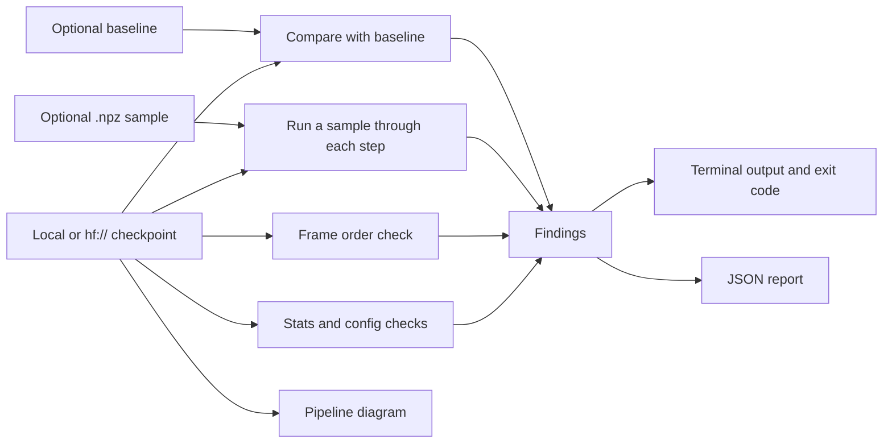

<div align="center">

# 🤖 Flinch

**Catch broken normalization in LeRobot checkpoints before your robot does.**

[](https://github.com/adi271213/flinch/actions/workflows/ci.yml)
[](LICENSE)
[](pyproject.toml)


</div>

A LeRobot checkpoint can load without a single warning and still have broken input conditioning. When an active normalization mode divides by a nearly zero standard deviation (plus a tiny `eps`), a small sensor perturbation can become a huge policy input. That is a numerical risk; it does not establish how a robot will move.

Flinch looks for that before anything moves. It reads the checkpoint's processor files, runs LeRobot's own processor code on a few test inputs on your CPU, and tells you exactly which step, key and coordinate is wrong.

## 🔍 What it found on the Hugging Face Hub

I pointed it at 100 public LeRobot checkpoints. Some of what turned up:

| Checkpoint | Problem | Result of a synthetic +0.20 perturbation |
| --- | --- | --- |
| `jhseon-holiday/vqbet_xarm_holi_test` | `observation.state` std is 6.7e-6 at index 4 | becomes ~29,971 (149,857× gain) |
| `HaomingSong/lerobot-pi0-bridge` | `observation.state` std is exactly 0 at index 6 | becomes ~20,000,000 |
| `iantc104/Diffusion-RPL-UR5-PegInsert-v0` | min equals max for 7 environment-state coordinates | becomes ~40,000,000 |
| `y1y2y3/smolvla_base1` | a 129-byte Git LFS pointer was saved instead of the stats tensor | the stats are simply missing |

The numerical probes are offsets from the saved mean or lower bound, using the inspected float32 formulas, saved normalization mode and `eps=1e-8`. Every row is pinned to an exact commit. The full write-up is in [docs/audit-evidence.md](docs/audit-evidence.md). These are artifact findings and numerical risks; I didn't run any of these on a real robot.

## 🚀 Quick start

You need Python 3.12. No GPU.

```bash
git clone https://github.com/adi271213/flinch.git
cd flinch
python3.12 -m venv .venv && source .venv/bin/activate
pip install .
```

The first install pulls in PyTorch and LeRobot, so give it a few minutes.

Now check a checkpoint straight from the Hub:

```bash
flinch --policy hf://jhseon-holiday/vqbet_xarm_holi_test
```

Or a checkpoint on your disk:

```bash
flinch --policy ./outputs/train/my_run/checkpoints/last/pretrained_model
```

With `hf://`, Flinch downloads only the small files it needs (processor configs, stats and the model header) into a temp folder that it deletes afterwards. It never downloads model weights. Add `@branch`, `@tag` or `@commit` to check a specific version. Private and gated repos aren't supported yet; download those and pass the local path.

No internet? Generate the test checkpoints that ship with the repo:

```bash
python -c "from pathlib import Path; from tests.fixtures.make_bug_fixtures import make_bug_fixtures; make_bug_fixtures(Path('.flinch-demo'))"
flinch --policy .flinch-demo/bug_5289_pathological_gain   # fails
flinch --policy .flinch-demo/clean_act_modern             # passes
```

## 🧰 More ways to use it

```bash
# Feed a real observation through the processors and watch each step
flinch --policy ./ckpt --sample ./obs.npz

# Compare a new checkpoint against the one you run today
flinch --policy ./candidate --baseline ./production

# Save the findings as JSON and draw the processor pipeline as a Mermaid diagram
flinch --policy ./ckpt --report ./report.json --graph ./pipeline.mmd

# Be strict: also fail when something couldn't be checked
flinch --policy ./ckpt --strict
```

For `--sample`, save an `.npz` whose keys match the checkpoint's feature names, like `observation.state`. Put `action` in it too (or in a `sample_action.npz` next to it) if you want the postprocessor checked as well.

Best of all, pass a whole recorded rollout (frames stacked along the first axis). Each near-zero-std finding then says whether your real data ever moved those coordinates, and by how much in normalized units.

## 🚦 Reading the output

Every finding gets one of four labels:

| Label | Meaning |
| --- | --- |
| `PASS` | Checked, and it's fine. |
| `FAIL` | Something is wrong, and Flinch shows you where. |
| `CONFLICT` | Two files in the checkpoint disagree with each other. |
| `UNKNOWN` | Flinch couldn't check this, so it won't pretend it did. |

Exit codes: `0` passed, `1` the checkpoint has a problem (`FAIL` or `CONFLICT`, or anything `--strict` or `--baseline` treats as blocking), `2` you passed a bad argument, `3` Flinch itself couldn't finish (a crash, the Hub was unreachable, or an output couldn't be written). If a real problem is found, `1` wins over `3`.

Flinch never guesses physical units. A tensor's shape can't tell you whether a joint is in radians or degrees, so that stays `UNKNOWN` unless you declare it with `--metadata`.

## ✅ What it checks

- **Stats that blow up inputs:** near-zero std, min equal to max, NaN or Inf, and stats that are missing or saved under the wrong name so normalization is silently skipped.
- **Action normalization contracts:** the postprocessor maps policy outputs back through the saved action stats. If that mapping disagrees with the preprocessor's declared action normalization, affected coordinates can be shifted or rescaled. Flinch compares the serialized contracts and identifies the differences; it does not establish the model's training history.
- **Stacked normalizers:** two steps that are each fine but multiply into a huge gain.
- **Precision:** values that overflow when the checkpoint runs in float16.
- **Base models:** checkpoints like `lerobot/smolvla_base` that need your dataset's stats before they can run. You get one clear message telling you to fine-tune or bind stats, instead of a wall of errors.
- **Relative actions on stacked observations:** LeRobot's relative-action step treats the first frame of a stacked observation as "now". That's right for the built-in policies, but a custom pipeline that puts the oldest frame first would be anchored to the wrong frame. Flinch checks the saved frame order.
- **Changes between checkpoints:** with `--baseline`, significant changes to input/action scaling, offsets or clipping under the configured thresholds, and increases in open-loop execution steps. Missing required comparison evidence blocks the gate.
- **Broken files:** Git LFS pointers saved in place of real data, and old-format checkpoints that need migrating.

## 🛡️ Guard selected inputs at runtime

The audits above run offline. For an additional runtime check, add an opt-in envelope guard after the last normalizer in your preprocessor:

```python
from lerobot_flinch.guard import add_input_guard

preprocessor = add_input_guard(preprocessor, max_abs=10.0)
```

The helper selects observation keys with active, bound normalization statistics, leaving `IDENTITY` and excluded raw features alone. Ambiguous partially normalized masks require an explicit selection. Use `keys=["observation.state"]` to choose a scope yourself. The limit applies to the values at the guard's insertion point; it does not infer physical units. With `MEAN_STD`, a limit of `10` is approximately ten saved standard deviations only when `eps` is negligible. Other normalization modes have different interpretations.

The default is to raise `InputEnvelopeError` with the key and bounded coordinate evidence. `on_violation="clamp"` explicitly opts into clipping finite outliers; checked non-finite values still raise. The guard operates on selected floating PyTorch tensors, not arbitrary NumPy or metadata values.

`add_input_guard` modifies the supplied pipeline in place. Calling it again reconfigures a single helper-managed guard; manual or multiple guards require explicit management. Later processor steps may change the values again, so this is an insertion-point check, not a guarantee about the final policy input or hardware safety. Offline audits remain read-only and run no policy, simulator or motor commands.

The guard saves and loads with the pipeline; `PolicyProcessorPipeline.from_pretrained` finds it on its own. In clamp mode, the first clip logs a warning and `guard.clamp_count` keeps a running total, so clipping is never silent.

## ⚙️ How it works



Flinch uses LeRobot's own `PolicyProcessorPipeline` and hooks for offline CPU probes, alongside direct inspection of serialized configs and buffers. Results describe those inspected inputs and arithmetic, not a hardware deployment. It never runs the neural network, a simulator or a motor, and it doesn't touch the network while checking. If a checkpoint uses a custom processor that Flinch can't inspect, it says `UNKNOWN` rather than importing unknown code.

<details>
<summary>Code layout</summary>

```text
src/lerobot_flinch/
  cli.py              the flinch command
  hub_source.py       hf:// downloads
  guard.py            runtime input guard step
  preflight.py        stats, config and file checks
  trace.py            runs a sample through each processor step
  temporal.py         frame order and relative-action checks
  privilege_delta.py  comparison against a baseline
  graph.py            pipeline diagram export
  hub_scanner.py      scanning many Hub repos at once
  models.py           findings and exit codes
tests/fixtures/       generates broken and healthy test checkpoints
scripts/              Hub scanner and release checks
```

</details>

<details>
<summary>All options</summary>

| Option | What it does |
| --- | --- |
| `--policy` | Checkpoint to check: a local folder or `hf://owner/name[@revision]`. Required. |
| `--sample` | `.npz` file with a real observation (and optionally an action) to trace. |
| `--baseline` | Checkpoint to compare against: local folder or `hf://`. |
| `--report` | Write findings as JSON. |
| `--graph` | Write the processor pipeline as `.json`, `.mmd` or `.md`. |
| `--metadata` | JSON file declaring units, frames or frame order, e.g. `{"temporal_observation_ordering": "oldest_first", "current_index": -1}`. |
| `--std-threshold` | How small a std counts as suspicious. Default `1e-4`. |
| `--strict` | Fail on non-exempt coverage `UNKNOWN`s and warnings; informational physical unknowns remain exempt. |
| `--version` | Print the version. |

Set `HF_HUB_OFFLINE=1` to stop any Hub downloads.

</details>

## 🛰️ Scanning the Hub

The script behind the findings table above:

```bash
python scripts/scan_hub.py --targeted --limit 100 --output-dir ./hub-audit
python scripts/scan_hub.py --repo lerobot/smolvla_base --output-dir ./hub-audit
```

It downloads only small files and byte ranges, never full model weights, and pins every repo to an exact commit. Run `python scripts/scan_hub.py --help` for the rest.

## 🤝 Similar tools

| Tool | What it's for |
| --- | --- |
| [lerobot-doctor](https://github.com/jashshah999/lerobot-doctor) | Checks LeRobot **datasets** before training. Works well alongside Flinch. |
| [robotruth](https://github.com/mulkakhileshmj/robotruth) | Compares a checkpoint against a baseline or benchmark, including model weight hashes, which Flinch doesn't check. |
| [Tether](https://pypi.org/project/fastcrest-tether/) | Deploys policies to edge hardware through ONNX, with some overlap on zero or NaN action stats. |

Flinch focuses on reference-free numerical diagnosis with LeRobot's own processors, without requiring a trusted baseline or ONNX export. Basic invalid-stat checks and baseline drift coverage overlap with other tools.

## ⚠️ Limits

- A `PASS` means the processor files look right. It doesn't mean the policy is good or the robot is safe.
- It doesn't check model weights or dataset quality.
- The relative-action frame-order check is tested on generated checkpoints only; none of the 100 Hub checkpoints used relative actions.
- Not on PyPI yet, so install from source for now.

## 🛠️ Development

```bash
pip install -e ".[test,dev]"
python -m pytest -q
python -m ruff check src scripts tests && python -m ruff format --check src scripts tests
python -m mypy
```

The tests build real LeRobot checkpoints for silently skipped normalization (#4415), near-zero std (#5289), float16 NaN (#4973), and the cross-policy chronology contract associated with #5315. The chronology fixture deliberately pairs an oldest-first custom history with index-zero anchoring; it does not reproduce a bug in current in-tree policies. Each case comes with a healthy control that must pass. CI installs the built package fresh on Linux, macOS and Windows and runs the whole suite there.

See [CONTRIBUTING.md](CONTRIBUTING.md) to contribute and [SECURITY.md](SECURITY.md) to report a security issue.

## 📄 License

MIT © 2026 Aditya Jain
