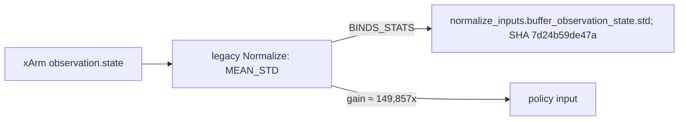
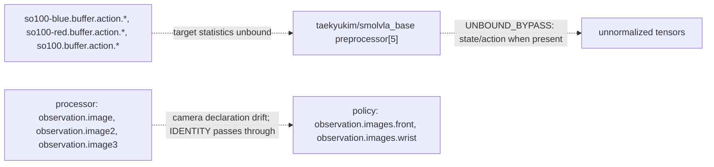

# flinch: numerical processor and chronology audit

Generated: 2026-11-18T16:48:51.487567+00:00

Reference-Free Numerical Processor Auditor & Chronology/Contract Linter for LeRobot Checkpoints. Findings describe serialized artifacts and inspected processor behavior; this is not a standalone ISO safety-compliance guarantee.

## Findings at a glance

Verified numeric/artifact signatures and base-model prerequisites from the pinned sample; only findings present in this report are listed.

| Family | Pinned checkpoint | Verified artifact evidence |
| --- | --- | --- |
| Numeric risk: xArm | [jhseon-holiday/vqbet_xarm_holi_test](https://huggingface.co/jhseon-holiday/vqbet_xarm_holi_test/tree/7dba32e8f65251b494491d7cefecfa8a6d5c2da7) | `normalize_inputs.buffer_observation_state.std` at [4]; `MEAN_STD`; saved value 6.6630414e-06; gain ≈ **149,857×**; synthetic +0.20 → ≈29,971 in float32; SHA `7d24b59de47a` |
| Numeric risk: Pi0 Bridge | [HaomingSong/lerobot-pi0-bridge](https://huggingface.co/HaomingSong/lerobot-pi0-bridge/tree/93c2840a2c68c337da0d472a2f52d1fd8d62132a) | `normalize_inputs.buffer_observation_state.std` at [6]; `MEAN_STD`; saved value 0; **zero std**; gain ≈ **100,000,001×**; synthetic +0.20 → ≈20,000,000 in float32; SHA `128ca7bfcb39` |
| Numeric risk: UR5 PegInsert | [iantc104/Diffusion-RPL-UR5-PegInsert-v0](https://huggingface.co/iantc104/Diffusion-RPL-UR5-PegInsert-v0/tree/0703f194c88b43cc1b704c682f27fe554e1b830e) | `normalize_inputs.buffer_observation_environment_state.min` at [11, 12, 13, 14, 15, 16, 17]; `MIN_MAX`; saved value -0.0127; **zero span (min == max)**; gain ≈ **200,000,001×**; synthetic +0.20 → ≈40,000,000 in float32; SHA `fb006f50ebd8` |
| Artifact: Git LFS pointer | [y1y2y3/smolvla_base1](https://huggingface.co/y1y2y3/smolvla_base1/tree/3dd6295344c2585dc096ac1d862d1ec4017425a0) | **129-byte** Git LFS pointer text replaces processor tensor data; `GIT_LFS_POINTER_ARTIFACT`. |
| Base-model prerequisite family | [lerobot/smolvla_base](https://huggingface.co/lerobot/smolvla_base/tree/5e8d12a6e2975b0e5e5fce7c8caf47c371d257b6), [lerobot/pi0_old](https://huggingface.co/lerobot/pi0_old/tree/e4ed526af508e58f6008b29e9e48f1098278fdb5) | Bind target dataset statistics or fine-tune before execution; missing/unbound stats are not defective pretrained weights. |

Compact xArm lineage (`xarm_processor_lineage.mmd`; a static normalization view):

Compact taekyukim/smolvla_base lineage (`taekyukim_smolvla_base_lineage.mmd`):

Camera drift is an advisory about downstream input mapping; IDENTITY preprocessing does not throw a camera KeyError.

Legacy numeric examples use inspected float32 buffer arithmetic; FP16 non-finite risks are conditional advisories. These artifact checks do not establish an observed robot failure.

## Coverage and interpretation

**5 independent artifact finding families across 15 repositories**: 4 defect/numeric-risk signatures and 1 dataset-stat binding prerequisite family. Base-model binding requirements are not defective pretrained weights; repeated payloads are not independent defects.

| Metric | Count |
| --- | ---: |
| Total repos scanned | 100 |
| Modern PolicyProcessorPipeline | 42 |
| Legacy embedded normalization (PR #1452) | 55 |
| Modern + embedded legacy | 1 |
| Non-policy repositories | 1 |
| Gated or private | 0 |
| Cached snapshots reused | 100 |
| Legacy normalization tensor bytes fetched | 0 |
| Generation unknown | 1 |
| Repos with download/coverage errors | 0 |
| UNKNOWN numeric coverage (repositories) | 13/100 |
| UNKNOWN native normalization-chain probes (repositories) | 9/100 |
| UNKNOWN temporal coverage (repositories) | 76/100 |
| Pinned revisions (full commits in JSON) | 100/100 |
| Cached legacy normalization tensors reconstructed | 242 |
| Cached tensor payload bytes (not new downloads) | 6,984 |
| Artifact / processor-contract findings (unique repositories) | 5 |
| Base-model stat-binding prerequisites (unique repositories) | 11 |
| Legacy version-compatibility requirements (unique repositories) | 55 |
| Conditional FP16 warnings (unique repositories) | 2 |

Base-model prerequisites, legacy migration requirements, and hypothetical FP16 warnings are separate from defect/numeric-risk findings. Category counts overlap. An unbound base checkpoint is not ready for zero-shot execution: its prerequisite findings retain deployment-gate FAIL status without claiming corrupt weights. Standard CLI mode gates on blocking FAIL/CONFLICT; strict mode additionally gates on coverage UNKNOWNs and WARNING advisories. Optional undeclared physical semantics remain informational, even in strict mode.

Temporal scope: **0 relative-action policies**, **23 non-relative policies**, **1 repositories not evaluated** (including non-policy scope), **76 UNKNOWN**, and **0 multi-step relative policies exercised**. Zero TEMPORAL_ANCHOR_MISMATCH findings do not establish correct anchoring for unexercised policies.

`TEMPORAL_ANCHOR_MISMATCH` (#5315) is a cross-policy chronology contract check for custom or migrated pipelines, not a reproduced upstream bug. The inspected native RelativeActionsProcessorStep and its inverse collapse 3D state with `state[:, 0]`. That choice is intentional and valid for current-first windows whose saved `observation_delta_indices` starts at 0, including VLA-JEPA and LingBot-VA. The check rejects a custom or migrated pairing with an oldest-first state history ending at delta 0, such as `[-1, 0]` or `[-k, ..., 0]`, whose current frame is `state[:, -1]`. The audit resolves these supported saved delta-index patterns automatically; explicitly selected chronology metadata overrides the inference. A saved non-null `state_observation_delta_indices` takes precedence for state, matching LeRobot's dataset factory. Delta-window length can exceed `n_obs_steps=1` in native VLA configurations. Policy names, tensor shapes, and separate image-history windows do not establish state chronology.

The shared SmolVLA stat-binding family includes **10 repositories**: the official base and 9 community forks/migrations share its individual action-stat payloads. The canonical modern container is `490ab239d96e`; legacy containers and Git LFS pointers are not byte-identical tensor files. Payload matches do not verify fine-tuning history. The two xArm repositories share identical saved statistics and contribute one numeric-risk signature.

Selection: tagged `lerobot` policy-family queries, name/tag family hints, round-robin family balancing and tagged fallback; obvious asset listings were filtered. This is a convenience sample, not a prevalence estimate.
Every repository below identifies its pinned commit; JSON records full revisions, discovery queries when available, and repo-relative local evidence paths.

## Exact Hub discovery queries (including seeds)

Expand discovery queries and seed evidence

Seed searches are not guaranteed inclusions; matching tagged candidates are selected before family round-robin and fallback. No additional discovery query ran during this cached revalidation.

| Query purpose | HfApi.list_models arguments | Returned |
| --- | --- | ---: |
| seed search | `{"filter": "lerobot", "full": true, "limit": 25, "search": "smolvla_base"}` | 25 |
| seed search | `{"filter": "lerobot", "full": true, "limit": 25, "search": "act_aloha_sim_transfer_cube_human"}` | 4 |
| family search | `{"filter": "lerobot", "full": true, "limit": 100, "search": "act"}` | 100 |
| family search | `{"filter": "lerobot", "full": true, "limit": 100, "search": "diffusion"}` | 100 |
| family search | `{"filter": "lerobot", "full": true, "limit": 100, "search": "smolvla"}` | 100 |
| family search | `{"filter": "lerobot", "full": true, "limit": 100, "search": "pi0"}` | 100 |
| family search | `{"filter": "lerobot", "full": true, "limit": 100, "search": "vqbet"}` | 28 |
| family search | `{"filter": "lerobot", "full": true, "limit": 100, "search": "tdmpc"}` | 0 |
| tagged fallback | `{"filter": "lerobot", "full": true, "limit": 400}` | 400 |

Configured seed repository IDs: `lerobot/smolvla_base`, `lerobot/act_aloha_sim_transfer_cube_human`.
Verified seed IDs in the original candidate pool: `lerobot/smolvla_base`.

## Repository classification

| Classification | Count |
| --- | ---: |
| `MODERN_POLICY` | 42 |
| `LEGACY_POLICY` | 55 |
| `NON_POLICY_REPO` | 1 |
| `GATED_OR_PRIVATE` | 0 |
| `MIXED_POLICY` | 1 |
| `UNKNOWN` | 1 |

## Targeted discovery coverage

Expand policy-family selection details

These are repository-name/tag hints used for balanced selection, not inferred architecture compatibility.

| Family hint | Repositories selected |
| --- | ---: |
| `act` | 20 |
| `diffusion` | 20 |
| `smolvla` | 21 |
| `pi0` | 20 |
| `vqbet` | 19 |
| `tdmpc` | 0 |

Candidate pool: 724; asset-only listings filtered before selection: 2. Full discovery queries are recorded in JSON.

## Shared stat payloads

Expand individual tensor-payload SHA-256 inventory

Groups use the full SHA-256 of each individual tensor's raw payload bytes, independently of safetensors file layout, tensor order, or unrelated buffers. Byte equality alone does not establish matching dtype, shape, feature, normalization mode, or physical semantics; each reference retains that metadata. Unused serialized statistics are included in this artifact inventory.

| Individual tensor-payload SHA-256 | Repository / tensor references |
| --- | --- |
| `008595501701093fa2cd4c01e27eb5c3f854910d0d9e4ba8e2543cec85ac8a4e` | `Ggghoney/pick_and_place_act_70:frame_index.max`, `Ggghoney/pick_and_place_act_kaggle:frame_index.max` |
| `008edf4538fa987a371ccb2f87a4bb0e188ccc3773391017677e03718fee45b5` | `Ggghoney/pick_and_place_act_70:frame_index.q01`, `Ggghoney/pick_and_place_act_kaggle:frame_index.q01` |
| `031fabe96e075e7078f9660aa467398b772326bc1824124309adfac0bdad719c` | `Danilrivero/smolvla_base:action.q90`, `Franbesq/smolvla_base:action.q90`, `Javiertxu22/smolvla_base1:action.q90` |
| `032b10142859407f8cfc80517e980d8cb6b36bf30300698ba592885e21f18fb4` | `AriyaKinoue/pb_v1_256_smolvla_base:frame_index.std`, `AriyaKinoue/pb_v1_smolvla_base:frame_index.std` |
| `07bacb360c4105b9fd39a8d6a11cb824f7b00065e21d04c05c8215e82f35ca66` | `Orellius/so101_sort_cubes_no_top_smolvla_base:timestamp.q99`, `Orellius/so101_sort_cubes_no_top_smolvla_base_100k:timestamp.q99` |
| `07e478d23a425f755d6319478f213d593af48dcbe688ccd957b7edcfe6d249f2` | `Orellius/so101_sort_cubes_no_top_smolvla_base:timestamp.mean`, `Orellius/so101_sort_cubes_no_top_smolvla_base_100k:timestamp.mean` |
| `0919ed7fccf8b9620ace8198cba5ed63b7b895e1b3b2aceaffdb5fd8adc47696` | `AriyaKinoue/pb_v1_256_smolvla_base:episode_index.std`, `AriyaKinoue/pb_v1_smolvla_base:episode_index.std` |
| `0bb51ff239dcc52321c28a7fb7907f4370107a555d3976099cac4d78a7f4985d` | `AriyaKinoue/pb_v1_256_smolvla_base:action.q99`, `AriyaKinoue/pb_v1_smolvla_base:action.q99` |
| `0cbacfb253726ccc7798d094a78d908d925797b7b31c900ce7330c21907d8deb` | `jian001/diffusion_so101_GRC2:normalize_inputs.buffer_observation_state.max`, `jian001/diffusion_so101_GRC2m:normalize_inputs.buffer_observation_state.max` |
| `0cd272b46c0ce50b6a33c2c79840d6ee56972d1fb1b098f4cf2890b49d8017ac` | `J-joon/act_aloha_sim_transfer_cube_human:timestamp.std`, `KKSingh-IN/act_aloha_sim_transfer_cube_human:timestamp.std`, `qualia-robotics/act-aloha-sim-transfer-cube-human-a76db398:timestamp.std` |
| `0ce7d00563b53cd97087bc5e9b99fadf0a5921351769c9a164a57512941bbb44` | `Danilrivero/smolvla_base:index.q01`, `Franbesq/smolvla_base:index.q01`, `Javiertxu22/smolvla_base1:index.q01` |
| `0da72141a195f9d6f79438b00b04f2218a7d30d4927a355b5130c6d9bec664b3` | `jhseon-holiday/vqbet_xarm_holi_test:normalize_inputs.buffer_observation_state.mean`, `jhseon-holiday/vqbet_xarm_holi_test_175000:normalize_inputs.buffer_observation_state.mean` |
| `0f1eea6ad53575fbf7a4fd61ba949874d828613b252e9460764f016372e170ba` | `alexandersoare/debug_act:normalize_inputs.buffer_observation_state.mean`, `jackvial/act-pistachio-v1-e140:normalize_inputs.buffer_observation_state.mean`, `jnm38/act-pistachio-v1:normalize_inputs.buffer_observation_state.mean`, `jnm38/diffusion-pistachio-v1:normalize_inputs.buffer_observation_state.mean`, `jnm38/vqbet-pistachio-v1:normalize_inputs.buffer_observation_state.mean` |
| `11e02b6700f2c8e620383046fa175bfd74b191e1bc847040cf8c8baa936c8f6f` | `J-joon/act_aloha_sim_transfer_cube_human:index.mean`, `KKSingh-IN/act_aloha_sim_transfer_cube_human:index.mean`, `qualia-robotics/act-aloha-sim-transfer-cube-human-a76db398:index.mean` |
| `12a595a166ab8d86eb6edab5f96d99f4dce74f55ff3226caf049c2fe62f13f26` | `Orellius/so101_sort_cubes_no_top_smolvla_base:observation.images.front.q10`, `Orellius/so101_sort_cubes_no_top_smolvla_base_100k:observation.images.front.q10` |
| `12ba426539d5eef27261a7b8a427f99904fc5de8a5180e5b4ffe70f222b4f66a` | `Orellius/so101_sort_cubes_no_top_smolvla_base:frame_index.mean`, `Orellius/so101_sort_cubes_no_top_smolvla_base_100k:frame_index.mean` |
| `136dfec653c288bce9afe24231fd116c7257e7323983cf2c4a1125852da513ce` | `mpreda/pusht_vqbet:episode_index.mean`, `zhangjiujiu/vqbet_pusht_local:episode_index.mean` |
| `141fddb47d28ded23a4d5b212e2db626e4dc43815c6f8b785a4b999741fa6359` | `KimEuna/piper_wetwipe_test_vqbet_Final:timestamp.mean`, `KimEuna/piper_wetwipe_test_vqbet_Final_2:timestamp.mean`, `jj-jjj/piper_wetwipe_test_vqbet_2000:timestamp.mean` |
| `1464a8e8970f4b27549c075d9f8ae9c91860683438cf7b034bd6a5402c9777f5` | `AriyaKinoue/pb_v1_256_smolvla_base:timestamp.q99`, `AriyaKinoue/pb_v1_smolvla_base:timestamp.q99` |
| `1547e4bc57a21696e378f0a755f35dbcf255c585641c73f60f66d653abc21178` | `KimEuna/piper_wetwipe_test_vqbet_Final:action.min`, `KimEuna/piper_wetwipe_test_vqbet_Final_2:action.min`, `jj-jjj/piper_wetwipe_test_vqbet_2000:action.min` |
| `15ec7bf0b50732b49f8228e07d24365338f9e3ab994b00af08e5a3bffe55fd8b` | `AriyaKinoue/pb_v1_256_smolvla_base:observation.images.overhead.min`, `AriyaKinoue/pb_v1_256_smolvla_base:observation.images.wrist.min`, `AriyaKinoue/pb_v1_smolvla_base:observation.images.overhead.min`, `AriyaKinoue/pb_v1_smolvla_base:observation.images.wrist.min`, `Danilrivero/smolvla_base:observation.images.front.min`, `Danilrivero/smolvla_base:observation.images.topdown.min`, `Franbesq/smolvla_base:observation.images.front.min`, `Franbesq/smolvla_base:observation.images.topdown.min`, `Ggghoney/pick_and_place_act_70:observation.images.front.min`, `Ggghoney/pick_and_place_act_70:observation.images.top.min`, `Ggghoney/pick_and_place_act_kaggle:observation.images.front.min`, `Ggghoney/pick_and_place_act_kaggle:observation.images.top.min`, `J-joon/act_aloha_sim_transfer_cube_human:observation.images.top.min`, `Javiertxu22/smolvla_base1:observation.images.front.min`, `Javiertxu22/smolvla_base1:observation.images.topdown.min`, `KKSingh-IN/act_aloha_sim_transfer_cube_human:observation.images.top.min`, `KimEuna/piper_wetwipe_test_vqbet_Final:observation.images.third.min`, `KimEuna/piper_wetwipe_test_vqbet_Final:observation.images.wrist.min`, `KimEuna/piper_wetwipe_test_vqbet_Final_2:observation.images.third.min`, `KimEuna/piper_wetwipe_test_vqbet_Final_2:observation.images.wrist.min`, `Orellius/so101_sort_cubes_no_top_smolvla_base:observation.images.front.min`, `Orellius/so101_sort_cubes_no_top_smolvla_base_100k:observation.images.front.min`, `axellin/act_cupfinal_2026-11-13_14-34-08:observation.images.top.min`, `dddw123/vqbet-so101-grab-pull:observation.images.left_front.min`, `edouardfoussier/vqbet_so101_pick_tennis_ball_wrist:observation.images.wrist.min`, `go234/act_chunk50:observation.images.cam1.min`, `go234/act_chunk50:observation.images.cam2.min`, `itsdavide/eraser_exp_vqbet_1cam_20260626_22-19-20:observation.images.wrist.min`, `jj-jjj/piper_wetwipe_test_vqbet_2000:observation.images.third.min`, `jj-jjj/piper_wetwipe_test_vqbet_2000:observation.images.wrist.min`, `lerobotForScienceEdu/act_electromagnetic_40_v2_policy:observation.images.handcam.min`, `lerobotForScienceEdu/act_electromagnetic_40_v2_policy:observation.images.webcam.min`, `ljonas/red-cube-cup-vqbet:observation.images.over.min`, `naavox/grasp_remote_policy_vqbet:observation.images.gripper_camera.min`, `qualia-robotics/act-aloha-sim-transfer-cube-human-a76db398:observation.images.top.min`, `r-oi/smolvla_base_so101_pickplace_cube_100ep_rand-pos_015000:observation.images.up.min`, `r-oi/smolvla_base_so101_pickplace_cube_100ep_rand-pos_015000:observation.images.wrist.min`, `tgibbons/SO-101-VQBET-ball2-claw_30k:observation.images.birdsEye.min`, `tgibbons/SO-101-VQBET-ball2-claw_30k:observation.images.claw.min`, `ywsldxk1/so101-pi05-staged-fullft-20261113:observation.images.overhead.min`, `ywsldxk1/so101-pi05-staged-fullft-20261113:observation.images.overhead_init.min`, `ywsldxk1/so101-pi05-staged-fullft-20261113:observation.images.wrist.min`, `ywsldxk1/so101-pi05-staged-fullft-20261113:observation.images.wrist_init.min` |
| `16a026989bda793f402ac3712da2fa2891bed39dd52330d8205917eed63d088f` | `jmercat/diffusion_feed_cat:unnormalize_outputs.buffer_action.mean`, `jmercat/diffusion_sample_koch_feed_cat:unnormalize_outputs.buffer_action.mean` |
| `16a2dc0fc7e43a9069c3c48ec4d2c05aeed7b657d739bafcc6d619df8e8c7934` | `Orellius/so101_sort_cubes_no_top_smolvla_base:observation.state.mean`, `Orellius/so101_sort_cubes_no_top_smolvla_base_100k:observation.state.mean` |
| `174eea57ea1bd69b95e10490d5a32fd38e8570c878fa72fff1b9cd03cfd11a59` | `aliberts/diffusion_test:unnormalize_outputs.buffer_action.max`, `fataldeman/diffusion_pusht_model:unnormalize_outputs.buffer_action.max`, `mpreda/pusht_vqbet:action.max`, `pepijn223/diffusion-pusht:unnormalize_outputs.buffer_action.max`, `zhangjiujiu/vqbet_pusht_local:action.max` |
| `17d66569bf1edca471114f7a2eef4b8be69d630b6a924e898cdbf89646f3a23b` | `alexandersoare/debug_act:unnormalize_outputs.buffer_action.max`, `jnm38/act-pistachio-v1:unnormalize_outputs.buffer_action.max`, `jnm38/diffusion-pistachio-v1:unnormalize_outputs.buffer_action.max`, `jnm38/vqbet-pistachio-v1:unnormalize_outputs.buffer_action.max` |
| `1932737c30744319ef1547726084d5abb5ab8261b8f35778d96675290af8f316` | `AriyaKinoue/pb_v1_256_smolvla_base:index.q90`, `AriyaKinoue/pb_v1_smolvla_base:index.q90` |
| `1a397e408ec60dc6dea2ec628822802c485f75c45b18e4389e4168a69679e674` | `AriyaKinoue/pb_v1_256_smolvla_base:action.max`, `AriyaKinoue/pb_v1_smolvla_base:action.max` |
| `1a3a36201deb0f20e256a48f9874ade74a984c908523046349ea806550884655` | `nberezny/act_hybwide_dense:observation.images.wrist.min`, `nberezny/act_lite6_nudge_dense:observation.images.wrist.min`, `nberezny/act_lite6_nudge_dense:observation.images.wrist.q01` |
| `1a593905f681202196608e0076c80f6555a7cba09b161b90f4e242723901d24c` | `Ggghoney/pick_and_place_act_70:frame_index.q10`, `Ggghoney/pick_and_place_act_kaggle:frame_index.q10` |
| `1a81e1af86a8949cedac9b055ffcccfe565782feb7313b32c84bb24c2ea3c672` | `J-joon/act_aloha_sim_transfer_cube_human:next.done.std`, `KKSingh-IN/act_aloha_sim_transfer_cube_human:next.done.std`, `qualia-robotics/act-aloha-sim-transfer-cube-human-a76db398:next.done.std` |
| `1ce6373b7d531bbf3ab877a55696371a852a924c452a133f4f7755053fb9b9a1` | `cadene/act_koch_bimanual_folding:normalize_inputs.buffer_observation_state.std`, `cadene/act_koch_bimanual_folding_080000:normalize_inputs.buffer_observation_state.std` |
| `1d64100cd3e4ec96906022ab026b5f8eb737d635071d028be7fbbad76e1752c1` | `Ggghoney/pick_and_place_act_70:episode_index.max`, `Ggghoney/pick_and_place_act_70:episode_index.q90`, `Ggghoney/pick_and_place_act_70:episode_index.q99`, `nberezny/act_hybwide_dense:frame_index.max` |
| `2469b0d0d276b68950d62e7848280a4e780e2440eaf6e8b5d05b8dd212fed110` | `J-joon/act_aloha_sim_transfer_cube_human:index.max`, `KKSingh-IN/act_aloha_sim_transfer_cube_human:index.max`, `qualia-robotics/act-aloha-sim-transfer-cube-human-a76db398:index.max` |
| `250dc6d0ac957cddf054f25abe0bf8c83179b75ffbe8d38648c5c48b3f87985d` | `Danilrivero/smolvla_base:action.min`, `Franbesq/smolvla_base:action.min`, `Javiertxu22/smolvla_base1:action.min` |
| `269fcb3c7a2ddf4f4ed34cd71d114ca006a36bcbc5eea10441d1789d7138ed73` | `mpreda/pusht_vqbet:frame_index.max`, `zhangjiujiu/vqbet_pusht_local:frame_index.max` |
| `26c5e87ba2125f688f332ef2dc3e8250c3ec87a79c6440e8999ed115a6be0144` | `Danilrivero/smolvla_base:timestamp.q10`, `Franbesq/smolvla_base:timestamp.q10`, `Javiertxu22/smolvla_base1:timestamp.q10` |
| `2748fa9ae9a7e85592f747cb6343363ee0af967adffbe086a3c657f41a5a126d` | `J-joon/act_aloha_sim_transfer_cube_human:episode_index.mean`, `KKSingh-IN/act_aloha_sim_transfer_cube_human:episode_index.mean`, `mpreda/pusht_vqbet:timestamp.max`, `qualia-robotics/act-aloha-sim-transfer-cube-human-a76db398:episode_index.mean`, `zhangjiujiu/vqbet_pusht_local:timestamp.max` |
| `279c2b07e927cda8bbe7953efc149cb8c81911479772ea43db934f034d1c5609` | `kadiru/vqbet_aiworker_bg2_pickplace_quest3_35demo_headonly_20k:normalize_inputs.buffer_observation_state.min`, `kadiru/vqbet_aiworker_bg2_pickplace_quest3_35demo_wristonly_20k:normalize_inputs.buffer_observation_state.min` |
| `283c7fed502533f6cdab08c2902b9b35d7235d4861ced6a5a5524b413b366178` | `Ggghoney/pick_and_place_act_70:timestamp.q90`, `Ggghoney/pick_and_place_act_kaggle:timestamp.q90` |
| `283cbb129ff14b2bf2dcc03f6a1a45e5ffabc0a07ed5b637a6d25d599f6bc9fb` | `Danilrivero/smolvla_base:observation.images.topdown.q90`, `Franbesq/smolvla_base:observation.images.topdown.q90`, `Javiertxu22/smolvla_base1:observation.images.topdown.q90` |
| `2869d1b2d203ef09044e02c69deca75c107cc66edb96bb1ed63bbe4502fb4850` | `Ggghoney/pick_and_place_act_70:timestamp.q10`, `Ggghoney/pick_and_place_act_kaggle:timestamp.q10` |
| `2b6df45fcc2a38f263df33f5a1275372b39826f4d60571022195d995fd7f732d` | `KimEuna/piper_wetwipe_test_vqbet_Final:index.std`, `KimEuna/piper_wetwipe_test_vqbet_Final_2:index.std`, `jj-jjj/piper_wetwipe_test_vqbet_2000:index.std` |
| `2b713fb757869507833a2a271235a9cb69576ecf0f98d43fe13df4b53168d459` | `J-joon/act_aloha_sim_transfer_cube_human:timestamp.max`, `KKSingh-IN/act_aloha_sim_transfer_cube_human:timestamp.max`, `qualia-robotics/act-aloha-sim-transfer-cube-human-a76db398:timestamp.max` |
| `2caa1612d0320247198dcb65998f53a0259ef8a956e343be29bea4809c39225f` | `fracapuano/smolvla_base:normalize_inputs.so100_buffer_observation_state.std`, `y1y2y3/smolvla_base1:normalize_inputs.so100_buffer_observation_state.std` |
| `2cdab0b38d1a5fec104456cb93f2059cb80af351509260e5039d11313e958dd3` | `Danilrivero/smolvla_base:timestamp.max`, `Franbesq/smolvla_base:timestamp.max`, `Javiertxu22/smolvla_base1:timestamp.max` |
| `2d6b92a2414c1007d33b522cb1d117e18859fc715e7420b4a70359fef441f209` | `Danilrivero/smolvla_base:action.max`, `Franbesq/smolvla_base:action.max`, `Javiertxu22/smolvla_base1:action.max` |
| `2e6ad7d754b0971ab28f134c9a0b3eea22a289583bc77415f494ce6d474e33db` | `J-joon/act_aloha_sim_transfer_cube_human:observation.state.mean`, `KKSingh-IN/act_aloha_sim_transfer_cube_human:observation.state.mean`, `qualia-robotics/act-aloha-sim-transfer-cube-human-a76db398:observation.state.mean` |
| `2f2e022162c5bbca107adab2b8c4e2ce24d77978835de5db66952647ca846ae4` | `KimEuna/piper_wetwipe_test_vqbet_Final:frame_index.std`, `KimEuna/piper_wetwipe_test_vqbet_Final_2:frame_index.std`, `jj-jjj/piper_wetwipe_test_vqbet_2000:frame_index.std` |
| `3116d3c286fdab0a3f84830f7b7417912606f58818f01d6814504544b6a4b37d` | `KimEuna/piper_wetwipe_test_vqbet_Final:episode_index.max`, `KimEuna/piper_wetwipe_test_vqbet_Final_2:episode_index.max`, `jj-jjj/piper_wetwipe_test_vqbet_2000:episode_index.max` |
| `324e247e3b7ae5cde3a633f1243988a0d80aa006b74676bea3440a7a04f40a6d` | `Danilrivero/smolvla_base:observation.images.front.q99`, `Franbesq/smolvla_base:observation.images.front.q99`, `Javiertxu22/smolvla_base1:observation.images.front.q99` |
| `32b61cfae68b1cdc3bdffd085f1037cca2ec387047cb06dc83432c9ec96e0e7c` | `AriyaKinoue/pb_v1_256_smolvla_base:observation.state.max`, `AriyaKinoue/pb_v1_smolvla_base:observation.state.max` |
| `33ecb60f293b7f38f0bd11e5062185c2d16b4f20b68ccb18eedf588646eed91e` | `kadiru/vqbet_head_aiworker_bg2_pickflip_place_quest3_30demo_20k:unnormalize_outputs.buffer_action.max`, `kadiru/vqbet_wrist_aiworker_bg2_pickflip_place_quest3_30demo_20k:unnormalize_outputs.buffer_action.max` |
| `345f4d657028a1b006e72c39364e0f5707bbabebb16be1b71d41343f53f9998d` | `Orellius/so101_sort_cubes_no_top_smolvla_base:episode_index.mean`, `Orellius/so101_sort_cubes_no_top_smolvla_base:episode_index.q01`, `Orellius/so101_sort_cubes_no_top_smolvla_base:episode_index.q10`, `Orellius/so101_sort_cubes_no_top_smolvla_base:episode_index.q90`, `Orellius/so101_sort_cubes_no_top_smolvla_base:episode_index.q99`, `Orellius/so101_sort_cubes_no_top_smolvla_base_100k:episode_index.mean`, `Orellius/so101_sort_cubes_no_top_smolvla_base_100k:episode_index.q01`, `Orellius/so101_sort_cubes_no_top_smolvla_base_100k:episode_index.q10`, `Orellius/so101_sort_cubes_no_top_smolvla_base_100k:episode_index.q90`, `Orellius/so101_sort_cubes_no_top_smolvla_base_100k:episode_index.q99` |
| `35146f39584cfde1de62f46f9e4acf3fc5d4c114cea6e4b8ebc25eaafd2125ee` | `AriyaKinoue/pb_v1_256_smolvla_base:frame_index.q10`, `AriyaKinoue/pb_v1_smolvla_base:frame_index.q10` |
| `37eb91920c9d2805fb41359a0177e8197f05b01b4dceb2158f5a6f66837e7bba` | `KimEuna/piper_wetwipe_test_vqbet_Final:action.mean`, `KimEuna/piper_wetwipe_test_vqbet_Final_2:action.mean`, `jj-jjj/piper_wetwipe_test_vqbet_2000:action.mean` |
| `380e7bdce0fb1795e462d82debeac9b74efe2a72a6a5e28512213267d1010f0e` | `AriyaKinoue/pb_v1_256_smolvla_base:index.q01`, `AriyaKinoue/pb_v1_smolvla_base:index.q01` |
| `3871943cff47391b2c473780769787ac5b86191c0d92856c0108fb49d7789183` | `Ggghoney/pick_and_place_act_70:observation.images.front.q10`, `Ggghoney/pick_and_place_act_kaggle:observation.images.front.q10` |
| `38b03d1a82e44b87c73b1e7aeb1137051be8d6c2ba286edf3fa2fbc2cf351570` | `AriyaKinoue/pb_v1_256_smolvla_base:task_index.q99`, `AriyaKinoue/pb_v1_smolvla_base:task_index.q99`, `Danilrivero/smolvla_base:task_index.q99`, `Franbesq/smolvla_base:task_index.q99`, `Ggghoney/pick_and_place_act_70:task_index.q99`, `Ggghoney/pick_and_place_act_kaggle:task_index.q99`, `Javiertxu22/smolvla_base1:task_index.q99`, `Orellius/so101_sort_cubes_no_top_smolvla_base:task_index.q99`, `Orellius/so101_sort_cubes_no_top_smolvla_base_100k:task_index.q99`, `axellin/act_cupfinal_2026-11-13_14-34-08:task_index.q99`, `dddw123/vqbet-so101-grab-pull:task_index.q99`, `edouardfoussier/vqbet_so101_pick_tennis_ball_wrist:task_index.q99`, `go234/act_chunk50:task_index.q99`, `itsdavide/eraser_exp_vqbet_1cam_20260626_22-19-20:task_index.q99`, `lerobotForScienceEdu/act_electromagnetic_40_v2_policy:task_index.q99`, `ljonas/red-cube-cup-vqbet:task_index.q99`, `naavox/grasp_remote_policy_vqbet:task_index.q99`, `nberezny/act_hybwide_dense:task_index.q99`, `nberezny/act_lite6_nudge_dense:task_index.q99`, `r-oi/smolvla_base_so101_pickplace_cube_100ep_rand-pos_015000:task_index.q99`, `tgibbons/SO-101-VQBET-ball2-claw_30k:task_index.q99` |
| `3c33f37077d4e65bd39afa3318d5e731faa4328c4867c83c1c109f0ca06bf359` | `Danilrivero/smolvla_base:frame_index.q99`, `Franbesq/smolvla_base:frame_index.q99`, `Javiertxu22/smolvla_base1:frame_index.q99` |
| `3c3d7c8566236b00e4184d796b5cf6b7066a0bf36d9c82020247de998ea11300` | `Danilrivero/smolvla_base:index.std`, `Franbesq/smolvla_base:index.std`, `Javiertxu22/smolvla_base1:index.std` |
| `3c43d9ae1de3bc3451407c78d1a94ad39193d6122df52c966f1b3f1a71ce8adc` | `alexandersoare/debug_act:unnormalize_outputs.buffer_action.min`, `jnm38/act-pistachio-v1:unnormalize_outputs.buffer_action.min`, `jnm38/diffusion-pistachio-v1:unnormalize_outputs.buffer_action.min`, `jnm38/vqbet-pistachio-v1:unnormalize_outputs.buffer_action.min` |
| `3cd4534773b1c0f00efa394feca2828cf20edf14c49c10f0a974b3149e758233` | `Ggghoney/pick_and_place_act_70:timestamp.q01`, `Ggghoney/pick_and_place_act_kaggle:timestamp.q01` |
| `3d0226971af6e99b39038200882d8f2ba7dabe8362768c3fafe6e7dad6552999` | `J-joon/act_aloha_sim_transfer_cube_human:observation.state.max`, `KKSingh-IN/act_aloha_sim_transfer_cube_human:observation.state.max`, `qualia-robotics/act-aloha-sim-transfer-cube-human-a76db398:observation.state.max` |
| `3dae4ac7996596b1d8412f3ee9095df6c8024aaf1a485c7afc7083d6a9e067e5` | `Danilrivero/smolvla_base:observation.images.topdown.q99`, `Franbesq/smolvla_base:observation.images.topdown.q99`, `Javiertxu22/smolvla_base1:observation.images.topdown.q99` |
| `3e2d3ea72151b3d9507889c77100a66b303c05153b0205fe30915f784c54b35d` | `AriyaKinoue/pb_v1_256_smolvla_base:frame_index.mean`, `AriyaKinoue/pb_v1_smolvla_base:frame_index.mean` |
| `3e74f468c3b6134d2d506994ff32fa29ad03ec79662ab4dd4399a6eb60a80920` | `kadiru/vqbet_aiworker_bg2_pickplace_quest3_35demo_headonly_20k:normalize_inputs.buffer_observation_state.max`, `kadiru/vqbet_aiworker_bg2_pickplace_quest3_35demo_wristonly_20k:normalize_inputs.buffer_observation_state.max` |
| `4074e9b6a97d862156d85d49c0ecbf9c27986b948c0d86b9bcd668d49cbc7e77` | `J-joon/act_aloha_sim_transfer_cube_human:observation.state.std`, `KKSingh-IN/act_aloha_sim_transfer_cube_human:observation.state.std`, `qualia-robotics/act-aloha-sim-transfer-cube-human-a76db398:observation.state.std` |
| `40822e60e19f00e7198f9a15276c885d7ba9d54b61232ba5bb9db1bf8a4c28b3` | `mpreda/pusht_vqbet:next.done.mean`, `zhangjiujiu/vqbet_pusht_local:next.done.mean` |
| `42acbe73b43a352d565f8e56dc06c7dbe7febe4cb4e4efa9314cc69fc8376909` | `Orellius/so101_sort_cubes_no_top_smolvla_base:frame_index.q90`, `Orellius/so101_sort_cubes_no_top_smolvla_base_100k:frame_index.q90` |
| `437f3e474bc77caf078a14114efd3a7f533fbe957f46ca7b2da993eb84df8207` | `Orellius/so101_sort_cubes_no_top_smolvla_base:observation.state.q99`, `Orellius/so101_sort_cubes_no_top_smolvla_base_100k:observation.state.q99` |
| `439b73a4a0bf51be912326bef656937b0addd7c83b89356308374ae9526dd7cd` | `Danilrivero/smolvla_base:episode_index.std`, `Franbesq/smolvla_base:episode_index.std`, `Javiertxu22/smolvla_base1:episode_index.std` |
| `43c441a41b7c1c264bcff90929bcff27eded5a4843a00cf8e6d44b518c7f4e0b` | `AriyaKinoue/pb_v1_256_smolvla_base:observation.state.min`, `AriyaKinoue/pb_v1_smolvla_base:observation.state.min` |
| `445c056908b66438812ad5e8836b63810ae44bf766d006cfd45cd2d14247e1ef` | `mpreda/pusht_vqbet:index.mean`, `zhangjiujiu/vqbet_pusht_local:index.mean` |
| `44d05316912096cb7d9ed08d7a6942d78e748ee28f5123ecc84f8dfd180fc470` | `Danilrivero/smolvla_base:timestamp.q99`, `Franbesq/smolvla_base:timestamp.q99`, `Javiertxu22/smolvla_base1:timestamp.q99` |
| `45564f2b360800fb86e325f5266290f88475469cf9a5c78862b740dd252a7640` | `Ggghoney/pick_and_place_act_70:frame_index.q99`, `Ggghoney/pick_and_place_act_kaggle:frame_index.q99` |
| `46d4e95bfcc3de49f32cee13e07d00bb397df2103e20f60246a42dc9c4676de9` | `AriyaKinoue/pb_v1_256_smolvla_base:observation.images.wrist.q01`, `AriyaKinoue/pb_v1_smolvla_base:observation.images.wrist.q01` |
| `47a776d644113bec8da5ecd3a29fa39e0aa78e3a20368f831818d95a2a317271` | `jclinton1/wedgit_stack_single_diffusion2_100k:normalize_inputs.buffer_observation_state.max`, `jclinton1/wedgit_stack_single_diffusion2_20k:normalize_inputs.buffer_observation_state.max` |
| `48d80cf1e5f92c5011698b07ad46af99eb7506f6b8ff0cfc73e648dfc3651738` | `J-joon/act_aloha_sim_transfer_cube_human:next.done.mean`, `KKSingh-IN/act_aloha_sim_transfer_cube_human:next.done.mean`, `qualia-robotics/act-aloha-sim-transfer-cube-human-a76db398:next.done.mean` |
| `491670dcb9634361af9a6c104d029cb5ba1fe57e8d69cfdb53be61d6fef4b5f3` | `KimEuna/piper_wetwipe_test_vqbet_Final:action.std`, `KimEuna/piper_wetwipe_test_vqbet_Final_2:action.std`, `jj-jjj/piper_wetwipe_test_vqbet_2000:action.std` |
| `4a20235b82cab848282935afb4da99c83eff25526e3dcf1a7e097ff1c521f2b2` | `KimEuna/piper_wetwipe_test_vqbet_Final:observation.state.std`, `KimEuna/piper_wetwipe_test_vqbet_Final_2:observation.state.std`, `jj-jjj/piper_wetwipe_test_vqbet_2000:observation.state.std` |
| `4a7a2af8b7994bf8ee23a4039b2715ec7f9f32d2f9ecace4578f2e694e66f520` | `AriyaKinoue/pb_v1_256_smolvla_base:observation.state.mean`, `AriyaKinoue/pb_v1_smolvla_base:observation.state.mean` |
| `4cf70f961f561c2c388df2fb03c5bd1092bbdba6963598b7c484d9cb06923a2d` | `Orellius/so101_sort_cubes_no_top_smolvla_base:timestamp.q90`, `Orellius/so101_sort_cubes_no_top_smolvla_base_100k:timestamp.q90` |
| `4d4930f972fc684b958983161858e63daa2741042b78e467a94cea39cfffce17` | `Danilrivero/smolvla_base:observation.state.q10`, `Franbesq/smolvla_base:observation.state.q10`, `Javiertxu22/smolvla_base1:observation.state.q10` |
| `4d7ddec527f658a8dcdf3c9d63ee57801c272e143904ea6f95c6bd4dc0ecf495` | `mpreda/pusht_vqbet:next.reward.std`, `zhangjiujiu/vqbet_pusht_local:next.reward.std` |
| `4da2f73066196b7c4ecb8bc86cbe486e586e816d0a7059a2736f0dc3a212c0fb` | `kadiru/vqbet_aiworker_bg2_pickplace_quest3_35demo_headonly_20k:unnormalize_outputs.buffer_action.min`, `kadiru/vqbet_aiworker_bg2_pickplace_quest3_35demo_wristonly_20k:unnormalize_outputs.buffer_action.min` |
| `4deb2fcd2af0aa4667f6b09748b5e527e543ca36c13e204b75273e7cc62c8bf6` | `AdilZtn/smol_vla_base_pipeline:so100-red.buffer.action.std`, `Alkatt/smolvla_base_migrated:so100-red.buffer.action.std`, `RonPlusSign/smolvla_base:so100-red.buffer.action.std`, `azaracla/smolvla_base:so100-red.buffer.action.std`, `fracapuano/smolvla_base:unnormalize_outputs.so100-red_buffer_action.std`, `lerobot/smolvla_base:so100-red.buffer.action.std`, `qualiaadmin/smolvla_base:so100-red.buffer.action.std`, `taekyukim/smolvla_base:so100-red.buffer.action.std`, `y1y2y3/smolvla_base1:unnormalize_outputs.so100-red_buffer_action.std`, `y1y2y3/smolvla_base2_migrated:so100-red.buffer.action.std` |
| `4ea3b6d2c5b0891e4e85356221239033abe69ce9d108173c801f43dc1da20a17` | `jmercat/diffusion_koch_feed_cat_2:normalize_inputs.buffer_observation_state.mean`, `jmercat/diffusion_koch_feed_cat_3:normalize_inputs.buffer_observation_state.mean` |
| `4f4b9b7d8b86633e2824e2f439819357b0cd010ab410ea1a691b12c5f94e91e0` | `Danilrivero/smolvla_base:episode_index.max`, `Franbesq/smolvla_base:episode_index.max`, `Javiertxu22/smolvla_base1:episode_index.max`, `lerobotForScienceEdu/act_electromagnetic_40_v2_policy:episode_index.max` |
| `4fe423ea82c5a92d4f046939fd79d7c96d615783ff06c213bcee971e31ca03c0` | `Danilrivero/smolvla_base:episode_index.mean`, `Danilrivero/smolvla_base:episode_index.q01`, `Danilrivero/smolvla_base:episode_index.q10`, `Danilrivero/smolvla_base:episode_index.q90`, `Danilrivero/smolvla_base:episode_index.q99`, `Franbesq/smolvla_base:episode_index.mean`, `Franbesq/smolvla_base:episode_index.q01`, `Franbesq/smolvla_base:episode_index.q10`, `Franbesq/smolvla_base:episode_index.q90`, `Franbesq/smolvla_base:episode_index.q99`, `Javiertxu22/smolvla_base1:episode_index.mean`, `Javiertxu22/smolvla_base1:episode_index.q01`, `Javiertxu22/smolvla_base1:episode_index.q10`, `Javiertxu22/smolvla_base1:episode_index.q90`, `Javiertxu22/smolvla_base1:episode_index.q99` |
| `5031f574ec5dfb34396910cbb08b6ed3eaec1ac782e3059f14c1b154101345dd` | `AriyaKinoue/pb_v1_256_smolvla_base:frame_index.max`, `AriyaKinoue/pb_v1_smolvla_base:frame_index.max` |
| `518fb8d0054d7ec05f54e20bc527288f2f6befe2305da3d1580d38883160ced6` | `Danilrivero/smolvla_base:index.q90`, `Franbesq/smolvla_base:index.q90`, `Javiertxu22/smolvla_base1:index.q90` |
| `52728339de8798d640c137a3c76f03b5b4e2189db69515b4243b853ac98a4270` | `Ggghoney/pick_and_place_act_70:timestamp.max`, `Ggghoney/pick_and_place_act_kaggle:timestamp.max` |
| `53414f1b9b8bc70ba66f4ecd72bf06c75f71f1434d9d087642d7fcadfb32de70` | `AriyaKinoue/pb_v1_256_smolvla_base:timestamp.std`, `AriyaKinoue/pb_v1_smolvla_base:timestamp.std` |
| `53f693dd73cd298f0fa7ff73d29ab93c1527e83eb1905663df879499cf133105` | `mpreda/pusht_vqbet:frame_index.mean`, `zhangjiujiu/vqbet_pusht_local:frame_index.mean` |
| `564845767229e5a211c88e42d8ac03c3ccebe95f00837b1a3f77b2ceadacac91` | `jmercat/diffusion_feed_cat:unnormalize_outputs.buffer_action.std`, `jmercat/diffusion_sample_koch_feed_cat:unnormalize_outputs.buffer_action.std` |
| `56f991bcb7c7a64b955b11b1291d3c1eef4a2061b62523f601122798038a89c2` | `cadene/act_koch_bimanual_folding:normalize_inputs.buffer_observation_state.mean`, `cadene/act_koch_bimanual_folding_080000:normalize_inputs.buffer_observation_state.mean` |
| `577be90447bf25ba57f2f84d39b071ce73e27828fd0db3c28af994c0fc44a339` | `AriyaKinoue/pb_v1_256_smolvla_base:timestamp.q01`, `AriyaKinoue/pb_v1_smolvla_base:timestamp.q01` |
| `58c9020ca9dd2114b382cb6a11aa7a2ca6dfac864ed26fbb4f3ffc79082296f4` | `Orellius/so101_sort_cubes_no_top_smolvla_base:action.q01`, `Orellius/so101_sort_cubes_no_top_smolvla_base_100k:action.q01` |
| `59fb2b02eec792b3b8cbe394eee0545800618aed9a30521f8fb4a46a44d39e6a` | `Danilrivero/smolvla_base:observation.state.max`, `Franbesq/smolvla_base:observation.state.max`, `Javiertxu22/smolvla_base1:observation.state.max` |
| `59fe6b67800cb3fcdce77b062c52f47133f37f295d670063ba6ddfc171ca375c` | `jclinton1/wedgit_stack_single_diffusion2_100k:normalize_inputs.buffer_observation_state.min`, `jclinton1/wedgit_stack_single_diffusion2_20k:normalize_inputs.buffer_observation_state.min` |
| `5dad9d3c3862162d957f1c5630e3fa14bdf1411b5c3f9bcef24c51ceb146d467` | `KimEuna/piper_wetwipe_test_vqbet_Final:timestamp.max`, `KimEuna/piper_wetwipe_test_vqbet_Final_2:timestamp.max`, `jj-jjj/piper_wetwipe_test_vqbet_2000:timestamp.max` |
| `5e3ce8021d765da1c4476d92a793af26c2dd5675cb8750ffc1da8b52e1b77361` | `KimEuna/piper_wetwipe_test_vqbet_Final:frame_index.max`, `KimEuna/piper_wetwipe_test_vqbet_Final_2:frame_index.max`, `jj-jjj/piper_wetwipe_test_vqbet_2000:frame_index.max` |
| `5eaa5c1a4fa99cf34af94ccef42ea122dbc921d2498f68c20bf9b4d5150f5083` | `AriyaKinoue/pb_v1_256_smolvla_base:episode_index.max`, `AriyaKinoue/pb_v1_smolvla_base:episode_index.max` |
| `5eb3b51a526206c466778a42a5b6b71894e8b3a137c168e04e356e45bae1e1bd` | `Orellius/so101_sort_cubes_no_top_smolvla_base:observation.state.std`, `Orellius/so101_sort_cubes_no_top_smolvla_base_100k:observation.state.std` |
| `6232e39af7372cf0a21b2e7a8a0c1c6004560ce3c223c5c13d1bc94affbff763` | `Orellius/so101_sort_cubes_no_top_smolvla_base:frame_index.std`, `Orellius/so101_sort_cubes_no_top_smolvla_base_100k:frame_index.std` |
| `62c684b883e8a8a911c68974803011de1c64da1e6276f10b399dda5f1b456c41` | `jhseon-holiday/vqbet_xarm_holi_test:normalize_inputs.buffer_observation_state.std`, `jhseon-holiday/vqbet_xarm_holi_test_175000:normalize_inputs.buffer_observation_state.std` |
| `6352c493296f63ef2381ef853a4b5cd39982e89df259883ee552cdbbe192cf2e` | `mpreda/pusht_vqbet:timestamp.std`, `zhangjiujiu/vqbet_pusht_local:timestamp.std` |
| `660292f69cef2948dc7663d4149ee049410959ceddb2714394211f32157ee674` | `Danilrivero/smolvla_base:observation.images.topdown.q10`, `Franbesq/smolvla_base:observation.images.topdown.q10`, `Javiertxu22/smolvla_base1:observation.images.topdown.q10` |
| `667e497ac7b258e64e7322caf60bed09eb822b6dbd4a64dbf4b35aca186e7809` | `J-joon/act_aloha_sim_transfer_cube_human:index.std`, `KKSingh-IN/act_aloha_sim_transfer_cube_human:index.std`, `qualia-robotics/act-aloha-sim-transfer-cube-human-a76db398:index.std` |
| `66cbac60797c008a16ca33813f004924f1eba50da366098648f01856c3b8358e` | `jmercat/diffusion_feed_cat:normalize_inputs.buffer_observation_state.mean`, `jmercat/diffusion_sample_koch_feed_cat:normalize_inputs.buffer_observation_state.mean` |
| `66dfd75dbe5c08004db41740dc096321df474cede58a7d9c5d96f3faa9f3d2c0` | `AriyaKinoue/pb_v1_256_smolvla_base:episode_index.mean`, `AriyaKinoue/pb_v1_256_smolvla_base:episode_index.q01`, `AriyaKinoue/pb_v1_256_smolvla_base:episode_index.q10`, `AriyaKinoue/pb_v1_256_smolvla_base:episode_index.q90`, `AriyaKinoue/pb_v1_256_smolvla_base:episode_index.q99`, `AriyaKinoue/pb_v1_smolvla_base:episode_index.mean`, `AriyaKinoue/pb_v1_smolvla_base:episode_index.q01`, `AriyaKinoue/pb_v1_smolvla_base:episode_index.q10`, `AriyaKinoue/pb_v1_smolvla_base:episode_index.q90`, `AriyaKinoue/pb_v1_smolvla_base:episode_index.q99` |
| `6744ed9c787dfdbec11e11bcb88b7748d7e69e7a4556552a92f0dac1d04c420a` | `Danilrivero/smolvla_base:frame_index.q10`, `Franbesq/smolvla_base:frame_index.q10`, `Javiertxu22/smolvla_base1:frame_index.q10` |
| `67b298c13f805b8f8fe30387f7149748c2fc6b738d93fc53497322058524a33d` | `Danilrivero/smolvla_base:observation.state.q01`, `Franbesq/smolvla_base:observation.state.q01`, `Javiertxu22/smolvla_base1:observation.state.q01` |
| `6bf939aafddce975ea886eba43203d64ea716f773cb9c23bcfb76f7fe59f9eb6` | `Ggghoney/pick_and_place_act_70:timestamp.q99`, `Ggghoney/pick_and_place_act_kaggle:timestamp.q99` |
| `6c289cec73b3e488e198b9c8e236edbbd1c22e7fce3e189dcb12b1ed87903a21` | `AriyaKinoue/pb_v1_256_smolvla_base:observation.images.overhead.std`, `AriyaKinoue/pb_v1_256_smolvla_base:observation.images.wrist.std`, `AriyaKinoue/pb_v1_smolvla_base:observation.images.overhead.std`, `AriyaKinoue/pb_v1_smolvla_base:observation.images.wrist.std`, `Danilrivero/smolvla_base:observation.images.front.std`, `Danilrivero/smolvla_base:observation.images.topdown.std`, `Franbesq/smolvla_base:observation.images.front.std`, `Franbesq/smolvla_base:observation.images.topdown.std`, `Ggghoney/pick_and_place_act_70:observation.images.front.std`, `Ggghoney/pick_and_place_act_70:observation.images.top.std`, `Ggghoney/pick_and_place_act_kaggle:observation.images.front.std`, `Ggghoney/pick_and_place_act_kaggle:observation.images.top.std`, `J-joon/act_aloha_sim_transfer_cube_human:observation.images.top.std`, `Javiertxu22/smolvla_base1:observation.images.front.std`, `Javiertxu22/smolvla_base1:observation.images.topdown.std`, `KKSingh-IN/act_aloha_sim_transfer_cube_human:observation.images.top.std`, `KimEuna/piper_wetwipe_test_vqbet_Final:observation.images.third.std`, `KimEuna/piper_wetwipe_test_vqbet_Final:observation.images.wrist.std`, `KimEuna/piper_wetwipe_test_vqbet_Final_2:observation.images.third.std`, `KimEuna/piper_wetwipe_test_vqbet_Final_2:observation.images.wrist.std`, `Orellius/so101_sort_cubes_no_top_smolvla_base:observation.images.front.std`, `Orellius/so101_sort_cubes_no_top_smolvla_base_100k:observation.images.front.std`, `axellin/act_cupfinal_2026-11-13_14-34-08:observation.images.top.std`, `crislmfroes/vqbet-boris-open-dishwasher-1000-new-sim:observation.images.top.std`, `dddw123/vqbet-so101-grab-pull:observation.images.left_front.std`, `edouardfoussier/vqbet_so101_pick_tennis_ball_wrist:observation.images.wrist.std`, `go234/act_chunk50:observation.images.cam1.std`, `go234/act_chunk50:observation.images.cam2.std`, `itsdavide/eraser_exp_vqbet_1cam_20260626_22-19-20:observation.images.wrist.std`, `jj-jjj/piper_wetwipe_test_vqbet_2000:observation.images.third.std`, `jj-jjj/piper_wetwipe_test_vqbet_2000:observation.images.wrist.std`, `lerobotForScienceEdu/act_electromagnetic_40_v2_policy:observation.images.handcam.std`, `lerobotForScienceEdu/act_electromagnetic_40_v2_policy:observation.images.webcam.std`, `ljonas/red-cube-cup-vqbet:observation.images.over.std`, `mpreda/pusht_vqbet:observation.image.std`, `naavox/grasp_remote_policy_vqbet:observation.images.gripper_camera.std`, `nberezny/act_hybwide_dense:observation.images.overhead.std`, `nberezny/act_hybwide_dense:observation.images.wrist.std`, `nberezny/act_lite6_nudge_dense:observation.images.overhead.std`, `nberezny/act_lite6_nudge_dense:observation.images.wrist.std`, `qualia-robotics/act-aloha-sim-transfer-cube-human-a76db398:observation.images.top.std`, `r-oi/smolvla_base_so101_pickplace_cube_100ep_rand-pos_015000:observation.images.up.std`, `r-oi/smolvla_base_so101_pickplace_cube_100ep_rand-pos_015000:observation.images.wrist.std`, `tgibbons/SO-101-VQBET-ball2-claw_30k:observation.images.birdsEye.std`, `tgibbons/SO-101-VQBET-ball2-claw_30k:observation.images.claw.std`, `yongjincho/act_aloha_sim_transfer_cube_human:observation.images.top.std`, `ywsldxk1/so101-pi05-staged-fullft-20261113:observation.images.overhead.std`, `ywsldxk1/so101-pi05-staged-fullft-20261113:observation.images.overhead_init.std`, `ywsldxk1/so101-pi05-staged-fullft-20261113:observation.images.wrist.std`, `ywsldxk1/so101-pi05-staged-fullft-20261113:observation.images.wrist_init.std`, `zhangjiujiu/vqbet_pusht_local:observation.image.std` |
| `6c43b000a9c34ceefe7fef4c8ebf85278ec4fb1cb87249b5be4e80e6e853e9cb` | `Orellius/so101_sort_cubes_no_top_smolvla_base:action.mean`, `Orellius/so101_sort_cubes_no_top_smolvla_base_100k:action.mean` |
| `6d1bd82322b5053e9b38b15334467f6eddc789f5bad132f6f37b5df38bc3131c` | `AriyaKinoue/pb_v1_256_smolvla_base:observation.images.overhead.q01`, `AriyaKinoue/pb_v1_smolvla_base:observation.images.overhead.q01` |
| `6e63a2877e2266ea300842dc03d0f33ce39b655bea6e2dcb277c653b83a3d6ab` | `mpreda/pusht_vqbet:timestamp.mean`, `zhangjiujiu/vqbet_pusht_local:timestamp.mean` |
| `6e74ea67dad87423fafbffa571a734db7bdf6c2ee83f2705ed222f921a5b982e` | `AriyaKinoue/pb_v1_256_smolvla_base:task_index.q10`, `AriyaKinoue/pb_v1_smolvla_base:task_index.q10`, `Danilrivero/smolvla_base:task_index.q10`, `Franbesq/smolvla_base:task_index.q10`, `Ggghoney/pick_and_place_act_70:episode_index.q10`, `Ggghoney/pick_and_place_act_70:task_index.q10`, `Ggghoney/pick_and_place_act_kaggle:episode_index.q10`, `Ggghoney/pick_and_place_act_kaggle:task_index.q10`, `Javiertxu22/smolvla_base1:task_index.q10`, `Orellius/so101_sort_cubes_no_top_smolvla_base:task_index.q10`, `Orellius/so101_sort_cubes_no_top_smolvla_base_100k:task_index.q10`, `axellin/act_cupfinal_2026-11-13_14-34-08:episode_index.q10`, `axellin/act_cupfinal_2026-11-13_14-34-08:task_index.q10`, `dddw123/vqbet-so101-grab-pull:task_index.q10`, `edouardfoussier/vqbet_so101_pick_tennis_ball_wrist:task_index.q10`, `go234/act_chunk50:task_index.q10`, `itsdavide/eraser_exp_vqbet_1cam_20260626_22-19-20:task_index.q10`, `lerobotForScienceEdu/act_electromagnetic_40_v2_policy:task_index.q10`, `ljonas/red-cube-cup-vqbet:task_index.q10`, `naavox/grasp_remote_policy_vqbet:task_index.q10`, `nberezny/act_hybwide_dense:episode_index.q10`, `nberezny/act_hybwide_dense:task_index.q10`, `nberezny/act_lite6_nudge_dense:episode_index.q10`, `nberezny/act_lite6_nudge_dense:task_index.q10`, `r-oi/smolvla_base_so101_pickplace_cube_100ep_rand-pos_015000:task_index.q10`, `tgibbons/SO-101-VQBET-ball2-claw_30k:task_index.q10` |
| `6e946f2a108b319a19e091a8fd2c892a0f5e3ddf0ab9bbf24f34b3c85ebb63f5` | `J-joon/act_aloha_sim_transfer_cube_human:timestamp.mean`, `KKSingh-IN/act_aloha_sim_transfer_cube_human:timestamp.mean`, `qualia-robotics/act-aloha-sim-transfer-cube-human-a76db398:timestamp.mean` |
| `7249f16842e0834e814eb1ba71da0f8f493f5cb67111f77beb8a51c061376498` | `Orellius/so101_sort_cubes_no_top_smolvla_base:episode_index.std`, `Orellius/so101_sort_cubes_no_top_smolvla_base_100k:episode_index.std` |
| `73942e381055fb13d60967b82f97b9206c58772bdae658d3d7dd3f1fef4524ef` | `AriyaKinoue/pb_v1_256_smolvla_base:action.q10`, `AriyaKinoue/pb_v1_smolvla_base:action.q10` |
| `7460c65c6980975bc508b5de0f9f49edab14edaa733940bc4211ad2da870a43c` | `J-joon/act_aloha_sim_transfer_cube_human:frame_index.mean`, `KKSingh-IN/act_aloha_sim_transfer_cube_human:frame_index.mean`, `qualia-robotics/act-aloha-sim-transfer-cube-human-a76db398:frame_index.mean` |
| `7487301d35f11016489aad5aa16c9977d96bd48d3a940fed2870aa8706a387ce` | `Danilrivero/smolvla_base:observation.images.front.q10`, `Franbesq/smolvla_base:observation.images.front.q10`, `Javiertxu22/smolvla_base1:observation.images.front.q10` |
| `7572c9b534fa3ea201c1e66ff94721059ec8ca37d388cb6f767a0b38a7e3d280` | `Danilrivero/smolvla_base:timestamp.std`, `Franbesq/smolvla_base:timestamp.std`, `Javiertxu22/smolvla_base1:timestamp.std` |
| `75c8d7c0ce0a1e6136b691ee3bc207e9c4c9313c1bb4161a8f3795a5c55b1cb8` | `mpreda/pusht_vqbet:index.max`, `zhangjiujiu/vqbet_pusht_local:index.max` |
| `76478ec41712b24a26e64d7351e3c4b0f89364d3998624da165f59e3dcc36eb1` | `mpreda/pusht_vqbet:action.std`, `zhangjiujiu/vqbet_pusht_local:action.std` |
| `76f939c36afab4337fdf048b300badac8621c32f36a17eb057ca7ad36cc98d90` | `Danilrivero/smolvla_base:observation.images.topdown.q01`, `Franbesq/smolvla_base:observation.images.topdown.q01`, `Javiertxu22/smolvla_base1:observation.images.topdown.q01` |
| `77457471d36de2609e75ebdb73c28dc4b20a5009c4bf928395429f4ef5ad1d22` | `Danilrivero/smolvla_base:observation.images.front.q01`, `Franbesq/smolvla_base:observation.images.front.q01`, `Javiertxu22/smolvla_base1:observation.images.front.q01` |
| `77caf50fa8855a75b01a25f160d3af7475ff485e8fdc810c6b12a2e6bd200c72` | `AriyaKinoue/pb_v1_256_smolvla_base:index.q10`, `AriyaKinoue/pb_v1_smolvla_base:index.q10` |
| `78704d42e360119207193756c3c541d0d17e9f083be49156abfe77d6a6592047` | `fracapuano/smolvla_base:normalize_inputs.so100-blue_buffer_observation_state.mean`, `y1y2y3/smolvla_base1:normalize_inputs.so100-blue_buffer_observation_state.mean` |
| `790f7fa4a08b8a740471b0535cdca2edfa1d46869dbbf8b0cb3db41e06c582f5` | `mpreda/pusht_vqbet:episode_index.max`, `zhangjiujiu/vqbet_pusht_local:episode_index.max` |
| `79a02ded18513ee61d6d3503b31435743728e6381be9ca135193492752788cbc` | `J-joon/act_aloha_sim_transfer_cube_human:action.min`, `KKSingh-IN/act_aloha_sim_transfer_cube_human:action.min`, `qualia-robotics/act-aloha-sim-transfer-cube-human-a76db398:action.min` |
| `7ab41adb4c428a00b21b2000d07362d26e3ecc8c1b68fd796df9db2d690bfed0` | `jian001/diffusion_so101_GRC2:unnormalize_outputs.buffer_action.min`, `jian001/diffusion_so101_GRC2m:unnormalize_outputs.buffer_action.min` |
| `7abbe2cba1743b8149e29ff97e83da5a808c6a84638cad692b3155e0c41f07aa` | `Orellius/so101_sort_cubes_no_top_smolvla_base:observation.state.q90`, `Orellius/so101_sort_cubes_no_top_smolvla_base_100k:observation.state.q90` |
| `7c6516a58718d3c820ed0a433704587d3ef8cce098db47501a770727ac023ae3` | `Danilrivero/smolvla_base:frame_index.mean`, `Franbesq/smolvla_base:frame_index.mean`, `Javiertxu22/smolvla_base1:frame_index.mean` |
| `7cdd60ccedbaf029aab7f3efb23e22a30150ecd2030e10c02606b60f590a291f` | `Orellius/so101_sort_cubes_no_top_smolvla_base:action.max`, `Orellius/so101_sort_cubes_no_top_smolvla_base_100k:action.max` |
| `7eb3592392caa9d96658be99e1a7943720ecf33c7ca0e5cb3666a565b14e8f38` | `mpreda/pusht_vqbet:next.reward.mean`, `zhangjiujiu/vqbet_pusht_local:next.reward.mean` |
| `7eec39f6a490e6df5aeab2816408ca467a25c718ada4b1acbb18075d6d2a2d62` | `jmercat/diffusion_koch_feed_cat_2:unnormalize_outputs.buffer_action.std`, `jmercat/diffusion_koch_feed_cat_3:unnormalize_outputs.buffer_action.std` |
| `7fe8da89fcdc092f8ed7702c1292cc80eaae7358eccf02c150d7724d1c74b051` | `J-joon/act_aloha_sim_transfer_cube_human:frame_index.max`, `KKSingh-IN/act_aloha_sim_transfer_cube_human:frame_index.max`, `qualia-robotics/act-aloha-sim-transfer-cube-human-a76db398:frame_index.max` |
| `80aba5271e31a21880a3040df02315389750412d69e9aec4388eac46802ce123` | `kadiru/vqbet_head_aiworker_bg2_pickflip_place_quest3_30demo_20k:unnormalize_outputs.buffer_action.min`, `kadiru/vqbet_wrist_aiworker_bg2_pickflip_place_quest3_30demo_20k:unnormalize_outputs.buffer_action.min` |
| `82360b0e88a8c8df5ea53e29098be357282b1870883739123949f72cb6b1c6b6` | `mpreda/pusht_vqbet:observation.state.std`, `zhangjiujiu/vqbet_pusht_local:observation.state.std` |
| `824c095eac8db3af80cd0d866756b04f97196b6dc4162c30080325c201ac71a0` | `Danilrivero/smolvla_base:frame_index.max`, `Franbesq/smolvla_base:frame_index.max`, `Javiertxu22/smolvla_base1:frame_index.max` |
| `84164f1564b91650bc91a0d1966134acd1a9a485ee9e1b27c43508ac647b114a` | `jian001/diffusion_so101_GRC2:unnormalize_outputs.buffer_action.max`, `jian001/diffusion_so101_GRC2m:unnormalize_outputs.buffer_action.max` |
| `84575f1b89f501748628fb7608b5badcdcca9498ae43e74382e0d0289142853a` | `fracapuano/smolvla_base:normalize_inputs.so100-red_buffer_observation_state.mean`, `y1y2y3/smolvla_base1:normalize_inputs.so100-red_buffer_observation_state.mean` |
| `847966431b12e3080c7825707cdd024eb24dc003df73c689c97c8d3a04a96000` | `tinkerbuggy/sugar_can_coffee_cup_diffusion_4k_steps:unnormalize_outputs.buffer_action.max`, `tinkerbuggy/sugar_can_coffee_cup_diffusion_50k_steps:unnormalize_outputs.buffer_action.max`, `tinkerbuggy/sugar_can_coffee_cup_diffusion_75k_steps:unnormalize_outputs.buffer_action.max` |
| `84b39c9dbbcc4078e3fdc7f7d16f71ae0c9f5a593edc22e0ac5729ee7abb3148` | `KimEuna/piper_wetwipe_test_vqbet_Final:action.max`, `KimEuna/piper_wetwipe_test_vqbet_Final_2:action.max`, `jj-jjj/piper_wetwipe_test_vqbet_2000:action.max` |
| `84daa9f0920451541c5b60522bc35e4e729145bba521c1285789017c1c140882` | `Ggghoney/pick_and_place_act_70:observation.images.front.q90`, `Ggghoney/pick_and_place_act_kaggle:observation.images.front.q90` |
| `8610d703488f7e82e810d8bdb1a097067e07581a19a49ac0ec5a08119b6991a3` | `KimEuna/piper_wetwipe_test_vqbet_Final:index.mean`, `KimEuna/piper_wetwipe_test_vqbet_Final_2:index.mean`, `jj-jjj/piper_wetwipe_test_vqbet_2000:index.mean` |
| `86622a869d94be25a0e5c903281e41920560b2d819cfe29638c161cde5eb118a` | `cadene/act_koch_bimanual_folding:unnormalize_outputs.buffer_action.std`, `cadene/act_koch_bimanual_folding_080000:unnormalize_outputs.buffer_action.std` |
| `877244d42cf3ef97b57f6d5462f23d6680708d56d3a28966bdf1c6f558b1fdcb` | `Danilrivero/smolvla_base:index.q99`, `Franbesq/smolvla_base:index.q99`, `Javiertxu22/smolvla_base1:index.q99` |
| `87770a37ca953b0d37c20e29757de467d3e2821a5ebc0b071c13b4091e244024` | `AriyaKinoue/pb_v1_256_smolvla_base:observation.images.overhead.q99`, `AriyaKinoue/pb_v1_smolvla_base:observation.images.overhead.q99` |
| `8a31a40ecac0ceb4d87b30bd156ca7a547e8e33dc071454b765fbc777d1c34a1` | `AriyaKinoue/pb_v1_256_smolvla_base:observation.images.overhead.max`, `AriyaKinoue/pb_v1_256_smolvla_base:observation.images.wrist.max`, `AriyaKinoue/pb_v1_smolvla_base:observation.images.overhead.max`, `AriyaKinoue/pb_v1_smolvla_base:observation.images.wrist.max`, `Danilrivero/smolvla_base:observation.images.front.max`, `Danilrivero/smolvla_base:observation.images.topdown.max`, `Franbesq/smolvla_base:observation.images.front.max`, `Franbesq/smolvla_base:observation.images.topdown.max`, `Ggghoney/pick_and_place_act_70:observation.images.front.max`, `Ggghoney/pick_and_place_act_70:observation.images.top.max`, `Ggghoney/pick_and_place_act_kaggle:observation.images.front.max`, `Ggghoney/pick_and_place_act_kaggle:observation.images.top.max`, `J-joon/act_aloha_sim_transfer_cube_human:observation.images.top.max`, `Javiertxu22/smolvla_base1:observation.images.front.max`, `Javiertxu22/smolvla_base1:observation.images.topdown.max`, `KKSingh-IN/act_aloha_sim_transfer_cube_human:observation.images.top.max`, `KimEuna/piper_wetwipe_test_vqbet_Final:observation.images.third.max`, `KimEuna/piper_wetwipe_test_vqbet_Final:observation.images.wrist.max`, `KimEuna/piper_wetwipe_test_vqbet_Final_2:observation.images.third.max`, `KimEuna/piper_wetwipe_test_vqbet_Final_2:observation.images.wrist.max`, `Orellius/so101_sort_cubes_no_top_smolvla_base:observation.images.front.max`, `Orellius/so101_sort_cubes_no_top_smolvla_base_100k:observation.images.front.max`, `axellin/act_cupfinal_2026-11-13_14-34-08:observation.images.top.max`, `dddw123/vqbet-so101-grab-pull:observation.images.left_front.max`, `edouardfoussier/vqbet_so101_pick_tennis_ball_wrist:observation.images.wrist.max`, `go234/act_chunk50:observation.images.cam1.max`, `go234/act_chunk50:observation.images.cam2.max`, `itsdavide/eraser_exp_vqbet_1cam_20260626_22-19-20:observation.images.wrist.max`, `jj-jjj/piper_wetwipe_test_vqbet_2000:observation.images.third.max`, `jj-jjj/piper_wetwipe_test_vqbet_2000:observation.images.wrist.max`, `lerobotForScienceEdu/act_electromagnetic_40_v2_policy:observation.images.handcam.max`, `lerobotForScienceEdu/act_electromagnetic_40_v2_policy:observation.images.webcam.max`, `ljonas/red-cube-cup-vqbet:observation.images.over.max`, `mpreda/pusht_vqbet:observation.image.max`, `nberezny/act_hybwide_dense:observation.images.overhead.max`, `nberezny/act_hybwide_dense:observation.images.wrist.max`, `nberezny/act_lite6_nudge_dense:observation.images.overhead.max`, `nberezny/act_lite6_nudge_dense:observation.images.wrist.max`, `qualia-robotics/act-aloha-sim-transfer-cube-human-a76db398:observation.images.top.max`, `r-oi/smolvla_base_so101_pickplace_cube_100ep_rand-pos_015000:observation.images.up.max`, `r-oi/smolvla_base_so101_pickplace_cube_100ep_rand-pos_015000:observation.images.wrist.max`, `tgibbons/SO-101-VQBET-ball2-claw_30k:observation.images.birdsEye.max`, `tgibbons/SO-101-VQBET-ball2-claw_30k:observation.images.claw.max`, `ywsldxk1/so101-pi05-staged-fullft-20261113:observation.images.overhead.max`, `ywsldxk1/so101-pi05-staged-fullft-20261113:observation.images.overhead_init.max`, `ywsldxk1/so101-pi05-staged-fullft-20261113:observation.images.wrist.max`, `ywsldxk1/so101-pi05-staged-fullft-20261113:observation.images.wrist_init.max`, `zhangjiujiu/vqbet_pusht_local:observation.image.max` |
| `8b2aa0d4d006b52ea6d6ece226160443a2274fd64016d07e0c304c077c0552aa` | `Danilrivero/smolvla_base:observation.state.q90`, `Franbesq/smolvla_base:observation.state.q90`, `Javiertxu22/smolvla_base1:observation.state.q90` |
| `8bc5c0accad0782806b6b54a286835cd6badaeb34b4eb3674a9e8ba9a87f357c` | `Orellius/so101_sort_cubes_no_top_smolvla_base:frame_index.q10`, `Orellius/so101_sort_cubes_no_top_smolvla_base_100k:frame_index.q10` |
| `8bfa004e5fffb9bc33da35f9459b800cabe1bcc59cd1897d246ba53120006444` | `Orellius/so101_sort_cubes_no_top_smolvla_base:timestamp.max`, `Orellius/so101_sort_cubes_no_top_smolvla_base_100k:timestamp.max` |
| `8c0ffd2e31984bd563affd7512ececc4f0ca9632efc3a8bfb351517fbed87146` | `AriyaKinoue/pb_v1_256_smolvla_base:index.mean`, `AriyaKinoue/pb_v1_smolvla_base:index.mean` |
| `8e272c2b0e3fd23c6b8fb2d41ca836283163f1d58913ac5a0d6daaad71608996` | `AriyaKinoue/pb_v1_256_smolvla_base:index.max`, `AriyaKinoue/pb_v1_smolvla_base:index.max` |
| `8f178ffad9bca313223b2ebf56102779a017dbb0409c557259fa8888e02155fb` | `AdilZtn/smol_vla_base_pipeline:so100-blue.buffer.action.mean`, `Alkatt/smolvla_base_migrated:so100-blue.buffer.action.mean`, `RonPlusSign/smolvla_base:so100-blue.buffer.action.mean`, `azaracla/smolvla_base:so100-blue.buffer.action.mean`, `fracapuano/smolvla_base:unnormalize_outputs.so100-blue_buffer_action.mean`, `lerobot/smolvla_base:so100-blue.buffer.action.mean`, `qualiaadmin/smolvla_base:so100-blue.buffer.action.mean`, `taekyukim/smolvla_base:so100-blue.buffer.action.mean`, `y1y2y3/smolvla_base1:unnormalize_outputs.so100-blue_buffer_action.mean`, `y1y2y3/smolvla_base2_migrated:so100-blue.buffer.action.mean` |
| `90b474552d0ab4b504592bcb85ff7a7ff27acda57656628902ffb18604e1573c` | `AriyaKinoue/pb_v1_256_smolvla_base:observation.images.overhead.q10`, `AriyaKinoue/pb_v1_smolvla_base:observation.images.overhead.q10` |
| `90bdacfa7120af6c2ef6050f6afb4001a2dfae2c4c4d1bcfc5cee599f5c23e2e` | `Orellius/so101_sort_cubes_no_top_smolvla_base:index.q01`, `Orellius/so101_sort_cubes_no_top_smolvla_base_100k:index.q01` |
| `911c222bf44b74e232efa7c4b44294f2e8945788963ee3b5872487a445929336` | `AriyaKinoue/pb_v1_256_smolvla_base:observation.images.overhead.q90`, `AriyaKinoue/pb_v1_smolvla_base:observation.images.overhead.q90` |
| `9132b3d3f070411e0d9bd183097e8b4e947828eb5d9a6f4601be47befc14b56f` | `mpreda/pusht_vqbet:next.done.std`, `zhangjiujiu/vqbet_pusht_local:next.done.std` |
| `91eac71b797642afd996fbb7a19bdc60448464c32afff2e5b4acf1619d4d2ea4` | `Danilrivero/smolvla_base:action.q10`, `Franbesq/smolvla_base:action.q10`, `Javiertxu22/smolvla_base1:action.q10` |
| `92970c38bc7135e0b3f0a002259bca60d6c01bf171008f512a3fa50c41e9ac63` | `AriyaKinoue/pb_v1_256_smolvla_base:timestamp.max`, `AriyaKinoue/pb_v1_smolvla_base:timestamp.max` |
| `92f2d17e799bc40b68618cfe8788a02f51b711daf73b86f3f56abf46aa29bc69` | `J-joon/act_aloha_sim_transfer_cube_human:action.std`, `KKSingh-IN/act_aloha_sim_transfer_cube_human:action.std`, `qualia-robotics/act-aloha-sim-transfer-cube-human-a76db398:action.std` |
| `943de7a9d9bf477ab3d0c1ea95b1c9c57d4cc5320b9574d7565fcced26c7fab9` | `AriyaKinoue/pb_v1_256_smolvla_base:observation.images.wrist.q10`, `AriyaKinoue/pb_v1_smolvla_base:observation.images.wrist.q10` |
| `949209b045391f586e89fc7fb476c50f935e74975d01fc0983187415611d771f` | `J-joon/act_aloha_sim_transfer_cube_human:episode_index.std`, `KKSingh-IN/act_aloha_sim_transfer_cube_human:episode_index.std`, `qualia-robotics/act-aloha-sim-transfer-cube-human-a76db398:episode_index.std` |
| `95f96cdba10ffcd8e9639b309c21f1f3466fe74c2ceb3f7563aef24631c4d944` | `Orellius/so101_sort_cubes_no_top_smolvla_base:observation.images.front.q99`, `Orellius/so101_sort_cubes_no_top_smolvla_base_100k:observation.images.front.q99` |
| `975a58b63baca16ac8575f005ee01a1684f43d9534bba810928078fe427cea6b` | `cadene/act_koch_bimanual_folding:unnormalize_outputs.buffer_action.mean`, `cadene/act_koch_bimanual_folding_080000:unnormalize_outputs.buffer_action.mean` |
| `9844d8e6fd377ca0bf4778b9763fbf45b8186f1a5d33706567b91336fc2c33bf` | `alexandersoare/debug_act:normalize_inputs.buffer_observation_state.std`, `jackvial/act-pistachio-v1-e140:normalize_inputs.buffer_observation_state.std`, `jnm38/act-pistachio-v1:normalize_inputs.buffer_observation_state.std`, `jnm38/diffusion-pistachio-v1:normalize_inputs.buffer_observation_state.std`, `jnm38/vqbet-pistachio-v1:normalize_inputs.buffer_observation_state.std` |
| `98581b8477c34c6ea122e3f61eac73f2a6a45e406e692f2fab170f352600a9b9` | `mpreda/pusht_vqbet:action.mean`, `zhangjiujiu/vqbet_pusht_local:action.mean` |
| `9861ceba566aa83d9ed362ddb43bfd7bb0d07186d593ebf20ba94ffa4d4629d5` | `Orellius/so101_sort_cubes_no_top_smolvla_base:observation.images.front.q90`, `Orellius/so101_sort_cubes_no_top_smolvla_base_100k:observation.images.front.q90` |
| `98f9b40d5a7f70f449cd91c4e187456850ea9cd91c860b436815ce4e34b9eb93` | `Orellius/so101_sort_cubes_no_top_smolvla_base:frame_index.q99`, `Orellius/so101_sort_cubes_no_top_smolvla_base_100k:frame_index.q99` |
| `a084c4e72cf697f04448330af0c4c26f09e3840eb96681fd337b8560d8d9e87c` | `KimEuna/piper_wetwipe_test_vqbet_Final:index.max`, `KimEuna/piper_wetwipe_test_vqbet_Final_2:index.max`, `jj-jjj/piper_wetwipe_test_vqbet_2000:index.max` |
| `a09262820c5532e2fffb6da68c7ee6d9670d0da7080f70aadd0b34b7af8755b9` | `AdilZtn/smol_vla_base_pipeline:so100.buffer.action.std`, `Alkatt/smolvla_base_migrated:so100.buffer.action.std`, `RonPlusSign/smolvla_base:so100.buffer.action.std`, `azaracla/smolvla_base:so100.buffer.action.std`, `fracapuano/smolvla_base:unnormalize_outputs.so100_buffer_action.std`, `lerobot/smolvla_base:so100.buffer.action.std`, `qualiaadmin/smolvla_base:so100.buffer.action.std`, `taekyukim/smolvla_base:so100.buffer.action.std`, `y1y2y3/smolvla_base1:unnormalize_outputs.so100_buffer_action.std`, `y1y2y3/smolvla_base2_migrated:so100.buffer.action.std` |
| `a1286477e9e3a73f5b6ee48b4c7eba40c33fb8be5faf39b85eadb726db2efd6b` | `jhseon-holiday/vqbet_xarm_holi_test:unnormalize_outputs.buffer_action.std`, `jhseon-holiday/vqbet_xarm_holi_test_175000:unnormalize_outputs.buffer_action.std` |
| `a1b93bd09c56b7ada3739283b24d0a024686d12eed50c18da141bebbaf410073` | `Orellius/so101_sort_cubes_no_top_smolvla_base:observation.state.max`, `Orellius/so101_sort_cubes_no_top_smolvla_base_100k:observation.state.max` |
| `a1e58100fcf86bcc73e9a00f26f77dd2e44f460281bb9a0ef8cdc07f3328ee15` | `Danilrivero/smolvla_base:timestamp.mean`, `Franbesq/smolvla_base:timestamp.mean`, `Javiertxu22/smolvla_base1:timestamp.mean` |
| `a2309fae8648e740131b2df3f64b989306262cdef41c7764cf2b560c1e0dfdc7` | `tinkerbuggy/sugar_can_coffee_cup_diffusion_4k_steps:unnormalize_outputs.buffer_action.min`, `tinkerbuggy/sugar_can_coffee_cup_diffusion_50k_steps:unnormalize_outputs.buffer_action.min`, `tinkerbuggy/sugar_can_coffee_cup_diffusion_75k_steps:unnormalize_outputs.buffer_action.min` |
| `a2f44c03f9f459647f162e7b7b4cb51ceefd837d75c29aa8b1003994a5af7b52` | `Danilrivero/smolvla_base:observation.state.std`, `Franbesq/smolvla_base:observation.state.std`, `Javiertxu22/smolvla_base1:observation.state.std` |
| `a316f6688ac63f032516f71184a3721b7cec8b25e442d9e1009f030aaa343bfe` | `KimEuna/piper_wetwipe_test_vqbet_Final:timestamp.std`, `KimEuna/piper_wetwipe_test_vqbet_Final_2:timestamp.std`, `jj-jjj/piper_wetwipe_test_vqbet_2000:timestamp.std` |
| `a340b6fcf7b3778ebb9db05d07733a744af62b5571decddbcd73d0bf096d7857` | `AriyaKinoue/pb_v1_256_smolvla_base:task_index.q90`, `AriyaKinoue/pb_v1_smolvla_base:task_index.q90`, `Danilrivero/smolvla_base:task_index.q90`, `Franbesq/smolvla_base:task_index.q90`, `Ggghoney/pick_and_place_act_70:task_index.q90`, `Ggghoney/pick_and_place_act_kaggle:task_index.q90`, `Javiertxu22/smolvla_base1:task_index.q90`, `Orellius/so101_sort_cubes_no_top_smolvla_base:task_index.q90`, `Orellius/so101_sort_cubes_no_top_smolvla_base_100k:task_index.q90`, `axellin/act_cupfinal_2026-11-13_14-34-08:task_index.q90`, `dddw123/vqbet-so101-grab-pull:task_index.q90`, `edouardfoussier/vqbet_so101_pick_tennis_ball_wrist:task_index.q90`, `go234/act_chunk50:task_index.q90`, `itsdavide/eraser_exp_vqbet_1cam_20260626_22-19-20:task_index.q90`, `lerobotForScienceEdu/act_electromagnetic_40_v2_policy:task_index.q90`, `ljonas/red-cube-cup-vqbet:task_index.q90`, `naavox/grasp_remote_policy_vqbet:task_index.q90`, `nberezny/act_hybwide_dense:task_index.q90`, `nberezny/act_lite6_nudge_dense:task_index.q90`, `r-oi/smolvla_base_so101_pickplace_cube_100ep_rand-pos_015000:task_index.q90`, `tgibbons/SO-101-VQBET-ball2-claw_30k:task_index.q90` |
| `a4762d32295adf3bf7d652ea86cb3e7f2cc575b496e7e30a220a572e927a6820` | `AdilZtn/smol_vla_base_pipeline:so100-blue.buffer.action.std`, `Alkatt/smolvla_base_migrated:so100-blue.buffer.action.std`, `RonPlusSign/smolvla_base:so100-blue.buffer.action.std`, `azaracla/smolvla_base:so100-blue.buffer.action.std`, `fracapuano/smolvla_base:unnormalize_outputs.so100-blue_buffer_action.std`, `lerobot/smolvla_base:so100-blue.buffer.action.std`, `qualiaadmin/smolvla_base:so100-blue.buffer.action.std`, `taekyukim/smolvla_base:so100-blue.buffer.action.std`, `y1y2y3/smolvla_base1:unnormalize_outputs.so100-blue_buffer_action.std`, `y1y2y3/smolvla_base2_migrated:so100-blue.buffer.action.std` |
| `a739a0fc8cde0df755d07e651bfb4fbcb21f6e35a97c68779878451957c61748` | `kadiru/vqbet_head_aiworker_bg2_pickflip_place_quest3_30demo_20k:normalize_inputs.buffer_observation_state.max`, `kadiru/vqbet_wrist_aiworker_bg2_pickflip_place_quest3_30demo_20k:normalize_inputs.buffer_observation_state.max` |
| `a74257fed792caf4735e1bde198cd67ab4c53f3d1fdd6e7d94dae040ddcebc53` | `AriyaKinoue/pb_v1_256_smolvla_base:observation.state.q01`, `AriyaKinoue/pb_v1_smolvla_base:observation.state.q01` |
| `a8ab3bcd9962a92f5ce5cfa02a5f469833e5e2c163131c3956d8162c257bed8f` | `Danilrivero/smolvla_base:action.mean`, `Franbesq/smolvla_base:action.mean`, `Javiertxu22/smolvla_base1:action.mean` |
| `ab1746a8dc3b965d82ca119819799dd816259f3b0a38eb191105e15a8701cada` | `aliberts/diffusion_test:unnormalize_outputs.buffer_action.min`, `fataldeman/diffusion_pusht_model:unnormalize_outputs.buffer_action.min`, `mpreda/pusht_vqbet:action.min`, `pepijn223/diffusion-pusht:unnormalize_outputs.buffer_action.min`, `zhangjiujiu/vqbet_pusht_local:action.min` |
| `ab8f21df6280fc5071280fc03438782f58d91a801b84417857c7ef90b82bc3fc` | `Orellius/so101_sort_cubes_no_top_smolvla_base:observation.state.q01`, `Orellius/so101_sort_cubes_no_top_smolvla_base_100k:observation.state.q01` |
| `abb0da73d8262496819751bbb1daa6a5a66eefc25d4448b8d66c28b21892f333` | `AriyaKinoue/pb_v1_256_smolvla_base:index.q99`, `AriyaKinoue/pb_v1_smolvla_base:index.q99` |
| `ae6728a3f3fccd835ebf0e4310e60db1d4a1310b046ea0660e8734714d128363` | `J-joon/act_aloha_sim_transfer_cube_human:episode_index.max`, `KKSingh-IN/act_aloha_sim_transfer_cube_human:episode_index.max`, `go234/act_chunk50:episode_index.max`, `ljonas/red-cube-cup-vqbet:episode_index.max`, `qualia-robotics/act-aloha-sim-transfer-cube-human-a76db398:episode_index.max` |
| `ae875f7b91900bc4f79bd395fc44cc674ce4a2ad265eebdcf487d487228d11c9` | `Ggghoney/pick_and_place_act_70:index.q01`, `Ggghoney/pick_and_place_act_kaggle:index.q01` |
| `af4c7f0fa6208c7178274f4b8fc842e39951078e55818604f926be507fed6cc8` | `aliberts/diffusion_test:normalize_inputs.buffer_observation_state.min`, `fataldeman/diffusion_pusht_model:normalize_inputs.buffer_observation_state.min`, `mpreda/pusht_vqbet:observation.state.min`, `pepijn223/diffusion-pusht:normalize_inputs.buffer_observation_state.min`, `zhangjiujiu/vqbet_pusht_local:observation.state.min` |
| `b057dc522e22fd2557afad717ae99de998fb8b53ba0c4bb64059706a30c00c77` | `AriyaKinoue/pb_v1_256_smolvla_base:observation.state.q90`, `AriyaKinoue/pb_v1_smolvla_base:observation.state.q90` |
| `b05b4cc8b0e2217f29cc0b1a94309d4c34fed0b2ad08a4939bbedd02517ed996` | `AriyaKinoue/pb_v1_256_smolvla_base:observation.images.wrist.q99`, `AriyaKinoue/pb_v1_smolvla_base:observation.images.wrist.q99` |
| `b40753e3c1be64061c5775ee7106f1722a912c4a727ad0b52fcdd3cc0de22d9f` | `jclinton1/wedgit_stack_single_diffusion2_100k:unnormalize_outputs.buffer_action.min`, `jclinton1/wedgit_stack_single_diffusion2_20k:unnormalize_outputs.buffer_action.min` |
| `b48987963baaade839ea507a6c7c785f162bd511ec030e336ececa9a69685542` | `mpreda/pusht_vqbet:observation.image.min`, `zhangjiujiu/vqbet_pusht_local:observation.image.min` |
| `b6251120d7658cd7e9e9bb64dbd6cf1899b7726a0b854a13ce7df3133db8e2dc` | `Danilrivero/smolvla_base:index.max`, `Franbesq/smolvla_base:index.max`, `Javiertxu22/smolvla_base1:index.max` |
| `b62b31ecd7668e3829c51891e37482ebef3588257383f97a5f793df07df98659` | `Danilrivero/smolvla_base:observation.state.min`, `Franbesq/smolvla_base:observation.state.min`, `Javiertxu22/smolvla_base1:observation.state.min` |
| `b65700ac558156646d6c83787d2e5aa6cf75697993e8483176e7faaa7e5977c5` | `Danilrivero/smolvla_base:observation.images.front.q90`, `Franbesq/smolvla_base:observation.images.front.q90`, `Javiertxu22/smolvla_base1:observation.images.front.q90` |
| `b86f7560852edce4e3cb6983c11497dd87025fa98b0459f7df1e899d76e0a72c` | `J-joon/act_aloha_sim_transfer_cube_human:action.max`, `KKSingh-IN/act_aloha_sim_transfer_cube_human:action.max`, `qualia-robotics/act-aloha-sim-transfer-cube-human-a76db398:action.max` |
| `b8b79e4d1901c7265d8adf83bd942e1c3d61318c354b18577fa4d4b327e308fe` | `Orellius/so101_sort_cubes_no_top_smolvla_base:index.mean`, `Orellius/so101_sort_cubes_no_top_smolvla_base_100k:index.mean` |
| `b99b8ad09641de7cd90e7da1635fc8946ac0dffc1548a6873456ab2893030f28` | `AriyaKinoue/pb_v1_256_smolvla_base:frame_index.q01`, `AriyaKinoue/pb_v1_smolvla_base:frame_index.q01` |
| `b9e45606574531e9afd2ef847a6dc62a17aae5b2fd0951915daacded5e4d7751` | `fracapuano/smolvla_base:normalize_inputs.so100_buffer_observation_state.mean`, `y1y2y3/smolvla_base1:normalize_inputs.so100_buffer_observation_state.mean` |
| `bb175a98ee2d1afa6962a417c7a151e6167d6d94e87cb5ce606b3559405a4c76` | `Danilrivero/smolvla_base:index.q10`, `Franbesq/smolvla_base:index.q10`, `Javiertxu22/smolvla_base1:index.q10` |
| `bb4875dff962e8649b2cf94a65ccde0379fa5bb352820fc2d60d10d35f4bc8a3` | `mpreda/pusht_vqbet:next.reward.max`, `zhangjiujiu/vqbet_pusht_local:next.reward.max` |
| `be78fd0bdb01d3abda3ea8be46f286958b266b873d34e69eae96eaa6357b0378` | `jmercat/diffusion_koch_feed_cat_2:normalize_inputs.buffer_observation_state.std`, `jmercat/diffusion_koch_feed_cat_3:normalize_inputs.buffer_observation_state.std` |
| `c1267021bf2f74f7d74f73e7842f405f8b78eac8b8f4ad6793a1a43c48338a22` | `AriyaKinoue/pb_v1_256_smolvla_base:timestamp.q10`, `AriyaKinoue/pb_v1_smolvla_base:timestamp.q10` |
| `c36c09f24b4f9c64975df066359b11dcba53a7e3fe331869cf791885013da691` | `Danilrivero/smolvla_base:frame_index.q90`, `Franbesq/smolvla_base:frame_index.q90`, `Javiertxu22/smolvla_base1:frame_index.q90` |
| `c4d9439a0a9fca9578b18a648643c34d7e3a8a7176b0d02d78a2ed5cb11fb88a` | `Danilrivero/smolvla_base:frame_index.q01`, `Danilrivero/smolvla_base:timestamp.q01`, `Franbesq/smolvla_base:frame_index.q01`, `Franbesq/smolvla_base:timestamp.q01`, `Javiertxu22/smolvla_base1:frame_index.q01`, `Javiertxu22/smolvla_base1:timestamp.q01`, `nberezny/act_hybwide_dense:frame_index.q01`, `nberezny/act_hybwide_dense:index.q01`, `nberezny/act_hybwide_dense:timestamp.q01`, `nberezny/act_lite6_nudge_dense:frame_index.q01`, `nberezny/act_lite6_nudge_dense:index.q01`, `nberezny/act_lite6_nudge_dense:timestamp.q01` |
| `c80f02d9f27237e3201495c470f6fc8298294fdaa8c8248ac7a535b115b456d2` | `mpreda/pusht_vqbet:episode_index.std`, `zhangjiujiu/vqbet_pusht_local:episode_index.std` |
| `c88642e28168b7fa2f1bead170f06e6bfdac3040a20b1243335b007904e64ac9` | `Orellius/so101_sort_cubes_no_top_smolvla_base:index.q90`, `Orellius/so101_sort_cubes_no_top_smolvla_base_100k:index.q90` |
| `c935e0b97a292290033d5c61841164aab70ee298778a9a15fe2b6611c84001a5` | `Orellius/so101_sort_cubes_no_top_smolvla_base:action.q10`, `Orellius/so101_sort_cubes_no_top_smolvla_base_100k:action.q10` |
| `c9eb2a812cd75a13449dda22a1c2da066e2c6b5a246c55ec2298aa4afa313670` | `AriyaKinoue/pb_v1_256_smolvla_base:action.mean`, `AriyaKinoue/pb_v1_smolvla_base:action.mean` |
| `cbda3243685490d6cc03df4e399b8e1177516dd3dbde5b16dc478c4dfc788247` | `AriyaKinoue/pb_v1_256_smolvla_base:observation.state.std`, `AriyaKinoue/pb_v1_smolvla_base:observation.state.std` |
| `cdfeacbfd3f0044e2296a7fda57ee3aca95cec646c38fd614646f72e58a79dda` | `Danilrivero/smolvla_base:action.q99`, `Franbesq/smolvla_base:action.q99`, `Javiertxu22/smolvla_base1:action.q99` |
| `ce508c98b536d59be391f605768128dbca4187b6013eeca1635b6ffa4f286f42` | `Danilrivero/smolvla_base:observation.state.q99`, `Franbesq/smolvla_base:observation.state.q99`, `Javiertxu22/smolvla_base1:observation.state.q99` |
| `ce8e0a31096ca44c92b205d6eb687262ce79fb11e479ba245c682ceacd2b330f` | `jmercat/diffusion_feed_cat:normalize_inputs.buffer_observation_state.std`, `jmercat/diffusion_sample_koch_feed_cat:normalize_inputs.buffer_observation_state.std` |
| `cedc462e9f5131a86318206041ec2366a9227232d5358384e84334d1a9eacc75` | `Ggghoney/pick_and_place_act_kaggle:episode_index.max`, `Ggghoney/pick_and_place_act_kaggle:episode_index.q90`, `Ggghoney/pick_and_place_act_kaggle:episode_index.q99`, `edouardfoussier/vqbet_so101_pick_tennis_ball_wrist:episode_index.max`, `itsdavide/eraser_exp_vqbet_1cam_20260626_22-19-20:episode_index.max` |
| `cfab8d7443ce1fd99edd32730366c466c9f3a20c73dbcf0bae2aa302d183b9d1` | `Ggghoney/pick_and_place_act_70:index.q10`, `Ggghoney/pick_and_place_act_kaggle:index.q10` |
| `cffa3a0586d7470ef257c7a416076727043201d51a4de7ef87a01cb3044ef450` | `Orellius/so101_sort_cubes_no_top_smolvla_base:frame_index.q01`, `Orellius/so101_sort_cubes_no_top_smolvla_base_100k:frame_index.q01` |
| `d0d848b8e9a35d463dde6b84bce38fd88ab6b4d1c0bbeede041159d76ab0aac5` | `KimEuna/piper_wetwipe_test_vqbet_Final:observation.state.mean`, `KimEuna/piper_wetwipe_test_vqbet_Final_2:observation.state.mean`, `jj-jjj/piper_wetwipe_test_vqbet_2000:observation.state.mean` |
| `d0ef08110b82d5f4640747ff38a80980bc0a91d5c8a613a1482c532895d01bd3` | `Orellius/so101_sort_cubes_no_top_smolvla_base:action.min`, `Orellius/so101_sort_cubes_no_top_smolvla_base_100k:action.min` |
| `d269a828b5967120e79b766757fd7b886108c0d7d84c4222b8d34b9c751aafa0` | `AriyaKinoue/pb_v1_256_smolvla_base:action.std`, `AriyaKinoue/pb_v1_smolvla_base:action.std` |
| `d32aed199a5cd169c15313d055578913bc0b45eeffb1222dc36d113312762357` | `AriyaKinoue/pb_v1_256_smolvla_base:observation.images.overhead.mean`, `AriyaKinoue/pb_v1_256_smolvla_base:observation.images.wrist.mean`, `AriyaKinoue/pb_v1_smolvla_base:observation.images.overhead.mean`, `AriyaKinoue/pb_v1_smolvla_base:observation.images.wrist.mean`, `Danilrivero/smolvla_base:observation.images.front.mean`, `Danilrivero/smolvla_base:observation.images.topdown.mean`, `Franbesq/smolvla_base:observation.images.front.mean`, `Franbesq/smolvla_base:observation.images.topdown.mean`, `Ggghoney/pick_and_place_act_70:observation.images.front.mean`, `Ggghoney/pick_and_place_act_70:observation.images.top.mean`, `Ggghoney/pick_and_place_act_kaggle:observation.images.front.mean`, `Ggghoney/pick_and_place_act_kaggle:observation.images.top.mean`, `J-joon/act_aloha_sim_transfer_cube_human:observation.images.top.mean`, `Javiertxu22/smolvla_base1:observation.images.front.mean`, `Javiertxu22/smolvla_base1:observation.images.topdown.mean`, `KKSingh-IN/act_aloha_sim_transfer_cube_human:observation.images.top.mean`, `KimEuna/piper_wetwipe_test_vqbet_Final:observation.images.third.mean`, `KimEuna/piper_wetwipe_test_vqbet_Final:observation.images.wrist.mean`, `KimEuna/piper_wetwipe_test_vqbet_Final_2:observation.images.third.mean`, `KimEuna/piper_wetwipe_test_vqbet_Final_2:observation.images.wrist.mean`, `Orellius/so101_sort_cubes_no_top_smolvla_base:observation.images.front.mean`, `Orellius/so101_sort_cubes_no_top_smolvla_base_100k:observation.images.front.mean`, `axellin/act_cupfinal_2026-11-13_14-34-08:observation.images.top.mean`, `crislmfroes/vqbet-boris-open-dishwasher-1000-new-sim:observation.images.top.mean`, `dddw123/vqbet-so101-grab-pull:observation.images.left_front.mean`, `edouardfoussier/vqbet_so101_pick_tennis_ball_wrist:observation.images.wrist.mean`, `go234/act_chunk50:observation.images.cam1.mean`, `go234/act_chunk50:observation.images.cam2.mean`, `itsdavide/eraser_exp_vqbet_1cam_20260626_22-19-20:observation.images.wrist.mean`, `jj-jjj/piper_wetwipe_test_vqbet_2000:observation.images.third.mean`, `jj-jjj/piper_wetwipe_test_vqbet_2000:observation.images.wrist.mean`, `lerobotForScienceEdu/act_electromagnetic_40_v2_policy:observation.images.handcam.mean`, `lerobotForScienceEdu/act_electromagnetic_40_v2_policy:observation.images.webcam.mean`, `ljonas/red-cube-cup-vqbet:observation.images.over.mean`, `mpreda/pusht_vqbet:observation.image.mean`, `naavox/grasp_remote_policy_vqbet:observation.images.gripper_camera.mean`, `nberezny/act_hybwide_dense:observation.images.overhead.mean`, `nberezny/act_hybwide_dense:observation.images.wrist.mean`, `nberezny/act_lite6_nudge_dense:observation.images.overhead.mean`, `nberezny/act_lite6_nudge_dense:observation.images.wrist.mean`, `qualia-robotics/act-aloha-sim-transfer-cube-human-a76db398:observation.images.top.mean`, `r-oi/smolvla_base_so101_pickplace_cube_100ep_rand-pos_015000:observation.images.up.mean`, `r-oi/smolvla_base_so101_pickplace_cube_100ep_rand-pos_015000:observation.images.wrist.mean`, `tgibbons/SO-101-VQBET-ball2-claw_30k:observation.images.birdsEye.mean`, `tgibbons/SO-101-VQBET-ball2-claw_30k:observation.images.claw.mean`, `yongjincho/act_aloha_sim_transfer_cube_human:observation.images.top.mean`, `ywsldxk1/so101-pi05-staged-fullft-20261113:observation.images.overhead.mean`, `ywsldxk1/so101-pi05-staged-fullft-20261113:observation.images.overhead_init.mean`, `ywsldxk1/so101-pi05-staged-fullft-20261113:observation.images.wrist.mean`, `ywsldxk1/so101-pi05-staged-fullft-20261113:observation.images.wrist_init.mean`, `zhangjiujiu/vqbet_pusht_local:observation.image.mean` |
| `d585cd9bbda6465d3e7fbc602e308acd5b1987e803593afb5da6758c9cbf2917` | `J-joon/act_aloha_sim_transfer_cube_human:frame_index.std`, `KKSingh-IN/act_aloha_sim_transfer_cube_human:frame_index.std`, `qualia-robotics/act-aloha-sim-transfer-cube-human-a76db398:frame_index.std` |
| `d5d0a69f91570fd52356bb66f7d35ba5d785bcfb0be2ca75078a3cfe489dfe9f` | `Orellius/so101_sort_cubes_no_top_smolvla_base:timestamp.q10`, `Orellius/so101_sort_cubes_no_top_smolvla_base_100k:timestamp.q10` |
| `d61eef8d1dd8847efefee3a17108c21a17cf8b4facad9650f38a5681a42fe09a` | `AriyaKinoue/pb_v1_256_smolvla_base:task_index.q01`, `AriyaKinoue/pb_v1_smolvla_base:task_index.q01`, `Danilrivero/smolvla_base:task_index.q01`, `Franbesq/smolvla_base:task_index.q01`, `Ggghoney/pick_and_place_act_70:episode_index.q01`, `Ggghoney/pick_and_place_act_70:task_index.q01`, `Ggghoney/pick_and_place_act_kaggle:episode_index.q01`, `Ggghoney/pick_and_place_act_kaggle:task_index.q01`, `Javiertxu22/smolvla_base1:task_index.q01`, `Orellius/so101_sort_cubes_no_top_smolvla_base:task_index.q01`, `Orellius/so101_sort_cubes_no_top_smolvla_base_100k:task_index.q01`, `axellin/act_cupfinal_2026-11-13_14-34-08:episode_index.q01`, `axellin/act_cupfinal_2026-11-13_14-34-08:task_index.q01`, `dddw123/vqbet-so101-grab-pull:task_index.q01`, `edouardfoussier/vqbet_so101_pick_tennis_ball_wrist:task_index.q01`, `go234/act_chunk50:task_index.q01`, `itsdavide/eraser_exp_vqbet_1cam_20260626_22-19-20:task_index.q01`, `lerobotForScienceEdu/act_electromagnetic_40_v2_policy:task_index.q01`, `ljonas/red-cube-cup-vqbet:task_index.q01`, `naavox/grasp_remote_policy_vqbet:task_index.q01`, `nberezny/act_hybwide_dense:episode_index.q01`, `nberezny/act_hybwide_dense:task_index.q01`, `nberezny/act_lite6_nudge_dense:episode_index.q01`, `nberezny/act_lite6_nudge_dense:task_index.q01`, `r-oi/smolvla_base_so101_pickplace_cube_100ep_rand-pos_015000:task_index.q01`, `tgibbons/SO-101-VQBET-ball2-claw_30k:task_index.q01` |
| `d6e6d77903a2d99573c0dd1a37651a1d363e4e860336edda16c08ed6c0d4898a` | `tinkerbuggy/sugar_can_coffee_cup_diffusion_4k_steps:normalize_inputs.buffer_observation_state.min`, `tinkerbuggy/sugar_can_coffee_cup_diffusion_50k_steps:normalize_inputs.buffer_observation_state.min`, `tinkerbuggy/sugar_can_coffee_cup_diffusion_75k_steps:normalize_inputs.buffer_observation_state.min` |
| `d7207f76f13727527b8e542eafc447ef001079cfd79b72ab894a290f63fa230f` | `KimEuna/piper_wetwipe_test_vqbet_Final:episode_index.mean`, `KimEuna/piper_wetwipe_test_vqbet_Final_2:episode_index.mean`, `jj-jjj/piper_wetwipe_test_vqbet_2000:episode_index.mean` |
| `d7b3d6233412fe8d2fd0fdee295348c54d91af1e229e2f77744f76afa1f3eb0a` | `Orellius/so101_sort_cubes_no_top_smolvla_base:action.q90`, `Orellius/so101_sort_cubes_no_top_smolvla_base_100k:action.q90` |
| `d7e21010a9b17a18b2e43ec7ac76c86c14aa17e489dd71a0ad97f26e20a95439` | `J-joon/act_aloha_sim_transfer_cube_human:action.mean`, `KKSingh-IN/act_aloha_sim_transfer_cube_human:action.mean`, `qualia-robotics/act-aloha-sim-transfer-cube-human-a76db398:action.mean` |
| `d8a3007930bba91e8d4d9842c29980b118a8266cc9706a11d9023f288ffeb5b8` | `fracapuano/smolvla_base:normalize_inputs.so100-blue_buffer_observation_state.std`, `y1y2y3/smolvla_base1:normalize_inputs.so100-blue_buffer_observation_state.std` |
| `d9888673ae69229c48730e4eed716034bc4733a7953e78334aaaa374463faff1` | `AriyaKinoue/pb_v1_256_smolvla_base:frame_index.q99`, `AriyaKinoue/pb_v1_smolvla_base:frame_index.q99` |
| `da4246772df516df170be381e8e2ee1a2beec921897c659c67a83d99c81a44a4` | `AriyaKinoue/pb_v1_256_smolvla_base:timestamp.q90`, `AriyaKinoue/pb_v1_smolvla_base:timestamp.q90` |
| `db7ab57df7b668f10ee85be1cb763f29dd7a4b44d62a49cd74a1e152478d4564` | `Orellius/so101_sort_cubes_no_top_smolvla_base:index.q10`, `Orellius/so101_sort_cubes_no_top_smolvla_base_100k:index.q10` |
| `ddef1bb81ef7db6569cde90a575c5d0bd614113c6d6c88e65c23579a216d4c29` | `Orellius/so101_sort_cubes_no_top_smolvla_base:episode_index.max`, `Orellius/so101_sort_cubes_no_top_smolvla_base_100k:episode_index.max` |
| `de075123aaa359a8c9ea1f0f7f88b94f4c21a44dd165093b4f1a3dacca23dff0` | `aliberts/diffusion_test:normalize_inputs.buffer_observation_state.max`, `fataldeman/diffusion_pusht_model:normalize_inputs.buffer_observation_state.max`, `mpreda/pusht_vqbet:observation.state.max`, `pepijn223/diffusion-pusht:normalize_inputs.buffer_observation_state.max`, `zhangjiujiu/vqbet_pusht_local:observation.state.max` |
| `de4fb5a4c175f464cde392e2dbe904b95e59cf29a420ee6eb1f56bb03229ab59` | `jclinton1/wedgit_stack_single_diffusion2_100k:unnormalize_outputs.buffer_action.max`, `jclinton1/wedgit_stack_single_diffusion2_20k:unnormalize_outputs.buffer_action.max` |
| `de56d8346db5f2bd7ec4d304f6f3ed03b34d7bc00a2c957c593ea302d02a6c10` | `AriyaKinoue/pb_v1_256_smolvla_base:frame_index.q90`, `AriyaKinoue/pb_v1_smolvla_base:frame_index.q90` |
| `df3f619804a92fdb4057192dc43dd748ea778adc52bc498ce80524c014b81119` | `AriyaKinoue/pb_v1_256_smolvla_base:episode_index.min`, `AriyaKinoue/pb_v1_256_smolvla_base:frame_index.min`, `AriyaKinoue/pb_v1_256_smolvla_base:index.min`, `AriyaKinoue/pb_v1_256_smolvla_base:task_index.max`, `AriyaKinoue/pb_v1_256_smolvla_base:task_index.mean`, `AriyaKinoue/pb_v1_256_smolvla_base:task_index.min`, `AriyaKinoue/pb_v1_256_smolvla_base:task_index.std`, `AriyaKinoue/pb_v1_256_smolvla_base:timestamp.min`, `AriyaKinoue/pb_v1_smolvla_base:episode_index.min`, `AriyaKinoue/pb_v1_smolvla_base:frame_index.min`, `AriyaKinoue/pb_v1_smolvla_base:index.min`, `AriyaKinoue/pb_v1_smolvla_base:task_index.max`, `AriyaKinoue/pb_v1_smolvla_base:task_index.mean`, `AriyaKinoue/pb_v1_smolvla_base:task_index.min`, `AriyaKinoue/pb_v1_smolvla_base:task_index.std`, `AriyaKinoue/pb_v1_smolvla_base:timestamp.min`, `Danilrivero/smolvla_base:episode_index.min`, `Danilrivero/smolvla_base:frame_index.min`, `Danilrivero/smolvla_base:index.min`, `Danilrivero/smolvla_base:task_index.max`, `Danilrivero/smolvla_base:task_index.mean`, `Danilrivero/smolvla_base:task_index.min`, `Danilrivero/smolvla_base:task_index.std`, `Danilrivero/smolvla_base:timestamp.min`, `Franbesq/smolvla_base:episode_index.min`, `Franbesq/smolvla_base:frame_index.min`, `Franbesq/smolvla_base:index.min`, `Franbesq/smolvla_base:task_index.max`, `Franbesq/smolvla_base:task_index.mean`, `Franbesq/smolvla_base:task_index.min`, `Franbesq/smolvla_base:task_index.std`, `Franbesq/smolvla_base:timestamp.min`, `Ggghoney/pick_and_place_act_70:episode_index.min`, `Ggghoney/pick_and_place_act_70:frame_index.min`, `Ggghoney/pick_and_place_act_70:index.min`, `Ggghoney/pick_and_place_act_70:task_index.max`, `Ggghoney/pick_and_place_act_70:task_index.mean`, `Ggghoney/pick_and_place_act_70:task_index.min`, `Ggghoney/pick_and_place_act_70:task_index.std`, `Ggghoney/pick_and_place_act_70:timestamp.min`, `Ggghoney/pick_and_place_act_kaggle:episode_index.min`, `Ggghoney/pick_and_place_act_kaggle:frame_index.min`, `Ggghoney/pick_and_place_act_kaggle:index.min`, `Ggghoney/pick_and_place_act_kaggle:task_index.max`, `Ggghoney/pick_and_place_act_kaggle:task_index.mean`, `Ggghoney/pick_and_place_act_kaggle:task_index.min`, `Ggghoney/pick_and_place_act_kaggle:task_index.std`, `Ggghoney/pick_and_place_act_kaggle:timestamp.min`, `J-joon/act_aloha_sim_transfer_cube_human:episode_index.min`, `J-joon/act_aloha_sim_transfer_cube_human:frame_index.min`, `J-joon/act_aloha_sim_transfer_cube_human:index.min`, `J-joon/act_aloha_sim_transfer_cube_human:next.done.min`, `J-joon/act_aloha_sim_transfer_cube_human:task_index.max`, `J-joon/act_aloha_sim_transfer_cube_human:task_index.mean`, `J-joon/act_aloha_sim_transfer_cube_human:task_index.min`, `J-joon/act_aloha_sim_transfer_cube_human:task_index.std`, `J-joon/act_aloha_sim_transfer_cube_human:timestamp.min`, `Javiertxu22/smolvla_base1:episode_index.min`, `Javiertxu22/smolvla_base1:frame_index.min`, `Javiertxu22/smolvla_base1:index.min`, `Javiertxu22/smolvla_base1:task_index.max`, `Javiertxu22/smolvla_base1:task_index.mean`, `Javiertxu22/smolvla_base1:task_index.min`, `Javiertxu22/smolvla_base1:task_index.std`, `Javiertxu22/smolvla_base1:timestamp.min`, `KKSingh-IN/act_aloha_sim_transfer_cube_human:episode_index.min`, `KKSingh-IN/act_aloha_sim_transfer_cube_human:frame_index.min`, `KKSingh-IN/act_aloha_sim_transfer_cube_human:index.min`, `KKSingh-IN/act_aloha_sim_transfer_cube_human:next.done.min`, `KKSingh-IN/act_aloha_sim_transfer_cube_human:task_index.max`, `KKSingh-IN/act_aloha_sim_transfer_cube_human:task_index.mean`, `KKSingh-IN/act_aloha_sim_transfer_cube_human:task_index.min`, `KKSingh-IN/act_aloha_sim_transfer_cube_human:task_index.std`, `KKSingh-IN/act_aloha_sim_transfer_cube_human:timestamp.min`, `KimEuna/piper_wetwipe_test_vqbet_Final:episode_index.min`, `KimEuna/piper_wetwipe_test_vqbet_Final:frame_index.min`, `KimEuna/piper_wetwipe_test_vqbet_Final:index.min`, `KimEuna/piper_wetwipe_test_vqbet_Final:task_index.max`, `KimEuna/piper_wetwipe_test_vqbet_Final:task_index.mean`, `KimEuna/piper_wetwipe_test_vqbet_Final:task_index.min`, `KimEuna/piper_wetwipe_test_vqbet_Final:task_index.std`, `KimEuna/piper_wetwipe_test_vqbet_Final:timestamp.min`, `KimEuna/piper_wetwipe_test_vqbet_Final_2:episode_index.min`, `KimEuna/piper_wetwipe_test_vqbet_Final_2:frame_index.min`, `KimEuna/piper_wetwipe_test_vqbet_Final_2:index.min`, `KimEuna/piper_wetwipe_test_vqbet_Final_2:task_index.max`, `KimEuna/piper_wetwipe_test_vqbet_Final_2:task_index.mean`, `KimEuna/piper_wetwipe_test_vqbet_Final_2:task_index.min`, `KimEuna/piper_wetwipe_test_vqbet_Final_2:task_index.std`, `KimEuna/piper_wetwipe_test_vqbet_Final_2:timestamp.min`, `Orellius/so101_sort_cubes_no_top_smolvla_base:episode_index.min`, `Orellius/so101_sort_cubes_no_top_smolvla_base:frame_index.min`, `Orellius/so101_sort_cubes_no_top_smolvla_base:index.min`, `Orellius/so101_sort_cubes_no_top_smolvla_base:task_index.max`, `Orellius/so101_sort_cubes_no_top_smolvla_base:task_index.mean`, `Orellius/so101_sort_cubes_no_top_smolvla_base:task_index.min`, `Orellius/so101_sort_cubes_no_top_smolvla_base:task_index.std`, `Orellius/so101_sort_cubes_no_top_smolvla_base:timestamp.min`, `Orellius/so101_sort_cubes_no_top_smolvla_base_100k:episode_index.min`, `Orellius/so101_sort_cubes_no_top_smolvla_base_100k:frame_index.min`, `Orellius/so101_sort_cubes_no_top_smolvla_base_100k:index.min`, `Orellius/so101_sort_cubes_no_top_smolvla_base_100k:task_index.max`, `Orellius/so101_sort_cubes_no_top_smolvla_base_100k:task_index.mean`, `Orellius/so101_sort_cubes_no_top_smolvla_base_100k:task_index.min`, `Orellius/so101_sort_cubes_no_top_smolvla_base_100k:task_index.std`, `Orellius/so101_sort_cubes_no_top_smolvla_base_100k:timestamp.min`, `axellin/act_cupfinal_2026-11-13_14-34-08:episode_index.min`, `axellin/act_cupfinal_2026-11-13_14-34-08:frame_index.min`, `axellin/act_cupfinal_2026-11-13_14-34-08:index.min`, `axellin/act_cupfinal_2026-11-13_14-34-08:task_index.max`, `axellin/act_cupfinal_2026-11-13_14-34-08:task_index.mean`, `axellin/act_cupfinal_2026-11-13_14-34-08:task_index.min`, `axellin/act_cupfinal_2026-11-13_14-34-08:task_index.std`, `axellin/act_cupfinal_2026-11-13_14-34-08:timestamp.min`, `crislmfroes/vqbet-boris-open-dishwasher-1000-new-sim:episode_index.min`, `crislmfroes/vqbet-boris-open-dishwasher-1000-new-sim:frame_index.min`, `crislmfroes/vqbet-boris-open-dishwasher-1000-new-sim:index.min`, `crislmfroes/vqbet-boris-open-dishwasher-1000-new-sim:task_index.max`, `crislmfroes/vqbet-boris-open-dishwasher-1000-new-sim:task_index.mean`, `crislmfroes/vqbet-boris-open-dishwasher-1000-new-sim:task_index.min`, `crislmfroes/vqbet-boris-open-dishwasher-1000-new-sim:task_index.std`, `crislmfroes/vqbet-boris-open-dishwasher-1000-new-sim:timestamp.min`, `dddw123/vqbet-so101-grab-pull:episode_index.min`, `dddw123/vqbet-so101-grab-pull:frame_index.min`, `dddw123/vqbet-so101-grab-pull:index.min`, `dddw123/vqbet-so101-grab-pull:task_index.max`, `dddw123/vqbet-so101-grab-pull:task_index.mean`, `dddw123/vqbet-so101-grab-pull:task_index.min`, `dddw123/vqbet-so101-grab-pull:task_index.std`, `dddw123/vqbet-so101-grab-pull:timestamp.min`, `edouardfoussier/vqbet_so101_pick_tennis_ball_wrist:episode_index.min`, `edouardfoussier/vqbet_so101_pick_tennis_ball_wrist:frame_index.min`, `edouardfoussier/vqbet_so101_pick_tennis_ball_wrist:index.min`, `edouardfoussier/vqbet_so101_pick_tennis_ball_wrist:task_index.max`, `edouardfoussier/vqbet_so101_pick_tennis_ball_wrist:task_index.mean`, `edouardfoussier/vqbet_so101_pick_tennis_ball_wrist:task_index.min`, `edouardfoussier/vqbet_so101_pick_tennis_ball_wrist:task_index.std`, `edouardfoussier/vqbet_so101_pick_tennis_ball_wrist:timestamp.min`, `go234/act_chunk50:episode_index.min`, `go234/act_chunk50:frame_index.min`, `go234/act_chunk50:index.min`, `go234/act_chunk50:task_index.max`, `go234/act_chunk50:task_index.mean`, `go234/act_chunk50:task_index.min`, `go234/act_chunk50:task_index.std`, `go234/act_chunk50:timestamp.min`, `itsdavide/eraser_exp_vqbet_1cam_20260626_22-19-20:episode_index.min`, `itsdavide/eraser_exp_vqbet_1cam_20260626_22-19-20:frame_index.min`, `itsdavide/eraser_exp_vqbet_1cam_20260626_22-19-20:index.min`, `itsdavide/eraser_exp_vqbet_1cam_20260626_22-19-20:task_index.max`, `itsdavide/eraser_exp_vqbet_1cam_20260626_22-19-20:task_index.mean`, `itsdavide/eraser_exp_vqbet_1cam_20260626_22-19-20:task_index.min`, `itsdavide/eraser_exp_vqbet_1cam_20260626_22-19-20:task_index.std`, `itsdavide/eraser_exp_vqbet_1cam_20260626_22-19-20:timestamp.min`, `jj-jjj/piper_wetwipe_test_vqbet_2000:episode_index.min`, `jj-jjj/piper_wetwipe_test_vqbet_2000:frame_index.min`, `jj-jjj/piper_wetwipe_test_vqbet_2000:index.min`, `jj-jjj/piper_wetwipe_test_vqbet_2000:task_index.max`, `jj-jjj/piper_wetwipe_test_vqbet_2000:task_index.mean`, `jj-jjj/piper_wetwipe_test_vqbet_2000:task_index.min`, `jj-jjj/piper_wetwipe_test_vqbet_2000:task_index.std`, `jj-jjj/piper_wetwipe_test_vqbet_2000:timestamp.min`, `lerobotForScienceEdu/act_electromagnetic_40_v2_policy:episode_index.min`, `lerobotForScienceEdu/act_electromagnetic_40_v2_policy:frame_index.min`, `lerobotForScienceEdu/act_electromagnetic_40_v2_policy:index.min`, `lerobotForScienceEdu/act_electromagnetic_40_v2_policy:task_index.max`, `lerobotForScienceEdu/act_electromagnetic_40_v2_policy:task_index.mean`, `lerobotForScienceEdu/act_electromagnetic_40_v2_policy:task_index.min`, `lerobotForScienceEdu/act_electromagnetic_40_v2_policy:task_index.std`, `lerobotForScienceEdu/act_electromagnetic_40_v2_policy:timestamp.min`, `ljonas/red-cube-cup-vqbet:episode_index.min`, `ljonas/red-cube-cup-vqbet:frame_index.min`, `ljonas/red-cube-cup-vqbet:index.min`, `ljonas/red-cube-cup-vqbet:task_index.max`, `ljonas/red-cube-cup-vqbet:task_index.mean`, `ljonas/red-cube-cup-vqbet:task_index.min`, `ljonas/red-cube-cup-vqbet:task_index.std`, `ljonas/red-cube-cup-vqbet:timestamp.min`, `mpreda/pusht_vqbet:episode_index.min`, `mpreda/pusht_vqbet:frame_index.min`, `mpreda/pusht_vqbet:index.min`, `mpreda/pusht_vqbet:next.done.min`, `mpreda/pusht_vqbet:next.reward.min`, `mpreda/pusht_vqbet:next.success.max`, `mpreda/pusht_vqbet:next.success.mean`, `mpreda/pusht_vqbet:next.success.min`, `mpreda/pusht_vqbet:next.success.std`, `mpreda/pusht_vqbet:task_index.max`, `mpreda/pusht_vqbet:task_index.mean`, `mpreda/pusht_vqbet:task_index.min`, `mpreda/pusht_vqbet:task_index.std`, `mpreda/pusht_vqbet:timestamp.min`, `naavox/grasp_remote_policy_vqbet:episode_index.min`, `naavox/grasp_remote_policy_vqbet:frame_index.min`, `naavox/grasp_remote_policy_vqbet:index.min`, `naavox/grasp_remote_policy_vqbet:task_index.max`, `naavox/grasp_remote_policy_vqbet:task_index.mean`, `naavox/grasp_remote_policy_vqbet:task_index.min`, `naavox/grasp_remote_policy_vqbet:task_index.std`, `naavox/grasp_remote_policy_vqbet:timestamp.min`, `nberezny/act_hybwide_dense:episode_index.min`, `nberezny/act_hybwide_dense:frame_index.min`, `nberezny/act_hybwide_dense:index.min`, `nberezny/act_hybwide_dense:task_index.max`, `nberezny/act_hybwide_dense:task_index.mean`, `nberezny/act_hybwide_dense:task_index.min`, `nberezny/act_hybwide_dense:task_index.std`, `nberezny/act_hybwide_dense:timestamp.min`, `nberezny/act_lite6_nudge_dense:episode_index.min`, `nberezny/act_lite6_nudge_dense:frame_index.min`, `nberezny/act_lite6_nudge_dense:index.min`, `nberezny/act_lite6_nudge_dense:task_index.max`, `nberezny/act_lite6_nudge_dense:task_index.mean`, `nberezny/act_lite6_nudge_dense:task_index.min`, `nberezny/act_lite6_nudge_dense:task_index.std`, `nberezny/act_lite6_nudge_dense:timestamp.min`, `qualia-robotics/act-aloha-sim-transfer-cube-human-a76db398:episode_index.min`, `qualia-robotics/act-aloha-sim-transfer-cube-human-a76db398:frame_index.min`, `qualia-robotics/act-aloha-sim-transfer-cube-human-a76db398:index.min`, `qualia-robotics/act-aloha-sim-transfer-cube-human-a76db398:next.done.min`, `qualia-robotics/act-aloha-sim-transfer-cube-human-a76db398:task_index.max`, `qualia-robotics/act-aloha-sim-transfer-cube-human-a76db398:task_index.mean`, `qualia-robotics/act-aloha-sim-transfer-cube-human-a76db398:task_index.min`, `qualia-robotics/act-aloha-sim-transfer-cube-human-a76db398:task_index.std`, `qualia-robotics/act-aloha-sim-transfer-cube-human-a76db398:timestamp.min`, `r-oi/smolvla_base_so101_pickplace_cube_100ep_rand-pos_015000:episode_index.min`, `r-oi/smolvla_base_so101_pickplace_cube_100ep_rand-pos_015000:frame_index.min`, `r-oi/smolvla_base_so101_pickplace_cube_100ep_rand-pos_015000:index.min`, `r-oi/smolvla_base_so101_pickplace_cube_100ep_rand-pos_015000:task_index.max`, `r-oi/smolvla_base_so101_pickplace_cube_100ep_rand-pos_015000:task_index.mean`, `r-oi/smolvla_base_so101_pickplace_cube_100ep_rand-pos_015000:task_index.min`, `r-oi/smolvla_base_so101_pickplace_cube_100ep_rand-pos_015000:task_index.std`, `r-oi/smolvla_base_so101_pickplace_cube_100ep_rand-pos_015000:timestamp.min`, `tgibbons/SO-101-VQBET-ball2-claw_30k:episode_index.min`, `tgibbons/SO-101-VQBET-ball2-claw_30k:frame_index.min`, `tgibbons/SO-101-VQBET-ball2-claw_30k:index.min`, `tgibbons/SO-101-VQBET-ball2-claw_30k:task_index.max`, `tgibbons/SO-101-VQBET-ball2-claw_30k:task_index.mean`, `tgibbons/SO-101-VQBET-ball2-claw_30k:task_index.min`, `tgibbons/SO-101-VQBET-ball2-claw_30k:task_index.std`, `tgibbons/SO-101-VQBET-ball2-claw_30k:timestamp.min`, `ywsldxk1/so101-pi05-staged-fullft-20261113:episode_index.min`, `ywsldxk1/so101-pi05-staged-fullft-20261113:frame_index.min`, `ywsldxk1/so101-pi05-staged-fullft-20261113:index.min`, `ywsldxk1/so101-pi05-staged-fullft-20261113:task_index.min`, `ywsldxk1/so101-pi05-staged-fullft-20261113:timestamp.min`, `zhangjiujiu/vqbet_pusht_local:episode_index.min`, `zhangjiujiu/vqbet_pusht_local:frame_index.min`, `zhangjiujiu/vqbet_pusht_local:index.min`, `zhangjiujiu/vqbet_pusht_local:next.done.min`, `zhangjiujiu/vqbet_pusht_local:next.reward.min`, `zhangjiujiu/vqbet_pusht_local:next.success.max`, `zhangjiujiu/vqbet_pusht_local:next.success.mean`, `zhangjiujiu/vqbet_pusht_local:next.success.min`, `zhangjiujiu/vqbet_pusht_local:next.success.std`, `zhangjiujiu/vqbet_pusht_local:task_index.max`, `zhangjiujiu/vqbet_pusht_local:task_index.mean`, `zhangjiujiu/vqbet_pusht_local:task_index.min`, `zhangjiujiu/vqbet_pusht_local:task_index.std`, `zhangjiujiu/vqbet_pusht_local:timestamp.min` |
| `e00e5eb9444182f352323374ef4e08ebcb784725fdd4fd612d7730540b3e0c8c` | `J-joon/act_aloha_sim_transfer_cube_human:next.done.max`, `KKSingh-IN/act_aloha_sim_transfer_cube_human:next.done.max`, `mpreda/pusht_vqbet:next.done.max`, `qualia-robotics/act-aloha-sim-transfer-cube-human-a76db398:next.done.max`, `zhangjiujiu/vqbet_pusht_local:next.done.max` |
| `e0a8b72a9a426b2285f87009f443de85995560f3bdd98460738261d00a8251be` | `mpreda/pusht_vqbet:frame_index.std`, `zhangjiujiu/vqbet_pusht_local:frame_index.std` |
| `e14eb7412a103c14ed9f7e45be3ec4c05cbb8a2f645e2c4f36433e737cd7e836` | `Orellius/so101_sort_cubes_no_top_smolvla_base:index.std`, `Orellius/so101_sort_cubes_no_top_smolvla_base_100k:index.std` |
| `e22c3af117ece699b816d50f60df8a1e7e4728e1babf5297634b74b8483ad924` | `AdilZtn/smol_vla_base_pipeline:so100.buffer.action.mean`, `Alkatt/smolvla_base_migrated:so100.buffer.action.mean`, `RonPlusSign/smolvla_base:so100.buffer.action.mean`, `azaracla/smolvla_base:so100.buffer.action.mean`, `fracapuano/smolvla_base:unnormalize_outputs.so100_buffer_action.mean`, `lerobot/smolvla_base:so100.buffer.action.mean`, `qualiaadmin/smolvla_base:so100.buffer.action.mean`, `taekyukim/smolvla_base:so100.buffer.action.mean`, `y1y2y3/smolvla_base1:unnormalize_outputs.so100_buffer_action.mean`, `y1y2y3/smolvla_base2_migrated:so100.buffer.action.mean` |
| `e2566a78848bf5025e1dfe13d603c05ba94bf612780b75e46f81128fd9ec73ec` | `Orellius/so101_sort_cubes_no_top_smolvla_base:index.max`, `Orellius/so101_sort_cubes_no_top_smolvla_base_100k:index.max` |
| `e2d186b89663bc058fe1bc795edc296161424f778ca01b5db5a7fe0bf8e781c5` | `Orellius/so101_sort_cubes_no_top_smolvla_base:timestamp.std`, `Orellius/so101_sort_cubes_no_top_smolvla_base_100k:timestamp.std` |
| `e39fa65687569721ecc4a8f4e72a53bac111cfccd9db73385b8d2a5511630dd9` | `Danilrivero/smolvla_base:index.mean`, `Franbesq/smolvla_base:index.mean`, `Javiertxu22/smolvla_base1:index.mean` |
| `e3f2cc2219d650adf5c77834bb17b0daf305950f719707cfec964cff06ee3ad7` | `Orellius/so101_sort_cubes_no_top_smolvla_base:frame_index.max`, `Orellius/so101_sort_cubes_no_top_smolvla_base_100k:frame_index.max` |
| `e497c389e08021a77ec147c6c6fc9ec05e7a3effdd6ffe99b520a525231d9c5b` | `Orellius/so101_sort_cubes_no_top_smolvla_base:index.q99`, `Orellius/so101_sort_cubes_no_top_smolvla_base_100k:index.q99` |
| `e49d8e7a91a178a4e99251ca57ed4072776a9c1f846b431dc9d0679c5d1360f7` | `KimEuna/piper_wetwipe_test_vqbet_Final:observation.state.max`, `KimEuna/piper_wetwipe_test_vqbet_Final_2:observation.state.max`, `jj-jjj/piper_wetwipe_test_vqbet_2000:observation.state.max` |
| `e660de1f8bc904d5ab2310cacd7f286ff5038377a9d00195358b6446514ea112` | `kadiru/vqbet_aiworker_bg2_pickplace_quest3_35demo_headonly_20k:unnormalize_outputs.buffer_action.max`, `kadiru/vqbet_aiworker_bg2_pickplace_quest3_35demo_wristonly_20k:unnormalize_outputs.buffer_action.max` |
| `e705b768121e4f2c6d9a7b5ec8d1ac60b0db10b8850b5d56069678546ecda0f5` | `AriyaKinoue/pb_v1_256_smolvla_base:observation.state.q10`, `AriyaKinoue/pb_v1_smolvla_base:observation.state.q10` |
| `e8d5671657020332d1d855a7970dad93445428d55ba583375dafa485afa6bbaa` | `Orellius/so101_sort_cubes_no_top_smolvla_base:observation.state.min`, `Orellius/so101_sort_cubes_no_top_smolvla_base_100k:observation.state.min` |
| `eb40ab306748a772976c66318201d7a99378eb8d642245cc5ad7a123cd7e624b` | `AriyaKinoue/pb_v1_256_smolvla_base:observation.state.q99`, `AriyaKinoue/pb_v1_smolvla_base:observation.state.q99` |
| `ec57b98a883c761c3ed114179ff2ec7073fc263afcf04a441ccaea3f7ddaaf3b` | `Orellius/so101_sort_cubes_no_top_smolvla_base:observation.images.front.q01`, `Orellius/so101_sort_cubes_no_top_smolvla_base_100k:observation.images.front.q01` |
| `ed2f159be49ffcc9f485f58e47228f2209aceb63d2063d28cf8dbfd453aa9ba0` | `AriyaKinoue/pb_v1_256_smolvla_base:action.q01`, `AriyaKinoue/pb_v1_smolvla_base:action.q01` |
| `ed42b599f74a7b9ee1cd400de45372eb210bc3ace910149cf87199bf555a145c` | `Danilrivero/smolvla_base:observation.state.mean`, `Franbesq/smolvla_base:observation.state.mean`, `Javiertxu22/smolvla_base1:observation.state.mean` |
| `edf66a47c1095b77cb766836b5a4afd208c230e40fc329615926da0bd0f95fe5` | `kadiru/vqbet_head_aiworker_bg2_pickflip_place_quest3_30demo_20k:normalize_inputs.buffer_observation_state.min`, `kadiru/vqbet_wrist_aiworker_bg2_pickflip_place_quest3_30demo_20k:normalize_inputs.buffer_observation_state.min` |
| `ee22dc1a11c77840950ea0b9d0ef3db417b52aa3aab2447fc2a60c25ddcae38d` | `Danilrivero/smolvla_base:frame_index.std`, `Franbesq/smolvla_base:frame_index.std`, `Javiertxu22/smolvla_base1:frame_index.std` |
| `eeaf1227fa4eef7cf7b5667327d7f544e2362532e56119abe24e92ddacc06e70` | `jhseon-holiday/vqbet_xarm_holi_test:unnormalize_outputs.buffer_action.mean`, `jhseon-holiday/vqbet_xarm_holi_test_175000:unnormalize_outputs.buffer_action.mean` |
| `eed5cbc95e315953d7b0575c978704b8a41d6a3a10121de5edb876f5e8af3151` | `Danilrivero/smolvla_base:action.q01`, `Franbesq/smolvla_base:action.q01`, `Javiertxu22/smolvla_base1:action.q01` |
| `ef874a093f0f00f5a2e49f5b5766b1ec1c0edf5c0ddcac54835717f048e37bb9` | `jmercat/diffusion_koch_feed_cat_2:unnormalize_outputs.buffer_action.mean`, `jmercat/diffusion_koch_feed_cat_3:unnormalize_outputs.buffer_action.mean` |
| `f01222c59635b452e865ceaa89d081e2e452143cc6b3cefdd0bbfd57db3595f9` | `KimEuna/piper_wetwipe_test_vqbet_Final:frame_index.mean`, `KimEuna/piper_wetwipe_test_vqbet_Final_2:frame_index.mean`, `jj-jjj/piper_wetwipe_test_vqbet_2000:frame_index.mean` |
| `f187d8692880cb4deffe7d7ab78368b5ed0a6868ea532f92a8093fe0520045e8` | `Orellius/so101_sort_cubes_no_top_smolvla_base:action.q99`, `Orellius/so101_sort_cubes_no_top_smolvla_base_100k:action.q99` |
| `f25d7c01f0f3a729b277fc2dd6ef2561aad05d7ad09a49e8cc6fa676540e7c6f` | `KimEuna/piper_wetwipe_test_vqbet_Final:observation.state.min`, `KimEuna/piper_wetwipe_test_vqbet_Final_2:observation.state.min`, `jj-jjj/piper_wetwipe_test_vqbet_2000:observation.state.min` |
| `f3ba5ff4559e3a3dabfb7beeed0036e56f7e41ef341a12ddbffb5e215030746d` | `AriyaKinoue/pb_v1_256_smolvla_base:action.q90`, `AriyaKinoue/pb_v1_smolvla_base:action.q90` |
| `f3d69772da2d5a75dd1563891af7125fc6006c86f65736975370e96d4fe4f1bc` | `AriyaKinoue/pb_v1_256_smolvla_base:observation.images.wrist.q90`, `AriyaKinoue/pb_v1_smolvla_base:observation.images.wrist.q90` |
| `f642b66f02b34ff09b72686278d33fc3f6b0b98301bceee4b9a998ca0ef171d0` | `KimEuna/piper_wetwipe_test_vqbet_Final:episode_index.std`, `KimEuna/piper_wetwipe_test_vqbet_Final_2:episode_index.std`, `jj-jjj/piper_wetwipe_test_vqbet_2000:episode_index.std` |
| `f6666ea9cb5a968d804be05372775a1d448247a23b82e04f16b97a89ebdf7f72` | `Orellius/so101_sort_cubes_no_top_smolvla_base:timestamp.q01`, `Orellius/so101_sort_cubes_no_top_smolvla_base_100k:timestamp.q01` |
| `f70d26319832e6e9697e5dd2d170909ae5e8df1fcf4231afb0f03b16665a8ec3` | `tinkerbuggy/sugar_can_coffee_cup_diffusion_4k_steps:normalize_inputs.buffer_observation_state.max`, `tinkerbuggy/sugar_can_coffee_cup_diffusion_50k_steps:normalize_inputs.buffer_observation_state.max`, `tinkerbuggy/sugar_can_coffee_cup_diffusion_75k_steps:normalize_inputs.buffer_observation_state.max` |
| `f71a365b8ff8785bdbc70051c72ddca5b0e5b3df309014f0e95fb8688656d151` | `mpreda/pusht_vqbet:index.std`, `zhangjiujiu/vqbet_pusht_local:index.std` |
| `f73a47b7c02707ad6328754bb15d0b48a4323369687d203833bea572c7d78c77` | `J-joon/act_aloha_sim_transfer_cube_human:observation.state.min`, `KKSingh-IN/act_aloha_sim_transfer_cube_human:observation.state.min`, `qualia-robotics/act-aloha-sim-transfer-cube-human-a76db398:observation.state.min` |
| `f78d44516f685aa0a8639ab5889e393949945a5e28b61361591037b0041ba3ec` | `Ggghoney/pick_and_place_act_70:frame_index.q90`, `Ggghoney/pick_and_place_act_kaggle:frame_index.q90` |
| `f85d5119f589c058249515c89ed780b4bba4fdaa30b81277bb738e513b7e6cc8` | `AdilZtn/smol_vla_base_pipeline:so100-red.buffer.action.mean`, `Alkatt/smolvla_base_migrated:so100-red.buffer.action.mean`, `RonPlusSign/smolvla_base:so100-red.buffer.action.mean`, `azaracla/smolvla_base:so100-red.buffer.action.mean`, `fracapuano/smolvla_base:unnormalize_outputs.so100-red_buffer_action.mean`, `lerobot/smolvla_base:so100-red.buffer.action.mean`, `qualiaadmin/smolvla_base:so100-red.buffer.action.mean`, `taekyukim/smolvla_base:so100-red.buffer.action.mean`, `y1y2y3/smolvla_base1:unnormalize_outputs.so100-red_buffer_action.mean`, `y1y2y3/smolvla_base2_migrated:so100-red.buffer.action.mean` |
| `fa79ff3a319756f34f0b420c9364a7f99d8b3cc53f1ae8583390e718a16e5772` | `AriyaKinoue/pb_v1_256_smolvla_base:timestamp.mean`, `AriyaKinoue/pb_v1_smolvla_base:timestamp.mean` |
| `fa926e86faf2cd674d07123a743a75e63921d2cfc9a00a6b571774e5e6cc855b` | `Orellius/so101_sort_cubes_no_top_smolvla_base:observation.state.q10`, `Orellius/so101_sort_cubes_no_top_smolvla_base_100k:observation.state.q10` |
| `faacfc2aa747186d6e1f037487e97faeb8369c59176f260478198a1be3757e42` | `fracapuano/smolvla_base:normalize_inputs.so100-red_buffer_observation_state.std`, `y1y2y3/smolvla_base1:normalize_inputs.so100-red_buffer_observation_state.std` |
| `fab0d2d880ad9498356007a34acb10d66059640129243d19de2147b0bd8884a2` | `Orellius/so101_sort_cubes_no_top_smolvla_base:action.std`, `Orellius/so101_sort_cubes_no_top_smolvla_base_100k:action.std` |
| `faca908bd19198820a6f601e7fb5ca16212599450fb2d993f818864f4105eb98` | `jian001/diffusion_so101_GRC2:normalize_inputs.buffer_observation_state.min`, `jian001/diffusion_so101_GRC2m:normalize_inputs.buffer_observation_state.min` |
| `fcbbd27ad946aedce45c14097920c3025030c5a7b6cf385877af83ca9c2fae0c` | `AriyaKinoue/pb_v1_256_smolvla_base:index.std`, `AriyaKinoue/pb_v1_smolvla_base:index.std` |
| `fdf2907eb29ce52ed45ef44aec1b86a0f05dbfb5492c62bee0f2edfb92ce28b3` | `Danilrivero/smolvla_base:action.std`, `Franbesq/smolvla_base:action.std`, `Javiertxu22/smolvla_base1:action.std` |
| `fe24cc7c7a875a08a4a092dd18ec9238bcd357e000c50a8e3fffdbac22e79fcb` | `Danilrivero/smolvla_base:timestamp.q90`, `Franbesq/smolvla_base:timestamp.q90`, `Javiertxu22/smolvla_base1:timestamp.q90` |
| `fee06d29f81cb39fa5ade6f16cf6db14f55d66a4c0957b7b57270ef752ff58c2` | `mpreda/pusht_vqbet:observation.state.mean`, `zhangjiujiu/vqbet_pusht_local:observation.state.mean` |
| `fff92290a15fe737b49864ee1b1830529abc53920f5640c67c2dfc61c9053aa7` | `AriyaKinoue/pb_v1_256_smolvla_base:action.min`, `AriyaKinoue/pb_v1_smolvla_base:action.min` |

## Artifact / Processor-Contract Findings

Expand exact artifact and numeric-risk evidence

| Check | Unique repositories | Repositories |
| --- | ---: | --- |
| `PATHOLOGICAL_STD_GAIN` | 4 | [jhseon-holiday/vqbet_xarm_holi_test](https://huggingface.co/jhseon-holiday/vqbet_xarm_holi_test), [jhseon-holiday/vqbet_xarm_holi_test_175000](https://huggingface.co/jhseon-holiday/vqbet_xarm_holi_test_175000), [HaomingSong/lerobot-pi0-bridge](https://huggingface.co/HaomingSong/lerobot-pi0-bridge), [iantc104/Diffusion-RPL-UR5-PegInsert-v0](https://huggingface.co/iantc104/Diffusion-RPL-UR5-PegInsert-v0) |
| `GIT_LFS_POINTER_ARTIFACT` | 1 | [y1y2y3/smolvla_base1](https://huggingface.co/y1y2y3/smolvla_base1) |

### Exact failure and conflict evidence

Step indices are zero-based within the named processor file. Embedded legacy buffers have no processor step index. File/header digests and individual tensor-payload digests have distinct scopes.

| Repository / check | Status / severity | File / step | Tensor key(s) | Dimensions | File SHA-256 prefix / scope | Tensor-payload SHA-256 | Exact evidence |
| --- | --- | --- | --- | --- | --- | --- | --- |
| [jhseon-holiday/vqbet_xarm_holi_test](https://huggingface.co/jhseon-holiday/vqbet_xarm_holi_test) / `PATHOLOGICAL_STD_GAIN` | FAIL / CRITICAL | `legacy_normalization.safetensors` / not available | normalize_inputs.buffer_observation_state.std | [4] | `7d24b59de47a` / local_evidence_file | ["62c684b883e8a8a911c68974803011de1c64da1e6276f10b399dda5f1b456c41"] | {"absolute_range": [25116, 25144], "amplification_factors": [150081.61279121344], "baseline_output_values": [0.0], "buffer_screen_only": true, "checkpoint_device": null, "checkpoint_use_amp": null, "data_offsets": [540, 568], "effective_gains_with_eps": [149856.70780574824], "eps": 1e-08, "eps_source": "inspected_legacy_Normalize_constant", "feature_key": "observation.state", "feature_shape_declared": true, "feature_shape_source": "declared_feature", "fp16_execution_conditional": true, "fp16_execution_configured": false, "gain_dtype": "float32", "gain_formula": "1 / (std + eps)", "indexing": "flattened row-major", "input_float_dtype": null, "legacy_default_buffer_dtype": "float32", "legacy_execution_configuration_known": false, "legacy_formula_reference": "huggingface/lerobot@d694ea1d38e53aad20ce36bc014a16e3da185f5c:lerobot/common/policies/normalize.py", "legacy_group": "normalize_inputs", "legacy_min_max_epsilon_behavior": "always add eps to max - min", "maximum_gain": 149856.70780574824, "modern_stats_follow_input_dtype": true, "normalization_implementation": "legacy Normalize", "normalization_mode": "MEAN_STD", "observed_execution": false, "payload_sha256": "62c684b883e8a8a911c68974803011de1c64da1e6276f10b399dda5f1b456c41", "probe_available": true, "probe_dtype": "float32", "probe_input_values": [0.2000003606081009], "probe_is_synthetic": true, "probe_offset": 0.2, "probe_output_max_abs": 29971.341796875, "probe_output_values": [29971.341796875], "probe_reference_values": [3.536939061632438e-07], "probe_tensor_shape": [7], "saved_values": [6.6630414039536845e-06], "screened_dtype": "float16", "screening_semantics": "legacy_normalize_formulas", "serialized_fp16_buffers": false, "source_file": "model.safetensors", "source_tensor_key": "normalize_inputs.buffer_observation_state.std", "std_warn_threshold": 0.0001, "step_direction": "forward", "step_index": null, "summary": "Forward MEAN_STD normalization has gain up to 149856.71x at indices [4]. A +0.20 float32 probe produces output magnitude up to 29971.342.", "tensor_shape": [7], "tensor_slice": [6.6630414039536845e-06], "tensor_values_verified": true, "violating_count": 1} |
| [jhseon-holiday/vqbet_xarm_holi_test_175000](https://huggingface.co/jhseon-holiday/vqbet_xarm_holi_test_175000) / `PATHOLOGICAL_STD_GAIN` | FAIL / CRITICAL | `legacy_normalization.safetensors` / not available | normalize_inputs.buffer_observation_state.std | [4] | `7d24b59de47a` / local_evidence_file | ["62c684b883e8a8a911c68974803011de1c64da1e6276f10b399dda5f1b456c41"] | {"note": "Same individual tensor payloads and screening configuration; evidence printed once.", "shared_payload_evidence": "jhseon-holiday/vqbet_xarm_holi_test / PATHOLOGICAL_STD_GAIN / normalize_inputs.buffer_observation_state.std", "step_index": "not available"} |
| [y1y2y3/smolvla_base1](https://huggingface.co/y1y2y3/smolvla_base1) / `GIT_LFS_POINTER_ARTIFACT` | FAIL / CRITICAL | `policy_postprocessor_step_0_unnormalizer_processor.safetensors` / 0 | not available | [] | `809f43bfa90a` / local_evidence_file | not available | {"declared_object_size": 640, "lfs_oid_sha256": "490ab239d96e263687c0b2e386a0afbc235a2eceb9857c36ed32f2f162a3e7c8", "pointer_size_bytes": 129, "processor_references": [{"processor_file": "policy_postprocessor.json", "step_index": 0, "step_name": "unnormalizer_processor"}], "state_file": ".hub_audit_snapshots/y1y2y3_smolvla_base1--d92gp9ma/policy_postprocessor_step_0_unnormalizer_processor.safetensors", "step_index": 0, "summary": "A Git LFS pointer was saved instead of safetensors tensor data.", "tensor_slice": [], "tensor_values_available": false} |
| [y1y2y3/smolvla_base1](https://huggingface.co/y1y2y3/smolvla_base1) / `GIT_LFS_POINTER_ARTIFACT` | FAIL / CRITICAL | `policy_preprocessor_step_5_normalizer_processor.safetensors` / 5 | not available | [] | `809f43bfa90a` / local_evidence_file | not available | {"declared_object_size": 640, "lfs_oid_sha256": "490ab239d96e263687c0b2e386a0afbc235a2eceb9857c36ed32f2f162a3e7c8", "pointer_size_bytes": 129, "processor_references": [{"processor_file": "policy_preprocessor.json", "step_index": 5, "step_name": "normalizer_processor"}], "state_file": ".hub_audit_snapshots/y1y2y3_smolvla_base1--d92gp9ma/policy_preprocessor_step_5_normalizer_processor.safetensors", "step_index": 5, "summary": "A Git LFS pointer was saved instead of safetensors tensor data.", "tensor_slice": [], "tensor_values_available": false} |
| [HaomingSong/lerobot-pi0-bridge](https://huggingface.co/HaomingSong/lerobot-pi0-bridge) / `PATHOLOGICAL_STD_GAIN` | FAIL / CRITICAL | `legacy_normalization.safetensors` / not available | normalize_inputs.buffer_observation_state.std | [6] | `128ca7bfcb39` / local_evidence_file | ["e996fc746638c37e7d81cf5e37be080e3d6b421edaf410538f01304d531d7a4e"] | {"absolute_range": [13128616, 13128648], "amplification_factors": ["Infinity"], "baseline_output_values": [0.0], "buffer_screen_only": true, "checkpoint_device": "cpu", "checkpoint_use_amp": false, "data_offsets": [12996768, 12996800], "effective_gains_with_eps": [100000000.60774711], "eps": 1e-08, "eps_source": "inspected_legacy_Normalize_constant", "feature_key": "observation.state", "feature_shape_declared": true, "feature_shape_source": "declared_feature", "fp16_execution_conditional": true, "fp16_execution_configured": false, "gain_dtype": "float32", "gain_formula": "1 / (std + eps)", "indexing": "flattened row-major", "input_float_dtype": null, "legacy_default_buffer_dtype": "float32", "legacy_execution_configuration_known": false, "legacy_formula_reference": "huggingface/lerobot@d694ea1d38e53aad20ce36bc014a16e3da185f5c:lerobot/common/policies/normalize.py", "legacy_group": "normalize_inputs", "legacy_min_max_epsilon_behavior": "always add eps to max - min", "maximum_gain": 100000000.60774711, "modern_stats_follow_input_dtype": true, "normalization_implementation": "legacy Normalize", "normalization_mode": "MEAN_STD", "observed_execution": false, "payload_sha256": "e996fc746638c37e7d81cf5e37be080e3d6b421edaf410538f01304d531d7a4e", "probe_available": true, "probe_dtype": "float32", "probe_input_values": [0.20000000298023224], "probe_is_synthetic": true, "probe_offset": 0.2, "probe_output_max_abs": 20000000.0, "probe_output_values": [20000000.0], "probe_reference_values": [0.0], "probe_tensor_shape": [8], "saved_values": [0.0], "screened_dtype": "float16", "screening_semantics": "legacy_normalize_formulas", "serialized_fp16_buffers": false, "source_file": "model.safetensors", "source_tensor_key": "normalize_inputs.buffer_observation_state.std", "std_warn_threshold": 0.0001, "step_direction": "forward", "step_index": null, "summary": "Forward MEAN_STD normalization has gain up to 1e+08x at indices [6]. A +0.20 float32 probe produces output magnitude up to 20000000.", "tensor_shape": [8], "tensor_slice": [0.0], "tensor_values_verified": true, "violating_count": 1} |
| [iantc104/Diffusion-RPL-UR5-PegInsert-v0](https://huggingface.co/iantc104/Diffusion-RPL-UR5-PegInsert-v0) / `PATHOLOGICAL_STD_GAIN` | FAIL / CRITICAL | `legacy_normalization.safetensors` / not available | normalize_inputs.buffer_observation_environment_state.min | [11, 12, 13, 14, 15, 16, 17] | `fb006f50ebd8` / local_evidence_file | ["59c77c5eda927e970fd0db235bfd83891c020f63e4b97505834ca38d6df8e006", "5fe83f9107b22195c8805fb9e0deabf46aec6909a2b3e8b70763c636c96e4bdf"] | {"absolute_range": [267597568, 267597640], "amplification_factors": ["Infinity", "Infinity", "Infinity", "Infinity", "Infinity", "Infinity", "Infinity"], "baseline_output_values": [-1.0, -1.0, -1.0, -1.0, -1.0, -1.0, -1.0], "buffer_screen_only": true, "checkpoint_device": null, "checkpoint_use_amp": null, "data_offsets": [267578992, 267579064], "effective_gains_with_eps": [200000001.21549422, 200000001.21549422, 200000001.21549422, 200000001.21549422, 200000001.21549422, 200000001.21549422, 200000001.21549422], "eps": 1e-08, "eps_source": "inspected_legacy_Normalize_constant", "feature_key": "observation.environment_state", "feature_shape_declared": true, "feature_shape_source": "declared_feature", "fp16_execution_conditional": true, "fp16_execution_configured": false, "gain_dtype": "float32", "gain_formula": "2 / (max - min + eps)", "indexing": "flattened row-major", "input_float_dtype": null, "legacy_default_buffer_dtype": "float32", "legacy_execution_configuration_known": false, "legacy_formula_reference": "huggingface/lerobot@d694ea1d38e53aad20ce36bc014a16e3da185f5c:lerobot/common/policies/normalize.py", "legacy_group": "normalize_inputs", "legacy_min_max_epsilon_behavior": "always add eps to max - min", "maximum_gain": 200000001.21549422, "modern_stats_follow_input_dtype": true, "normalization_implementation": "legacy Normalize", "normalization_mode": "MIN_MAX", "observed_execution": false, "payload_sha256": "59c77c5eda927e970fd0db235bfd83891c020f63e4b97505834ca38d6df8e006", "probe_available": true, "probe_dtype": "float32", "probe_input_values": [0.18729999661445618, 1.2000000476837158, 0.20000000298023224, 0.20000000298023224, 0.20000000298023224, 1.2000000476837158, 0.20000000298023224], "probe_is_synthetic": true, "probe_offset": 0.2, "probe_output_max_abs": 40000008.0, "probe_output_values": [40000000.0, 40000008.0, 40000000.0, 40000000.0, 40000000.0, 40000008.0, 40000000.0], "probe_reference_values": [-0.01269999984651804, 1.0, 0.0, 0.0, 0.0, 1.0, 0.0], "probe_tensor_shape": [18], "saved_span_values": [0.0, 0.0, 0.0, 0.0, 0.0, 0.0, 0.0], "saved_values": [-0.01269999984651804, 1.0, 0.0, 0.0, 0.0, 1.0, 0.0], "screened_dtype": "float16", "screening_semantics": "legacy_normalize_formulas", "serialized_fp16_buffers": false, "source_file": "model.safetensors", "source_tensor_key": "normalize_inputs.buffer_observation_environment_state.min", "std_warn_threshold": 0.0001, "step_direction": "forward", "step_index": null, "summary": "Forward MIN_MAX normalization has gain up to 2e+08x at indices [11, 12, 13, 14, 15, 16, 17]. A +0.20 float32 probe produces output magnitude up to 40000008.", "tensor_shape": [18], "tensor_slice": [-0.01269999984651804, 1.0, 0.0, 0.0, 0.0, 1.0, 0.0], "tensor_values_verified": true, "upper_buffer_key": "normalize_inputs.buffer_observation_environment_state.max", "upper_values": [-0.01269999984651804, 1.0, 0.0, 0.0, 0.0, 1.0, 0.0], "violating_count": 7} |

## Intentional Base Models: Dataset-Stat Binding Prerequisites (Non-Defect)

Expand base-model prerequisite evidence

| Check | Unique repositories | Repositories |
| --- | ---: | --- |
| `UNBOUND_BASE_MODEL_STATS` | 10 | [lerobot/smolvla_base](https://huggingface.co/lerobot/smolvla_base), [fracapuano/smolvla_base](https://huggingface.co/fracapuano/smolvla_base), [AdilZtn/smol_vla_base_pipeline](https://huggingface.co/AdilZtn/smol_vla_base_pipeline), [y1y2y3/smolvla_base1](https://huggingface.co/y1y2y3/smolvla_base1), [y1y2y3/smolvla_base2_migrated](https://huggingface.co/y1y2y3/smolvla_base2_migrated), [azaracla/smolvla_base](https://huggingface.co/azaracla/smolvla_base), [Alkatt/smolvla_base_migrated](https://huggingface.co/Alkatt/smolvla_base_migrated), [RonPlusSign/smolvla_base](https://huggingface.co/RonPlusSign/smolvla_base), [qualiaadmin/smolvla_base](https://huggingface.co/qualiaadmin/smolvla_base), [taekyukim/smolvla_base](https://huggingface.co/taekyukim/smolvla_base) |
| `FEATURE_CONTRACT` | 9 | [lerobot/smolvla_base](https://huggingface.co/lerobot/smolvla_base), [lerobot/pi0_old](https://huggingface.co/lerobot/pi0_old), [AdilZtn/smol_vla_base_pipeline](https://huggingface.co/AdilZtn/smol_vla_base_pipeline), [y1y2y3/smolvla_base2_migrated](https://huggingface.co/y1y2y3/smolvla_base2_migrated), [azaracla/smolvla_base](https://huggingface.co/azaracla/smolvla_base), [Alkatt/smolvla_base_migrated](https://huggingface.co/Alkatt/smolvla_base_migrated), [RonPlusSign/smolvla_base](https://huggingface.co/RonPlusSign/smolvla_base), [qualiaadmin/smolvla_base](https://huggingface.co/qualiaadmin/smolvla_base), [taekyukim/smolvla_base](https://huggingface.co/taekyukim/smolvla_base) |

Bind target dataset statistics or fine-tune before execution. These are non-defect prerequisites for base checkpoints such as smolvla_base and pi0_old; missing-stat FEATURE_CONTRACT symptoms are grouped with the same prerequisite. This report does not establish whether community weights were fine-tuned. Original deployment-gate statuses remain visible.

Classification is explicitly curated: `_INTENTIONAL_BASE_REPOS = {"lerobot/smolvla_base", "lerobot/pi0_old"}` identifies those two official upstream bases by repository ID. Shared buffer hashes (individual tensor-payload SHA-256) identify exact-stat copies/forks; unbound multi-dataset stat namespaces establish the binding prerequisite. Neither establishes neural-weight identity or fine-tuning history.

### Exact base-model prerequisite evidence

Step indices are zero-based within the named processor file. Embedded legacy buffers have no processor step index. File/header digests and individual tensor-payload digests have distinct scopes.

| Repository / check | Status / severity | File / step | Tensor key(s) | Dimensions | File SHA-256 prefix / scope | Tensor-payload SHA-256 | Exact evidence |
| --- | --- | --- | --- | --- | --- | --- | --- |
| [lerobot/smolvla_base](https://huggingface.co/lerobot/smolvla_base) / `UNBOUND_BASE_MODEL_STATS` | FAIL / CRITICAL | `policy_postprocessor_step_0_unnormalizer_processor.safetensors` / 0 | action.mean | [] | `490ab239d96e` / local_evidence_file | ["4deb2fcd2af0aa4667f6b09748b5e527e543ca36c13e204b75273e7cc62c8bf6", "8f178ffad9bca313223b2ebf56102779a017dbb0409c557259fa8888e02155fb", "a09262820c5532e2fffb6da68c7ee6d9670d0da7080f70aadd0b34b7af8755b9", "a4762d32295adf3bf7d652ea86cb3e7f2cc575b496e7e30a220a572e927a6820", "e22c3af117ece699b816d50f60df8a1e7e4728e1babf5297634b74b8483ad924", "f85d5119f589c058249515c89ed780b4bba4fdaa30b81277bb738e513b7e6cc8"] | {"actual_feature_keys": ["so100-blue.buffer.action", "so100-red.buffer.action", "so100.buffer.action"], "available_buffer_keys": ["so100-blue.buffer.action.mean", "so100-blue.buffer.action.std", "so100-red.buffer.action.mean", "so100-red.buffer.action.std", "so100.buffer.action.mean", "so100.buffer.action.std"], "dataset_namespaces": ["so100", "so100-blue", "so100-red"], "declared_feature_keys": ["action"], "expected_buffer_keys": ["action.mean", "action.std"], "feature_key": "action", "matching_prefixed_keys": ["so100-blue.buffer.action.mean", "so100-blue.buffer.action.std", "so100-red.buffer.action.mean", "so100-red.buffer.action.std", "so100.buffer.action.mean", "so100.buffer.action.std"], "missing_observation_state_stats": ["observation.state.mean", "observation.state.std"], "required_buffer_keys": ["action.mean", "action.std"], "step_index": 0, "subtype": "multi_dataset_pretraining_buffers", "summary": "Checkpoint contains multi-dataset pretraining buffers without bound target dataset statistics; zero-shot execution without dataset-stat binding or fine-tuning will silently bypass normalization.", "target_dataset_stats_bound": false, "tensor_slice": [], "training_provenance_verified": false} |
| [lerobot/smolvla_base](https://huggingface.co/lerobot/smolvla_base) / `FEATURE_CONTRACT` | FAIL / CRITICAL | `policy_postprocessor_step_0_unnormalizer_processor.safetensors` / 0 | action.mean | [] | `490ab239d96e` / local_evidence_file | ["4deb2fcd2af0aa4667f6b09748b5e527e543ca36c13e204b75273e7cc62c8bf6", "8f178ffad9bca313223b2ebf56102779a017dbb0409c557259fa8888e02155fb", "a09262820c5532e2fffb6da68c7ee6d9670d0da7080f70aadd0b34b7af8755b9", "a4762d32295adf3bf7d652ea86cb3e7f2cc575b496e7e30a220a572e927a6820", "e22c3af117ece699b816d50f60df8a1e7e4728e1babf5297634b74b8483ad924", "f85d5119f589c058249515c89ed780b4bba4fdaa30b81277bb738e513b7e6cc8"] | {"available_buffer_keys": ["so100-blue.buffer.action.mean", "so100-blue.buffer.action.std", "so100-red.buffer.action.mean", "so100-red.buffer.action.std", "so100.buffer.action.mean", "so100.buffer.action.std"], "feature_key": "action", "normalization_mode": "MEAN_STD", "step_direction": "inverse", "step_index": 0, "summary": "Required normalization buffer action.mean is missing; normalization may be bypassed.", "tensor_slice": []} |
| [lerobot/smolvla_base](https://huggingface.co/lerobot/smolvla_base) / `FEATURE_CONTRACT` | FAIL / CRITICAL | `policy_postprocessor_step_0_unnormalizer_processor.safetensors` / 0 | action.std | [] | `490ab239d96e` / local_evidence_file | ["4deb2fcd2af0aa4667f6b09748b5e527e543ca36c13e204b75273e7cc62c8bf6", "8f178ffad9bca313223b2ebf56102779a017dbb0409c557259fa8888e02155fb", "a09262820c5532e2fffb6da68c7ee6d9670d0da7080f70aadd0b34b7af8755b9", "a4762d32295adf3bf7d652ea86cb3e7f2cc575b496e7e30a220a572e927a6820", "e22c3af117ece699b816d50f60df8a1e7e4728e1babf5297634b74b8483ad924", "f85d5119f589c058249515c89ed780b4bba4fdaa30b81277bb738e513b7e6cc8"] | {"note": "Same individual tensor payloads and screening configuration; evidence printed once.", "shared_payload_evidence": "lerobot/smolvla_base / FEATURE_CONTRACT / action.mean", "step_index": 0} |
| [lerobot/smolvla_base](https://huggingface.co/lerobot/smolvla_base) / `FEATURE_CONTRACT` | FAIL / CRITICAL | `policy_preprocessor_step_5_normalizer_processor.safetensors` / 5 | observation.state.mean | [] | `490ab239d96e` / local_evidence_file | ["4deb2fcd2af0aa4667f6b09748b5e527e543ca36c13e204b75273e7cc62c8bf6", "8f178ffad9bca313223b2ebf56102779a017dbb0409c557259fa8888e02155fb", "a09262820c5532e2fffb6da68c7ee6d9670d0da7080f70aadd0b34b7af8755b9", "a4762d32295adf3bf7d652ea86cb3e7f2cc575b496e7e30a220a572e927a6820", "e22c3af117ece699b816d50f60df8a1e7e4728e1babf5297634b74b8483ad924", "f85d5119f589c058249515c89ed780b4bba4fdaa30b81277bb738e513b7e6cc8"] | {"available_buffer_keys": ["so100-blue.buffer.action.mean", "so100-blue.buffer.action.std", "so100-red.buffer.action.mean", "so100-red.buffer.action.std", "so100.buffer.action.mean", "so100.buffer.action.std"], "feature_key": "observation.state", "normalization_mode": "MEAN_STD", "step_direction": "forward", "step_index": 5, "summary": "Required normalization buffer observation.state.mean is missing; normalization may be bypassed.", "tensor_slice": []} |
| [lerobot/smolvla_base](https://huggingface.co/lerobot/smolvla_base) / `FEATURE_CONTRACT` | FAIL / CRITICAL | `policy_preprocessor_step_5_normalizer_processor.safetensors` / 5 | observation.state.std | [] | `490ab239d96e` / local_evidence_file | ["4deb2fcd2af0aa4667f6b09748b5e527e543ca36c13e204b75273e7cc62c8bf6", "8f178ffad9bca313223b2ebf56102779a017dbb0409c557259fa8888e02155fb", "a09262820c5532e2fffb6da68c7ee6d9670d0da7080f70aadd0b34b7af8755b9", "a4762d32295adf3bf7d652ea86cb3e7f2cc575b496e7e30a220a572e927a6820", "e22c3af117ece699b816d50f60df8a1e7e4728e1babf5297634b74b8483ad924", "f85d5119f589c058249515c89ed780b4bba4fdaa30b81277bb738e513b7e6cc8"] | {"note": "Same individual tensor payloads and screening configuration; evidence printed once.", "shared_payload_evidence": "lerobot/smolvla_base / FEATURE_CONTRACT / observation.state.mean", "step_index": 5} |
| [lerobot/smolvla_base](https://huggingface.co/lerobot/smolvla_base) / `UNBOUND_BASE_MODEL_STATS` | FAIL / CRITICAL | `policy_preprocessor_step_5_normalizer_processor.safetensors` / 5 | action.mean | [] | `490ab239d96e` / local_evidence_file | ["4deb2fcd2af0aa4667f6b09748b5e527e543ca36c13e204b75273e7cc62c8bf6", "8f178ffad9bca313223b2ebf56102779a017dbb0409c557259fa8888e02155fb", "a09262820c5532e2fffb6da68c7ee6d9670d0da7080f70aadd0b34b7af8755b9", "a4762d32295adf3bf7d652ea86cb3e7f2cc575b496e7e30a220a572e927a6820", "e22c3af117ece699b816d50f60df8a1e7e4728e1babf5297634b74b8483ad924", "f85d5119f589c058249515c89ed780b4bba4fdaa30b81277bb738e513b7e6cc8"] | {"actual_feature_keys": ["so100-blue.buffer.action", "so100-red.buffer.action", "so100.buffer.action"], "available_buffer_keys": ["so100-blue.buffer.action.mean", "so100-blue.buffer.action.std", "so100-red.buffer.action.mean", "so100-red.buffer.action.std", "so100.buffer.action.mean", "so100.buffer.action.std"], "dataset_namespaces": ["so100", "so100-blue", "so100-red"], "declared_feature_keys": ["action", "observation.image", "observation.image2", "observation.image3", "observation.state"], "expected_buffer_keys": ["action.mean", "action.std"], "feature_key": "action", "matching_prefixed_keys": ["so100-blue.buffer.action.mean", "so100-blue.buffer.action.std", "so100-red.buffer.action.mean", "so100-red.buffer.action.std", "so100.buffer.action.mean", "so100.buffer.action.std"], "missing_observation_state_stats": ["observation.state.mean", "observation.state.std"], "required_buffer_keys": ["action.mean", "action.std"], "step_index": 5, "subtype": "multi_dataset_pretraining_buffers", "summary": "Checkpoint contains multi-dataset pretraining buffers without bound target dataset statistics; zero-shot execution without dataset-stat binding or fine-tuning will silently bypass normalization.", "target_dataset_stats_bound": false, "tensor_slice": [], "training_provenance_verified": false} |
| [lerobot/smolvla_base](https://huggingface.co/lerobot/smolvla_base) / `FEATURE_CONTRACT` | FAIL / CRITICAL | `policy_preprocessor_step_5_normalizer_processor.safetensors` / 5 | action.mean | [] | `490ab239d96e` / local_evidence_file | ["4deb2fcd2af0aa4667f6b09748b5e527e543ca36c13e204b75273e7cc62c8bf6", "8f178ffad9bca313223b2ebf56102779a017dbb0409c557259fa8888e02155fb", "a09262820c5532e2fffb6da68c7ee6d9670d0da7080f70aadd0b34b7af8755b9", "a4762d32295adf3bf7d652ea86cb3e7f2cc575b496e7e30a220a572e927a6820", "e22c3af117ece699b816d50f60df8a1e7e4728e1babf5297634b74b8483ad924", "f85d5119f589c058249515c89ed780b4bba4fdaa30b81277bb738e513b7e6cc8"] | {"available_buffer_keys": ["so100-blue.buffer.action.mean", "so100-blue.buffer.action.std", "so100-red.buffer.action.mean", "so100-red.buffer.action.std", "so100.buffer.action.mean", "so100.buffer.action.std"], "feature_key": "action", "normalization_mode": "MEAN_STD", "step_direction": "forward", "step_index": 5, "summary": "Required normalization buffer action.mean is missing; normalization may be bypassed.", "tensor_slice": []} |
| [lerobot/smolvla_base](https://huggingface.co/lerobot/smolvla_base) / `FEATURE_CONTRACT` | FAIL / CRITICAL | `policy_preprocessor_step_5_normalizer_processor.safetensors` / 5 | action.std | [] | `490ab239d96e` / local_evidence_file | ["4deb2fcd2af0aa4667f6b09748b5e527e543ca36c13e204b75273e7cc62c8bf6", "8f178ffad9bca313223b2ebf56102779a017dbb0409c557259fa8888e02155fb", "a09262820c5532e2fffb6da68c7ee6d9670d0da7080f70aadd0b34b7af8755b9", "a4762d32295adf3bf7d652ea86cb3e7f2cc575b496e7e30a220a572e927a6820", "e22c3af117ece699b816d50f60df8a1e7e4728e1babf5297634b74b8483ad924", "f85d5119f589c058249515c89ed780b4bba4fdaa30b81277bb738e513b7e6cc8"] | {"note": "Same individual tensor payloads and screening configuration; evidence printed once.", "shared_payload_evidence": "lerobot/smolvla_base / FEATURE_CONTRACT / action.mean", "step_index": 5} |
| [fracapuano/smolvla_base](https://huggingface.co/fracapuano/smolvla_base) / `UNBOUND_BASE_MODEL_STATS` | FAIL / CRITICAL | `legacy_normalization.safetensors` / not available | normalize_inputs.so100-blue_buffer_observation_state.mean | [] | `b37966cce3ec` / local_evidence_file | ["78704d42e360119207193756c3c541d0d17e9f083be49156abfe77d6a6592047"] | {"available_buffer_keys": ["normalize_inputs.so100-blue_buffer_observation_state.mean", "normalize_inputs.so100-blue_buffer_observation_state.std", "normalize_inputs.so100-red_buffer_observation_state.mean", "normalize_inputs.so100-red_buffer_observation_state.std", "normalize_inputs.so100_buffer_observation_state.mean", "normalize_inputs.so100_buffer_observation_state.std", "unnormalize_outputs.so100-blue_buffer_action.mean", "unnormalize_outputs.so100-blue_buffer_action.std", "unnormalize_outputs.so100-red_buffer_action.mean", "unnormalize_outputs.so100-red_buffer_action.std", "unnormalize_outputs.so100_buffer_action.mean", "unnormalize_outputs.so100_buffer_action.std"], "dataset_namespaces": ["so100", "so100-blue", "so100-red"], "legacy_embedded": true, "missing_observation_state_stats": ["normalize_inputs.buffer_observation_state.mean", "normalize_inputs.buffer_observation_state.std"], "summary": "Checkpoint contains multi-dataset pretraining buffers without bound target dataset statistics; zero-shot execution without dataset-stat binding or fine-tuning will silently bypass normalization.", "target_dataset_stats_bound": false, "tensor_slice": [], "training_provenance_verified": false} |
| [lerobot/pi0_old](https://huggingface.co/lerobot/pi0_old) / `FEATURE_CONTRACT` | FAIL / CRITICAL | `policy_postprocessor.json` / 0 | action.mean | [] | `a681a9837016` / local_evidence_file | not available | {"available_buffer_keys": [], "feature_key": "action", "normalization_mode": "MEAN_STD", "step_direction": "inverse", "step_index": 0, "summary": "Required normalization buffer action.mean is missing; normalization may be bypassed.", "tensor_slice": []} |
| [lerobot/pi0_old](https://huggingface.co/lerobot/pi0_old) / `FEATURE_CONTRACT` | FAIL / CRITICAL | `policy_postprocessor.json` / 0 | action.std | [] | `a681a9837016` / local_evidence_file | not available | {"available_buffer_keys": [], "feature_key": "action", "normalization_mode": "MEAN_STD", "step_direction": "inverse", "step_index": 0, "summary": "Required normalization buffer action.std is missing; normalization may be bypassed.", "tensor_slice": []} |
| [lerobot/pi0_old](https://huggingface.co/lerobot/pi0_old) / `FEATURE_CONTRACT` | FAIL / CRITICAL | `policy_preprocessor.json` / 5 | observation.state.mean | [] | `b108f4c0e6ab` / local_evidence_file | not available | {"available_buffer_keys": [], "feature_key": "observation.state", "normalization_mode": "MEAN_STD", "step_direction": "forward", "step_index": 5, "summary": "Required normalization buffer observation.state.mean is missing; normalization may be bypassed.", "tensor_slice": []} |
| [lerobot/pi0_old](https://huggingface.co/lerobot/pi0_old) / `FEATURE_CONTRACT` | FAIL / CRITICAL | `policy_preprocessor.json` / 5 | observation.state.std | [] | `b108f4c0e6ab` / local_evidence_file | not available | {"available_buffer_keys": [], "feature_key": "observation.state", "normalization_mode": "MEAN_STD", "step_direction": "forward", "step_index": 5, "summary": "Required normalization buffer observation.state.std is missing; normalization may be bypassed.", "tensor_slice": []} |
| [lerobot/pi0_old](https://huggingface.co/lerobot/pi0_old) / `FEATURE_CONTRACT` | FAIL / CRITICAL | `policy_preprocessor.json` / 5 | action.mean | [] | `b108f4c0e6ab` / local_evidence_file | not available | {"available_buffer_keys": [], "feature_key": "action", "normalization_mode": "MEAN_STD", "step_direction": "forward", "step_index": 5, "summary": "Required normalization buffer action.mean is missing; normalization may be bypassed.", "tensor_slice": []} |
| [lerobot/pi0_old](https://huggingface.co/lerobot/pi0_old) / `FEATURE_CONTRACT` | FAIL / CRITICAL | `policy_preprocessor.json` / 5 | action.std | [] | `b108f4c0e6ab` / local_evidence_file | not available | {"available_buffer_keys": [], "feature_key": "action", "normalization_mode": "MEAN_STD", "step_direction": "forward", "step_index": 5, "summary": "Required normalization buffer action.std is missing; normalization may be bypassed.", "tensor_slice": []} |
| [AdilZtn/smol_vla_base_pipeline](https://huggingface.co/AdilZtn/smol_vla_base_pipeline) / `UNBOUND_BASE_MODEL_STATS` | FAIL / CRITICAL | `policy_postprocessor_step_0_unnormalizer_processor.safetensors` / 0 | action.mean | [] | `490ab239d96e` / local_evidence_file | ["4deb2fcd2af0aa4667f6b09748b5e527e543ca36c13e204b75273e7cc62c8bf6", "8f178ffad9bca313223b2ebf56102779a017dbb0409c557259fa8888e02155fb", "a09262820c5532e2fffb6da68c7ee6d9670d0da7080f70aadd0b34b7af8755b9", "a4762d32295adf3bf7d652ea86cb3e7f2cc575b496e7e30a220a572e927a6820", "e22c3af117ece699b816d50f60df8a1e7e4728e1babf5297634b74b8483ad924", "f85d5119f589c058249515c89ed780b4bba4fdaa30b81277bb738e513b7e6cc8"] | {"note": "Same individual tensor payloads and screening configuration; evidence printed once.", "shared_payload_evidence": "lerobot/smolvla_base / UNBOUND_BASE_MODEL_STATS / action.mean", "step_index": 0} |
| [AdilZtn/smol_vla_base_pipeline](https://huggingface.co/AdilZtn/smol_vla_base_pipeline) / `FEATURE_CONTRACT` | FAIL / CRITICAL | `policy_postprocessor_step_0_unnormalizer_processor.safetensors` / 0 | action.mean | [] | `490ab239d96e` / local_evidence_file | ["4deb2fcd2af0aa4667f6b09748b5e527e543ca36c13e204b75273e7cc62c8bf6", "8f178ffad9bca313223b2ebf56102779a017dbb0409c557259fa8888e02155fb", "a09262820c5532e2fffb6da68c7ee6d9670d0da7080f70aadd0b34b7af8755b9", "a4762d32295adf3bf7d652ea86cb3e7f2cc575b496e7e30a220a572e927a6820", "e22c3af117ece699b816d50f60df8a1e7e4728e1babf5297634b74b8483ad924", "f85d5119f589c058249515c89ed780b4bba4fdaa30b81277bb738e513b7e6cc8"] | {"note": "Same individual tensor payloads and screening configuration; evidence printed once.", "shared_payload_evidence": "lerobot/smolvla_base / FEATURE_CONTRACT / action.mean", "step_index": 0} |
| [AdilZtn/smol_vla_base_pipeline](https://huggingface.co/AdilZtn/smol_vla_base_pipeline) / `FEATURE_CONTRACT` | FAIL / CRITICAL | `policy_postprocessor_step_0_unnormalizer_processor.safetensors` / 0 | action.std | [] | `490ab239d96e` / local_evidence_file | ["4deb2fcd2af0aa4667f6b09748b5e527e543ca36c13e204b75273e7cc62c8bf6", "8f178ffad9bca313223b2ebf56102779a017dbb0409c557259fa8888e02155fb", "a09262820c5532e2fffb6da68c7ee6d9670d0da7080f70aadd0b34b7af8755b9", "a4762d32295adf3bf7d652ea86cb3e7f2cc575b496e7e30a220a572e927a6820", "e22c3af117ece699b816d50f60df8a1e7e4728e1babf5297634b74b8483ad924", "f85d5119f589c058249515c89ed780b4bba4fdaa30b81277bb738e513b7e6cc8"] | {"note": "Same individual tensor payloads and screening configuration; evidence printed once.", "shared_payload_evidence": "lerobot/smolvla_base / FEATURE_CONTRACT / action.mean", "step_index": 0} |
| [AdilZtn/smol_vla_base_pipeline](https://huggingface.co/AdilZtn/smol_vla_base_pipeline) / `FEATURE_CONTRACT` | FAIL / CRITICAL | `policy_preprocessor_step_5_normalizer_processor.safetensors` / 5 | observation.state.mean | [] | `490ab239d96e` / local_evidence_file | ["4deb2fcd2af0aa4667f6b09748b5e527e543ca36c13e204b75273e7cc62c8bf6", "8f178ffad9bca313223b2ebf56102779a017dbb0409c557259fa8888e02155fb", "a09262820c5532e2fffb6da68c7ee6d9670d0da7080f70aadd0b34b7af8755b9", "a4762d32295adf3bf7d652ea86cb3e7f2cc575b496e7e30a220a572e927a6820", "e22c3af117ece699b816d50f60df8a1e7e4728e1babf5297634b74b8483ad924", "f85d5119f589c058249515c89ed780b4bba4fdaa30b81277bb738e513b7e6cc8"] | {"note": "Same individual tensor payloads and screening configuration; evidence printed once.", "shared_payload_evidence": "lerobot/smolvla_base / FEATURE_CONTRACT / observation.state.mean", "step_index": 5} |
| [AdilZtn/smol_vla_base_pipeline](https://huggingface.co/AdilZtn/smol_vla_base_pipeline) / `FEATURE_CONTRACT` | FAIL / CRITICAL | `policy_preprocessor_step_5_normalizer_processor.safetensors` / 5 | observation.state.std | [] | `490ab239d96e` / local_evidence_file | ["4deb2fcd2af0aa4667f6b09748b5e527e543ca36c13e204b75273e7cc62c8bf6", "8f178ffad9bca313223b2ebf56102779a017dbb0409c557259fa8888e02155fb", "a09262820c5532e2fffb6da68c7ee6d9670d0da7080f70aadd0b34b7af8755b9", "a4762d32295adf3bf7d652ea86cb3e7f2cc575b496e7e30a220a572e927a6820", "e22c3af117ece699b816d50f60df8a1e7e4728e1babf5297634b74b8483ad924", "f85d5119f589c058249515c89ed780b4bba4fdaa30b81277bb738e513b7e6cc8"] | {"note": "Same individual tensor payloads and screening configuration; evidence printed once.", "shared_payload_evidence": "lerobot/smolvla_base / FEATURE_CONTRACT / observation.state.mean", "step_index": 5} |
| [AdilZtn/smol_vla_base_pipeline](https://huggingface.co/AdilZtn/smol_vla_base_pipeline) / `UNBOUND_BASE_MODEL_STATS` | FAIL / CRITICAL | `policy_preprocessor_step_5_normalizer_processor.safetensors` / 5 | action.mean | [] | `490ab239d96e` / local_evidence_file | ["4deb2fcd2af0aa4667f6b09748b5e527e543ca36c13e204b75273e7cc62c8bf6", "8f178ffad9bca313223b2ebf56102779a017dbb0409c557259fa8888e02155fb", "a09262820c5532e2fffb6da68c7ee6d9670d0da7080f70aadd0b34b7af8755b9", "a4762d32295adf3bf7d652ea86cb3e7f2cc575b496e7e30a220a572e927a6820", "e22c3af117ece699b816d50f60df8a1e7e4728e1babf5297634b74b8483ad924", "f85d5119f589c058249515c89ed780b4bba4fdaa30b81277bb738e513b7e6cc8"] | {"note": "Same individual tensor payloads and screening configuration; evidence printed once.", "shared_payload_evidence": "lerobot/smolvla_base / UNBOUND_BASE_MODEL_STATS / action.mean", "step_index": 5} |
| [AdilZtn/smol_vla_base_pipeline](https://huggingface.co/AdilZtn/smol_vla_base_pipeline) / `FEATURE_CONTRACT` | FAIL / CRITICAL | `policy_preprocessor_step_5_normalizer_processor.safetensors` / 5 | action.mean | [] | `490ab239d96e` / local_evidence_file | ["4deb2fcd2af0aa4667f6b09748b5e527e543ca36c13e204b75273e7cc62c8bf6", "8f178ffad9bca313223b2ebf56102779a017dbb0409c557259fa8888e02155fb", "a09262820c5532e2fffb6da68c7ee6d9670d0da7080f70aadd0b34b7af8755b9", "a4762d32295adf3bf7d652ea86cb3e7f2cc575b496e7e30a220a572e927a6820", "e22c3af117ece699b816d50f60df8a1e7e4728e1babf5297634b74b8483ad924", "f85d5119f589c058249515c89ed780b4bba4fdaa30b81277bb738e513b7e6cc8"] | {"note": "Same individual tensor payloads and screening configuration; evidence printed once.", "shared_payload_evidence": "lerobot/smolvla_base / FEATURE_CONTRACT / action.mean", "step_index": 5} |
| [AdilZtn/smol_vla_base_pipeline](https://huggingface.co/AdilZtn/smol_vla_base_pipeline) / `FEATURE_CONTRACT` | FAIL / CRITICAL | `policy_preprocessor_step_5_normalizer_processor.safetensors` / 5 | action.std | [] | `490ab239d96e` / local_evidence_file | ["4deb2fcd2af0aa4667f6b09748b5e527e543ca36c13e204b75273e7cc62c8bf6", "8f178ffad9bca313223b2ebf56102779a017dbb0409c557259fa8888e02155fb", "a09262820c5532e2fffb6da68c7ee6d9670d0da7080f70aadd0b34b7af8755b9", "a4762d32295adf3bf7d652ea86cb3e7f2cc575b496e7e30a220a572e927a6820", "e22c3af117ece699b816d50f60df8a1e7e4728e1babf5297634b74b8483ad924", "f85d5119f589c058249515c89ed780b4bba4fdaa30b81277bb738e513b7e6cc8"] | {"note": "Same individual tensor payloads and screening configuration; evidence printed once.", "shared_payload_evidence": "lerobot/smolvla_base / FEATURE_CONTRACT / action.mean", "step_index": 5} |
| [y1y2y3/smolvla_base1](https://huggingface.co/y1y2y3/smolvla_base1) / `UNBOUND_BASE_MODEL_STATS` | FAIL / CRITICAL | `legacy_normalization.safetensors` / not available | normalize_inputs.so100-blue_buffer_observation_state.mean | [] | `b37966cce3ec` / local_evidence_file | ["78704d42e360119207193756c3c541d0d17e9f083be49156abfe77d6a6592047"] | {"note": "Same individual tensor payloads and screening configuration; evidence printed once.", "shared_payload_evidence": "fracapuano/smolvla_base / UNBOUND_BASE_MODEL_STATS / normalize_inputs.so100-blue_buffer_observation_state.mean", "step_index": "not available"} |
| [y1y2y3/smolvla_base2_migrated](https://huggingface.co/y1y2y3/smolvla_base2_migrated) / `UNBOUND_BASE_MODEL_STATS` | FAIL / CRITICAL | `policy_postprocessor_step_0_unnormalizer_processor.safetensors` / 0 | action.mean | [] | `490ab239d96e` / local_evidence_file | ["4deb2fcd2af0aa4667f6b09748b5e527e543ca36c13e204b75273e7cc62c8bf6", "8f178ffad9bca313223b2ebf56102779a017dbb0409c557259fa8888e02155fb", "a09262820c5532e2fffb6da68c7ee6d9670d0da7080f70aadd0b34b7af8755b9", "a4762d32295adf3bf7d652ea86cb3e7f2cc575b496e7e30a220a572e927a6820", "e22c3af117ece699b816d50f60df8a1e7e4728e1babf5297634b74b8483ad924", "f85d5119f589c058249515c89ed780b4bba4fdaa30b81277bb738e513b7e6cc8"] | {"note": "Same individual tensor payloads and screening configuration; evidence printed once.", "shared_payload_evidence": "lerobot/smolvla_base / UNBOUND_BASE_MODEL_STATS / action.mean", "step_index": 0} |
| [y1y2y3/smolvla_base2_migrated](https://huggingface.co/y1y2y3/smolvla_base2_migrated) / `FEATURE_CONTRACT` | FAIL / CRITICAL | `policy_postprocessor_step_0_unnormalizer_processor.safetensors` / 0 | action.mean | [] | `490ab239d96e` / local_evidence_file | ["4deb2fcd2af0aa4667f6b09748b5e527e543ca36c13e204b75273e7cc62c8bf6", "8f178ffad9bca313223b2ebf56102779a017dbb0409c557259fa8888e02155fb", "a09262820c5532e2fffb6da68c7ee6d9670d0da7080f70aadd0b34b7af8755b9", "a4762d32295adf3bf7d652ea86cb3e7f2cc575b496e7e30a220a572e927a6820", "e22c3af117ece699b816d50f60df8a1e7e4728e1babf5297634b74b8483ad924", "f85d5119f589c058249515c89ed780b4bba4fdaa30b81277bb738e513b7e6cc8"] | {"note": "Same individual tensor payloads and screening configuration; evidence printed once.", "shared_payload_evidence": "lerobot/smolvla_base / FEATURE_CONTRACT / action.mean", "step_index": 0} |
| [y1y2y3/smolvla_base2_migrated](https://huggingface.co/y1y2y3/smolvla_base2_migrated) / `FEATURE_CONTRACT` | FAIL / CRITICAL | `policy_postprocessor_step_0_unnormalizer_processor.safetensors` / 0 | action.std | [] | `490ab239d96e` / local_evidence_file | ["4deb2fcd2af0aa4667f6b09748b5e527e543ca36c13e204b75273e7cc62c8bf6", "8f178ffad9bca313223b2ebf56102779a017dbb0409c557259fa8888e02155fb", "a09262820c5532e2fffb6da68c7ee6d9670d0da7080f70aadd0b34b7af8755b9", "a4762d32295adf3bf7d652ea86cb3e7f2cc575b496e7e30a220a572e927a6820", "e22c3af117ece699b816d50f60df8a1e7e4728e1babf5297634b74b8483ad924", "f85d5119f589c058249515c89ed780b4bba4fdaa30b81277bb738e513b7e6cc8"] | {"note": "Same individual tensor payloads and screening configuration; evidence printed once.", "shared_payload_evidence": "lerobot/smolvla_base / FEATURE_CONTRACT / action.mean", "step_index": 0} |
| [y1y2y3/smolvla_base2_migrated](https://huggingface.co/y1y2y3/smolvla_base2_migrated) / `FEATURE_CONTRACT` | FAIL / CRITICAL | `policy_preprocessor_step_5_normalizer_processor.safetensors` / 5 | observation.state.mean | [] | `490ab239d96e` / local_evidence_file | ["4deb2fcd2af0aa4667f6b09748b5e527e543ca36c13e204b75273e7cc62c8bf6", "8f178ffad9bca313223b2ebf56102779a017dbb0409c557259fa8888e02155fb", "a09262820c5532e2fffb6da68c7ee6d9670d0da7080f70aadd0b34b7af8755b9", "a4762d32295adf3bf7d652ea86cb3e7f2cc575b496e7e30a220a572e927a6820", "e22c3af117ece699b816d50f60df8a1e7e4728e1babf5297634b74b8483ad924", "f85d5119f589c058249515c89ed780b4bba4fdaa30b81277bb738e513b7e6cc8"] | {"note": "Same individual tensor payloads and screening configuration; evidence printed once.", "shared_payload_evidence": "lerobot/smolvla_base / FEATURE_CONTRACT / observation.state.mean", "step_index": 5} |
| [y1y2y3/smolvla_base2_migrated](https://huggingface.co/y1y2y3/smolvla_base2_migrated) / `FEATURE_CONTRACT` | FAIL / CRITICAL | `policy_preprocessor_step_5_normalizer_processor.safetensors` / 5 | observation.state.std | [] | `490ab239d96e` / local_evidence_file | ["4deb2fcd2af0aa4667f6b09748b5e527e543ca36c13e204b75273e7cc62c8bf6", "8f178ffad9bca313223b2ebf56102779a017dbb0409c557259fa8888e02155fb", "a09262820c5532e2fffb6da68c7ee6d9670d0da7080f70aadd0b34b7af8755b9", "a4762d32295adf3bf7d652ea86cb3e7f2cc575b496e7e30a220a572e927a6820", "e22c3af117ece699b816d50f60df8a1e7e4728e1babf5297634b74b8483ad924", "f85d5119f589c058249515c89ed780b4bba4fdaa30b81277bb738e513b7e6cc8"] | {"note": "Same individual tensor payloads and screening configuration; evidence printed once.", "shared_payload_evidence": "lerobot/smolvla_base / FEATURE_CONTRACT / observation.state.mean", "step_index": 5} |
| [y1y2y3/smolvla_base2_migrated](https://huggingface.co/y1y2y3/smolvla_base2_migrated) / `UNBOUND_BASE_MODEL_STATS` | FAIL / CRITICAL | `policy_preprocessor_step_5_normalizer_processor.safetensors` / 5 | action.mean | [] | `490ab239d96e` / local_evidence_file | ["4deb2fcd2af0aa4667f6b09748b5e527e543ca36c13e204b75273e7cc62c8bf6", "8f178ffad9bca313223b2ebf56102779a017dbb0409c557259fa8888e02155fb", "a09262820c5532e2fffb6da68c7ee6d9670d0da7080f70aadd0b34b7af8755b9", "a4762d32295adf3bf7d652ea86cb3e7f2cc575b496e7e30a220a572e927a6820", "e22c3af117ece699b816d50f60df8a1e7e4728e1babf5297634b74b8483ad924", "f85d5119f589c058249515c89ed780b4bba4fdaa30b81277bb738e513b7e6cc8"] | {"note": "Same individual tensor payloads and screening configuration; evidence printed once.", "shared_payload_evidence": "lerobot/smolvla_base / UNBOUND_BASE_MODEL_STATS / action.mean", "step_index": 5} |
| [y1y2y3/smolvla_base2_migrated](https://huggingface.co/y1y2y3/smolvla_base2_migrated) / `FEATURE_CONTRACT` | FAIL / CRITICAL | `policy_preprocessor_step_5_normalizer_processor.safetensors` / 5 | action.mean | [] | `490ab239d96e` / local_evidence_file | ["4deb2fcd2af0aa4667f6b09748b5e527e543ca36c13e204b75273e7cc62c8bf6", "8f178ffad9bca313223b2ebf56102779a017dbb0409c557259fa8888e02155fb", "a09262820c5532e2fffb6da68c7ee6d9670d0da7080f70aadd0b34b7af8755b9", "a4762d32295adf3bf7d652ea86cb3e7f2cc575b496e7e30a220a572e927a6820", "e22c3af117ece699b816d50f60df8a1e7e4728e1babf5297634b74b8483ad924", "f85d5119f589c058249515c89ed780b4bba4fdaa30b81277bb738e513b7e6cc8"] | {"note": "Same individual tensor payloads and screening configuration; evidence printed once.", "shared_payload_evidence": "lerobot/smolvla_base / FEATURE_CONTRACT / action.mean", "step_index": 5} |
| [y1y2y3/smolvla_base2_migrated](https://huggingface.co/y1y2y3/smolvla_base2_migrated) / `FEATURE_CONTRACT` | FAIL / CRITICAL | `policy_preprocessor_step_5_normalizer_processor.safetensors` / 5 | action.std | [] | `490ab239d96e` / local_evidence_file | ["4deb2fcd2af0aa4667f6b09748b5e527e543ca36c13e204b75273e7cc62c8bf6", "8f178ffad9bca313223b2ebf56102779a017dbb0409c557259fa8888e02155fb", "a09262820c5532e2fffb6da68c7ee6d9670d0da7080f70aadd0b34b7af8755b9", "a4762d32295adf3bf7d652ea86cb3e7f2cc575b496e7e30a220a572e927a6820", "e22c3af117ece699b816d50f60df8a1e7e4728e1babf5297634b74b8483ad924", "f85d5119f589c058249515c89ed780b4bba4fdaa30b81277bb738e513b7e6cc8"] | {"note": "Same individual tensor payloads and screening configuration; evidence printed once.", "shared_payload_evidence": "lerobot/smolvla_base / FEATURE_CONTRACT / action.mean", "step_index": 5} |
| [azaracla/smolvla_base](https://huggingface.co/azaracla/smolvla_base) / `UNBOUND_BASE_MODEL_STATS` | FAIL / CRITICAL | `policy_postprocessor_step_0_unnormalizer_processor.safetensors` / 0 | action.mean | [] | `490ab239d96e` / local_evidence_file | ["4deb2fcd2af0aa4667f6b09748b5e527e543ca36c13e204b75273e7cc62c8bf6", "8f178ffad9bca313223b2ebf56102779a017dbb0409c557259fa8888e02155fb", "a09262820c5532e2fffb6da68c7ee6d9670d0da7080f70aadd0b34b7af8755b9", "a4762d32295adf3bf7d652ea86cb3e7f2cc575b496e7e30a220a572e927a6820", "e22c3af117ece699b816d50f60df8a1e7e4728e1babf5297634b74b8483ad924", "f85d5119f589c058249515c89ed780b4bba4fdaa30b81277bb738e513b7e6cc8"] | {"note": "Same individual tensor payloads and screening configuration; evidence printed once.", "shared_payload_evidence": "lerobot/smolvla_base / UNBOUND_BASE_MODEL_STATS / action.mean", "step_index": 0} |
| [azaracla/smolvla_base](https://huggingface.co/azaracla/smolvla_base) / `FEATURE_CONTRACT` | FAIL / CRITICAL | `policy_postprocessor_step_0_unnormalizer_processor.safetensors` / 0 | action.mean | [] | `490ab239d96e` / local_evidence_file | ["4deb2fcd2af0aa4667f6b09748b5e527e543ca36c13e204b75273e7cc62c8bf6", "8f178ffad9bca313223b2ebf56102779a017dbb0409c557259fa8888e02155fb", "a09262820c5532e2fffb6da68c7ee6d9670d0da7080f70aadd0b34b7af8755b9", "a4762d32295adf3bf7d652ea86cb3e7f2cc575b496e7e30a220a572e927a6820", "e22c3af117ece699b816d50f60df8a1e7e4728e1babf5297634b74b8483ad924", "f85d5119f589c058249515c89ed780b4bba4fdaa30b81277bb738e513b7e6cc8"] | {"note": "Same individual tensor payloads and screening configuration; evidence printed once.", "shared_payload_evidence": "lerobot/smolvla_base / FEATURE_CONTRACT / action.mean", "step_index": 0} |
| [azaracla/smolvla_base](https://huggingface.co/azaracla/smolvla_base) / `FEATURE_CONTRACT` | FAIL / CRITICAL | `policy_postprocessor_step_0_unnormalizer_processor.safetensors` / 0 | action.std | [] | `490ab239d96e` / local_evidence_file | ["4deb2fcd2af0aa4667f6b09748b5e527e543ca36c13e204b75273e7cc62c8bf6", "8f178ffad9bca313223b2ebf56102779a017dbb0409c557259fa8888e02155fb", "a09262820c5532e2fffb6da68c7ee6d9670d0da7080f70aadd0b34b7af8755b9", "a4762d32295adf3bf7d652ea86cb3e7f2cc575b496e7e30a220a572e927a6820", "e22c3af117ece699b816d50f60df8a1e7e4728e1babf5297634b74b8483ad924", "f85d5119f589c058249515c89ed780b4bba4fdaa30b81277bb738e513b7e6cc8"] | {"note": "Same individual tensor payloads and screening configuration; evidence printed once.", "shared_payload_evidence": "lerobot/smolvla_base / FEATURE_CONTRACT / action.mean", "step_index": 0} |
| [azaracla/smolvla_base](https://huggingface.co/azaracla/smolvla_base) / `FEATURE_CONTRACT` | FAIL / CRITICAL | `policy_preprocessor_step_5_normalizer_processor.safetensors` / 5 | observation.state.mean | [] | `490ab239d96e` / local_evidence_file | ["4deb2fcd2af0aa4667f6b09748b5e527e543ca36c13e204b75273e7cc62c8bf6", "8f178ffad9bca313223b2ebf56102779a017dbb0409c557259fa8888e02155fb", "a09262820c5532e2fffb6da68c7ee6d9670d0da7080f70aadd0b34b7af8755b9", "a4762d32295adf3bf7d652ea86cb3e7f2cc575b496e7e30a220a572e927a6820", "e22c3af117ece699b816d50f60df8a1e7e4728e1babf5297634b74b8483ad924", "f85d5119f589c058249515c89ed780b4bba4fdaa30b81277bb738e513b7e6cc8"] | {"note": "Same individual tensor payloads and screening configuration; evidence printed once.", "shared_payload_evidence": "lerobot/smolvla_base / FEATURE_CONTRACT / observation.state.mean", "step_index": 5} |
| [azaracla/smolvla_base](https://huggingface.co/azaracla/smolvla_base) / `FEATURE_CONTRACT` | FAIL / CRITICAL | `policy_preprocessor_step_5_normalizer_processor.safetensors` / 5 | observation.state.std | [] | `490ab239d96e` / local_evidence_file | ["4deb2fcd2af0aa4667f6b09748b5e527e543ca36c13e204b75273e7cc62c8bf6", "8f178ffad9bca313223b2ebf56102779a017dbb0409c557259fa8888e02155fb", "a09262820c5532e2fffb6da68c7ee6d9670d0da7080f70aadd0b34b7af8755b9", "a4762d32295adf3bf7d652ea86cb3e7f2cc575b496e7e30a220a572e927a6820", "e22c3af117ece699b816d50f60df8a1e7e4728e1babf5297634b74b8483ad924", "f85d5119f589c058249515c89ed780b4bba4fdaa30b81277bb738e513b7e6cc8"] | {"note": "Same individual tensor payloads and screening configuration; evidence printed once.", "shared_payload_evidence": "lerobot/smolvla_base / FEATURE_CONTRACT / observation.state.mean", "step_index": 5} |
| [azaracla/smolvla_base](https://huggingface.co/azaracla/smolvla_base) / `UNBOUND_BASE_MODEL_STATS` | FAIL / CRITICAL | `policy_preprocessor_step_5_normalizer_processor.safetensors` / 5 | action.mean | [] | `490ab239d96e` / local_evidence_file | ["4deb2fcd2af0aa4667f6b09748b5e527e543ca36c13e204b75273e7cc62c8bf6", "8f178ffad9bca313223b2ebf56102779a017dbb0409c557259fa8888e02155fb", "a09262820c5532e2fffb6da68c7ee6d9670d0da7080f70aadd0b34b7af8755b9", "a4762d32295adf3bf7d652ea86cb3e7f2cc575b496e7e30a220a572e927a6820", "e22c3af117ece699b816d50f60df8a1e7e4728e1babf5297634b74b8483ad924", "f85d5119f589c058249515c89ed780b4bba4fdaa30b81277bb738e513b7e6cc8"] | {"note": "Same individual tensor payloads and screening configuration; evidence printed once.", "shared_payload_evidence": "lerobot/smolvla_base / UNBOUND_BASE_MODEL_STATS / action.mean", "step_index": 5} |
| [azaracla/smolvla_base](https://huggingface.co/azaracla/smolvla_base) / `FEATURE_CONTRACT` | FAIL / CRITICAL | `policy_preprocessor_step_5_normalizer_processor.safetensors` / 5 | action.mean | [] | `490ab239d96e` / local_evidence_file | ["4deb2fcd2af0aa4667f6b09748b5e527e543ca36c13e204b75273e7cc62c8bf6", "8f178ffad9bca313223b2ebf56102779a017dbb0409c557259fa8888e02155fb", "a09262820c5532e2fffb6da68c7ee6d9670d0da7080f70aadd0b34b7af8755b9", "a4762d32295adf3bf7d652ea86cb3e7f2cc575b496e7e30a220a572e927a6820", "e22c3af117ece699b816d50f60df8a1e7e4728e1babf5297634b74b8483ad924", "f85d5119f589c058249515c89ed780b4bba4fdaa30b81277bb738e513b7e6cc8"] | {"note": "Same individual tensor payloads and screening configuration; evidence printed once.", "shared_payload_evidence": "lerobot/smolvla_base / FEATURE_CONTRACT / action.mean", "step_index": 5} |
| [azaracla/smolvla_base](https://huggingface.co/azaracla/smolvla_base) / `FEATURE_CONTRACT` | FAIL / CRITICAL | `policy_preprocessor_step_5_normalizer_processor.safetensors` / 5 | action.std | [] | `490ab239d96e` / local_evidence_file | ["4deb2fcd2af0aa4667f6b09748b5e527e543ca36c13e204b75273e7cc62c8bf6", "8f178ffad9bca313223b2ebf56102779a017dbb0409c557259fa8888e02155fb", "a09262820c5532e2fffb6da68c7ee6d9670d0da7080f70aadd0b34b7af8755b9", "a4762d32295adf3bf7d652ea86cb3e7f2cc575b496e7e30a220a572e927a6820", "e22c3af117ece699b816d50f60df8a1e7e4728e1babf5297634b74b8483ad924", "f85d5119f589c058249515c89ed780b4bba4fdaa30b81277bb738e513b7e6cc8"] | {"note": "Same individual tensor payloads and screening configuration; evidence printed once.", "shared_payload_evidence": "lerobot/smolvla_base / FEATURE_CONTRACT / action.mean", "step_index": 5} |
| [Alkatt/smolvla_base_migrated](https://huggingface.co/Alkatt/smolvla_base_migrated) / `UNBOUND_BASE_MODEL_STATS` | FAIL / CRITICAL | `policy_postprocessor_step_0_unnormalizer_processor.safetensors` / 0 | action.mean | [] | `490ab239d96e` / local_evidence_file | ["4deb2fcd2af0aa4667f6b09748b5e527e543ca36c13e204b75273e7cc62c8bf6", "8f178ffad9bca313223b2ebf56102779a017dbb0409c557259fa8888e02155fb", "a09262820c5532e2fffb6da68c7ee6d9670d0da7080f70aadd0b34b7af8755b9", "a4762d32295adf3bf7d652ea86cb3e7f2cc575b496e7e30a220a572e927a6820", "e22c3af117ece699b816d50f60df8a1e7e4728e1babf5297634b74b8483ad924", "f85d5119f589c058249515c89ed780b4bba4fdaa30b81277bb738e513b7e6cc8"] | {"note": "Same individual tensor payloads and screening configuration; evidence printed once.", "shared_payload_evidence": "lerobot/smolvla_base / UNBOUND_BASE_MODEL_STATS / action.mean", "step_index": 0} |
| [Alkatt/smolvla_base_migrated](https://huggingface.co/Alkatt/smolvla_base_migrated) / `FEATURE_CONTRACT` | FAIL / CRITICAL | `policy_postprocessor_step_0_unnormalizer_processor.safetensors` / 0 | action.mean | [] | `490ab239d96e` / local_evidence_file | ["4deb2fcd2af0aa4667f6b09748b5e527e543ca36c13e204b75273e7cc62c8bf6", "8f178ffad9bca313223b2ebf56102779a017dbb0409c557259fa8888e02155fb", "a09262820c5532e2fffb6da68c7ee6d9670d0da7080f70aadd0b34b7af8755b9", "a4762d32295adf3bf7d652ea86cb3e7f2cc575b496e7e30a220a572e927a6820", "e22c3af117ece699b816d50f60df8a1e7e4728e1babf5297634b74b8483ad924", "f85d5119f589c058249515c89ed780b4bba4fdaa30b81277bb738e513b7e6cc8"] | {"note": "Same individual tensor payloads and screening configuration; evidence printed once.", "shared_payload_evidence": "lerobot/smolvla_base / FEATURE_CONTRACT / action.mean", "step_index": 0} |
| [Alkatt/smolvla_base_migrated](https://huggingface.co/Alkatt/smolvla_base_migrated) / `FEATURE_CONTRACT` | FAIL / CRITICAL | `policy_postprocessor_step_0_unnormalizer_processor.safetensors` / 0 | action.std | [] | `490ab239d96e` / local_evidence_file | ["4deb2fcd2af0aa4667f6b09748b5e527e543ca36c13e204b75273e7cc62c8bf6", "8f178ffad9bca313223b2ebf56102779a017dbb0409c557259fa8888e02155fb", "a09262820c5532e2fffb6da68c7ee6d9670d0da7080f70aadd0b34b7af8755b9", "a4762d32295adf3bf7d652ea86cb3e7f2cc575b496e7e30a220a572e927a6820", "e22c3af117ece699b816d50f60df8a1e7e4728e1babf5297634b74b8483ad924", "f85d5119f589c058249515c89ed780b4bba4fdaa30b81277bb738e513b7e6cc8"] | {"note": "Same individual tensor payloads and screening configuration; evidence printed once.", "shared_payload_evidence": "lerobot/smolvla_base / FEATURE_CONTRACT / action.mean", "step_index": 0} |
| [Alkatt/smolvla_base_migrated](https://huggingface.co/Alkatt/smolvla_base_migrated) / `FEATURE_CONTRACT` | FAIL / CRITICAL | `policy_preprocessor_step_5_normalizer_processor.safetensors` / 5 | observation.state.mean | [] | `490ab239d96e` / local_evidence_file | ["4deb2fcd2af0aa4667f6b09748b5e527e543ca36c13e204b75273e7cc62c8bf6", "8f178ffad9bca313223b2ebf56102779a017dbb0409c557259fa8888e02155fb", "a09262820c5532e2fffb6da68c7ee6d9670d0da7080f70aadd0b34b7af8755b9", "a4762d32295adf3bf7d652ea86cb3e7f2cc575b496e7e30a220a572e927a6820", "e22c3af117ece699b816d50f60df8a1e7e4728e1babf5297634b74b8483ad924", "f85d5119f589c058249515c89ed780b4bba4fdaa30b81277bb738e513b7e6cc8"] | {"note": "Same individual tensor payloads and screening configuration; evidence printed once.", "shared_payload_evidence": "lerobot/smolvla_base / FEATURE_CONTRACT / observation.state.mean", "step_index": 5} |
| [Alkatt/smolvla_base_migrated](https://huggingface.co/Alkatt/smolvla_base_migrated) / `FEATURE_CONTRACT` | FAIL / CRITICAL | `policy_preprocessor_step_5_normalizer_processor.safetensors` / 5 | observation.state.std | [] | `490ab239d96e` / local_evidence_file | ["4deb2fcd2af0aa4667f6b09748b5e527e543ca36c13e204b75273e7cc62c8bf6", "8f178ffad9bca313223b2ebf56102779a017dbb0409c557259fa8888e02155fb", "a09262820c5532e2fffb6da68c7ee6d9670d0da7080f70aadd0b34b7af8755b9", "a4762d32295adf3bf7d652ea86cb3e7f2cc575b496e7e30a220a572e927a6820", "e22c3af117ece699b816d50f60df8a1e7e4728e1babf5297634b74b8483ad924", "f85d5119f589c058249515c89ed780b4bba4fdaa30b81277bb738e513b7e6cc8"] | {"note": "Same individual tensor payloads and screening configuration; evidence printed once.", "shared_payload_evidence": "lerobot/smolvla_base / FEATURE_CONTRACT / observation.state.mean", "step_index": 5} |
| [Alkatt/smolvla_base_migrated](https://huggingface.co/Alkatt/smolvla_base_migrated) / `UNBOUND_BASE_MODEL_STATS` | FAIL / CRITICAL | `policy_preprocessor_step_5_normalizer_processor.safetensors` / 5 | action.mean | [] | `490ab239d96e` / local_evidence_file | ["4deb2fcd2af0aa4667f6b09748b5e527e543ca36c13e204b75273e7cc62c8bf6", "8f178ffad9bca313223b2ebf56102779a017dbb0409c557259fa8888e02155fb", "a09262820c5532e2fffb6da68c7ee6d9670d0da7080f70aadd0b34b7af8755b9", "a4762d32295adf3bf7d652ea86cb3e7f2cc575b496e7e30a220a572e927a6820", "e22c3af117ece699b816d50f60df8a1e7e4728e1babf5297634b74b8483ad924", "f85d5119f589c058249515c89ed780b4bba4fdaa30b81277bb738e513b7e6cc8"] | {"note": "Same individual tensor payloads and screening configuration; evidence printed once.", "shared_payload_evidence": "lerobot/smolvla_base / UNBOUND_BASE_MODEL_STATS / action.mean", "step_index": 5} |
| [Alkatt/smolvla_base_migrated](https://huggingface.co/Alkatt/smolvla_base_migrated) / `FEATURE_CONTRACT` | FAIL / CRITICAL | `policy_preprocessor_step_5_normalizer_processor.safetensors` / 5 | action.mean | [] | `490ab239d96e` / local_evidence_file | ["4deb2fcd2af0aa4667f6b09748b5e527e543ca36c13e204b75273e7cc62c8bf6", "8f178ffad9bca313223b2ebf56102779a017dbb0409c557259fa8888e02155fb", "a09262820c5532e2fffb6da68c7ee6d9670d0da7080f70aadd0b34b7af8755b9", "a4762d32295adf3bf7d652ea86cb3e7f2cc575b496e7e30a220a572e927a6820", "e22c3af117ece699b816d50f60df8a1e7e4728e1babf5297634b74b8483ad924", "f85d5119f589c058249515c89ed780b4bba4fdaa30b81277bb738e513b7e6cc8"] | {"note": "Same individual tensor payloads and screening configuration; evidence printed once.", "shared_payload_evidence": "lerobot/smolvla_base / FEATURE_CONTRACT / action.mean", "step_index": 5} |
| [Alkatt/smolvla_base_migrated](https://huggingface.co/Alkatt/smolvla_base_migrated) / `FEATURE_CONTRACT` | FAIL / CRITICAL | `policy_preprocessor_step_5_normalizer_processor.safetensors` / 5 | action.std | [] | `490ab239d96e` / local_evidence_file | ["4deb2fcd2af0aa4667f6b09748b5e527e543ca36c13e204b75273e7cc62c8bf6", "8f178ffad9bca313223b2ebf56102779a017dbb0409c557259fa8888e02155fb", "a09262820c5532e2fffb6da68c7ee6d9670d0da7080f70aadd0b34b7af8755b9", "a4762d32295adf3bf7d652ea86cb3e7f2cc575b496e7e30a220a572e927a6820", "e22c3af117ece699b816d50f60df8a1e7e4728e1babf5297634b74b8483ad924", "f85d5119f589c058249515c89ed780b4bba4fdaa30b81277bb738e513b7e6cc8"] | {"note": "Same individual tensor payloads and screening configuration; evidence printed once.", "shared_payload_evidence": "lerobot/smolvla_base / FEATURE_CONTRACT / action.mean", "step_index": 5} |
| [RonPlusSign/smolvla_base](https://huggingface.co/RonPlusSign/smolvla_base) / `UNBOUND_BASE_MODEL_STATS` | FAIL / CRITICAL | `policy_postprocessor_step_0_unnormalizer_processor.safetensors` / 0 | action.mean | [] | `490ab239d96e` / local_evidence_file | ["4deb2fcd2af0aa4667f6b09748b5e527e543ca36c13e204b75273e7cc62c8bf6", "8f178ffad9bca313223b2ebf56102779a017dbb0409c557259fa8888e02155fb", "a09262820c5532e2fffb6da68c7ee6d9670d0da7080f70aadd0b34b7af8755b9", "a4762d32295adf3bf7d652ea86cb3e7f2cc575b496e7e30a220a572e927a6820", "e22c3af117ece699b816d50f60df8a1e7e4728e1babf5297634b74b8483ad924", "f85d5119f589c058249515c89ed780b4bba4fdaa30b81277bb738e513b7e6cc8"] | {"note": "Same individual tensor payloads and screening configuration; evidence printed once.", "shared_payload_evidence": "lerobot/smolvla_base / UNBOUND_BASE_MODEL_STATS / action.mean", "step_index": 0} |
| [RonPlusSign/smolvla_base](https://huggingface.co/RonPlusSign/smolvla_base) / `FEATURE_CONTRACT` | FAIL / CRITICAL | `policy_postprocessor_step_0_unnormalizer_processor.safetensors` / 0 | action.mean | [] | `490ab239d96e` / local_evidence_file | ["4deb2fcd2af0aa4667f6b09748b5e527e543ca36c13e204b75273e7cc62c8bf6", "8f178ffad9bca313223b2ebf56102779a017dbb0409c557259fa8888e02155fb", "a09262820c5532e2fffb6da68c7ee6d9670d0da7080f70aadd0b34b7af8755b9", "a4762d32295adf3bf7d652ea86cb3e7f2cc575b496e7e30a220a572e927a6820", "e22c3af117ece699b816d50f60df8a1e7e4728e1babf5297634b74b8483ad924", "f85d5119f589c058249515c89ed780b4bba4fdaa30b81277bb738e513b7e6cc8"] | {"note": "Same individual tensor payloads and screening configuration; evidence printed once.", "shared_payload_evidence": "lerobot/smolvla_base / FEATURE_CONTRACT / action.mean", "step_index": 0} |
| [RonPlusSign/smolvla_base](https://huggingface.co/RonPlusSign/smolvla_base) / `FEATURE_CONTRACT` | FAIL / CRITICAL | `policy_postprocessor_step_0_unnormalizer_processor.safetensors` / 0 | action.std | [] | `490ab239d96e` / local_evidence_file | ["4deb2fcd2af0aa4667f6b09748b5e527e543ca36c13e204b75273e7cc62c8bf6", "8f178ffad9bca313223b2ebf56102779a017dbb0409c557259fa8888e02155fb", "a09262820c5532e2fffb6da68c7ee6d9670d0da7080f70aadd0b34b7af8755b9", "a4762d32295adf3bf7d652ea86cb3e7f2cc575b496e7e30a220a572e927a6820", "e22c3af117ece699b816d50f60df8a1e7e4728e1babf5297634b74b8483ad924", "f85d5119f589c058249515c89ed780b4bba4fdaa30b81277bb738e513b7e6cc8"] | {"note": "Same individual tensor payloads and screening configuration; evidence printed once.", "shared_payload_evidence": "lerobot/smolvla_base / FEATURE_CONTRACT / action.mean", "step_index": 0} |
| [RonPlusSign/smolvla_base](https://huggingface.co/RonPlusSign/smolvla_base) / `FEATURE_CONTRACT` | FAIL / CRITICAL | `policy_preprocessor_step_5_normalizer_processor.safetensors` / 5 | observation.state.mean | [] | `490ab239d96e` / local_evidence_file | ["4deb2fcd2af0aa4667f6b09748b5e527e543ca36c13e204b75273e7cc62c8bf6", "8f178ffad9bca313223b2ebf56102779a017dbb0409c557259fa8888e02155fb", "a09262820c5532e2fffb6da68c7ee6d9670d0da7080f70aadd0b34b7af8755b9", "a4762d32295adf3bf7d652ea86cb3e7f2cc575b496e7e30a220a572e927a6820", "e22c3af117ece699b816d50f60df8a1e7e4728e1babf5297634b74b8483ad924", "f85d5119f589c058249515c89ed780b4bba4fdaa30b81277bb738e513b7e6cc8"] | {"note": "Same individual tensor payloads and screening configuration; evidence printed once.", "shared_payload_evidence": "lerobot/smolvla_base / FEATURE_CONTRACT / observation.state.mean", "step_index": 5} |
| [RonPlusSign/smolvla_base](https://huggingface.co/RonPlusSign/smolvla_base) / `FEATURE_CONTRACT` | FAIL / CRITICAL | `policy_preprocessor_step_5_normalizer_processor.safetensors` / 5 | observation.state.std | [] | `490ab239d96e` / local_evidence_file | ["4deb2fcd2af0aa4667f6b09748b5e527e543ca36c13e204b75273e7cc62c8bf6", "8f178ffad9bca313223b2ebf56102779a017dbb0409c557259fa8888e02155fb", "a09262820c5532e2fffb6da68c7ee6d9670d0da7080f70aadd0b34b7af8755b9", "a4762d32295adf3bf7d652ea86cb3e7f2cc575b496e7e30a220a572e927a6820", "e22c3af117ece699b816d50f60df8a1e7e4728e1babf5297634b74b8483ad924", "f85d5119f589c058249515c89ed780b4bba4fdaa30b81277bb738e513b7e6cc8"] | {"note": "Same individual tensor payloads and screening configuration; evidence printed once.", "shared_payload_evidence": "lerobot/smolvla_base / FEATURE_CONTRACT / observation.state.mean", "step_index": 5} |
| [RonPlusSign/smolvla_base](https://huggingface.co/RonPlusSign/smolvla_base) / `UNBOUND_BASE_MODEL_STATS` | FAIL / CRITICAL | `policy_preprocessor_step_5_normalizer_processor.safetensors` / 5 | action.mean | [] | `490ab239d96e` / local_evidence_file | ["4deb2fcd2af0aa4667f6b09748b5e527e543ca36c13e204b75273e7cc62c8bf6", "8f178ffad9bca313223b2ebf56102779a017dbb0409c557259fa8888e02155fb", "a09262820c5532e2fffb6da68c7ee6d9670d0da7080f70aadd0b34b7af8755b9", "a4762d32295adf3bf7d652ea86cb3e7f2cc575b496e7e30a220a572e927a6820", "e22c3af117ece699b816d50f60df8a1e7e4728e1babf5297634b74b8483ad924", "f85d5119f589c058249515c89ed780b4bba4fdaa30b81277bb738e513b7e6cc8"] | {"note": "Same individual tensor payloads and screening configuration; evidence printed once.", "shared_payload_evidence": "lerobot/smolvla_base / UNBOUND_BASE_MODEL_STATS / action.mean", "step_index": 5} |
| [RonPlusSign/smolvla_base](https://huggingface.co/RonPlusSign/smolvla_base) / `FEATURE_CONTRACT` | FAIL / CRITICAL | `policy_preprocessor_step_5_normalizer_processor.safetensors` / 5 | action.mean | [] | `490ab239d96e` / local_evidence_file | ["4deb2fcd2af0aa4667f6b09748b5e527e543ca36c13e204b75273e7cc62c8bf6", "8f178ffad9bca313223b2ebf56102779a017dbb0409c557259fa8888e02155fb", "a09262820c5532e2fffb6da68c7ee6d9670d0da7080f70aadd0b34b7af8755b9", "a4762d32295adf3bf7d652ea86cb3e7f2cc575b496e7e30a220a572e927a6820", "e22c3af117ece699b816d50f60df8a1e7e4728e1babf5297634b74b8483ad924", "f85d5119f589c058249515c89ed780b4bba4fdaa30b81277bb738e513b7e6cc8"] | {"note": "Same individual tensor payloads and screening configuration; evidence printed once.", "shared_payload_evidence": "lerobot/smolvla_base / FEATURE_CONTRACT / action.mean", "step_index": 5} |
| [RonPlusSign/smolvla_base](https://huggingface.co/RonPlusSign/smolvla_base) / `FEATURE_CONTRACT` | FAIL / CRITICAL | `policy_preprocessor_step_5_normalizer_processor.safetensors` / 5 | action.std | [] | `490ab239d96e` / local_evidence_file | ["4deb2fcd2af0aa4667f6b09748b5e527e543ca36c13e204b75273e7cc62c8bf6", "8f178ffad9bca313223b2ebf56102779a017dbb0409c557259fa8888e02155fb", "a09262820c5532e2fffb6da68c7ee6d9670d0da7080f70aadd0b34b7af8755b9", "a4762d32295adf3bf7d652ea86cb3e7f2cc575b496e7e30a220a572e927a6820", "e22c3af117ece699b816d50f60df8a1e7e4728e1babf5297634b74b8483ad924", "f85d5119f589c058249515c89ed780b4bba4fdaa30b81277bb738e513b7e6cc8"] | {"note": "Same individual tensor payloads and screening configuration; evidence printed once.", "shared_payload_evidence": "lerobot/smolvla_base / FEATURE_CONTRACT / action.mean", "step_index": 5} |
| [qualiaadmin/smolvla_base](https://huggingface.co/qualiaadmin/smolvla_base) / `UNBOUND_BASE_MODEL_STATS` | FAIL / CRITICAL | `policy_postprocessor_step_0_unnormalizer_processor.safetensors` / 0 | action.mean | [] | `490ab239d96e` / local_evidence_file | ["4deb2fcd2af0aa4667f6b09748b5e527e543ca36c13e204b75273e7cc62c8bf6", "8f178ffad9bca313223b2ebf56102779a017dbb0409c557259fa8888e02155fb", "a09262820c5532e2fffb6da68c7ee6d9670d0da7080f70aadd0b34b7af8755b9", "a4762d32295adf3bf7d652ea86cb3e7f2cc575b496e7e30a220a572e927a6820", "e22c3af117ece699b816d50f60df8a1e7e4728e1babf5297634b74b8483ad924", "f85d5119f589c058249515c89ed780b4bba4fdaa30b81277bb738e513b7e6cc8"] | {"note": "Same individual tensor payloads and screening configuration; evidence printed once.", "shared_payload_evidence": "lerobot/smolvla_base / UNBOUND_BASE_MODEL_STATS / action.mean", "step_index": 0} |
| [qualiaadmin/smolvla_base](https://huggingface.co/qualiaadmin/smolvla_base) / `FEATURE_CONTRACT` | FAIL / CRITICAL | `policy_postprocessor_step_0_unnormalizer_processor.safetensors` / 0 | action.mean | [] | `490ab239d96e` / local_evidence_file | ["4deb2fcd2af0aa4667f6b09748b5e527e543ca36c13e204b75273e7cc62c8bf6", "8f178ffad9bca313223b2ebf56102779a017dbb0409c557259fa8888e02155fb", "a09262820c5532e2fffb6da68c7ee6d9670d0da7080f70aadd0b34b7af8755b9", "a4762d32295adf3bf7d652ea86cb3e7f2cc575b496e7e30a220a572e927a6820", "e22c3af117ece699b816d50f60df8a1e7e4728e1babf5297634b74b8483ad924", "f85d5119f589c058249515c89ed780b4bba4fdaa30b81277bb738e513b7e6cc8"] | {"note": "Same individual tensor payloads and screening configuration; evidence printed once.", "shared_payload_evidence": "lerobot/smolvla_base / FEATURE_CONTRACT / action.mean", "step_index": 0} |
| [qualiaadmin/smolvla_base](https://huggingface.co/qualiaadmin/smolvla_base) / `FEATURE_CONTRACT` | FAIL / CRITICAL | `policy_postprocessor_step_0_unnormalizer_processor.safetensors` / 0 | action.std | [] | `490ab239d96e` / local_evidence_file | ["4deb2fcd2af0aa4667f6b09748b5e527e543ca36c13e204b75273e7cc62c8bf6", "8f178ffad9bca313223b2ebf56102779a017dbb0409c557259fa8888e02155fb", "a09262820c5532e2fffb6da68c7ee6d9670d0da7080f70aadd0b34b7af8755b9", "a4762d32295adf3bf7d652ea86cb3e7f2cc575b496e7e30a220a572e927a6820", "e22c3af117ece699b816d50f60df8a1e7e4728e1babf5297634b74b8483ad924", "f85d5119f589c058249515c89ed780b4bba4fdaa30b81277bb738e513b7e6cc8"] | {"note": "Same individual tensor payloads and screening configuration; evidence printed once.", "shared_payload_evidence": "lerobot/smolvla_base / FEATURE_CONTRACT / action.mean", "step_index": 0} |
| [qualiaadmin/smolvla_base](https://huggingface.co/qualiaadmin/smolvla_base) / `FEATURE_CONTRACT` | FAIL / CRITICAL | `policy_preprocessor_step_5_normalizer_processor.safetensors` / 5 | observation.state.mean | [] | `490ab239d96e` / local_evidence_file | ["4deb2fcd2af0aa4667f6b09748b5e527e543ca36c13e204b75273e7cc62c8bf6", "8f178ffad9bca313223b2ebf56102779a017dbb0409c557259fa8888e02155fb", "a09262820c5532e2fffb6da68c7ee6d9670d0da7080f70aadd0b34b7af8755b9", "a4762d32295adf3bf7d652ea86cb3e7f2cc575b496e7e30a220a572e927a6820", "e22c3af117ece699b816d50f60df8a1e7e4728e1babf5297634b74b8483ad924", "f85d5119f589c058249515c89ed780b4bba4fdaa30b81277bb738e513b7e6cc8"] | {"note": "Same individual tensor payloads and screening configuration; evidence printed once.", "shared_payload_evidence": "lerobot/smolvla_base / FEATURE_CONTRACT / observation.state.mean", "step_index": 5} |
| [qualiaadmin/smolvla_base](https://huggingface.co/qualiaadmin/smolvla_base) / `FEATURE_CONTRACT` | FAIL / CRITICAL | `policy_preprocessor_step_5_normalizer_processor.safetensors` / 5 | observation.state.std | [] | `490ab239d96e` / local_evidence_file | ["4deb2fcd2af0aa4667f6b09748b5e527e543ca36c13e204b75273e7cc62c8bf6", "8f178ffad9bca313223b2ebf56102779a017dbb0409c557259fa8888e02155fb", "a09262820c5532e2fffb6da68c7ee6d9670d0da7080f70aadd0b34b7af8755b9", "a4762d32295adf3bf7d652ea86cb3e7f2cc575b496e7e30a220a572e927a6820", "e22c3af117ece699b816d50f60df8a1e7e4728e1babf5297634b74b8483ad924", "f85d5119f589c058249515c89ed780b4bba4fdaa30b81277bb738e513b7e6cc8"] | {"note": "Same individual tensor payloads and screening configuration; evidence printed once.", "shared_payload_evidence": "lerobot/smolvla_base / FEATURE_CONTRACT / observation.state.mean", "step_index": 5} |
| [qualiaadmin/smolvla_base](https://huggingface.co/qualiaadmin/smolvla_base) / `UNBOUND_BASE_MODEL_STATS` | FAIL / CRITICAL | `policy_preprocessor_step_5_normalizer_processor.safetensors` / 5 | action.mean | [] | `490ab239d96e` / local_evidence_file | ["4deb2fcd2af0aa4667f6b09748b5e527e543ca36c13e204b75273e7cc62c8bf6", "8f178ffad9bca313223b2ebf56102779a017dbb0409c557259fa8888e02155fb", "a09262820c5532e2fffb6da68c7ee6d9670d0da7080f70aadd0b34b7af8755b9", "a4762d32295adf3bf7d652ea86cb3e7f2cc575b496e7e30a220a572e927a6820", "e22c3af117ece699b816d50f60df8a1e7e4728e1babf5297634b74b8483ad924", "f85d5119f589c058249515c89ed780b4bba4fdaa30b81277bb738e513b7e6cc8"] | {"note": "Same individual tensor payloads and screening configuration; evidence printed once.", "shared_payload_evidence": "lerobot/smolvla_base / UNBOUND_BASE_MODEL_STATS / action.mean", "step_index": 5} |
| [qualiaadmin/smolvla_base](https://huggingface.co/qualiaadmin/smolvla_base) / `FEATURE_CONTRACT` | FAIL / CRITICAL | `policy_preprocessor_step_5_normalizer_processor.safetensors` / 5 | action.mean | [] | `490ab239d96e` / local_evidence_file | ["4deb2fcd2af0aa4667f6b09748b5e527e543ca36c13e204b75273e7cc62c8bf6", "8f178ffad9bca313223b2ebf56102779a017dbb0409c557259fa8888e02155fb", "a09262820c5532e2fffb6da68c7ee6d9670d0da7080f70aadd0b34b7af8755b9", "a4762d32295adf3bf7d652ea86cb3e7f2cc575b496e7e30a220a572e927a6820", "e22c3af117ece699b816d50f60df8a1e7e4728e1babf5297634b74b8483ad924", "f85d5119f589c058249515c89ed780b4bba4fdaa30b81277bb738e513b7e6cc8"] | {"note": "Same individual tensor payloads and screening configuration; evidence printed once.", "shared_payload_evidence": "lerobot/smolvla_base / FEATURE_CONTRACT / action.mean", "step_index": 5} |
| [qualiaadmin/smolvla_base](https://huggingface.co/qualiaadmin/smolvla_base) / `FEATURE_CONTRACT` | FAIL / CRITICAL | `policy_preprocessor_step_5_normalizer_processor.safetensors` / 5 | action.std | [] | `490ab239d96e` / local_evidence_file | ["4deb2fcd2af0aa4667f6b09748b5e527e543ca36c13e204b75273e7cc62c8bf6", "8f178ffad9bca313223b2ebf56102779a017dbb0409c557259fa8888e02155fb", "a09262820c5532e2fffb6da68c7ee6d9670d0da7080f70aadd0b34b7af8755b9", "a4762d32295adf3bf7d652ea86cb3e7f2cc575b496e7e30a220a572e927a6820", "e22c3af117ece699b816d50f60df8a1e7e4728e1babf5297634b74b8483ad924", "f85d5119f589c058249515c89ed780b4bba4fdaa30b81277bb738e513b7e6cc8"] | {"note": "Same individual tensor payloads and screening configuration; evidence printed once.", "shared_payload_evidence": "lerobot/smolvla_base / FEATURE_CONTRACT / action.mean", "step_index": 5} |
| [taekyukim/smolvla_base](https://huggingface.co/taekyukim/smolvla_base) / `UNBOUND_BASE_MODEL_STATS` | FAIL / CRITICAL | `policy_postprocessor_step_0_unnormalizer_processor.safetensors` / 0 | action.mean | [] | `490ab239d96e` / local_evidence_file | ["4deb2fcd2af0aa4667f6b09748b5e527e543ca36c13e204b75273e7cc62c8bf6", "8f178ffad9bca313223b2ebf56102779a017dbb0409c557259fa8888e02155fb", "a09262820c5532e2fffb6da68c7ee6d9670d0da7080f70aadd0b34b7af8755b9", "a4762d32295adf3bf7d652ea86cb3e7f2cc575b496e7e30a220a572e927a6820", "e22c3af117ece699b816d50f60df8a1e7e4728e1babf5297634b74b8483ad924", "f85d5119f589c058249515c89ed780b4bba4fdaa30b81277bb738e513b7e6cc8"] | {"note": "Same individual tensor payloads and screening configuration; evidence printed once.", "shared_payload_evidence": "lerobot/smolvla_base / UNBOUND_BASE_MODEL_STATS / action.mean", "step_index": 0} |
| [taekyukim/smolvla_base](https://huggingface.co/taekyukim/smolvla_base) / `FEATURE_CONTRACT` | FAIL / CRITICAL | `policy_postprocessor_step_0_unnormalizer_processor.safetensors` / 0 | action.mean | [] | `490ab239d96e` / local_evidence_file | ["4deb2fcd2af0aa4667f6b09748b5e527e543ca36c13e204b75273e7cc62c8bf6", "8f178ffad9bca313223b2ebf56102779a017dbb0409c557259fa8888e02155fb", "a09262820c5532e2fffb6da68c7ee6d9670d0da7080f70aadd0b34b7af8755b9", "a4762d32295adf3bf7d652ea86cb3e7f2cc575b496e7e30a220a572e927a6820", "e22c3af117ece699b816d50f60df8a1e7e4728e1babf5297634b74b8483ad924", "f85d5119f589c058249515c89ed780b4bba4fdaa30b81277bb738e513b7e6cc8"] | {"note": "Same individual tensor payloads and screening configuration; evidence printed once.", "shared_payload_evidence": "lerobot/smolvla_base / FEATURE_CONTRACT / action.mean", "step_index": 0} |
| [taekyukim/smolvla_base](https://huggingface.co/taekyukim/smolvla_base) / `FEATURE_CONTRACT` | FAIL / CRITICAL | `policy_postprocessor_step_0_unnormalizer_processor.safetensors` / 0 | action.std | [] | `490ab239d96e` / local_evidence_file | ["4deb2fcd2af0aa4667f6b09748b5e527e543ca36c13e204b75273e7cc62c8bf6", "8f178ffad9bca313223b2ebf56102779a017dbb0409c557259fa8888e02155fb", "a09262820c5532e2fffb6da68c7ee6d9670d0da7080f70aadd0b34b7af8755b9", "a4762d32295adf3bf7d652ea86cb3e7f2cc575b496e7e30a220a572e927a6820", "e22c3af117ece699b816d50f60df8a1e7e4728e1babf5297634b74b8483ad924", "f85d5119f589c058249515c89ed780b4bba4fdaa30b81277bb738e513b7e6cc8"] | {"note": "Same individual tensor payloads and screening configuration; evidence printed once.", "shared_payload_evidence": "lerobot/smolvla_base / FEATURE_CONTRACT / action.mean", "step_index": 0} |
| [taekyukim/smolvla_base](https://huggingface.co/taekyukim/smolvla_base) / `FEATURE_CONTRACT` | FAIL / CRITICAL | `policy_preprocessor_step_5_normalizer_processor.safetensors` / 5 | observation.state.mean | [] | `490ab239d96e` / local_evidence_file | ["4deb2fcd2af0aa4667f6b09748b5e527e543ca36c13e204b75273e7cc62c8bf6", "8f178ffad9bca313223b2ebf56102779a017dbb0409c557259fa8888e02155fb", "a09262820c5532e2fffb6da68c7ee6d9670d0da7080f70aadd0b34b7af8755b9", "a4762d32295adf3bf7d652ea86cb3e7f2cc575b496e7e30a220a572e927a6820", "e22c3af117ece699b816d50f60df8a1e7e4728e1babf5297634b74b8483ad924", "f85d5119f589c058249515c89ed780b4bba4fdaa30b81277bb738e513b7e6cc8"] | {"note": "Same individual tensor payloads and screening configuration; evidence printed once.", "shared_payload_evidence": "lerobot/smolvla_base / FEATURE_CONTRACT / observation.state.mean", "step_index": 5} |
| [taekyukim/smolvla_base](https://huggingface.co/taekyukim/smolvla_base) / `FEATURE_CONTRACT` | FAIL / CRITICAL | `policy_preprocessor_step_5_normalizer_processor.safetensors` / 5 | observation.state.std | [] | `490ab239d96e` / local_evidence_file | ["4deb2fcd2af0aa4667f6b09748b5e527e543ca36c13e204b75273e7cc62c8bf6", "8f178ffad9bca313223b2ebf56102779a017dbb0409c557259fa8888e02155fb", "a09262820c5532e2fffb6da68c7ee6d9670d0da7080f70aadd0b34b7af8755b9", "a4762d32295adf3bf7d652ea86cb3e7f2cc575b496e7e30a220a572e927a6820", "e22c3af117ece699b816d50f60df8a1e7e4728e1babf5297634b74b8483ad924", "f85d5119f589c058249515c89ed780b4bba4fdaa30b81277bb738e513b7e6cc8"] | {"note": "Same individual tensor payloads and screening configuration; evidence printed once.", "shared_payload_evidence": "lerobot/smolvla_base / FEATURE_CONTRACT / observation.state.mean", "step_index": 5} |
| [taekyukim/smolvla_base](https://huggingface.co/taekyukim/smolvla_base) / `UNBOUND_BASE_MODEL_STATS` | FAIL / CRITICAL | `policy_preprocessor_step_5_normalizer_processor.safetensors` / 5 | action.mean | [] | `490ab239d96e` / local_evidence_file | ["4deb2fcd2af0aa4667f6b09748b5e527e543ca36c13e204b75273e7cc62c8bf6", "8f178ffad9bca313223b2ebf56102779a017dbb0409c557259fa8888e02155fb", "a09262820c5532e2fffb6da68c7ee6d9670d0da7080f70aadd0b34b7af8755b9", "a4762d32295adf3bf7d652ea86cb3e7f2cc575b496e7e30a220a572e927a6820", "e22c3af117ece699b816d50f60df8a1e7e4728e1babf5297634b74b8483ad924", "f85d5119f589c058249515c89ed780b4bba4fdaa30b81277bb738e513b7e6cc8"] | {"note": "Same individual tensor payloads and screening configuration; evidence printed once.", "shared_payload_evidence": "lerobot/smolvla_base / UNBOUND_BASE_MODEL_STATS / action.mean", "step_index": 5} |
| [taekyukim/smolvla_base](https://huggingface.co/taekyukim/smolvla_base) / `FEATURE_CONTRACT` | FAIL / CRITICAL | `policy_preprocessor_step_5_normalizer_processor.safetensors` / 5 | action.mean | [] | `490ab239d96e` / local_evidence_file | ["4deb2fcd2af0aa4667f6b09748b5e527e543ca36c13e204b75273e7cc62c8bf6", "8f178ffad9bca313223b2ebf56102779a017dbb0409c557259fa8888e02155fb", "a09262820c5532e2fffb6da68c7ee6d9670d0da7080f70aadd0b34b7af8755b9", "a4762d32295adf3bf7d652ea86cb3e7f2cc575b496e7e30a220a572e927a6820", "e22c3af117ece699b816d50f60df8a1e7e4728e1babf5297634b74b8483ad924", "f85d5119f589c058249515c89ed780b4bba4fdaa30b81277bb738e513b7e6cc8"] | {"note": "Same individual tensor payloads and screening configuration; evidence printed once.", "shared_payload_evidence": "lerobot/smolvla_base / FEATURE_CONTRACT / action.mean", "step_index": 5} |
| [taekyukim/smolvla_base](https://huggingface.co/taekyukim/smolvla_base) / `FEATURE_CONTRACT` | FAIL / CRITICAL | `policy_preprocessor_step_5_normalizer_processor.safetensors` / 5 | action.std | [] | `490ab239d96e` / local_evidence_file | ["4deb2fcd2af0aa4667f6b09748b5e527e543ca36c13e204b75273e7cc62c8bf6", "8f178ffad9bca313223b2ebf56102779a017dbb0409c557259fa8888e02155fb", "a09262820c5532e2fffb6da68c7ee6d9670d0da7080f70aadd0b34b7af8755b9", "a4762d32295adf3bf7d652ea86cb3e7f2cc575b496e7e30a220a572e927a6820", "e22c3af117ece699b816d50f60df8a1e7e4728e1babf5297634b74b8483ad924", "f85d5119f589c058249515c89ed780b4bba4fdaa30b81277bb738e513b7e6cc8"] | {"note": "Same individual tensor payloads and screening configuration; evidence printed once.", "shared_payload_evidence": "lerobot/smolvla_base / FEATURE_CONTRACT / action.mean", "step_index": 5} |

## Version-Compatibility / Legacy Schema (Requires PR #1452 Migration)

Expand legacy migration evidence by repository

| Check | Unique repositories | Repositories |
| --- | ---: | --- |
| `SCHEMA_GENERATION_MISMATCH` | 55 | [jnm38/diffusion-pistachio-v1](https://huggingface.co/jnm38/diffusion-pistachio-v1), [fracapuano/smolvla_base](https://huggingface.co/fracapuano/smolvla_base), [jnm38/vqbet-pistachio-v1](https://huggingface.co/jnm38/vqbet-pistachio-v1), [tinkerbuggy/sugar_can_coffee_cup_diffusion_4k_steps](https://huggingface.co/tinkerbuggy/sugar_can_coffee_cup_diffusion_4k_steps), [zhenxuan/finetuned_smolvla_base](https://huggingface.co/zhenxuan/finetuned_smolvla_base), [jhseon-holiday/vqbet_xarm_holi_test](https://huggingface.co/jhseon-holiday/vqbet_xarm_holi_test), [tinkerbuggy/sugar_can_coffee_cup_diffusion_50k_steps](https://huggingface.co/tinkerbuggy/sugar_can_coffee_cup_diffusion_50k_steps), [karimnihal/smolvla_so101_pen_cup_base](https://huggingface.co/karimnihal/smolvla_so101_pen_cup_base), [jhseon-holiday/vqbet_xarm_holi_test_175000](https://huggingface.co/jhseon-holiday/vqbet_xarm_holi_test_175000), [tinkerbuggy/sugar_can_coffee_cup_diffusion_75k_steps](https://huggingface.co/tinkerbuggy/sugar_can_coffee_cup_diffusion_75k_steps), [jmercat/diffusion_feed_cat](https://huggingface.co/jmercat/diffusion_feed_cat), [Ziang-Li/pi0_pre_train_100](https://huggingface.co/Ziang-Li/pi0_pre_train_100), [jmercat/diffusion_sample_koch_feed_cat](https://huggingface.co/jmercat/diffusion_sample_koch_feed_cat), [Ziang-Li/so100_pretrain_pi0_300](https://huggingface.co/Ziang-Li/so100_pretrain_pi0_300), [jmercat/diffusion_koch_feed_cat_2](https://huggingface.co/jmercat/diffusion_koch_feed_cat_2), [anvilbot-patrickhhh/SO101_PickAndPlace_3cams_smolVLA_from_base](https://huggingface.co/anvilbot-patrickhhh/SO101_PickAndPlace_3cams_smolVLA_from_base), [HaomingSong/lerobot-pi0-bridge](https://huggingface.co/HaomingSong/lerobot-pi0-bridge), [jmercat/diffusion_koch_feed_cat_3](https://huggingface.co/jmercat/diffusion_koch_feed_cat_3), [HaomingSong/lerobot-pi0-fractal](https://huggingface.co/HaomingSong/lerobot-pi0-fractal), [aliberts/diffusion_test](https://huggingface.co/aliberts/diffusion_test), [salhotra/lerobot_pi0_so100wrist_test](https://huggingface.co/salhotra/lerobot_pi0_so100wrist_test), [pepijn223/diffusion-pusht](https://huggingface.co/pepijn223/diffusion-pusht), [iantc104/Diffusion-RPL-UR5-PegInsert-v0](https://huggingface.co/iantc104/Diffusion-RPL-UR5-PegInsert-v0), [HelloCephalopod/my_pi0](https://huggingface.co/HelloCephalopod/my_pi0), [cadene/act_koch_bimanual_folding](https://huggingface.co/cadene/act_koch_bimanual_folding), [jclinton1/wedgit_stack_single_diffusion2_20k](https://huggingface.co/jclinton1/wedgit_stack_single_diffusion2_20k), [psg777/pi0_greencube](https://huggingface.co/psg777/pi0_greencube), [cadene/act_koch_bimanual_folding_080000](https://huggingface.co/cadene/act_koch_bimanual_folding_080000), [jclinton1/wedgit_stack_single_diffusion2_100k](https://huggingface.co/jclinton1/wedgit_stack_single_diffusion2_100k), [kumarhans/test_pi0](https://huggingface.co/kumarhans/test_pi0), [jackvial/act-pistachio-v1-e140](https://huggingface.co/jackvial/act-pistachio-v1-e140), [diogo4256/diffusion_so101_test_025000_10_episodes_25K_checkpoint](https://huggingface.co/diogo4256/diffusion_so101_test_025000_10_episodes_25K_checkpoint), [jayyucippg/my_policy_pi0](https://huggingface.co/jayyucippg/my_policy_pi0), [kadiru/vqbet_aiworker_bg2_pickplace_quest3_35demo_wristonly_20k](https://huggingface.co/kadiru/vqbet_aiworker_bg2_pickplace_quest3_35demo_wristonly_20k), [jnm38/act-pistachio-v1](https://huggingface.co/jnm38/act-pistachio-v1), [NeilKim/diffusion-so100-policy-2](https://huggingface.co/NeilKim/diffusion-so100-policy-2), [jayyucippg/pi0_up_views](https://huggingface.co/jayyucippg/pi0_up_views), [kadiru/vqbet_aiworker_bg2_pickplace_quest3_35demo_headonly_20k](https://huggingface.co/kadiru/vqbet_aiworker_bg2_pickplace_quest3_35demo_headonly_20k), [alexandersoare/debug_act](https://huggingface.co/alexandersoare/debug_act), [LemonadeDai/diffusion_policy](https://huggingface.co/LemonadeDai/diffusion_policy), [lipsop/reuben_pi0](https://huggingface.co/lipsop/reuben_pi0), [kadiru/vqbet_wrist_aiworker_bg2_pickflip_place_quest3_30demo_20k](https://huggingface.co/kadiru/vqbet_wrist_aiworker_bg2_pickflip_place_quest3_30demo_20k), [jiroh2000/act_koch_test](https://huggingface.co/jiroh2000/act_koch_test), [jian001/diffusion_so101_GRC1](https://huggingface.co/jian001/diffusion_so101_GRC1), [nik658/ur10e_pi0_model_78ep_depthh](https://huggingface.co/nik658/ur10e_pi0_model_78ep_depthh), [kadiru/vqbet_head_aiworker_bg2_pickflip_place_quest3_30demo_20k](https://huggingface.co/kadiru/vqbet_head_aiworker_bg2_pickflip_place_quest3_30demo_20k), [javasoup/act_koch_test](https://huggingface.co/javasoup/act_koch_test), [fataldeman/diffusion_pusht_model](https://huggingface.co/fataldeman/diffusion_pusht_model), [lipsop/so101_pi0_100ep](https://huggingface.co/lipsop/so101_pi0_100ep), [cmcgartoll/act_koch_test](https://huggingface.co/cmcgartoll/act_koch_test), [jian001/diffusion_so101_GRC2](https://huggingface.co/jian001/diffusion_so101_GRC2), [leesangoh/pi0_pickplace](https://huggingface.co/leesangoh/pi0_pickplace), [oshvartz/act_koch_test_030000](https://huggingface.co/oshvartz/act_koch_test_030000), [jian001/diffusion_so101_GRC2m](https://huggingface.co/jian001/diffusion_so101_GRC2m), [omkarmayekar555/pi0_finetunning22july_nolookbrainthrow22july](https://huggingface.co/omkarmayekar555/pi0_finetunning22july_nolookbrainthrow22july) |

Legacy checkpoints may be valid for their original LeRobot version. These findings identify migration requirements for modern processor consumers, not standalone checkpoint defects.

### Exact compatibility evidence

Step indices are zero-based within the named processor file. Embedded legacy buffers have no processor step index. File/header digests and individual tensor-payload digests have distinct scopes.

| Repository / check | Status / severity | File / step | Tensor key(s) | Dimensions | File SHA-256 prefix / scope | Tensor-payload SHA-256 | Exact evidence |
| --- | --- | --- | --- | --- | --- | --- | --- |
| [jnm38/diffusion-pistachio-v1](https://huggingface.co/jnm38/diffusion-pistachio-v1) / `SCHEMA_GENERATION_MISMATCH` | FAIL / CRITICAL | `model.safetensors.header.json` / embedded (no processor step) | ["normalize_inputs.buffer_observation_images_elp0.mean", "normalize_inputs.buffer_observation_images_elp0.std", "normalize_inputs.buffer_observation_images_elp1.mean", "normalize_inputs.buffer_observation_images_elp1.std", "normalize_inputs.buffer_observation_state.mean", "normalize_inputs.buffer_observation_state.std", "unnormalize_outputs.buffer_action.max", "unnormalize_outputs.buffer_action.min"] | null | `e04c4062f84a` / local_header_metadata_file | not available | {"declared_header_digest_scope": "safetensors_header_bytes_including_length_prefix", "declared_header_sha256_prefix": "27cf7cef8058", "declared_total_size": 1066521464, "digest_scope": "local_header_metadata_file", "evidence_source": "safetensors_header_metadata", "header_complete": true, "legacy_buffer_keys": ["normalize_inputs.buffer_observation_images_elp0.mean", "normalize_inputs.buffer_observation_images_elp0.std", "normalize_inputs.buffer_observation_images_elp1.mean", "normalize_inputs.buffer_observation_images_elp1.std", "normalize_inputs.buffer_observation_state.mean", "normalize_inputs.buffer_observation_state.std", "unnormalize_outputs.buffer_action.max", "unnormalize_outputs.buffer_action.min"], "legacy_buffer_metadata": {"normalize_inputs.buffer_observation_images_elp0.mean": {"data_offsets": [1066494832, 1066494844], "dtype": "F32", "shape": [3, 1, 1]}, "normalize_inputs.buffer_observation_images_elp0.std": {"data_offsets": [1066494844, 1066494856], "dtype": "F32", "shape": [3, 1, 1]}, "normalize_inputs.buffer_observation_images_elp1.mean": {"data_offsets": [1066494856, 1066494868], "dtype": "F32", "shape": [3, 1, 1]}, "normalize_inputs.buffer_observation_images_elp1.std": {"data_offsets": [1066494868, 1066494880], "dtype": "F32", "shape": [3, 1, 1]}, "normalize_inputs.buffer_observation_state.mean": {"data_offsets": [1066494880, 1066494904], "dtype": "F32", "shape": [6]}, "normalize_inputs.buffer_observation_state.std": {"data_offsets": [1066494904, 1066494928], "dtype": "F32", "shape": [6]}, "unnormalize_outputs.buffer_action.max": {"data_offsets": [1066494976, 1066495000], "dtype": "F32", "shape": [6]}, "unnormalize_outputs.buffer_action.min": {"data_offsets": [1066495000, 1066495024], "dtype": "F32", "shape": [6]}}, "model_weights_skipped": true, "repo_id": "jnm38/diffusion-pistachio-v1", "revision": "a60458aad2670c461b56f6580cf92b8236ad70a8", "source_file": "model.safetensors", "summary": "Legacy embedded normalization buffers exist without modern processor JSONs.", "tensor_shape_dtype_available": true, "tensor_values_available": false} |
| [fracapuano/smolvla_base](https://huggingface.co/fracapuano/smolvla_base) / `SCHEMA_GENERATION_MISMATCH` | FAIL / CRITICAL | `model.safetensors.header.json` / embedded (no processor step) | ["normalize_inputs.so100-blue_buffer_observation_state.mean", "normalize_inputs.so100-blue_buffer_observation_state.std", "normalize_inputs.so100-red_buffer_observation_state.mean", "normalize_inputs.so100-red_buffer_observation_state.std", "normalize_inputs.so100_buffer_observation_state.mean", "normalize_inputs.so100_buffer_observation_state.std", "unnormalize_outputs.so100-blue_buffer_action.mean", "unnormalize_outputs.so100-blue_buffer_action.std", "unnormalize_outputs.so100-red_buffer_action.mean", "unnormalize_outputs.so100-red_buffer_action.std", "unnormalize_outputs.so100_buffer_action.mean", "unnormalize_outputs.so100_buffer_action.std"] | null | `80fa9f015ea0` / local_header_metadata_file | not available | {"declared_header_digest_scope": "safetensors_header_bytes_including_length_prefix", "declared_header_sha256_prefix": "2df1c3ac6279", "declared_total_size": 906720008, "digest_scope": "local_header_metadata_file", "evidence_source": "safetensors_header_metadata", "header_complete": true, "legacy_buffer_keys": ["normalize_inputs.so100-blue_buffer_observation_state.mean", "normalize_inputs.so100-blue_buffer_observation_state.std", "normalize_inputs.so100-red_buffer_observation_state.mean", "normalize_inputs.so100-red_buffer_observation_state.std", "normalize_inputs.so100_buffer_observation_state.mean", "normalize_inputs.so100_buffer_observation_state.std", "unnormalize_outputs.so100-blue_buffer_action.mean", "unnormalize_outputs.so100-blue_buffer_action.std", "unnormalize_outputs.so100-red_buffer_action.mean", "unnormalize_outputs.so100-red_buffer_action.std", "unnormalize_outputs.so100_buffer_action.mean", "unnormalize_outputs.so100_buffer_action.std"], "legacy_buffer_metadata": {"normalize_inputs.so100-blue_buffer_observation_state.mean": {"data_offsets": [13094208, 13094232], "dtype": "F32", "shape": [6]}, "normalize_inputs.so100-blue_buffer_observation_state.std": {"data_offsets": [13094232, 13094256], "dtype": "F32", "shape": [6]}, "normalize_inputs.so100-red_buffer_observation_state.mean": {"data_offsets": [13094256, 13094280], "dtype": "F32", "shape": [6]}, "normalize_inputs.so100-red_buffer_observation_state.std": {"data_offsets": [13094280, 13094304], "dtype": "F32", "shape": [6]}, "normalize_inputs.so100_buffer_observation_state.mean": {"data_offsets": [13094304, 13094328], "dtype": "F32", "shape": [6]}, "normalize_inputs.so100_buffer_observation_state.std": {"data_offsets": [13094328, 13094352], "dtype": "F32", "shape": [6]}, "unnormalize_outputs.so100-blue_buffer_action.mean": {"data_offsets": [13094496, 13094520], "dtype": "F32", "shape": [6]}, "unnormalize_outputs.so100-blue_buffer_action.std": {"data_offsets": [13094520, 13094544], "dtype": "F32", "shape": [6]}, "unnormalize_outputs.so100-red_buffer_action.mean": {"data_offsets": [13094544, 13094568], "dtype": "F32", "shape": [6]}, "unnormalize_outputs.so100-red_buffer_action.std": {"data_offsets": [13094568, 13094592], "dtype": "F32", "shape": [6]}, "unnormalize_outputs.so100_buffer_action.mean": {"data_offsets": [13094592, 13094616], "dtype": "F32", "shape": [6]}, "unnormalize_outputs.so100_buffer_action.std": {"data_offsets": [13094616, 13094640], "dtype": "F32", "shape": [6]}}, "model_weights_skipped": true, "repo_id": "fracapuano/smolvla_base", "revision": "af99be203b38eb185753883ef475a658225703f1", "source_file": "model.safetensors", "summary": "Legacy embedded normalization buffers exist without modern processor JSONs.", "tensor_shape_dtype_available": true, "tensor_values_available": false} |
| [jnm38/vqbet-pistachio-v1](https://huggingface.co/jnm38/vqbet-pistachio-v1) / `SCHEMA_GENERATION_MISMATCH` | FAIL / CRITICAL | `model.safetensors.header.json` / embedded (no processor step) | ["normalize_inputs.buffer_observation_images_elp0.mean", "normalize_inputs.buffer_observation_images_elp0.std", "normalize_inputs.buffer_observation_state.mean", "normalize_inputs.buffer_observation_state.std", "unnormalize_outputs.buffer_action.max", "unnormalize_outputs.buffer_action.min"] | null | `df365c9838a6` / local_header_metadata_file | not available | {"declared_header_digest_scope": "safetensors_header_bytes_including_length_prefix", "declared_header_sha256_prefix": "3ca54f4907ee", "declared_total_size": 159494602, "digest_scope": "local_header_metadata_file", "evidence_source": "safetensors_header_metadata", "header_complete": true, "legacy_buffer_keys": ["normalize_inputs.buffer_observation_images_elp0.mean", "normalize_inputs.buffer_observation_images_elp0.std", "normalize_inputs.buffer_observation_state.mean", "normalize_inputs.buffer_observation_state.std", "unnormalize_outputs.buffer_action.max", "unnormalize_outputs.buffer_action.min"], "legacy_buffer_metadata": {"normalize_inputs.buffer_observation_images_elp0.mean": {"data_offsets": [440, 452], "dtype": "F32", "shape": [3, 1, 1]}, "normalize_inputs.buffer_observation_images_elp0.std": {"data_offsets": [452, 464], "dtype": "F32", "shape": [3, 1, 1]}, "normalize_inputs.buffer_observation_state.mean": {"data_offsets": [464, 488], "dtype": "F32", "shape": [6]}, "normalize_inputs.buffer_observation_state.std": {"data_offsets": [488, 512], "dtype": "F32", "shape": [6]}, "unnormalize_outputs.buffer_action.max": {"data_offsets": [560, 584], "dtype": "F32", "shape": [6]}, "unnormalize_outputs.buffer_action.min": {"data_offsets": [584, 608], "dtype": "F32", "shape": [6]}}, "model_weights_skipped": true, "repo_id": "jnm38/vqbet-pistachio-v1", "revision": "3f4d482b643acdbb40eab327355513f479cd4e34", "source_file": "model.safetensors", "summary": "Legacy embedded normalization buffers exist without modern processor JSONs.", "tensor_shape_dtype_available": true, "tensor_values_available": false} |
| [tinkerbuggy/sugar_can_coffee_cup_diffusion_4k_steps](https://huggingface.co/tinkerbuggy/sugar_can_coffee_cup_diffusion_4k_steps) / `SCHEMA_GENERATION_MISMATCH` | FAIL / CRITICAL | `model.safetensors.header.json` / embedded (no processor step) | ["normalize_inputs.buffer_observation_images_laptop.mean", "normalize_inputs.buffer_observation_images_laptop.std", "normalize_inputs.buffer_observation_state.max", "normalize_inputs.buffer_observation_state.min", "unnormalize_outputs.buffer_action.max", "unnormalize_outputs.buffer_action.min"] | null | `22576d67ec61` / local_header_metadata_file | not available | {"declared_header_digest_scope": "safetensors_header_bytes_including_length_prefix", "declared_header_sha256_prefix": "4863673bf92a", "declared_total_size": 1051838888, "digest_scope": "local_header_metadata_file", "evidence_source": "safetensors_header_metadata", "header_complete": true, "legacy_buffer_keys": ["normalize_inputs.buffer_observation_images_laptop.mean", "normalize_inputs.buffer_observation_images_laptop.std", "normalize_inputs.buffer_observation_state.max", "normalize_inputs.buffer_observation_state.min", "unnormalize_outputs.buffer_action.max", "unnormalize_outputs.buffer_action.min"], "legacy_buffer_metadata": {"normalize_inputs.buffer_observation_images_laptop.mean": {"data_offsets": [1051812536, 1051812548], "dtype": "F32", "shape": [3, 1, 1]}, "normalize_inputs.buffer_observation_images_laptop.std": {"data_offsets": [1051812548, 1051812560], "dtype": "F32", "shape": [3, 1, 1]}, "normalize_inputs.buffer_observation_state.max": {"data_offsets": [1051812560, 1051812584], "dtype": "F32", "shape": [6]}, "normalize_inputs.buffer_observation_state.min": {"data_offsets": [1051812584, 1051812608], "dtype": "F32", "shape": [6]}, "unnormalize_outputs.buffer_action.max": {"data_offsets": [1051812656, 1051812680], "dtype": "F32", "shape": [6]}, "unnormalize_outputs.buffer_action.min": {"data_offsets": [1051812680, 1051812704], "dtype": "F32", "shape": [6]}}, "model_weights_skipped": true, "repo_id": "tinkerbuggy/sugar_can_coffee_cup_diffusion_4k_steps", "revision": "52037831409e208738df14fef82ca89a4b275f84", "source_file": "model.safetensors", "summary": "Legacy embedded normalization buffers exist without modern processor JSONs.", "tensor_shape_dtype_available": true, "tensor_values_available": false} |
| [zhenxuan/finetuned_smolvla_base](https://huggingface.co/zhenxuan/finetuned_smolvla_base) / `SCHEMA_GENERATION_MISMATCH` | FAIL / CRITICAL | `model.safetensors.header.json` / embedded (no processor step) | ["normalize_inputs.buffer_observation_state.mean", "normalize_inputs.buffer_observation_state.std", "unnormalize_outputs.buffer_action.mean", "unnormalize_outputs.buffer_action.std"] | null | `ed03c3209d23` / local_header_metadata_file | not available | {"declared_header_digest_scope": "safetensors_header_bytes_including_length_prefix", "declared_header_sha256_prefix": "46a1223862a4", "declared_total_size": 906713496, "digest_scope": "local_header_metadata_file", "evidence_source": "safetensors_header_metadata", "header_complete": true, "legacy_buffer_keys": ["normalize_inputs.buffer_observation_state.mean", "normalize_inputs.buffer_observation_state.std", "unnormalize_outputs.buffer_action.mean", "unnormalize_outputs.buffer_action.std"], "legacy_buffer_metadata": {"normalize_inputs.buffer_observation_state.mean": {"data_offsets": [13094208, 13094264], "dtype": "F32", "shape": [14]}, "normalize_inputs.buffer_observation_state.std": {"data_offsets": [13094264, 13094320], "dtype": "F32", "shape": [14]}, "unnormalize_outputs.buffer_action.mean": {"data_offsets": [13094432, 13094488], "dtype": "F32", "shape": [14]}, "unnormalize_outputs.buffer_action.std": {"data_offsets": [13094488, 13094544], "dtype": "F32", "shape": [14]}}, "model_weights_skipped": true, "repo_id": "zhenxuan/finetuned_smolvla_base", "revision": "a4aaf178d259407c63acd8fa65b2894684cdacd7", "source_file": "model.safetensors", "summary": "Legacy embedded normalization buffers exist without modern processor JSONs.", "tensor_shape_dtype_available": true, "tensor_values_available": false} |
| [jhseon-holiday/vqbet_xarm_holi_test](https://huggingface.co/jhseon-holiday/vqbet_xarm_holi_test) / `SCHEMA_GENERATION_MISMATCH` | FAIL / CRITICAL | `model.safetensors.header.json` / embedded (no processor step) | ["normalize_inputs.buffer_observation_image_cam_left.mean", "normalize_inputs.buffer_observation_image_cam_left.std", "normalize_inputs.buffer_observation_image_cam_right.mean", "normalize_inputs.buffer_observation_image_cam_right.std", "normalize_inputs.buffer_observation_image_cam_wrist.mean", "normalize_inputs.buffer_observation_image_cam_wrist.std", "normalize_inputs.buffer_observation_state.mean", "normalize_inputs.buffer_observation_state.std", "unnormalize_outputs.buffer_action.mean", "unnormalize_outputs.buffer_action.std"] | null | `ab8185631484` / local_header_metadata_file | not available | {"declared_header_digest_scope": "safetensors_header_bytes_including_length_prefix", "declared_header_sha256_prefix": "fd1632d643d1", "declared_total_size": 159830662, "digest_scope": "local_header_metadata_file", "evidence_source": "safetensors_header_metadata", "header_complete": true, "legacy_buffer_keys": ["normalize_inputs.buffer_observation_image_cam_left.mean", "normalize_inputs.buffer_observation_image_cam_left.std", "normalize_inputs.buffer_observation_image_cam_right.mean", "normalize_inputs.buffer_observation_image_cam_right.std", "normalize_inputs.buffer_observation_image_cam_wrist.mean", "normalize_inputs.buffer_observation_image_cam_wrist.std", "normalize_inputs.buffer_observation_state.mean", "normalize_inputs.buffer_observation_state.std", "unnormalize_outputs.buffer_action.mean", "unnormalize_outputs.buffer_action.std"], "legacy_buffer_metadata": {"normalize_inputs.buffer_observation_image_cam_left.mean": {"data_offsets": [440, 452], "dtype": "F32", "shape": [3, 1, 1]}, "normalize_inputs.buffer_observation_image_cam_left.std": {"data_offsets": [452, 464], "dtype": "F32", "shape": [3, 1, 1]}, "normalize_inputs.buffer_observation_image_cam_right.mean": {"data_offsets": [464, 476], "dtype": "F32", "shape": [3, 1, 1]}, "normalize_inputs.buffer_observation_image_cam_right.std": {"data_offsets": [476, 488], "dtype": "F32", "shape": [3, 1, 1]}, "normalize_inputs.buffer_observation_image_cam_wrist.mean": {"data_offsets": [488, 500], "dtype": "F32", "shape": [3, 1, 1]}, "normalize_inputs.buffer_observation_image_cam_wrist.std": {"data_offsets": [500, 512], "dtype": "F32", "shape": [3, 1, 1]}, "normalize_inputs.buffer_observation_state.mean": {"data_offsets": [512, 540], "dtype": "F32", "shape": [7]}, "normalize_inputs.buffer_observation_state.std": {"data_offsets": [540, 568], "dtype": "F32", "shape": [7]}, "unnormalize_outputs.buffer_action.mean": {"data_offsets": [624, 652], "dtype": "F32", "shape": [7]}, "unnormalize_outputs.buffer_action.std": {"data_offsets": [652, 680], "dtype": "F32", "shape": [7]}}, "model_weights_skipped": true, "repo_id": "jhseon-holiday/vqbet_xarm_holi_test", "revision": "7dba32e8f65251b494491d7cefecfa8a6d5c2da7", "source_file": "model.safetensors", "summary": "Legacy embedded normalization buffers exist without modern processor JSONs.", "tensor_shape_dtype_available": true, "tensor_values_available": false} |
| [tinkerbuggy/sugar_can_coffee_cup_diffusion_50k_steps](https://huggingface.co/tinkerbuggy/sugar_can_coffee_cup_diffusion_50k_steps) / `SCHEMA_GENERATION_MISMATCH` | FAIL / CRITICAL | `model.safetensors.header.json` / embedded (no processor step) | ["normalize_inputs.buffer_observation_images_laptop.mean", "normalize_inputs.buffer_observation_images_laptop.std", "normalize_inputs.buffer_observation_state.max", "normalize_inputs.buffer_observation_state.min", "unnormalize_outputs.buffer_action.max", "unnormalize_outputs.buffer_action.min"] | null | `b313debccc03` / local_header_metadata_file | not available | {"declared_header_digest_scope": "safetensors_header_bytes_including_length_prefix", "declared_header_sha256_prefix": "4863673bf92a", "declared_total_size": 1051838888, "digest_scope": "local_header_metadata_file", "evidence_source": "safetensors_header_metadata", "header_complete": true, "legacy_buffer_keys": ["normalize_inputs.buffer_observation_images_laptop.mean", "normalize_inputs.buffer_observation_images_laptop.std", "normalize_inputs.buffer_observation_state.max", "normalize_inputs.buffer_observation_state.min", "unnormalize_outputs.buffer_action.max", "unnormalize_outputs.buffer_action.min"], "legacy_buffer_metadata": {"normalize_inputs.buffer_observation_images_laptop.mean": {"data_offsets": [1051812536, 1051812548], "dtype": "F32", "shape": [3, 1, 1]}, "normalize_inputs.buffer_observation_images_laptop.std": {"data_offsets": [1051812548, 1051812560], "dtype": "F32", "shape": [3, 1, 1]}, "normalize_inputs.buffer_observation_state.max": {"data_offsets": [1051812560, 1051812584], "dtype": "F32", "shape": [6]}, "normalize_inputs.buffer_observation_state.min": {"data_offsets": [1051812584, 1051812608], "dtype": "F32", "shape": [6]}, "unnormalize_outputs.buffer_action.max": {"data_offsets": [1051812656, 1051812680], "dtype": "F32", "shape": [6]}, "unnormalize_outputs.buffer_action.min": {"data_offsets": [1051812680, 1051812704], "dtype": "F32", "shape": [6]}}, "model_weights_skipped": true, "repo_id": "tinkerbuggy/sugar_can_coffee_cup_diffusion_50k_steps", "revision": "1708c148735963d2f8f5386881ac024aa494b498", "source_file": "model.safetensors", "summary": "Legacy embedded normalization buffers exist without modern processor JSONs.", "tensor_shape_dtype_available": true, "tensor_values_available": false} |
| [karimnihal/smolvla_so101_pen_cup_base](https://huggingface.co/karimnihal/smolvla_so101_pen_cup_base) / `SCHEMA_GENERATION_MISMATCH` | FAIL / CRITICAL | `model.safetensors.header.json` / embedded (no processor step) | ["normalize_inputs.buffer_observation_state.mean", "normalize_inputs.buffer_observation_state.std", "unnormalize_outputs.buffer_action.mean", "unnormalize_outputs.buffer_action.std"] | null | `f47e29619389` / local_header_metadata_file | not available | {"declared_header_digest_scope": "safetensors_header_bytes_including_length_prefix", "declared_header_sha256_prefix": "011a404c77c6", "declared_total_size": 906713296, "digest_scope": "local_header_metadata_file", "evidence_source": "safetensors_header_metadata", "header_complete": true, "legacy_buffer_keys": ["normalize_inputs.buffer_observation_state.mean", "normalize_inputs.buffer_observation_state.std", "unnormalize_outputs.buffer_action.mean", "unnormalize_outputs.buffer_action.std"], "legacy_buffer_metadata": {"normalize_inputs.buffer_observation_state.mean": {"data_offsets": [13094208, 13094232], "dtype": "F32", "shape": [6]}, "normalize_inputs.buffer_observation_state.std": {"data_offsets": [13094232, 13094256], "dtype": "F32", "shape": [6]}, "unnormalize_outputs.buffer_action.mean": {"data_offsets": [13094304, 13094328], "dtype": "F32", "shape": [6]}, "unnormalize_outputs.buffer_action.std": {"data_offsets": [13094328, 13094352], "dtype": "F32", "shape": [6]}}, "model_weights_skipped": true, "repo_id": "karimnihal/smolvla_so101_pen_cup_base", "revision": "2695af2a81e73305578092308383d9db4cbb13e2", "source_file": "model.safetensors", "summary": "Legacy embedded normalization buffers exist without modern processor JSONs.", "tensor_shape_dtype_available": true, "tensor_values_available": false} |
| [jhseon-holiday/vqbet_xarm_holi_test_175000](https://huggingface.co/jhseon-holiday/vqbet_xarm_holi_test_175000) / `SCHEMA_GENERATION_MISMATCH` | FAIL / CRITICAL | `model.safetensors.header.json` / embedded (no processor step) | ["normalize_inputs.buffer_observation_image_cam_left.mean", "normalize_inputs.buffer_observation_image_cam_left.std", "normalize_inputs.buffer_observation_image_cam_right.mean", "normalize_inputs.buffer_observation_image_cam_right.std", "normalize_inputs.buffer_observation_image_cam_wrist.mean", "normalize_inputs.buffer_observation_image_cam_wrist.std", "normalize_inputs.buffer_observation_state.mean", "normalize_inputs.buffer_observation_state.std", "unnormalize_outputs.buffer_action.mean", "unnormalize_outputs.buffer_action.std"] | null | `5a780acd9e97` / local_header_metadata_file | not available | {"declared_header_digest_scope": "safetensors_header_bytes_including_length_prefix", "declared_header_sha256_prefix": "fd1632d643d1", "declared_total_size": 159830662, "digest_scope": "local_header_metadata_file", "evidence_source": "safetensors_header_metadata", "header_complete": true, "legacy_buffer_keys": ["normalize_inputs.buffer_observation_image_cam_left.mean", "normalize_inputs.buffer_observation_image_cam_left.std", "normalize_inputs.buffer_observation_image_cam_right.mean", "normalize_inputs.buffer_observation_image_cam_right.std", "normalize_inputs.buffer_observation_image_cam_wrist.mean", "normalize_inputs.buffer_observation_image_cam_wrist.std", "normalize_inputs.buffer_observation_state.mean", "normalize_inputs.buffer_observation_state.std", "unnormalize_outputs.buffer_action.mean", "unnormalize_outputs.buffer_action.std"], "legacy_buffer_metadata": {"normalize_inputs.buffer_observation_image_cam_left.mean": {"data_offsets": [440, 452], "dtype": "F32", "shape": [3, 1, 1]}, "normalize_inputs.buffer_observation_image_cam_left.std": {"data_offsets": [452, 464], "dtype": "F32", "shape": [3, 1, 1]}, "normalize_inputs.buffer_observation_image_cam_right.mean": {"data_offsets": [464, 476], "dtype": "F32", "shape": [3, 1, 1]}, "normalize_inputs.buffer_observation_image_cam_right.std": {"data_offsets": [476, 488], "dtype": "F32", "shape": [3, 1, 1]}, "normalize_inputs.buffer_observation_image_cam_wrist.mean": {"data_offsets": [488, 500], "dtype": "F32", "shape": [3, 1, 1]}, "normalize_inputs.buffer_observation_image_cam_wrist.std": {"data_offsets": [500, 512], "dtype": "F32", "shape": [3, 1, 1]}, "normalize_inputs.buffer_observation_state.mean": {"data_offsets": [512, 540], "dtype": "F32", "shape": [7]}, "normalize_inputs.buffer_observation_state.std": {"data_offsets": [540, 568], "dtype": "F32", "shape": [7]}, "unnormalize_outputs.buffer_action.mean": {"data_offsets": [624, 652], "dtype": "F32", "shape": [7]}, "unnormalize_outputs.buffer_action.std": {"data_offsets": [652, 680], "dtype": "F32", "shape": [7]}}, "model_weights_skipped": true, "repo_id": "jhseon-holiday/vqbet_xarm_holi_test_175000", "revision": "9dd03107e5461e85afdf1849c17266b6a84443a4", "source_file": "model.safetensors", "summary": "Legacy embedded normalization buffers exist without modern processor JSONs.", "tensor_shape_dtype_available": true, "tensor_values_available": false} |
| [tinkerbuggy/sugar_can_coffee_cup_diffusion_75k_steps](https://huggingface.co/tinkerbuggy/sugar_can_coffee_cup_diffusion_75k_steps) / `SCHEMA_GENERATION_MISMATCH` | FAIL / CRITICAL | `model.safetensors.header.json` / embedded (no processor step) | ["normalize_inputs.buffer_observation_images_laptop.mean", "normalize_inputs.buffer_observation_images_laptop.std", "normalize_inputs.buffer_observation_state.max", "normalize_inputs.buffer_observation_state.min", "unnormalize_outputs.buffer_action.max", "unnormalize_outputs.buffer_action.min"] | null | `8e9c2457da9a` / local_header_metadata_file | not available | {"declared_header_digest_scope": "safetensors_header_bytes_including_length_prefix", "declared_header_sha256_prefix": "4863673bf92a", "declared_total_size": 1051838888, "digest_scope": "local_header_metadata_file", "evidence_source": "safetensors_header_metadata", "header_complete": true, "legacy_buffer_keys": ["normalize_inputs.buffer_observation_images_laptop.mean", "normalize_inputs.buffer_observation_images_laptop.std", "normalize_inputs.buffer_observation_state.max", "normalize_inputs.buffer_observation_state.min", "unnormalize_outputs.buffer_action.max", "unnormalize_outputs.buffer_action.min"], "legacy_buffer_metadata": {"normalize_inputs.buffer_observation_images_laptop.mean": {"data_offsets": [1051812536, 1051812548], "dtype": "F32", "shape": [3, 1, 1]}, "normalize_inputs.buffer_observation_images_laptop.std": {"data_offsets": [1051812548, 1051812560], "dtype": "F32", "shape": [3, 1, 1]}, "normalize_inputs.buffer_observation_state.max": {"data_offsets": [1051812560, 1051812584], "dtype": "F32", "shape": [6]}, "normalize_inputs.buffer_observation_state.min": {"data_offsets": [1051812584, 1051812608], "dtype": "F32", "shape": [6]}, "unnormalize_outputs.buffer_action.max": {"data_offsets": [1051812656, 1051812680], "dtype": "F32", "shape": [6]}, "unnormalize_outputs.buffer_action.min": {"data_offsets": [1051812680, 1051812704], "dtype": "F32", "shape": [6]}}, "model_weights_skipped": true, "repo_id": "tinkerbuggy/sugar_can_coffee_cup_diffusion_75k_steps", "revision": "fa74db859c9c2d913b876d5229c45cac856c54e7", "source_file": "model.safetensors", "summary": "Legacy embedded normalization buffers exist without modern processor JSONs.", "tensor_shape_dtype_available": true, "tensor_values_available": false} |
| [jmercat/diffusion_feed_cat](https://huggingface.co/jmercat/diffusion_feed_cat) / `SCHEMA_GENERATION_MISMATCH` | FAIL / CRITICAL | `model.safetensors.header.json` / embedded (no processor step) | ["normalize_inputs.buffer_observation_images_phone.mean", "normalize_inputs.buffer_observation_images_phone.std", "normalize_inputs.buffer_observation_state.mean", "normalize_inputs.buffer_observation_state.std", "unnormalize_outputs.buffer_action.mean", "unnormalize_outputs.buffer_action.std"] | null | `3029dff1420d` / local_header_metadata_file | not available | {"declared_header_digest_scope": "safetensors_header_bytes_including_length_prefix", "declared_header_sha256_prefix": "c87c41886073", "declared_total_size": 1043856648, "digest_scope": "local_header_metadata_file", "evidence_source": "safetensors_header_metadata", "header_complete": true, "legacy_buffer_keys": ["normalize_inputs.buffer_observation_images_phone.mean", "normalize_inputs.buffer_observation_images_phone.std", "normalize_inputs.buffer_observation_state.mean", "normalize_inputs.buffer_observation_state.std", "unnormalize_outputs.buffer_action.mean", "unnormalize_outputs.buffer_action.std"], "legacy_buffer_metadata": {"normalize_inputs.buffer_observation_images_phone.mean": {"data_offsets": [1043823384, 1043823396], "dtype": "F32", "shape": [3, 1, 1]}, "normalize_inputs.buffer_observation_images_phone.std": {"data_offsets": [1043823396, 1043823408], "dtype": "F32", "shape": [3, 1, 1]}, "normalize_inputs.buffer_observation_state.mean": {"data_offsets": [1043823408, 1043823432], "dtype": "F32", "shape": [6]}, "normalize_inputs.buffer_observation_state.std": {"data_offsets": [1043823432, 1043823456], "dtype": "F32", "shape": [6]}, "unnormalize_outputs.buffer_action.mean": {"data_offsets": [1043823504, 1043823528], "dtype": "F32", "shape": [6]}, "unnormalize_outputs.buffer_action.std": {"data_offsets": [1043823528, 1043823552], "dtype": "F32", "shape": [6]}}, "model_weights_skipped": true, "repo_id": "jmercat/diffusion_feed_cat", "revision": "f7803c56bb3bee392d420af9b5db175b9bd748be", "source_file": "model.safetensors", "summary": "Legacy embedded normalization buffers exist without modern processor JSONs.", "tensor_shape_dtype_available": true, "tensor_values_available": false} |
| [Ziang-Li/pi0_pre_train_100](https://huggingface.co/Ziang-Li/pi0_pre_train_100) / `SCHEMA_GENERATION_MISMATCH` | FAIL / CRITICAL | `model.safetensors.header.json` / embedded (no processor step) | ["normalize_inputs.buffer_observation_state.mean", "normalize_inputs.buffer_observation_state.std", "unnormalize_outputs.buffer_action.mean", "unnormalize_outputs.buffer_action.std"] | null | `622693ed906c` / local_header_metadata_file | not available | {"declared_header_digest_scope": "safetensors_header_bytes_including_length_prefix", "declared_header_sha256_prefix": "c90157a7e508", "declared_total_size": 7536022544, "digest_scope": "local_header_metadata_file", "evidence_source": "safetensors_header_metadata", "header_complete": true, "legacy_buffer_keys": ["normalize_inputs.buffer_observation_state.mean", "normalize_inputs.buffer_observation_state.std", "unnormalize_outputs.buffer_action.mean", "unnormalize_outputs.buffer_action.std"], "legacy_buffer_metadata": {"normalize_inputs.buffer_observation_state.mean": {"data_offsets": [1066291328, 1066291352], "dtype": "F32", "shape": [6]}, "normalize_inputs.buffer_observation_state.std": {"data_offsets": [1066291352, 1066291376], "dtype": "F32", "shape": [6]}, "unnormalize_outputs.buffer_action.mean": {"data_offsets": [1066291424, 1066291448], "dtype": "F32", "shape": [6]}, "unnormalize_outputs.buffer_action.std": {"data_offsets": [1066291448, 1066291472], "dtype": "F32", "shape": [6]}}, "model_weights_skipped": true, "repo_id": "Ziang-Li/pi0_pre_train_100", "revision": "7c5566241f0a745c93fbac7b569d2bb2152bbcbc", "source_file": "model.safetensors", "summary": "Legacy embedded normalization buffers exist without modern processor JSONs.", "tensor_shape_dtype_available": true, "tensor_values_available": false} |
| [jmercat/diffusion_sample_koch_feed_cat](https://huggingface.co/jmercat/diffusion_sample_koch_feed_cat) / `SCHEMA_GENERATION_MISMATCH` | FAIL / CRITICAL | `model.safetensors.header.json` / embedded (no processor step) | ["normalize_inputs.buffer_observation_images_phone.mean", "normalize_inputs.buffer_observation_images_phone.std", "normalize_inputs.buffer_observation_state.mean", "normalize_inputs.buffer_observation_state.std", "unnormalize_outputs.buffer_action.mean", "unnormalize_outputs.buffer_action.std"] | null | `e3f779de5661` / local_header_metadata_file | not available | {"declared_header_digest_scope": "safetensors_header_bytes_including_length_prefix", "declared_header_sha256_prefix": "c87c41886073", "declared_total_size": 1043856648, "digest_scope": "local_header_metadata_file", "evidence_source": "safetensors_header_metadata", "header_complete": true, "legacy_buffer_keys": ["normalize_inputs.buffer_observation_images_phone.mean", "normalize_inputs.buffer_observation_images_phone.std", "normalize_inputs.buffer_observation_state.mean", "normalize_inputs.buffer_observation_state.std", "unnormalize_outputs.buffer_action.mean", "unnormalize_outputs.buffer_action.std"], "legacy_buffer_metadata": {"normalize_inputs.buffer_observation_images_phone.mean": {"data_offsets": [1043823384, 1043823396], "dtype": "F32", "shape": [3, 1, 1]}, "normalize_inputs.buffer_observation_images_phone.std": {"data_offsets": [1043823396, 1043823408], "dtype": "F32", "shape": [3, 1, 1]}, "normalize_inputs.buffer_observation_state.mean": {"data_offsets": [1043823408, 1043823432], "dtype": "F32", "shape": [6]}, "normalize_inputs.buffer_observation_state.std": {"data_offsets": [1043823432, 1043823456], "dtype": "F32", "shape": [6]}, "unnormalize_outputs.buffer_action.mean": {"data_offsets": [1043823504, 1043823528], "dtype": "F32", "shape": [6]}, "unnormalize_outputs.buffer_action.std": {"data_offsets": [1043823528, 1043823552], "dtype": "F32", "shape": [6]}}, "model_weights_skipped": true, "repo_id": "jmercat/diffusion_sample_koch_feed_cat", "revision": "9152577b47e06cd602893fa50fe50fac5c1cb061", "source_file": "model.safetensors", "summary": "Legacy embedded normalization buffers exist without modern processor JSONs.", "tensor_shape_dtype_available": true, "tensor_values_available": false} |
| [Ziang-Li/so100_pretrain_pi0_300](https://huggingface.co/Ziang-Li/so100_pretrain_pi0_300) / `SCHEMA_GENERATION_MISMATCH` | FAIL / CRITICAL | `model.safetensors.header.json` / embedded (no processor step) | ["normalize_inputs.buffer_observation_state.mean", "normalize_inputs.buffer_observation_state.std", "unnormalize_outputs.buffer_action.mean", "unnormalize_outputs.buffer_action.std"] | null | `e2931dfe9cf5` / local_header_metadata_file | not available | {"declared_header_digest_scope": "safetensors_header_bytes_including_length_prefix", "declared_header_sha256_prefix": "c90157a7e508", "declared_total_size": 7536022544, "digest_scope": "local_header_metadata_file", "evidence_source": "safetensors_header_metadata", "header_complete": true, "legacy_buffer_keys": ["normalize_inputs.buffer_observation_state.mean", "normalize_inputs.buffer_observation_state.std", "unnormalize_outputs.buffer_action.mean", "unnormalize_outputs.buffer_action.std"], "legacy_buffer_metadata": {"normalize_inputs.buffer_observation_state.mean": {"data_offsets": [1066291328, 1066291352], "dtype": "F32", "shape": [6]}, "normalize_inputs.buffer_observation_state.std": {"data_offsets": [1066291352, 1066291376], "dtype": "F32", "shape": [6]}, "unnormalize_outputs.buffer_action.mean": {"data_offsets": [1066291424, 1066291448], "dtype": "F32", "shape": [6]}, "unnormalize_outputs.buffer_action.std": {"data_offsets": [1066291448, 1066291472], "dtype": "F32", "shape": [6]}}, "model_weights_skipped": true, "repo_id": "Ziang-Li/so100_pretrain_pi0_300", "revision": "7837304f1b92e2d2fbfd798cfee08403cf036749", "source_file": "model.safetensors", "summary": "Legacy embedded normalization buffers exist without modern processor JSONs.", "tensor_shape_dtype_available": true, "tensor_values_available": false} |
| [jmercat/diffusion_koch_feed_cat_2](https://huggingface.co/jmercat/diffusion_koch_feed_cat_2) / `SCHEMA_GENERATION_MISMATCH` | FAIL / CRITICAL | `model.safetensors.header.json` / embedded (no processor step) | ["normalize_inputs.buffer_observation_images_phone.mean", "normalize_inputs.buffer_observation_images_phone.std", "normalize_inputs.buffer_observation_state.mean", "normalize_inputs.buffer_observation_state.std", "unnormalize_outputs.buffer_action.mean", "unnormalize_outputs.buffer_action.std"] | null | `95b543e02a30` / local_header_metadata_file | not available | {"declared_header_digest_scope": "safetensors_header_bytes_including_length_prefix", "declared_header_sha256_prefix": "29a7ec841d7b", "declared_total_size": 210612832, "digest_scope": "local_header_metadata_file", "evidence_source": "safetensors_header_metadata", "header_complete": true, "legacy_buffer_keys": ["normalize_inputs.buffer_observation_images_phone.mean", "normalize_inputs.buffer_observation_images_phone.std", "normalize_inputs.buffer_observation_state.mean", "normalize_inputs.buffer_observation_state.std", "unnormalize_outputs.buffer_action.mean", "unnormalize_outputs.buffer_action.std"], "legacy_buffer_metadata": {"normalize_inputs.buffer_observation_images_phone.mean": {"data_offsets": [210580248, 210580260], "dtype": "F32", "shape": [3, 1, 1]}, "normalize_inputs.buffer_observation_images_phone.std": {"data_offsets": [210580260, 210580272], "dtype": "F32", "shape": [3, 1, 1]}, "normalize_inputs.buffer_observation_state.mean": {"data_offsets": [210580272, 210580296], "dtype": "F32", "shape": [6]}, "normalize_inputs.buffer_observation_state.std": {"data_offsets": [210580296, 210580320], "dtype": "F32", "shape": [6]}, "unnormalize_outputs.buffer_action.mean": {"data_offsets": [210580368, 210580392], "dtype": "F32", "shape": [6]}, "unnormalize_outputs.buffer_action.std": {"data_offsets": [210580392, 210580416], "dtype": "F32", "shape": [6]}}, "model_weights_skipped": true, "repo_id": "jmercat/diffusion_koch_feed_cat_2", "revision": "cef7e3e5e656561efd7fd9204dc9a36940fd13e4", "source_file": "model.safetensors", "summary": "Legacy embedded normalization buffers exist without modern processor JSONs.", "tensor_shape_dtype_available": true, "tensor_values_available": false} |
| [anvilbot-patrickhhh/SO101_PickAndPlace_3cams_smolVLA_from_base](https://huggingface.co/anvilbot-patrickhhh/SO101_PickAndPlace_3cams_smolVLA_from_base) / `SCHEMA_GENERATION_MISMATCH` | FAIL / CRITICAL | `model.safetensors.header.json` / embedded (no processor step) | ["normalize_inputs.buffer_observation_state.mean", "normalize_inputs.buffer_observation_state.std", "unnormalize_outputs.buffer_action.mean", "unnormalize_outputs.buffer_action.std"] | null | `2ae59ad9130d` / local_header_metadata_file | not available | {"declared_header_digest_scope": "safetensors_header_bytes_including_length_prefix", "declared_header_sha256_prefix": "011a404c77c6", "declared_total_size": 906713296, "digest_scope": "local_header_metadata_file", "evidence_source": "safetensors_header_metadata", "header_complete": true, "legacy_buffer_keys": ["normalize_inputs.buffer_observation_state.mean", "normalize_inputs.buffer_observation_state.std", "unnormalize_outputs.buffer_action.mean", "unnormalize_outputs.buffer_action.std"], "legacy_buffer_metadata": {"normalize_inputs.buffer_observation_state.mean": {"data_offsets": [13094208, 13094232], "dtype": "F32", "shape": [6]}, "normalize_inputs.buffer_observation_state.std": {"data_offsets": [13094232, 13094256], "dtype": "F32", "shape": [6]}, "unnormalize_outputs.buffer_action.mean": {"data_offsets": [13094304, 13094328], "dtype": "F32", "shape": [6]}, "unnormalize_outputs.buffer_action.std": {"data_offsets": [13094328, 13094352], "dtype": "F32", "shape": [6]}}, "model_weights_skipped": true, "repo_id": "anvilbot-patrickhhh/SO101_PickAndPlace_3cams_smolVLA_from_base", "revision": "14ab4b2c4fe87fc81c905da7c7225d9d911b5d6f", "source_file": "model.safetensors", "summary": "Legacy embedded normalization buffers exist without modern processor JSONs.", "tensor_shape_dtype_available": true, "tensor_values_available": false} |
| [HaomingSong/lerobot-pi0-bridge](https://huggingface.co/HaomingSong/lerobot-pi0-bridge) / `SCHEMA_GENERATION_MISMATCH` | FAIL / CRITICAL | `model.safetensors.header.json` / embedded (no processor step) | ["normalize_inputs.buffer_observation_state.mean", "normalize_inputs.buffer_observation_state.std", "unnormalize_outputs.buffer_action.mean", "unnormalize_outputs.buffer_action.std"] | null | `a9475c7f4ee1` / local_header_metadata_file | not available | {"declared_header_digest_scope": "safetensors_header_bytes_including_length_prefix", "declared_header_sha256_prefix": "902532ac5ea1", "declared_total_size": 6482727448, "digest_scope": "local_header_metadata_file", "evidence_source": "safetensors_header_metadata", "header_complete": true, "legacy_buffer_keys": ["normalize_inputs.buffer_observation_state.mean", "normalize_inputs.buffer_observation_state.std", "unnormalize_outputs.buffer_action.mean", "unnormalize_outputs.buffer_action.std"], "legacy_buffer_metadata": {"normalize_inputs.buffer_observation_state.mean": {"data_offsets": [12996736, 12996768], "dtype": "F32", "shape": [8]}, "normalize_inputs.buffer_observation_state.std": {"data_offsets": [12996768, 12996800], "dtype": "F32", "shape": [8]}, "unnormalize_outputs.buffer_action.mean": {"data_offsets": [12996856, 12996884], "dtype": "F32", "shape": [7]}, "unnormalize_outputs.buffer_action.std": {"data_offsets": [12996884, 12996912], "dtype": "F32", "shape": [7]}}, "model_weights_skipped": true, "repo_id": "HaomingSong/lerobot-pi0-bridge", "revision": "93c2840a2c68c337da0d472a2f52d1fd8d62132a", "source_file": "model.safetensors", "summary": "Legacy embedded normalization buffers exist without modern processor JSONs.", "tensor_shape_dtype_available": true, "tensor_values_available": false} |
| [jmercat/diffusion_koch_feed_cat_3](https://huggingface.co/jmercat/diffusion_koch_feed_cat_3) / `SCHEMA_GENERATION_MISMATCH` | FAIL / CRITICAL | `model.safetensors.header.json` / embedded (no processor step) | ["normalize_inputs.buffer_observation_images_phone.mean", "normalize_inputs.buffer_observation_images_phone.std", "normalize_inputs.buffer_observation_state.mean", "normalize_inputs.buffer_observation_state.std", "unnormalize_outputs.buffer_action.mean", "unnormalize_outputs.buffer_action.std"] | null | `d8f51fc93f72` / local_header_metadata_file | not available | {"declared_header_digest_scope": "safetensors_header_bytes_including_length_prefix", "declared_header_sha256_prefix": "29a7ec841d7b", "declared_total_size": 210612832, "digest_scope": "local_header_metadata_file", "evidence_source": "safetensors_header_metadata", "header_complete": true, "legacy_buffer_keys": ["normalize_inputs.buffer_observation_images_phone.mean", "normalize_inputs.buffer_observation_images_phone.std", "normalize_inputs.buffer_observation_state.mean", "normalize_inputs.buffer_observation_state.std", "unnormalize_outputs.buffer_action.mean", "unnormalize_outputs.buffer_action.std"], "legacy_buffer_metadata": {"normalize_inputs.buffer_observation_images_phone.mean": {"data_offsets": [210580248, 210580260], "dtype": "F32", "shape": [3, 1, 1]}, "normalize_inputs.buffer_observation_images_phone.std": {"data_offsets": [210580260, 210580272], "dtype": "F32", "shape": [3, 1, 1]}, "normalize_inputs.buffer_observation_state.mean": {"data_offsets": [210580272, 210580296], "dtype": "F32", "shape": [6]}, "normalize_inputs.buffer_observation_state.std": {"data_offsets": [210580296, 210580320], "dtype": "F32", "shape": [6]}, "unnormalize_outputs.buffer_action.mean": {"data_offsets": [210580368, 210580392], "dtype": "F32", "shape": [6]}, "unnormalize_outputs.buffer_action.std": {"data_offsets": [210580392, 210580416], "dtype": "F32", "shape": [6]}}, "model_weights_skipped": true, "repo_id": "jmercat/diffusion_koch_feed_cat_3", "revision": "8f8d781c5b272490f4846a93533c4067906979cb", "source_file": "model.safetensors", "summary": "Legacy embedded normalization buffers exist without modern processor JSONs.", "tensor_shape_dtype_available": true, "tensor_values_available": false} |
| [HaomingSong/lerobot-pi0-fractal](https://huggingface.co/HaomingSong/lerobot-pi0-fractal) / `SCHEMA_GENERATION_MISMATCH` | FAIL / CRITICAL | `model.safetensors.header.json` / embedded (no processor step) | ["normalize_inputs.buffer_observation_state.mean", "normalize_inputs.buffer_observation_state.std", "unnormalize_outputs.buffer_action.mean", "unnormalize_outputs.buffer_action.std"] | null | `7bd798feff57` / local_header_metadata_file | not available | {"declared_header_digest_scope": "safetensors_header_bytes_including_length_prefix", "declared_header_sha256_prefix": "902532ac5ea1", "declared_total_size": 6482727448, "digest_scope": "local_header_metadata_file", "evidence_source": "safetensors_header_metadata", "header_complete": true, "legacy_buffer_keys": ["normalize_inputs.buffer_observation_state.mean", "normalize_inputs.buffer_observation_state.std", "unnormalize_outputs.buffer_action.mean", "unnormalize_outputs.buffer_action.std"], "legacy_buffer_metadata": {"normalize_inputs.buffer_observation_state.mean": {"data_offsets": [12996736, 12996768], "dtype": "F32", "shape": [8]}, "normalize_inputs.buffer_observation_state.std": {"data_offsets": [12996768, 12996800], "dtype": "F32", "shape": [8]}, "unnormalize_outputs.buffer_action.mean": {"data_offsets": [12996856, 12996884], "dtype": "F32", "shape": [7]}, "unnormalize_outputs.buffer_action.std": {"data_offsets": [12996884, 12996912], "dtype": "F32", "shape": [7]}}, "model_weights_skipped": true, "repo_id": "HaomingSong/lerobot-pi0-fractal", "revision": "ea837a39b14bb42751406460be5a64638f8e190f", "source_file": "model.safetensors", "summary": "Legacy embedded normalization buffers exist without modern processor JSONs.", "tensor_shape_dtype_available": true, "tensor_values_available": false} |
| [aliberts/diffusion_test](https://huggingface.co/aliberts/diffusion_test) / `SCHEMA_GENERATION_MISMATCH` | FAIL / CRITICAL | `model.safetensors.header.json` / embedded (no processor step) | ["normalize_inputs.buffer_observation_image.mean", "normalize_inputs.buffer_observation_image.std", "normalize_inputs.buffer_observation_state.max", "normalize_inputs.buffer_observation_state.min", "unnormalize_outputs.buffer_action.max", "unnormalize_outputs.buffer_action.min"] | null | `0b027032b0b2` / local_header_metadata_file | not available | {"declared_header_digest_scope": "safetensors_header_bytes_including_length_prefix", "declared_header_sha256_prefix": "bc6b5e324973", "declared_total_size": 62501608, "digest_scope": "local_header_metadata_file", "evidence_source": "safetensors_header_metadata", "header_complete": true, "legacy_buffer_keys": ["normalize_inputs.buffer_observation_image.mean", "normalize_inputs.buffer_observation_image.std", "normalize_inputs.buffer_observation_state.max", "normalize_inputs.buffer_observation_state.min", "unnormalize_outputs.buffer_action.max", "unnormalize_outputs.buffer_action.min"], "legacy_buffer_metadata": {"normalize_inputs.buffer_observation_image.mean": {"data_offsets": [62475856, 62475868], "dtype": "F32", "shape": [3, 1, 1]}, "normalize_inputs.buffer_observation_image.std": {"data_offsets": [62475868, 62475880], "dtype": "F32", "shape": [3, 1, 1]}, "normalize_inputs.buffer_observation_state.max": {"data_offsets": [62475880, 62475888], "dtype": "F32", "shape": [2]}, "normalize_inputs.buffer_observation_state.min": {"data_offsets": [62475888, 62475896], "dtype": "F32", "shape": [2]}, "unnormalize_outputs.buffer_action.max": {"data_offsets": [62475912, 62475920], "dtype": "F32", "shape": [2]}, "unnormalize_outputs.buffer_action.min": {"data_offsets": [62475920, 62475928], "dtype": "F32", "shape": [2]}}, "model_weights_skipped": true, "repo_id": "aliberts/diffusion_test", "revision": "59675cede84dedd73ff6bb5830c4d9e01455cbfc", "source_file": "model.safetensors", "summary": "Legacy embedded normalization buffers exist without modern processor JSONs.", "tensor_shape_dtype_available": true, "tensor_values_available": false} |
| [salhotra/lerobot_pi0_so100wrist_test](https://huggingface.co/salhotra/lerobot_pi0_so100wrist_test) / `SCHEMA_GENERATION_MISMATCH` | FAIL / CRITICAL | `model.safetensors.header.json` / embedded (no processor step) | ["normalize_inputs.buffer_observation_state.mean", "normalize_inputs.buffer_observation_state.std", "unnormalize_outputs.buffer_action.mean", "unnormalize_outputs.buffer_action.std"] | null | `704b16a3a691` / local_header_metadata_file | not available | {"declared_header_digest_scope": "safetensors_header_bytes_including_length_prefix", "declared_header_sha256_prefix": "aeb9e1efffc5", "declared_total_size": 7536025152, "digest_scope": "local_header_metadata_file", "evidence_source": "safetensors_header_metadata", "header_complete": true, "legacy_buffer_keys": ["normalize_inputs.buffer_observation_state.mean", "normalize_inputs.buffer_observation_state.std", "unnormalize_outputs.buffer_action.mean", "unnormalize_outputs.buffer_action.std"], "legacy_buffer_metadata": {"normalize_inputs.buffer_observation_state.mean": {"data_offsets": [1066291328, 1066291352], "dtype": "F32", "shape": [6]}, "normalize_inputs.buffer_observation_state.std": {"data_offsets": [1066291352, 1066291376], "dtype": "F32", "shape": [6]}, "unnormalize_outputs.buffer_action.mean": {"data_offsets": [1066291424, 1066291448], "dtype": "F32", "shape": [6]}, "unnormalize_outputs.buffer_action.std": {"data_offsets": [1066291448, 1066291472], "dtype": "F32", "shape": [6]}}, "model_weights_skipped": true, "repo_id": "salhotra/lerobot_pi0_so100wrist_test", "revision": "fc62166d30dc387bf79c9283ca62bd78503145ff", "source_file": "model.safetensors", "summary": "Legacy embedded normalization buffers exist without modern processor JSONs.", "tensor_shape_dtype_available": true, "tensor_values_available": false} |
| [pepijn223/diffusion-pusht](https://huggingface.co/pepijn223/diffusion-pusht) / `SCHEMA_GENERATION_MISMATCH` | FAIL / CRITICAL | `model.safetensors.header.json` / embedded (no processor step) | ["normalize_inputs.buffer_observation_image.mean", "normalize_inputs.buffer_observation_image.std", "normalize_inputs.buffer_observation_state.max", "normalize_inputs.buffer_observation_state.min", "unnormalize_outputs.buffer_action.max", "unnormalize_outputs.buffer_action.min"] | null | `303c5abea38f` / local_header_metadata_file | not available | {"declared_header_digest_scope": "safetensors_header_bytes_including_length_prefix", "declared_header_sha256_prefix": "79cab714aedb", "declared_total_size": 1050862408, "digest_scope": "local_header_metadata_file", "evidence_source": "safetensors_header_metadata", "header_complete": true, "legacy_buffer_keys": ["normalize_inputs.buffer_observation_image.mean", "normalize_inputs.buffer_observation_image.std", "normalize_inputs.buffer_observation_state.max", "normalize_inputs.buffer_observation_state.min", "unnormalize_outputs.buffer_action.max", "unnormalize_outputs.buffer_action.min"], "legacy_buffer_metadata": {"normalize_inputs.buffer_observation_image.mean": {"data_offsets": [1050836176, 1050836188], "dtype": "F32", "shape": [3, 1, 1]}, "normalize_inputs.buffer_observation_image.std": {"data_offsets": [1050836188, 1050836200], "dtype": "F32", "shape": [3, 1, 1]}, "normalize_inputs.buffer_observation_state.max": {"data_offsets": [1050836200, 1050836208], "dtype": "F32", "shape": [2]}, "normalize_inputs.buffer_observation_state.min": {"data_offsets": [1050836208, 1050836216], "dtype": "F32", "shape": [2]}, "unnormalize_outputs.buffer_action.max": {"data_offsets": [1050836232, 1050836240], "dtype": "F32", "shape": [2]}, "unnormalize_outputs.buffer_action.min": {"data_offsets": [1050836240, 1050836248], "dtype": "F32", "shape": [2]}}, "model_weights_skipped": true, "repo_id": "pepijn223/diffusion-pusht", "revision": "f3184597a424cbd6b0b5a07cf45b08d3aef35d4a", "source_file": "model.safetensors", "summary": "Legacy embedded normalization buffers exist without modern processor JSONs.", "tensor_shape_dtype_available": true, "tensor_values_available": false} |
| [iantc104/Diffusion-RPL-UR5-PegInsert-v0](https://huggingface.co/iantc104/Diffusion-RPL-UR5-PegInsert-v0) / `SCHEMA_GENERATION_MISMATCH` | FAIL / CRITICAL | `model.safetensors.header.json` / embedded (no processor step) | ["normalize_inputs.buffer_observation_environment_state.max", "normalize_inputs.buffer_observation_environment_state.min", "normalize_inputs.buffer_observation_state.max", "normalize_inputs.buffer_observation_state.min", "unnormalize_outputs.buffer_action.max", "unnormalize_outputs.buffer_action.min"] | null | `056ae0e80cf4` / local_header_metadata_file | not available | {"declared_header_digest_scope": "safetensors_header_bytes_including_length_prefix", "declared_header_sha256_prefix": "f0a8867263d2", "declared_total_size": 267597928, "digest_scope": "local_header_metadata_file", "evidence_source": "safetensors_header_metadata", "header_complete": true, "legacy_buffer_keys": ["normalize_inputs.buffer_observation_environment_state.max", "normalize_inputs.buffer_observation_environment_state.min", "normalize_inputs.buffer_observation_state.max", "normalize_inputs.buffer_observation_state.min", "unnormalize_outputs.buffer_action.max", "unnormalize_outputs.buffer_action.min"], "legacy_buffer_metadata": {"normalize_inputs.buffer_observation_environment_state.max": {"data_offsets": [267578920, 267578992], "dtype": "F32", "shape": [18]}, "normalize_inputs.buffer_observation_environment_state.min": {"data_offsets": [267578992, 267579064], "dtype": "F32", "shape": [18]}, "normalize_inputs.buffer_observation_state.max": {"data_offsets": [267579064, 267579128], "dtype": "F32", "shape": [16]}, "normalize_inputs.buffer_observation_state.min": {"data_offsets": [267579128, 267579192], "dtype": "F32", "shape": [16]}, "unnormalize_outputs.buffer_action.max": {"data_offsets": [267579272, 267579312], "dtype": "F32", "shape": [10]}, "unnormalize_outputs.buffer_action.min": {"data_offsets": [267579312, 267579352], "dtype": "F32", "shape": [10]}}, "model_weights_skipped": true, "repo_id": "iantc104/Diffusion-RPL-UR5-PegInsert-v0", "revision": "0703f194c88b43cc1b704c682f27fe554e1b830e", "source_file": "model.safetensors", "summary": "Legacy embedded normalization buffers exist without modern processor JSONs.", "tensor_shape_dtype_available": true, "tensor_values_available": false} |
| [HelloCephalopod/my_pi0](https://huggingface.co/HelloCephalopod/my_pi0) / `SCHEMA_GENERATION_MISMATCH` | FAIL / CRITICAL | `model.safetensors.header.json` / embedded (no processor step) | ["normalize_inputs.buffer_observation_state.mean", "normalize_inputs.buffer_observation_state.std", "unnormalize_outputs.buffer_action.mean", "unnormalize_outputs.buffer_action.std"] | null | `f474fe5cf535` / local_header_metadata_file | not available | {"declared_header_digest_scope": "safetensors_header_bytes_including_length_prefix", "declared_header_sha256_prefix": "aeb9e1efffc5", "declared_total_size": 7536025152, "digest_scope": "local_header_metadata_file", "evidence_source": "safetensors_header_metadata", "header_complete": true, "legacy_buffer_keys": ["normalize_inputs.buffer_observation_state.mean", "normalize_inputs.buffer_observation_state.std", "unnormalize_outputs.buffer_action.mean", "unnormalize_outputs.buffer_action.std"], "legacy_buffer_metadata": {"normalize_inputs.buffer_observation_state.mean": {"data_offsets": [1066291328, 1066291352], "dtype": "F32", "shape": [6]}, "normalize_inputs.buffer_observation_state.std": {"data_offsets": [1066291352, 1066291376], "dtype": "F32", "shape": [6]}, "unnormalize_outputs.buffer_action.mean": {"data_offsets": [1066291424, 1066291448], "dtype": "F32", "shape": [6]}, "unnormalize_outputs.buffer_action.std": {"data_offsets": [1066291448, 1066291472], "dtype": "F32", "shape": [6]}}, "model_weights_skipped": true, "repo_id": "HelloCephalopod/my_pi0", "revision": "8bef6c0016c1b61005fb370302d23945e39ba843", "source_file": "model.safetensors", "summary": "Legacy embedded normalization buffers exist without modern processor JSONs.", "tensor_shape_dtype_available": true, "tensor_values_available": false} |
| [cadene/act_koch_bimanual_folding](https://huggingface.co/cadene/act_koch_bimanual_folding) / `SCHEMA_GENERATION_MISMATCH` | FAIL / CRITICAL | `model.safetensors.header.json` / embedded (no processor step) | ["normalize_inputs.buffer_observation_images_laptop.mean", "normalize_inputs.buffer_observation_images_laptop.std", "normalize_inputs.buffer_observation_images_phone.mean", "normalize_inputs.buffer_observation_images_phone.std", "normalize_inputs.buffer_observation_state.mean", "normalize_inputs.buffer_observation_state.std", "unnormalize_outputs.buffer_action.mean", "unnormalize_outputs.buffer_action.std"] | null | `40d6045cdcad` / local_header_metadata_file | not available | {"declared_header_digest_scope": "safetensors_header_bytes_including_length_prefix", "declared_header_sha256_prefix": "94dbabadf6ec", "declared_total_size": 271374488, "digest_scope": "local_header_metadata_file", "evidence_source": "safetensors_header_metadata", "header_complete": true, "legacy_buffer_keys": ["normalize_inputs.buffer_observation_images_laptop.mean", "normalize_inputs.buffer_observation_images_laptop.std", "normalize_inputs.buffer_observation_images_phone.mean", "normalize_inputs.buffer_observation_images_phone.std", "normalize_inputs.buffer_observation_state.mean", "normalize_inputs.buffer_observation_state.std", "unnormalize_outputs.buffer_action.mean", "unnormalize_outputs.buffer_action.std"], "legacy_buffer_metadata": {"normalize_inputs.buffer_observation_images_laptop.mean": {"data_offsets": [271341616, 271341628], "dtype": "F32", "shape": [3, 1, 1]}, "normalize_inputs.buffer_observation_images_laptop.std": {"data_offsets": [271341628, 271341640], "dtype": "F32", "shape": [3, 1, 1]}, "normalize_inputs.buffer_observation_images_phone.mean": {"data_offsets": [271341640, 271341652], "dtype": "F32", "shape": [3, 1, 1]}, "normalize_inputs.buffer_observation_images_phone.std": {"data_offsets": [271341652, 271341664], "dtype": "F32", "shape": [3, 1, 1]}, "normalize_inputs.buffer_observation_state.mean": {"data_offsets": [271341664, 271341712], "dtype": "F32", "shape": [12]}, "normalize_inputs.buffer_observation_state.std": {"data_offsets": [271341712, 271341760], "dtype": "F32", "shape": [12]}, "unnormalize_outputs.buffer_action.mean": {"data_offsets": [271341856, 271341904], "dtype": "F32", "shape": [12]}, "unnormalize_outputs.buffer_action.std": {"data_offsets": [271341904, 271341952], "dtype": "F32", "shape": [12]}}, "model_weights_skipped": true, "repo_id": "cadene/act_koch_bimanual_folding", "revision": "16d0f5ee78301244341e25c6254df26c1274834d", "source_file": "model.safetensors", "summary": "Legacy embedded normalization buffers exist without modern processor JSONs.", "tensor_shape_dtype_available": true, "tensor_values_available": false} |
| [jclinton1/wedgit_stack_single_diffusion2_20k](https://huggingface.co/jclinton1/wedgit_stack_single_diffusion2_20k) / `SCHEMA_GENERATION_MISMATCH` | FAIL / CRITICAL | `model.safetensors.header.json` / embedded (no processor step) | ["normalize_inputs.buffer_observation_images_webcam.mean", "normalize_inputs.buffer_observation_images_webcam.std", "normalize_inputs.buffer_observation_images_wrist.mean", "normalize_inputs.buffer_observation_images_wrist.std", "normalize_inputs.buffer_observation_state.max", "normalize_inputs.buffer_observation_state.min", "unnormalize_outputs.buffer_action.max", "unnormalize_outputs.buffer_action.min"] | null | `2ebbfec3d2b7` / local_header_metadata_file | not available | {"declared_header_digest_scope": "safetensors_header_bytes_including_length_prefix", "declared_header_sha256_prefix": "7151808c7fa2", "declared_total_size": 1066517736, "digest_scope": "local_header_metadata_file", "evidence_source": "safetensors_header_metadata", "header_complete": true, "legacy_buffer_keys": ["normalize_inputs.buffer_observation_images_webcam.mean", "normalize_inputs.buffer_observation_images_webcam.std", "normalize_inputs.buffer_observation_images_wrist.mean", "normalize_inputs.buffer_observation_images_wrist.std", "normalize_inputs.buffer_observation_state.max", "normalize_inputs.buffer_observation_state.min", "unnormalize_outputs.buffer_action.max", "unnormalize_outputs.buffer_action.min"], "legacy_buffer_metadata": {"normalize_inputs.buffer_observation_images_webcam.mean": {"data_offsets": [1066491104, 1066491116], "dtype": "F32", "shape": [3, 1, 1]}, "normalize_inputs.buffer_observation_images_webcam.std": {"data_offsets": [1066491116, 1066491128], "dtype": "F32", "shape": [3, 1, 1]}, "normalize_inputs.buffer_observation_images_wrist.mean": {"data_offsets": [1066491128, 1066491140], "dtype": "F32", "shape": [3, 1, 1]}, "normalize_inputs.buffer_observation_images_wrist.std": {"data_offsets": [1066491140, 1066491152], "dtype": "F32", "shape": [3, 1, 1]}, "normalize_inputs.buffer_observation_state.max": {"data_offsets": [1066491152, 1066491176], "dtype": "F32", "shape": [6]}, "normalize_inputs.buffer_observation_state.min": {"data_offsets": [1066491176, 1066491200], "dtype": "F32", "shape": [6]}, "unnormalize_outputs.buffer_action.max": {"data_offsets": [1066491248, 1066491272], "dtype": "F32", "shape": [6]}, "unnormalize_outputs.buffer_action.min": {"data_offsets": [1066491272, 1066491296], "dtype": "F32", "shape": [6]}}, "model_weights_skipped": true, "repo_id": "jclinton1/wedgit_stack_single_diffusion2_20k", "revision": "f133fa5970f5e47179efcb802d4213e753c02f92", "source_file": "model.safetensors", "summary": "Legacy embedded normalization buffers exist without modern processor JSONs.", "tensor_shape_dtype_available": true, "tensor_values_available": false} |
| [psg777/pi0_greencube](https://huggingface.co/psg777/pi0_greencube) / `SCHEMA_GENERATION_MISMATCH` | FAIL / CRITICAL | `model.safetensors.header.json` / embedded (no processor step) | ["normalize_inputs.buffer_observation_state.mean", "normalize_inputs.buffer_observation_state.std", "unnormalize_outputs.buffer_action.mean", "unnormalize_outputs.buffer_action.std"] | null | `343d08ba1595` / local_header_metadata_file | not available | {"declared_header_digest_scope": "safetensors_header_bytes_including_length_prefix", "declared_header_sha256_prefix": "aeb9e1efffc5", "declared_total_size": 7536025152, "digest_scope": "local_header_metadata_file", "evidence_source": "safetensors_header_metadata", "header_complete": true, "legacy_buffer_keys": ["normalize_inputs.buffer_observation_state.mean", "normalize_inputs.buffer_observation_state.std", "unnormalize_outputs.buffer_action.mean", "unnormalize_outputs.buffer_action.std"], "legacy_buffer_metadata": {"normalize_inputs.buffer_observation_state.mean": {"data_offsets": [1066291328, 1066291352], "dtype": "F32", "shape": [6]}, "normalize_inputs.buffer_observation_state.std": {"data_offsets": [1066291352, 1066291376], "dtype": "F32", "shape": [6]}, "unnormalize_outputs.buffer_action.mean": {"data_offsets": [1066291424, 1066291448], "dtype": "F32", "shape": [6]}, "unnormalize_outputs.buffer_action.std": {"data_offsets": [1066291448, 1066291472], "dtype": "F32", "shape": [6]}}, "model_weights_skipped": true, "repo_id": "psg777/pi0_greencube", "revision": "6546d352345eb4f35965acf60a2814506d635963", "source_file": "model.safetensors", "summary": "Legacy embedded normalization buffers exist without modern processor JSONs.", "tensor_shape_dtype_available": true, "tensor_values_available": false} |
| [cadene/act_koch_bimanual_folding_080000](https://huggingface.co/cadene/act_koch_bimanual_folding_080000) / `SCHEMA_GENERATION_MISMATCH` | FAIL / CRITICAL | `model.safetensors.header.json` / embedded (no processor step) | ["normalize_inputs.buffer_observation_images_laptop.mean", "normalize_inputs.buffer_observation_images_laptop.std", "normalize_inputs.buffer_observation_images_phone.mean", "normalize_inputs.buffer_observation_images_phone.std", "normalize_inputs.buffer_observation_state.mean", "normalize_inputs.buffer_observation_state.std", "unnormalize_outputs.buffer_action.mean", "unnormalize_outputs.buffer_action.std"] | null | `dcfd808d2348` / local_header_metadata_file | not available | {"declared_header_digest_scope": "safetensors_header_bytes_including_length_prefix", "declared_header_sha256_prefix": "94dbabadf6ec", "declared_total_size": 271374488, "digest_scope": "local_header_metadata_file", "evidence_source": "safetensors_header_metadata", "header_complete": true, "legacy_buffer_keys": ["normalize_inputs.buffer_observation_images_laptop.mean", "normalize_inputs.buffer_observation_images_laptop.std", "normalize_inputs.buffer_observation_images_phone.mean", "normalize_inputs.buffer_observation_images_phone.std", "normalize_inputs.buffer_observation_state.mean", "normalize_inputs.buffer_observation_state.std", "unnormalize_outputs.buffer_action.mean", "unnormalize_outputs.buffer_action.std"], "legacy_buffer_metadata": {"normalize_inputs.buffer_observation_images_laptop.mean": {"data_offsets": [271341616, 271341628], "dtype": "F32", "shape": [3, 1, 1]}, "normalize_inputs.buffer_observation_images_laptop.std": {"data_offsets": [271341628, 271341640], "dtype": "F32", "shape": [3, 1, 1]}, "normalize_inputs.buffer_observation_images_phone.mean": {"data_offsets": [271341640, 271341652], "dtype": "F32", "shape": [3, 1, 1]}, "normalize_inputs.buffer_observation_images_phone.std": {"data_offsets": [271341652, 271341664], "dtype": "F32", "shape": [3, 1, 1]}, "normalize_inputs.buffer_observation_state.mean": {"data_offsets": [271341664, 271341712], "dtype": "F32", "shape": [12]}, "normalize_inputs.buffer_observation_state.std": {"data_offsets": [271341712, 271341760], "dtype": "F32", "shape": [12]}, "unnormalize_outputs.buffer_action.mean": {"data_offsets": [271341856, 271341904], "dtype": "F32", "shape": [12]}, "unnormalize_outputs.buffer_action.std": {"data_offsets": [271341904, 271341952], "dtype": "F32", "shape": [12]}}, "model_weights_skipped": true, "repo_id": "cadene/act_koch_bimanual_folding_080000", "revision": "b8447ab093579a4d8103740c895567c270848851", "source_file": "model.safetensors", "summary": "Legacy embedded normalization buffers exist without modern processor JSONs.", "tensor_shape_dtype_available": true, "tensor_values_available": false} |
| [jclinton1/wedgit_stack_single_diffusion2_100k](https://huggingface.co/jclinton1/wedgit_stack_single_diffusion2_100k) / `SCHEMA_GENERATION_MISMATCH` | FAIL / CRITICAL | `model.safetensors.header.json` / embedded (no processor step) | ["normalize_inputs.buffer_observation_images_webcam.mean", "normalize_inputs.buffer_observation_images_webcam.std", "normalize_inputs.buffer_observation_images_wrist.mean", "normalize_inputs.buffer_observation_images_wrist.std", "normalize_inputs.buffer_observation_state.max", "normalize_inputs.buffer_observation_state.min", "unnormalize_outputs.buffer_action.max", "unnormalize_outputs.buffer_action.min"] | null | `d48a1178728c` / local_header_metadata_file | not available | {"declared_header_digest_scope": "safetensors_header_bytes_including_length_prefix", "declared_header_sha256_prefix": "7151808c7fa2", "declared_total_size": 1066517736, "digest_scope": "local_header_metadata_file", "evidence_source": "safetensors_header_metadata", "header_complete": true, "legacy_buffer_keys": ["normalize_inputs.buffer_observation_images_webcam.mean", "normalize_inputs.buffer_observation_images_webcam.std", "normalize_inputs.buffer_observation_images_wrist.mean", "normalize_inputs.buffer_observation_images_wrist.std", "normalize_inputs.buffer_observation_state.max", "normalize_inputs.buffer_observation_state.min", "unnormalize_outputs.buffer_action.max", "unnormalize_outputs.buffer_action.min"], "legacy_buffer_metadata": {"normalize_inputs.buffer_observation_images_webcam.mean": {"data_offsets": [1066491104, 1066491116], "dtype": "F32", "shape": [3, 1, 1]}, "normalize_inputs.buffer_observation_images_webcam.std": {"data_offsets": [1066491116, 1066491128], "dtype": "F32", "shape": [3, 1, 1]}, "normalize_inputs.buffer_observation_images_wrist.mean": {"data_offsets": [1066491128, 1066491140], "dtype": "F32", "shape": [3, 1, 1]}, "normalize_inputs.buffer_observation_images_wrist.std": {"data_offsets": [1066491140, 1066491152], "dtype": "F32", "shape": [3, 1, 1]}, "normalize_inputs.buffer_observation_state.max": {"data_offsets": [1066491152, 1066491176], "dtype": "F32", "shape": [6]}, "normalize_inputs.buffer_observation_state.min": {"data_offsets": [1066491176, 1066491200], "dtype": "F32", "shape": [6]}, "unnormalize_outputs.buffer_action.max": {"data_offsets": [1066491248, 1066491272], "dtype": "F32", "shape": [6]}, "unnormalize_outputs.buffer_action.min": {"data_offsets": [1066491272, 1066491296], "dtype": "F32", "shape": [6]}}, "model_weights_skipped": true, "repo_id": "jclinton1/wedgit_stack_single_diffusion2_100k", "revision": "cd8790d9d017045ed35ade0f9e77095068443773", "source_file": "model.safetensors", "summary": "Legacy embedded normalization buffers exist without modern processor JSONs.", "tensor_shape_dtype_available": true, "tensor_values_available": false} |
| [kumarhans/test_pi0](https://huggingface.co/kumarhans/test_pi0) / `SCHEMA_GENERATION_MISMATCH` | FAIL / CRITICAL | `model.safetensors.header.json` / embedded (no processor step) | ["normalize_inputs.buffer_observation_state.mean", "normalize_inputs.buffer_observation_state.std", "unnormalize_outputs.buffer_action.mean", "unnormalize_outputs.buffer_action.std"] | null | `1b7338ab2c8e` / local_header_metadata_file | not available | {"declared_header_digest_scope": "safetensors_header_bytes_including_length_prefix", "declared_header_sha256_prefix": "7bf124998cb4", "declared_total_size": 7536283744, "digest_scope": "local_header_metadata_file", "evidence_source": "safetensors_header_metadata", "header_complete": true, "legacy_buffer_keys": ["normalize_inputs.buffer_observation_state.mean", "normalize_inputs.buffer_observation_state.std", "unnormalize_outputs.buffer_action.mean", "unnormalize_outputs.buffer_action.std"], "legacy_buffer_metadata": {"normalize_inputs.buffer_observation_state.mean": {"data_offsets": [1066291328, 1066291384], "dtype": "F32", "shape": [14]}, "normalize_inputs.buffer_observation_state.std": {"data_offsets": [1066291384, 1066291440], "dtype": "F32", "shape": [14]}, "unnormalize_outputs.buffer_action.mean": {"data_offsets": [1066291552, 1066291608], "dtype": "F32", "shape": [14]}, "unnormalize_outputs.buffer_action.std": {"data_offsets": [1066291608, 1066291664], "dtype": "F32", "shape": [14]}}, "model_weights_skipped": true, "repo_id": "kumarhans/test_pi0", "revision": "b8c4fd65c9234bdf2139531ec50c6f47918a116d", "source_file": "model.safetensors", "summary": "Legacy embedded normalization buffers exist without modern processor JSONs.", "tensor_shape_dtype_available": true, "tensor_values_available": false} |
| [jackvial/act-pistachio-v1-e140](https://huggingface.co/jackvial/act-pistachio-v1-e140) / `SCHEMA_GENERATION_MISMATCH` | FAIL / CRITICAL | `model.safetensors.header.json` / embedded (no processor step) | ["normalize_inputs.buffer_observation_images_elp0.mean", "normalize_inputs.buffer_observation_images_elp0.std", "normalize_inputs.buffer_observation_images_elp1.mean", "normalize_inputs.buffer_observation_images_elp1.std", "normalize_inputs.buffer_observation_state.mean", "normalize_inputs.buffer_observation_state.std", "unnormalize_outputs.buffer_action.mean", "unnormalize_outputs.buffer_action.std"] | null | `00f1b6657909` / local_header_metadata_file | not available | {"declared_header_digest_scope": "safetensors_header_bytes_including_length_prefix", "declared_header_sha256_prefix": "5e40bc83b431", "declared_total_size": 206701064, "digest_scope": "local_header_metadata_file", "evidence_source": "safetensors_header_metadata", "header_complete": true, "legacy_buffer_keys": ["normalize_inputs.buffer_observation_images_elp0.mean", "normalize_inputs.buffer_observation_images_elp0.std", "normalize_inputs.buffer_observation_images_elp1.mean", "normalize_inputs.buffer_observation_images_elp1.std", "normalize_inputs.buffer_observation_state.mean", "normalize_inputs.buffer_observation_state.std", "unnormalize_outputs.buffer_action.mean", "unnormalize_outputs.buffer_action.std"], "legacy_buffer_metadata": {"normalize_inputs.buffer_observation_images_elp0.mean": {"data_offsets": [206674456, 206674468], "dtype": "F32", "shape": [3, 1, 1]}, "normalize_inputs.buffer_observation_images_elp0.std": {"data_offsets": [206674468, 206674480], "dtype": "F32", "shape": [3, 1, 1]}, "normalize_inputs.buffer_observation_images_elp1.mean": {"data_offsets": [206674480, 206674492], "dtype": "F32", "shape": [3, 1, 1]}, "normalize_inputs.buffer_observation_images_elp1.std": {"data_offsets": [206674492, 206674504], "dtype": "F32", "shape": [3, 1, 1]}, "normalize_inputs.buffer_observation_state.mean": {"data_offsets": [206674504, 206674528], "dtype": "F32", "shape": [6]}, "normalize_inputs.buffer_observation_state.std": {"data_offsets": [206674528, 206674552], "dtype": "F32", "shape": [6]}, "unnormalize_outputs.buffer_action.mean": {"data_offsets": [206674600, 206674624], "dtype": "F32", "shape": [6]}, "unnormalize_outputs.buffer_action.std": {"data_offsets": [206674624, 206674648], "dtype": "F32", "shape": [6]}}, "model_weights_skipped": true, "repo_id": "jackvial/act-pistachio-v1-e140", "revision": "593aad19c19ac9f030466606ca407faa1ee60503", "source_file": "model.safetensors", "summary": "Legacy embedded normalization buffers exist without modern processor JSONs.", "tensor_shape_dtype_available": true, "tensor_values_available": false} |
| [diogo4256/diffusion_so101_test_025000_10_episodes_25K_checkpoint](https://huggingface.co/diogo4256/diffusion_so101_test_025000_10_episodes_25K_checkpoint) / `SCHEMA_GENERATION_MISMATCH` | FAIL / CRITICAL | `model.safetensors.header.json` / embedded (no processor step) | ["normalize_inputs.buffer_observation_images_lateral_cam.mean", "normalize_inputs.buffer_observation_images_lateral_cam.std", "normalize_inputs.buffer_observation_images_top_cam.mean", "normalize_inputs.buffer_observation_images_top_cam.std", "normalize_inputs.buffer_observation_state.max", "normalize_inputs.buffer_observation_state.min", "unnormalize_outputs.buffer_action.max", "unnormalize_outputs.buffer_action.min"] | null | `2afe11590da9` / local_header_metadata_file | not available | {"declared_header_digest_scope": "safetensors_header_bytes_including_length_prefix", "declared_header_sha256_prefix": "6bf5452b8d5b", "declared_total_size": 1066517752, "digest_scope": "local_header_metadata_file", "evidence_source": "safetensors_header_metadata", "header_complete": true, "legacy_buffer_keys": ["normalize_inputs.buffer_observation_images_lateral_cam.mean", "normalize_inputs.buffer_observation_images_lateral_cam.std", "normalize_inputs.buffer_observation_images_top_cam.mean", "normalize_inputs.buffer_observation_images_top_cam.std", "normalize_inputs.buffer_observation_state.max", "normalize_inputs.buffer_observation_state.min", "unnormalize_outputs.buffer_action.max", "unnormalize_outputs.buffer_action.min"], "legacy_buffer_metadata": {"normalize_inputs.buffer_observation_images_lateral_cam.mean": {"data_offsets": [1066491104, 1066491116], "dtype": "F32", "shape": [3, 1, 1]}, "normalize_inputs.buffer_observation_images_lateral_cam.std": {"data_offsets": [1066491116, 1066491128], "dtype": "F32", "shape": [3, 1, 1]}, "normalize_inputs.buffer_observation_images_top_cam.mean": {"data_offsets": [1066491128, 1066491140], "dtype": "F32", "shape": [3, 1, 1]}, "normalize_inputs.buffer_observation_images_top_cam.std": {"data_offsets": [1066491140, 1066491152], "dtype": "F32", "shape": [3, 1, 1]}, "normalize_inputs.buffer_observation_state.max": {"data_offsets": [1066491152, 1066491176], "dtype": "F32", "shape": [6]}, "normalize_inputs.buffer_observation_state.min": {"data_offsets": [1066491176, 1066491200], "dtype": "F32", "shape": [6]}, "unnormalize_outputs.buffer_action.max": {"data_offsets": [1066491248, 1066491272], "dtype": "F32", "shape": [6]}, "unnormalize_outputs.buffer_action.min": {"data_offsets": [1066491272, 1066491296], "dtype": "F32", "shape": [6]}}, "model_weights_skipped": true, "repo_id": "diogo4256/diffusion_so101_test_025000_10_episodes_25K_checkpoint", "revision": "1bb8339b400b8e4bbcf419e1f3cfb4f7175ce5de", "source_file": "model.safetensors", "summary": "Legacy embedded normalization buffers exist without modern processor JSONs.", "tensor_shape_dtype_available": true, "tensor_values_available": false} |
| [jayyucippg/my_policy_pi0](https://huggingface.co/jayyucippg/my_policy_pi0) / `SCHEMA_GENERATION_MISMATCH` | FAIL / CRITICAL | `model.safetensors.header.json` / embedded (no processor step) | ["normalize_inputs.buffer_observation_state.mean", "normalize_inputs.buffer_observation_state.std", "unnormalize_outputs.buffer_action.mean", "unnormalize_outputs.buffer_action.std"] | null | `726a93c4a0a9` / local_header_metadata_file | not available | {"declared_header_digest_scope": "safetensors_header_bytes_including_length_prefix", "declared_header_sha256_prefix": "aeb9e1efffc5", "declared_total_size": 7536025152, "digest_scope": "local_header_metadata_file", "evidence_source": "safetensors_header_metadata", "header_complete": true, "legacy_buffer_keys": ["normalize_inputs.buffer_observation_state.mean", "normalize_inputs.buffer_observation_state.std", "unnormalize_outputs.buffer_action.mean", "unnormalize_outputs.buffer_action.std"], "legacy_buffer_metadata": {"normalize_inputs.buffer_observation_state.mean": {"data_offsets": [1066291328, 1066291352], "dtype": "F32", "shape": [6]}, "normalize_inputs.buffer_observation_state.std": {"data_offsets": [1066291352, 1066291376], "dtype": "F32", "shape": [6]}, "unnormalize_outputs.buffer_action.mean": {"data_offsets": [1066291424, 1066291448], "dtype": "F32", "shape": [6]}, "unnormalize_outputs.buffer_action.std": {"data_offsets": [1066291448, 1066291472], "dtype": "F32", "shape": [6]}}, "model_weights_skipped": true, "repo_id": "jayyucippg/my_policy_pi0", "revision": "428b301158870132a307a6421cc9cd7cce51bc90", "source_file": "model.safetensors", "summary": "Legacy embedded normalization buffers exist without modern processor JSONs.", "tensor_shape_dtype_available": true, "tensor_values_available": false} |
| [kadiru/vqbet_aiworker_bg2_pickplace_quest3_35demo_wristonly_20k](https://huggingface.co/kadiru/vqbet_aiworker_bg2_pickplace_quest3_35demo_wristonly_20k) / `SCHEMA_GENERATION_MISMATCH` | FAIL / CRITICAL | `model.safetensors.header.json` / embedded (no processor step) | ["normalize_inputs.buffer_observation_state.max", "normalize_inputs.buffer_observation_state.min", "unnormalize_outputs.buffer_action.max", "unnormalize_outputs.buffer_action.min"] | null | `cb9e02fbd2ba` / local_header_metadata_file | not available | {"declared_header_digest_scope": "safetensors_header_bytes_including_length_prefix", "declared_header_sha256_prefix": "50072b41e5ec", "declared_total_size": 159862630, "digest_scope": "local_header_metadata_file", "evidence_source": "safetensors_header_metadata", "header_complete": true, "legacy_buffer_keys": ["normalize_inputs.buffer_observation_state.max", "normalize_inputs.buffer_observation_state.min", "unnormalize_outputs.buffer_action.max", "unnormalize_outputs.buffer_action.min"], "legacy_buffer_metadata": {"normalize_inputs.buffer_observation_state.max": {"data_offsets": [280, 372], "dtype": "F32", "shape": [23]}, "normalize_inputs.buffer_observation_state.min": {"data_offsets": [372, 464], "dtype": "F32", "shape": [23]}, "unnormalize_outputs.buffer_action.max": {"data_offsets": [520, 548], "dtype": "F32", "shape": [7]}, "unnormalize_outputs.buffer_action.min": {"data_offsets": [548, 576], "dtype": "F32", "shape": [7]}}, "model_weights_skipped": true, "repo_id": "kadiru/vqbet_aiworker_bg2_pickplace_quest3_35demo_wristonly_20k", "revision": "9695dd6841b374397625dcf398b8f2f99cee1aa3", "source_file": "model.safetensors", "summary": "Legacy embedded normalization buffers exist without modern processor JSONs.", "tensor_shape_dtype_available": true, "tensor_values_available": false} |
| [jnm38/act-pistachio-v1](https://huggingface.co/jnm38/act-pistachio-v1) / `SCHEMA_GENERATION_MISMATCH` | FAIL / CRITICAL | `model.safetensors.header.json` / embedded (no processor step) | ["normalize_inputs.buffer_observation_images_elp0.mean", "normalize_inputs.buffer_observation_images_elp0.std", "normalize_inputs.buffer_observation_images_elp1.mean", "normalize_inputs.buffer_observation_images_elp1.std", "normalize_inputs.buffer_observation_state.mean", "normalize_inputs.buffer_observation_state.std", "unnormalize_outputs.buffer_action.max", "unnormalize_outputs.buffer_action.min"] | null | `827ed932599e` / local_header_metadata_file | not available | {"declared_header_digest_scope": "safetensors_header_bytes_including_length_prefix", "declared_header_sha256_prefix": "5dd3a71ea026", "declared_total_size": 206701064, "digest_scope": "local_header_metadata_file", "evidence_source": "safetensors_header_metadata", "header_complete": true, "legacy_buffer_keys": ["normalize_inputs.buffer_observation_images_elp0.mean", "normalize_inputs.buffer_observation_images_elp0.std", "normalize_inputs.buffer_observation_images_elp1.mean", "normalize_inputs.buffer_observation_images_elp1.std", "normalize_inputs.buffer_observation_state.mean", "normalize_inputs.buffer_observation_state.std", "unnormalize_outputs.buffer_action.max", "unnormalize_outputs.buffer_action.min"], "legacy_buffer_metadata": {"normalize_inputs.buffer_observation_images_elp0.mean": {"data_offsets": [206674456, 206674468], "dtype": "F32", "shape": [3, 1, 1]}, "normalize_inputs.buffer_observation_images_elp0.std": {"data_offsets": [206674468, 206674480], "dtype": "F32", "shape": [3, 1, 1]}, "normalize_inputs.buffer_observation_images_elp1.mean": {"data_offsets": [206674480, 206674492], "dtype": "F32", "shape": [3, 1, 1]}, "normalize_inputs.buffer_observation_images_elp1.std": {"data_offsets": [206674492, 206674504], "dtype": "F32", "shape": [3, 1, 1]}, "normalize_inputs.buffer_observation_state.mean": {"data_offsets": [206674504, 206674528], "dtype": "F32", "shape": [6]}, "normalize_inputs.buffer_observation_state.std": {"data_offsets": [206674528, 206674552], "dtype": "F32", "shape": [6]}, "unnormalize_outputs.buffer_action.max": {"data_offsets": [206674600, 206674624], "dtype": "F32", "shape": [6]}, "unnormalize_outputs.buffer_action.min": {"data_offsets": [206674624, 206674648], "dtype": "F32", "shape": [6]}}, "model_weights_skipped": true, "repo_id": "jnm38/act-pistachio-v1", "revision": "71fbd3dd4085e9755f7fb9fa747d8f5d3b7a23c5", "source_file": "model.safetensors", "summary": "Legacy embedded normalization buffers exist without modern processor JSONs.", "tensor_shape_dtype_available": true, "tensor_values_available": false} |
| [NeilKim/diffusion-so100-policy-2](https://huggingface.co/NeilKim/diffusion-so100-policy-2) / `SCHEMA_GENERATION_MISMATCH` | FAIL / CRITICAL | `model.safetensors.header.json` / embedded (no processor step) | ["normalize_inputs.buffer_observation_images_hand.mean", "normalize_inputs.buffer_observation_images_hand.std", "normalize_inputs.buffer_observation_images_top.mean", "normalize_inputs.buffer_observation_images_top.std", "normalize_inputs.buffer_observation_state.max", "normalize_inputs.buffer_observation_state.min", "unnormalize_outputs.buffer_action.max", "unnormalize_outputs.buffer_action.min"] | null | `e6e818daec24` / local_header_metadata_file | not available | {"declared_header_digest_scope": "safetensors_header_bytes_including_length_prefix", "declared_header_sha256_prefix": "1b8b79af0cd2", "declared_total_size": 1066517728, "digest_scope": "local_header_metadata_file", "evidence_source": "safetensors_header_metadata", "header_complete": true, "legacy_buffer_keys": ["normalize_inputs.buffer_observation_images_hand.mean", "normalize_inputs.buffer_observation_images_hand.std", "normalize_inputs.buffer_observation_images_top.mean", "normalize_inputs.buffer_observation_images_top.std", "normalize_inputs.buffer_observation_state.max", "normalize_inputs.buffer_observation_state.min", "unnormalize_outputs.buffer_action.max", "unnormalize_outputs.buffer_action.min"], "legacy_buffer_metadata": {"normalize_inputs.buffer_observation_images_hand.mean": {"data_offsets": [1066491104, 1066491116], "dtype": "F32", "shape": [3, 1, 1]}, "normalize_inputs.buffer_observation_images_hand.std": {"data_offsets": [1066491116, 1066491128], "dtype": "F32", "shape": [3, 1, 1]}, "normalize_inputs.buffer_observation_images_top.mean": {"data_offsets": [1066491128, 1066491140], "dtype": "F32", "shape": [3, 1, 1]}, "normalize_inputs.buffer_observation_images_top.std": {"data_offsets": [1066491140, 1066491152], "dtype": "F32", "shape": [3, 1, 1]}, "normalize_inputs.buffer_observation_state.max": {"data_offsets": [1066491152, 1066491176], "dtype": "F32", "shape": [6]}, "normalize_inputs.buffer_observation_state.min": {"data_offsets": [1066491176, 1066491200], "dtype": "F32", "shape": [6]}, "unnormalize_outputs.buffer_action.max": {"data_offsets": [1066491248, 1066491272], "dtype": "F32", "shape": [6]}, "unnormalize_outputs.buffer_action.min": {"data_offsets": [1066491272, 1066491296], "dtype": "F32", "shape": [6]}}, "model_weights_skipped": true, "repo_id": "NeilKim/diffusion-so100-policy-2", "revision": "b50562b49c0b99354024f83fc451331b865a4329", "source_file": "model.safetensors", "summary": "Legacy embedded normalization buffers exist without modern processor JSONs.", "tensor_shape_dtype_available": true, "tensor_values_available": false} |
| [jayyucippg/pi0_up_views](https://huggingface.co/jayyucippg/pi0_up_views) / `SCHEMA_GENERATION_MISMATCH` | FAIL / CRITICAL | `model.safetensors.header.json` / embedded (no processor step) | ["normalize_inputs.buffer_observation_state.mean", "normalize_inputs.buffer_observation_state.std", "unnormalize_outputs.buffer_action.mean", "unnormalize_outputs.buffer_action.std"] | null | `74ce97a76995` / local_header_metadata_file | not available | {"declared_header_digest_scope": "safetensors_header_bytes_including_length_prefix", "declared_header_sha256_prefix": "aeb9e1efffc5", "declared_total_size": 7536025152, "digest_scope": "local_header_metadata_file", "evidence_source": "safetensors_header_metadata", "header_complete": true, "legacy_buffer_keys": ["normalize_inputs.buffer_observation_state.mean", "normalize_inputs.buffer_observation_state.std", "unnormalize_outputs.buffer_action.mean", "unnormalize_outputs.buffer_action.std"], "legacy_buffer_metadata": {"normalize_inputs.buffer_observation_state.mean": {"data_offsets": [1066291328, 1066291352], "dtype": "F32", "shape": [6]}, "normalize_inputs.buffer_observation_state.std": {"data_offsets": [1066291352, 1066291376], "dtype": "F32", "shape": [6]}, "unnormalize_outputs.buffer_action.mean": {"data_offsets": [1066291424, 1066291448], "dtype": "F32", "shape": [6]}, "unnormalize_outputs.buffer_action.std": {"data_offsets": [1066291448, 1066291472], "dtype": "F32", "shape": [6]}}, "model_weights_skipped": true, "repo_id": "jayyucippg/pi0_up_views", "revision": "08c4f0bba2206517a385767a7535b82156eaccc5", "source_file": "model.safetensors", "summary": "Legacy embedded normalization buffers exist without modern processor JSONs.", "tensor_shape_dtype_available": true, "tensor_values_available": false} |
| [kadiru/vqbet_aiworker_bg2_pickplace_quest3_35demo_headonly_20k](https://huggingface.co/kadiru/vqbet_aiworker_bg2_pickplace_quest3_35demo_headonly_20k) / `SCHEMA_GENERATION_MISMATCH` | FAIL / CRITICAL | `model.safetensors.header.json` / embedded (no processor step) | ["normalize_inputs.buffer_observation_state.max", "normalize_inputs.buffer_observation_state.min", "unnormalize_outputs.buffer_action.max", "unnormalize_outputs.buffer_action.min"] | null | `316548cc5594` / local_header_metadata_file | not available | {"declared_header_digest_scope": "safetensors_header_bytes_including_length_prefix", "declared_header_sha256_prefix": "50072b41e5ec", "declared_total_size": 159862630, "digest_scope": "local_header_metadata_file", "evidence_source": "safetensors_header_metadata", "header_complete": true, "legacy_buffer_keys": ["normalize_inputs.buffer_observation_state.max", "normalize_inputs.buffer_observation_state.min", "unnormalize_outputs.buffer_action.max", "unnormalize_outputs.buffer_action.min"], "legacy_buffer_metadata": {"normalize_inputs.buffer_observation_state.max": {"data_offsets": [280, 372], "dtype": "F32", "shape": [23]}, "normalize_inputs.buffer_observation_state.min": {"data_offsets": [372, 464], "dtype": "F32", "shape": [23]}, "unnormalize_outputs.buffer_action.max": {"data_offsets": [520, 548], "dtype": "F32", "shape": [7]}, "unnormalize_outputs.buffer_action.min": {"data_offsets": [548, 576], "dtype": "F32", "shape": [7]}}, "model_weights_skipped": true, "repo_id": "kadiru/vqbet_aiworker_bg2_pickplace_quest3_35demo_headonly_20k", "revision": "0d20a2b775606bcde1dae1ed02402e8aa93b149e", "source_file": "model.safetensors", "summary": "Legacy embedded normalization buffers exist without modern processor JSONs.", "tensor_shape_dtype_available": true, "tensor_values_available": false} |
| [alexandersoare/debug_act](https://huggingface.co/alexandersoare/debug_act) / `SCHEMA_GENERATION_MISMATCH` | FAIL / CRITICAL | `model.safetensors.header.json` / embedded (no processor step) | ["normalize_inputs.buffer_observation_images_elp0.mean", "normalize_inputs.buffer_observation_images_elp0.std", "normalize_inputs.buffer_observation_images_elp1.mean", "normalize_inputs.buffer_observation_images_elp1.std", "normalize_inputs.buffer_observation_state.mean", "normalize_inputs.buffer_observation_state.std", "unnormalize_outputs.buffer_action.max", "unnormalize_outputs.buffer_action.min"] | null | `eef842d907f0` / local_header_metadata_file | not available | {"declared_header_digest_scope": "safetensors_header_bytes_including_length_prefix", "declared_header_sha256_prefix": "f446b36ab6a6", "declared_total_size": 136992784, "digest_scope": "local_header_metadata_file", "evidence_source": "safetensors_header_metadata", "header_complete": true, "legacy_buffer_keys": ["normalize_inputs.buffer_observation_images_elp0.mean", "normalize_inputs.buffer_observation_images_elp0.std", "normalize_inputs.buffer_observation_images_elp1.mean", "normalize_inputs.buffer_observation_images_elp1.std", "normalize_inputs.buffer_observation_state.mean", "normalize_inputs.buffer_observation_state.std", "unnormalize_outputs.buffer_action.max", "unnormalize_outputs.buffer_action.min"], "legacy_buffer_metadata": {"normalize_inputs.buffer_observation_images_elp0.mean": {"data_offsets": [136972568, 136972580], "dtype": "F32", "shape": [3, 1, 1]}, "normalize_inputs.buffer_observation_images_elp0.std": {"data_offsets": [136972580, 136972592], "dtype": "F32", "shape": [3, 1, 1]}, "normalize_inputs.buffer_observation_images_elp1.mean": {"data_offsets": [136972592, 136972604], "dtype": "F32", "shape": [3, 1, 1]}, "normalize_inputs.buffer_observation_images_elp1.std": {"data_offsets": [136972604, 136972616], "dtype": "F32", "shape": [3, 1, 1]}, "normalize_inputs.buffer_observation_state.mean": {"data_offsets": [136972616, 136972640], "dtype": "F32", "shape": [6]}, "normalize_inputs.buffer_observation_state.std": {"data_offsets": [136972640, 136972664], "dtype": "F32", "shape": [6]}, "unnormalize_outputs.buffer_action.max": {"data_offsets": [136972712, 136972736], "dtype": "F32", "shape": [6]}, "unnormalize_outputs.buffer_action.min": {"data_offsets": [136972736, 136972760], "dtype": "F32", "shape": [6]}}, "model_weights_skipped": true, "repo_id": "alexandersoare/debug_act", "revision": "e15670c598e5ab815c7bcd255b3c20aabb78a50b", "source_file": "model.safetensors", "summary": "Legacy embedded normalization buffers exist without modern processor JSONs.", "tensor_shape_dtype_available": true, "tensor_values_available": false} |
| [LemonadeDai/diffusion_policy](https://huggingface.co/LemonadeDai/diffusion_policy) / `SCHEMA_GENERATION_MISMATCH` | FAIL / CRITICAL | `model.safetensors.header.json` / embedded (no processor step) | ["normalize_inputs.buffer_observation_images_left.mean", "normalize_inputs.buffer_observation_images_left.std", "normalize_inputs.buffer_observation_images_right.mean", "normalize_inputs.buffer_observation_images_right.std", "normalize_inputs.buffer_observation_images_top.mean", "normalize_inputs.buffer_observation_images_top.std", "normalize_inputs.buffer_observation_state.max", "normalize_inputs.buffer_observation_state.min", "unnormalize_outputs.buffer_action.max", "unnormalize_outputs.buffer_action.min"] | null | `84ebbc254e87` / local_header_metadata_file | not available | {"declared_header_digest_scope": "safetensors_header_bytes_including_length_prefix", "declared_header_sha256_prefix": "80c421034302", "declared_total_size": 1082660520, "digest_scope": "local_header_metadata_file", "evidence_source": "safetensors_header_metadata", "header_complete": true, "legacy_buffer_keys": ["normalize_inputs.buffer_observation_images_left.mean", "normalize_inputs.buffer_observation_images_left.std", "normalize_inputs.buffer_observation_images_right.mean", "normalize_inputs.buffer_observation_images_right.std", "normalize_inputs.buffer_observation_images_top.mean", "normalize_inputs.buffer_observation_images_top.std", "normalize_inputs.buffer_observation_state.max", "normalize_inputs.buffer_observation_state.min", "unnormalize_outputs.buffer_action.max", "unnormalize_outputs.buffer_action.min"], "legacy_buffer_metadata": {"normalize_inputs.buffer_observation_images_left.mean": {"data_offsets": [1082633464, 1082633476], "dtype": "F32", "shape": [3, 1, 1]}, "normalize_inputs.buffer_observation_images_left.std": {"data_offsets": [1082633476, 1082633488], "dtype": "F32", "shape": [3, 1, 1]}, "normalize_inputs.buffer_observation_images_right.mean": {"data_offsets": [1082633488, 1082633500], "dtype": "F32", "shape": [3, 1, 1]}, "normalize_inputs.buffer_observation_images_right.std": {"data_offsets": [1082633500, 1082633512], "dtype": "F32", "shape": [3, 1, 1]}, "normalize_inputs.buffer_observation_images_top.mean": {"data_offsets": [1082633512, 1082633524], "dtype": "F32", "shape": [3, 1, 1]}, "normalize_inputs.buffer_observation_images_top.std": {"data_offsets": [1082633524, 1082633536], "dtype": "F32", "shape": [3, 1, 1]}, "normalize_inputs.buffer_observation_state.max": {"data_offsets": [1082633536, 1082633584], "dtype": "F32", "shape": [12]}, "normalize_inputs.buffer_observation_state.min": {"data_offsets": [1082633584, 1082633632], "dtype": "F32", "shape": [12]}, "unnormalize_outputs.buffer_action.max": {"data_offsets": [1082633728, 1082633776], "dtype": "F32", "shape": [12]}, "unnormalize_outputs.buffer_action.min": {"data_offsets": [1082633776, 1082633824], "dtype": "F32", "shape": [12]}}, "model_weights_skipped": true, "repo_id": "LemonadeDai/diffusion_policy", "revision": "a00df4fecdfc3c4555a59afa7659954caad3ad58", "source_file": "model.safetensors", "summary": "Legacy embedded normalization buffers exist without modern processor JSONs.", "tensor_shape_dtype_available": true, "tensor_values_available": false} |
| [lipsop/reuben_pi0](https://huggingface.co/lipsop/reuben_pi0) / `SCHEMA_GENERATION_MISMATCH` | FAIL / CRITICAL | `model.safetensors.header.json` / embedded (no processor step) | ["normalize_inputs.buffer_observation_state.mean", "normalize_inputs.buffer_observation_state.std", "unnormalize_outputs.buffer_action.mean", "unnormalize_outputs.buffer_action.std"] | null | `6b4113a69c7e` / local_header_metadata_file | not available | {"declared_header_digest_scope": "safetensors_header_bytes_including_length_prefix", "declared_header_sha256_prefix": "aeb9e1efffc5", "declared_total_size": 7536025152, "digest_scope": "local_header_metadata_file", "evidence_source": "safetensors_header_metadata", "header_complete": true, "legacy_buffer_keys": ["normalize_inputs.buffer_observation_state.mean", "normalize_inputs.buffer_observation_state.std", "unnormalize_outputs.buffer_action.mean", "unnormalize_outputs.buffer_action.std"], "legacy_buffer_metadata": {"normalize_inputs.buffer_observation_state.mean": {"data_offsets": [1066291328, 1066291352], "dtype": "F32", "shape": [6]}, "normalize_inputs.buffer_observation_state.std": {"data_offsets": [1066291352, 1066291376], "dtype": "F32", "shape": [6]}, "unnormalize_outputs.buffer_action.mean": {"data_offsets": [1066291424, 1066291448], "dtype": "F32", "shape": [6]}, "unnormalize_outputs.buffer_action.std": {"data_offsets": [1066291448, 1066291472], "dtype": "F32", "shape": [6]}}, "model_weights_skipped": true, "repo_id": "lipsop/reuben_pi0", "revision": "6803b7a1074f991cae5856fa45d6755da143c37c", "source_file": "model.safetensors", "summary": "Legacy embedded normalization buffers exist without modern processor JSONs.", "tensor_shape_dtype_available": true, "tensor_values_available": false} |
| [kadiru/vqbet_wrist_aiworker_bg2_pickflip_place_quest3_30demo_20k](https://huggingface.co/kadiru/vqbet_wrist_aiworker_bg2_pickflip_place_quest3_30demo_20k) / `SCHEMA_GENERATION_MISMATCH` | FAIL / CRITICAL | `model.safetensors.header.json` / embedded (no processor step) | ["normalize_inputs.buffer_observation_state.max", "normalize_inputs.buffer_observation_state.min", "unnormalize_outputs.buffer_action.max", "unnormalize_outputs.buffer_action.min"] | null | `faa188e35205` / local_header_metadata_file | not available | {"declared_header_digest_scope": "safetensors_header_bytes_including_length_prefix", "declared_header_sha256_prefix": "50072b41e5ec", "declared_total_size": 159862630, "digest_scope": "local_header_metadata_file", "evidence_source": "safetensors_header_metadata", "header_complete": true, "legacy_buffer_keys": ["normalize_inputs.buffer_observation_state.max", "normalize_inputs.buffer_observation_state.min", "unnormalize_outputs.buffer_action.max", "unnormalize_outputs.buffer_action.min"], "legacy_buffer_metadata": {"normalize_inputs.buffer_observation_state.max": {"data_offsets": [280, 372], "dtype": "F32", "shape": [23]}, "normalize_inputs.buffer_observation_state.min": {"data_offsets": [372, 464], "dtype": "F32", "shape": [23]}, "unnormalize_outputs.buffer_action.max": {"data_offsets": [520, 548], "dtype": "F32", "shape": [7]}, "unnormalize_outputs.buffer_action.min": {"data_offsets": [548, 576], "dtype": "F32", "shape": [7]}}, "model_weights_skipped": true, "repo_id": "kadiru/vqbet_wrist_aiworker_bg2_pickflip_place_quest3_30demo_20k", "revision": "8c86317f44464913faa7c7a9eb2e96f982c8a172", "source_file": "model.safetensors", "summary": "Legacy embedded normalization buffers exist without modern processor JSONs.", "tensor_shape_dtype_available": true, "tensor_values_available": false} |
| [jiroh2000/act_koch_test](https://huggingface.co/jiroh2000/act_koch_test) / `SCHEMA_GENERATION_MISMATCH` | FAIL / CRITICAL | `model.safetensors.header.json` / embedded (no processor step) | ["normalize_inputs.buffer_observation_images_laptop.mean", "normalize_inputs.buffer_observation_images_laptop.std", "normalize_inputs.buffer_observation_images_phone.mean", "normalize_inputs.buffer_observation_images_phone.std", "normalize_inputs.buffer_observation_state.mean", "normalize_inputs.buffer_observation_state.std", "unnormalize_outputs.buffer_action.mean", "unnormalize_outputs.buffer_action.std"] | null | `5cf7b863e1f3` / local_header_metadata_file | not available | {"declared_header_digest_scope": "safetensors_header_bytes_including_length_prefix", "declared_header_sha256_prefix": "b6f862ea0666", "declared_total_size": 206701072, "digest_scope": "local_header_metadata_file", "evidence_source": "safetensors_header_metadata", "header_complete": true, "legacy_buffer_keys": ["normalize_inputs.buffer_observation_images_laptop.mean", "normalize_inputs.buffer_observation_images_laptop.std", "normalize_inputs.buffer_observation_images_phone.mean", "normalize_inputs.buffer_observation_images_phone.std", "normalize_inputs.buffer_observation_state.mean", "normalize_inputs.buffer_observation_state.std", "unnormalize_outputs.buffer_action.mean", "unnormalize_outputs.buffer_action.std"], "legacy_buffer_metadata": {"normalize_inputs.buffer_observation_images_laptop.mean": {"data_offsets": [206674456, 206674468], "dtype": "F32", "shape": [3, 1, 1]}, "normalize_inputs.buffer_observation_images_laptop.std": {"data_offsets": [206674468, 206674480], "dtype": "F32", "shape": [3, 1, 1]}, "normalize_inputs.buffer_observation_images_phone.mean": {"data_offsets": [206674480, 206674492], "dtype": "F32", "shape": [3, 1, 1]}, "normalize_inputs.buffer_observation_images_phone.std": {"data_offsets": [206674492, 206674504], "dtype": "F32", "shape": [3, 1, 1]}, "normalize_inputs.buffer_observation_state.mean": {"data_offsets": [206674504, 206674528], "dtype": "F32", "shape": [6]}, "normalize_inputs.buffer_observation_state.std": {"data_offsets": [206674528, 206674552], "dtype": "F32", "shape": [6]}, "unnormalize_outputs.buffer_action.mean": {"data_offsets": [206674600, 206674624], "dtype": "F32", "shape": [6]}, "unnormalize_outputs.buffer_action.std": {"data_offsets": [206674624, 206674648], "dtype": "F32", "shape": [6]}}, "model_weights_skipped": true, "repo_id": "jiroh2000/act_koch_test", "revision": "85b37b8a5ce174d24d6e8f17d7211d9b260ad9f5", "source_file": "model.safetensors", "summary": "Legacy embedded normalization buffers exist without modern processor JSONs.", "tensor_shape_dtype_available": true, "tensor_values_available": false} |
| [jian001/diffusion_so101_GRC1](https://huggingface.co/jian001/diffusion_so101_GRC1) / `SCHEMA_GENERATION_MISMATCH` | FAIL / CRITICAL | `model.safetensors.header.json` / embedded (no processor step) | ["normalize_inputs.buffer_observation_images_front.mean", "normalize_inputs.buffer_observation_images_front.std", "normalize_inputs.buffer_observation_images_side.mean", "normalize_inputs.buffer_observation_images_side.std", "normalize_inputs.buffer_observation_state.max", "normalize_inputs.buffer_observation_state.min", "unnormalize_outputs.buffer_action.max", "unnormalize_outputs.buffer_action.min"] | null | `6b18b0e34706` / local_header_metadata_file | not available | {"declared_header_digest_scope": "safetensors_header_bytes_including_length_prefix", "declared_header_sha256_prefix": "0d2833584a6c", "declared_total_size": 312135688, "digest_scope": "local_header_metadata_file", "evidence_source": "safetensors_header_metadata", "header_complete": true, "legacy_buffer_keys": ["normalize_inputs.buffer_observation_images_front.mean", "normalize_inputs.buffer_observation_images_front.std", "normalize_inputs.buffer_observation_images_side.mean", "normalize_inputs.buffer_observation_images_side.std", "normalize_inputs.buffer_observation_state.max", "normalize_inputs.buffer_observation_state.min", "unnormalize_outputs.buffer_action.max", "unnormalize_outputs.buffer_action.min"], "legacy_buffer_metadata": {"normalize_inputs.buffer_observation_images_front.mean": {"data_offsets": [312109240, 312109252], "dtype": "F32", "shape": [3, 1, 1]}, "normalize_inputs.buffer_observation_images_front.std": {"data_offsets": [312109252, 312109264], "dtype": "F32", "shape": [3, 1, 1]}, "normalize_inputs.buffer_observation_images_side.mean": {"data_offsets": [312109264, 312109276], "dtype": "F32", "shape": [3, 1, 1]}, "normalize_inputs.buffer_observation_images_side.std": {"data_offsets": [312109276, 312109288], "dtype": "F32", "shape": [3, 1, 1]}, "normalize_inputs.buffer_observation_state.max": {"data_offsets": [312109288, 312109312], "dtype": "F32", "shape": [6]}, "normalize_inputs.buffer_observation_state.min": {"data_offsets": [312109312, 312109336], "dtype": "F32", "shape": [6]}, "unnormalize_outputs.buffer_action.max": {"data_offsets": [312109384, 312109408], "dtype": "F32", "shape": [6]}, "unnormalize_outputs.buffer_action.min": {"data_offsets": [312109408, 312109432], "dtype": "F32", "shape": [6]}}, "model_weights_skipped": true, "repo_id": "jian001/diffusion_so101_GRC1", "revision": "f40e02c1fd40baeb19537f6cb8a4f932eace2bea", "source_file": "model.safetensors", "summary": "Legacy embedded normalization buffers exist without modern processor JSONs.", "tensor_shape_dtype_available": true, "tensor_values_available": false} |
| [nik658/ur10e_pi0_model_78ep_depthh](https://huggingface.co/nik658/ur10e_pi0_model_78ep_depthh) / `SCHEMA_GENERATION_MISMATCH` | FAIL / CRITICAL | `model.safetensors.header.json` / embedded (no processor step) | ["normalize_inputs.buffer_observation_state.mean", "normalize_inputs.buffer_observation_state.std", "unnormalize_outputs.buffer_action.mean", "unnormalize_outputs.buffer_action.std"] | null | `1f93db5a20d9` / local_header_metadata_file | not available | {"declared_header_digest_scope": "safetensors_header_bytes_including_length_prefix", "declared_header_sha256_prefix": "54e4bbf3b9fd", "declared_total_size": 7536025096, "digest_scope": "local_header_metadata_file", "evidence_source": "safetensors_header_metadata", "header_complete": true, "legacy_buffer_keys": ["normalize_inputs.buffer_observation_state.mean", "normalize_inputs.buffer_observation_state.std", "unnormalize_outputs.buffer_action.mean", "unnormalize_outputs.buffer_action.std"], "legacy_buffer_metadata": {"normalize_inputs.buffer_observation_state.mean": {"data_offsets": [1066291328, 1066291340], "dtype": "F32", "shape": [3]}, "normalize_inputs.buffer_observation_state.std": {"data_offsets": [1066291340, 1066291352], "dtype": "F32", "shape": [3]}, "unnormalize_outputs.buffer_action.mean": {"data_offsets": [1066291384, 1066291400], "dtype": "F32", "shape": [4]}, "unnormalize_outputs.buffer_action.std": {"data_offsets": [1066291400, 1066291416], "dtype": "F32", "shape": [4]}}, "model_weights_skipped": true, "repo_id": "nik658/ur10e_pi0_model_78ep_depthh", "revision": "67e180b5271df0662ffa4a1d837554037a0fe67b", "source_file": "model.safetensors", "summary": "Legacy embedded normalization buffers exist without modern processor JSONs.", "tensor_shape_dtype_available": true, "tensor_values_available": false} |
| [kadiru/vqbet_head_aiworker_bg2_pickflip_place_quest3_30demo_20k](https://huggingface.co/kadiru/vqbet_head_aiworker_bg2_pickflip_place_quest3_30demo_20k) / `SCHEMA_GENERATION_MISMATCH` | FAIL / CRITICAL | `model.safetensors.header.json` / embedded (no processor step) | ["normalize_inputs.buffer_observation_state.max", "normalize_inputs.buffer_observation_state.min", "unnormalize_outputs.buffer_action.max", "unnormalize_outputs.buffer_action.min"] | null | `5ef4fadb30f1` / local_header_metadata_file | not available | {"declared_header_digest_scope": "safetensors_header_bytes_including_length_prefix", "declared_header_sha256_prefix": "50072b41e5ec", "declared_total_size": 159862630, "digest_scope": "local_header_metadata_file", "evidence_source": "safetensors_header_metadata", "header_complete": true, "legacy_buffer_keys": ["normalize_inputs.buffer_observation_state.max", "normalize_inputs.buffer_observation_state.min", "unnormalize_outputs.buffer_action.max", "unnormalize_outputs.buffer_action.min"], "legacy_buffer_metadata": {"normalize_inputs.buffer_observation_state.max": {"data_offsets": [280, 372], "dtype": "F32", "shape": [23]}, "normalize_inputs.buffer_observation_state.min": {"data_offsets": [372, 464], "dtype": "F32", "shape": [23]}, "unnormalize_outputs.buffer_action.max": {"data_offsets": [520, 548], "dtype": "F32", "shape": [7]}, "unnormalize_outputs.buffer_action.min": {"data_offsets": [548, 576], "dtype": "F32", "shape": [7]}}, "model_weights_skipped": true, "repo_id": "kadiru/vqbet_head_aiworker_bg2_pickflip_place_quest3_30demo_20k", "revision": "3a6ebdb9fae945495704f23b27f8037338205296", "source_file": "model.safetensors", "summary": "Legacy embedded normalization buffers exist without modern processor JSONs.", "tensor_shape_dtype_available": true, "tensor_values_available": false} |
| [javasoup/act_koch_test](https://huggingface.co/javasoup/act_koch_test) / `SCHEMA_GENERATION_MISMATCH` | FAIL / CRITICAL | `model.safetensors.header.json` / embedded (no processor step) | ["normalize_inputs.buffer_observation_images_laptop.mean", "normalize_inputs.buffer_observation_images_laptop.std", "normalize_inputs.buffer_observation_images_phone.mean", "normalize_inputs.buffer_observation_images_phone.std", "normalize_inputs.buffer_observation_state.mean", "normalize_inputs.buffer_observation_state.std", "unnormalize_outputs.buffer_action.mean", "unnormalize_outputs.buffer_action.std"] | null | `d95cc6c0e64f` / local_header_metadata_file | not available | {"declared_header_digest_scope": "safetensors_header_bytes_including_length_prefix", "declared_header_sha256_prefix": "b6f862ea0666", "declared_total_size": 206701072, "digest_scope": "local_header_metadata_file", "evidence_source": "safetensors_header_metadata", "header_complete": true, "legacy_buffer_keys": ["normalize_inputs.buffer_observation_images_laptop.mean", "normalize_inputs.buffer_observation_images_laptop.std", "normalize_inputs.buffer_observation_images_phone.mean", "normalize_inputs.buffer_observation_images_phone.std", "normalize_inputs.buffer_observation_state.mean", "normalize_inputs.buffer_observation_state.std", "unnormalize_outputs.buffer_action.mean", "unnormalize_outputs.buffer_action.std"], "legacy_buffer_metadata": {"normalize_inputs.buffer_observation_images_laptop.mean": {"data_offsets": [206674456, 206674468], "dtype": "F32", "shape": [3, 1, 1]}, "normalize_inputs.buffer_observation_images_laptop.std": {"data_offsets": [206674468, 206674480], "dtype": "F32", "shape": [3, 1, 1]}, "normalize_inputs.buffer_observation_images_phone.mean": {"data_offsets": [206674480, 206674492], "dtype": "F32", "shape": [3, 1, 1]}, "normalize_inputs.buffer_observation_images_phone.std": {"data_offsets": [206674492, 206674504], "dtype": "F32", "shape": [3, 1, 1]}, "normalize_inputs.buffer_observation_state.mean": {"data_offsets": [206674504, 206674528], "dtype": "F32", "shape": [6]}, "normalize_inputs.buffer_observation_state.std": {"data_offsets": [206674528, 206674552], "dtype": "F32", "shape": [6]}, "unnormalize_outputs.buffer_action.mean": {"data_offsets": [206674600, 206674624], "dtype": "F32", "shape": [6]}, "unnormalize_outputs.buffer_action.std": {"data_offsets": [206674624, 206674648], "dtype": "F32", "shape": [6]}}, "model_weights_skipped": true, "repo_id": "javasoup/act_koch_test", "revision": "ec6ba3aa1a38af4dc574b536138910f13c2cc7b1", "source_file": "model.safetensors", "summary": "Legacy embedded normalization buffers exist without modern processor JSONs.", "tensor_shape_dtype_available": true, "tensor_values_available": false} |
| [fataldeman/diffusion_pusht_model](https://huggingface.co/fataldeman/diffusion_pusht_model) / `SCHEMA_GENERATION_MISMATCH` | FAIL / CRITICAL | `model.safetensors.header.json` / embedded (no processor step) | ["normalize_inputs.buffer_observation_image.mean", "normalize_inputs.buffer_observation_image.std", "normalize_inputs.buffer_observation_state.max", "normalize_inputs.buffer_observation_state.min", "unnormalize_outputs.buffer_action.max", "unnormalize_outputs.buffer_action.min"] | null | `2f57ac9ac258` / local_header_metadata_file | not available | {"declared_header_digest_scope": "safetensors_header_bytes_including_length_prefix", "declared_header_sha256_prefix": "79cab714aedb", "declared_total_size": 1050862408, "digest_scope": "local_header_metadata_file", "evidence_source": "safetensors_header_metadata", "header_complete": true, "legacy_buffer_keys": ["normalize_inputs.buffer_observation_image.mean", "normalize_inputs.buffer_observation_image.std", "normalize_inputs.buffer_observation_state.max", "normalize_inputs.buffer_observation_state.min", "unnormalize_outputs.buffer_action.max", "unnormalize_outputs.buffer_action.min"], "legacy_buffer_metadata": {"normalize_inputs.buffer_observation_image.mean": {"data_offsets": [1050836176, 1050836188], "dtype": "F32", "shape": [3, 1, 1]}, "normalize_inputs.buffer_observation_image.std": {"data_offsets": [1050836188, 1050836200], "dtype": "F32", "shape": [3, 1, 1]}, "normalize_inputs.buffer_observation_state.max": {"data_offsets": [1050836200, 1050836208], "dtype": "F32", "shape": [2]}, "normalize_inputs.buffer_observation_state.min": {"data_offsets": [1050836208, 1050836216], "dtype": "F32", "shape": [2]}, "unnormalize_outputs.buffer_action.max": {"data_offsets": [1050836232, 1050836240], "dtype": "F32", "shape": [2]}, "unnormalize_outputs.buffer_action.min": {"data_offsets": [1050836240, 1050836248], "dtype": "F32", "shape": [2]}}, "model_weights_skipped": true, "repo_id": "fataldeman/diffusion_pusht_model", "revision": "0cda0296586f768848d6303d0e26ad67599339c8", "source_file": "model.safetensors", "summary": "Legacy embedded normalization buffers exist without modern processor JSONs.", "tensor_shape_dtype_available": true, "tensor_values_available": false} |
| [lipsop/so101_pi0_100ep](https://huggingface.co/lipsop/so101_pi0_100ep) / `SCHEMA_GENERATION_MISMATCH` | FAIL / CRITICAL | `model.safetensors.header.json` / embedded (no processor step) | ["normalize_inputs.buffer_observation_state.mean", "normalize_inputs.buffer_observation_state.std", "unnormalize_outputs.buffer_action.mean", "unnormalize_outputs.buffer_action.std"] | null | `4e063b5887b5` / local_header_metadata_file | not available | {"declared_header_digest_scope": "safetensors_header_bytes_including_length_prefix", "declared_header_sha256_prefix": "aeb9e1efffc5", "declared_total_size": 7536025152, "digest_scope": "local_header_metadata_file", "evidence_source": "safetensors_header_metadata", "header_complete": true, "legacy_buffer_keys": ["normalize_inputs.buffer_observation_state.mean", "normalize_inputs.buffer_observation_state.std", "unnormalize_outputs.buffer_action.mean", "unnormalize_outputs.buffer_action.std"], "legacy_buffer_metadata": {"normalize_inputs.buffer_observation_state.mean": {"data_offsets": [1066291328, 1066291352], "dtype": "F32", "shape": [6]}, "normalize_inputs.buffer_observation_state.std": {"data_offsets": [1066291352, 1066291376], "dtype": "F32", "shape": [6]}, "unnormalize_outputs.buffer_action.mean": {"data_offsets": [1066291424, 1066291448], "dtype": "F32", "shape": [6]}, "unnormalize_outputs.buffer_action.std": {"data_offsets": [1066291448, 1066291472], "dtype": "F32", "shape": [6]}}, "model_weights_skipped": true, "repo_id": "lipsop/so101_pi0_100ep", "revision": "b0178a9b6110059383280474b363f070e7f13d66", "source_file": "model.safetensors", "summary": "Legacy embedded normalization buffers exist without modern processor JSONs.", "tensor_shape_dtype_available": true, "tensor_values_available": false} |
| [cmcgartoll/act_koch_test](https://huggingface.co/cmcgartoll/act_koch_test) / `SCHEMA_GENERATION_MISMATCH` | FAIL / CRITICAL | `model.safetensors.header.json` / embedded (no processor step) | ["normalize_inputs.buffer_observation_images_laptop.mean", "normalize_inputs.buffer_observation_images_laptop.std", "normalize_inputs.buffer_observation_images_phone.mean", "normalize_inputs.buffer_observation_images_phone.std", "normalize_inputs.buffer_observation_state.mean", "normalize_inputs.buffer_observation_state.std", "unnormalize_outputs.buffer_action.mean", "unnormalize_outputs.buffer_action.std"] | null | `9b2e99f16ea7` / local_header_metadata_file | not available | {"declared_header_digest_scope": "safetensors_header_bytes_including_length_prefix", "declared_header_sha256_prefix": "b6f862ea0666", "declared_total_size": 206701072, "digest_scope": "local_header_metadata_file", "evidence_source": "safetensors_header_metadata", "header_complete": true, "legacy_buffer_keys": ["normalize_inputs.buffer_observation_images_laptop.mean", "normalize_inputs.buffer_observation_images_laptop.std", "normalize_inputs.buffer_observation_images_phone.mean", "normalize_inputs.buffer_observation_images_phone.std", "normalize_inputs.buffer_observation_state.mean", "normalize_inputs.buffer_observation_state.std", "unnormalize_outputs.buffer_action.mean", "unnormalize_outputs.buffer_action.std"], "legacy_buffer_metadata": {"normalize_inputs.buffer_observation_images_laptop.mean": {"data_offsets": [206674456, 206674468], "dtype": "F32", "shape": [3, 1, 1]}, "normalize_inputs.buffer_observation_images_laptop.std": {"data_offsets": [206674468, 206674480], "dtype": "F32", "shape": [3, 1, 1]}, "normalize_inputs.buffer_observation_images_phone.mean": {"data_offsets": [206674480, 206674492], "dtype": "F32", "shape": [3, 1, 1]}, "normalize_inputs.buffer_observation_images_phone.std": {"data_offsets": [206674492, 206674504], "dtype": "F32", "shape": [3, 1, 1]}, "normalize_inputs.buffer_observation_state.mean": {"data_offsets": [206674504, 206674528], "dtype": "F32", "shape": [6]}, "normalize_inputs.buffer_observation_state.std": {"data_offsets": [206674528, 206674552], "dtype": "F32", "shape": [6]}, "unnormalize_outputs.buffer_action.mean": {"data_offsets": [206674600, 206674624], "dtype": "F32", "shape": [6]}, "unnormalize_outputs.buffer_action.std": {"data_offsets": [206674624, 206674648], "dtype": "F32", "shape": [6]}}, "model_weights_skipped": true, "repo_id": "cmcgartoll/act_koch_test", "revision": "69582ac333ea82821311b3c53dbb00aec7da5ddc", "source_file": "model.safetensors", "summary": "Legacy embedded normalization buffers exist without modern processor JSONs.", "tensor_shape_dtype_available": true, "tensor_values_available": false} |
| [jian001/diffusion_so101_GRC2](https://huggingface.co/jian001/diffusion_so101_GRC2) / `SCHEMA_GENERATION_MISMATCH` | FAIL / CRITICAL | `model.safetensors.header.json` / embedded (no processor step) | ["normalize_inputs.buffer_observation_images_front.mean", "normalize_inputs.buffer_observation_images_front.std", "normalize_inputs.buffer_observation_images_hand.mean", "normalize_inputs.buffer_observation_images_hand.std", "normalize_inputs.buffer_observation_state.max", "normalize_inputs.buffer_observation_state.min", "unnormalize_outputs.buffer_action.max", "unnormalize_outputs.buffer_action.min"] | null | `777a6d27adfc` / local_header_metadata_file | not available | {"declared_header_digest_scope": "safetensors_header_bytes_including_length_prefix", "declared_header_sha256_prefix": "47bbc6067837", "declared_total_size": 312135728, "digest_scope": "local_header_metadata_file", "evidence_source": "safetensors_header_metadata", "header_complete": true, "legacy_buffer_keys": ["normalize_inputs.buffer_observation_images_front.mean", "normalize_inputs.buffer_observation_images_front.std", "normalize_inputs.buffer_observation_images_hand.mean", "normalize_inputs.buffer_observation_images_hand.std", "normalize_inputs.buffer_observation_state.max", "normalize_inputs.buffer_observation_state.min", "unnormalize_outputs.buffer_action.max", "unnormalize_outputs.buffer_action.min"], "legacy_buffer_metadata": {"normalize_inputs.buffer_observation_images_front.mean": {"data_offsets": [312109280, 312109292], "dtype": "F32", "shape": [3, 1, 1]}, "normalize_inputs.buffer_observation_images_front.std": {"data_offsets": [312109292, 312109304], "dtype": "F32", "shape": [3, 1, 1]}, "normalize_inputs.buffer_observation_images_hand.mean": {"data_offsets": [312109304, 312109316], "dtype": "F32", "shape": [3, 1, 1]}, "normalize_inputs.buffer_observation_images_hand.std": {"data_offsets": [312109316, 312109328], "dtype": "F32", "shape": [3, 1, 1]}, "normalize_inputs.buffer_observation_state.max": {"data_offsets": [312109328, 312109352], "dtype": "F32", "shape": [6]}, "normalize_inputs.buffer_observation_state.min": {"data_offsets": [312109352, 312109376], "dtype": "F32", "shape": [6]}, "unnormalize_outputs.buffer_action.max": {"data_offsets": [312109424, 312109448], "dtype": "F32", "shape": [6]}, "unnormalize_outputs.buffer_action.min": {"data_offsets": [312109448, 312109472], "dtype": "F32", "shape": [6]}}, "model_weights_skipped": true, "repo_id": "jian001/diffusion_so101_GRC2", "revision": "fc6407ac748b228af5b62c3d5b941ee95de06943", "source_file": "model.safetensors", "summary": "Legacy embedded normalization buffers exist without modern processor JSONs.", "tensor_shape_dtype_available": true, "tensor_values_available": false} |
| [leesangoh/pi0_pickplace](https://huggingface.co/leesangoh/pi0_pickplace) / `SCHEMA_GENERATION_MISMATCH` | FAIL / CRITICAL | `model.safetensors.header.json` / embedded (no processor step) | ["normalize_inputs.buffer_observation_state.mean", "normalize_inputs.buffer_observation_state.std", "unnormalize_outputs.buffer_action.mean", "unnormalize_outputs.buffer_action.std"] | null | `004a269fe15e` / local_header_metadata_file | not available | {"declared_header_digest_scope": "safetensors_header_bytes_including_length_prefix", "declared_header_sha256_prefix": "aeb9e1efffc5", "declared_total_size": 7536025152, "digest_scope": "local_header_metadata_file", "evidence_source": "safetensors_header_metadata", "header_complete": true, "legacy_buffer_keys": ["normalize_inputs.buffer_observation_state.mean", "normalize_inputs.buffer_observation_state.std", "unnormalize_outputs.buffer_action.mean", "unnormalize_outputs.buffer_action.std"], "legacy_buffer_metadata": {"normalize_inputs.buffer_observation_state.mean": {"data_offsets": [1066291328, 1066291352], "dtype": "F32", "shape": [6]}, "normalize_inputs.buffer_observation_state.std": {"data_offsets": [1066291352, 1066291376], "dtype": "F32", "shape": [6]}, "unnormalize_outputs.buffer_action.mean": {"data_offsets": [1066291424, 1066291448], "dtype": "F32", "shape": [6]}, "unnormalize_outputs.buffer_action.std": {"data_offsets": [1066291448, 1066291472], "dtype": "F32", "shape": [6]}}, "model_weights_skipped": true, "repo_id": "leesangoh/pi0_pickplace", "revision": "ecdd90d841296484a81a3867c6ee6c2d6d7e1ae8", "source_file": "model.safetensors", "summary": "Legacy embedded normalization buffers exist without modern processor JSONs.", "tensor_shape_dtype_available": true, "tensor_values_available": false} |
| [oshvartz/act_koch_test_030000](https://huggingface.co/oshvartz/act_koch_test_030000) / `SCHEMA_GENERATION_MISMATCH` | FAIL / CRITICAL | `model.safetensors.header.json` / embedded (no processor step) | ["normalize_inputs.buffer_observation_images_laptop.mean", "normalize_inputs.buffer_observation_images_laptop.std", "normalize_inputs.buffer_observation_images_phone.mean", "normalize_inputs.buffer_observation_images_phone.std", "normalize_inputs.buffer_observation_state.mean", "normalize_inputs.buffer_observation_state.std", "unnormalize_outputs.buffer_action.mean", "unnormalize_outputs.buffer_action.std"] | null | `de1703e61590` / local_header_metadata_file | not available | {"declared_header_digest_scope": "safetensors_header_bytes_including_length_prefix", "declared_header_sha256_prefix": "b6f862ea0666", "declared_total_size": 206701072, "digest_scope": "local_header_metadata_file", "evidence_source": "safetensors_header_metadata", "header_complete": true, "legacy_buffer_keys": ["normalize_inputs.buffer_observation_images_laptop.mean", "normalize_inputs.buffer_observation_images_laptop.std", "normalize_inputs.buffer_observation_images_phone.mean", "normalize_inputs.buffer_observation_images_phone.std", "normalize_inputs.buffer_observation_state.mean", "normalize_inputs.buffer_observation_state.std", "unnormalize_outputs.buffer_action.mean", "unnormalize_outputs.buffer_action.std"], "legacy_buffer_metadata": {"normalize_inputs.buffer_observation_images_laptop.mean": {"data_offsets": [206674456, 206674468], "dtype": "F32", "shape": [3, 1, 1]}, "normalize_inputs.buffer_observation_images_laptop.std": {"data_offsets": [206674468, 206674480], "dtype": "F32", "shape": [3, 1, 1]}, "normalize_inputs.buffer_observation_images_phone.mean": {"data_offsets": [206674480, 206674492], "dtype": "F32", "shape": [3, 1, 1]}, "normalize_inputs.buffer_observation_images_phone.std": {"data_offsets": [206674492, 206674504], "dtype": "F32", "shape": [3, 1, 1]}, "normalize_inputs.buffer_observation_state.mean": {"data_offsets": [206674504, 206674528], "dtype": "F32", "shape": [6]}, "normalize_inputs.buffer_observation_state.std": {"data_offsets": [206674528, 206674552], "dtype": "F32", "shape": [6]}, "unnormalize_outputs.buffer_action.mean": {"data_offsets": [206674600, 206674624], "dtype": "F32", "shape": [6]}, "unnormalize_outputs.buffer_action.std": {"data_offsets": [206674624, 206674648], "dtype": "F32", "shape": [6]}}, "model_weights_skipped": true, "repo_id": "oshvartz/act_koch_test_030000", "revision": "c714310442bdc5a603eafa2ce5244d78a63ac0ed", "source_file": "model.safetensors", "summary": "Legacy embedded normalization buffers exist without modern processor JSONs.", "tensor_shape_dtype_available": true, "tensor_values_available": false} |
| [jian001/diffusion_so101_GRC2m](https://huggingface.co/jian001/diffusion_so101_GRC2m) / `SCHEMA_GENERATION_MISMATCH` | FAIL / CRITICAL | `model.safetensors.header.json` / embedded (no processor step) | ["normalize_inputs.buffer_observation_images_front.mean", "normalize_inputs.buffer_observation_images_front.std", "normalize_inputs.buffer_observation_images_hand.mean", "normalize_inputs.buffer_observation_images_hand.std", "normalize_inputs.buffer_observation_state.max", "normalize_inputs.buffer_observation_state.min", "unnormalize_outputs.buffer_action.max", "unnormalize_outputs.buffer_action.min"] | null | `26e2a2da38a3` / local_header_metadata_file | not available | {"declared_header_digest_scope": "safetensors_header_bytes_including_length_prefix", "declared_header_sha256_prefix": "54101ae3f579", "declared_total_size": 212110480, "digest_scope": "local_header_metadata_file", "evidence_source": "safetensors_header_metadata", "header_complete": true, "legacy_buffer_keys": ["normalize_inputs.buffer_observation_images_front.mean", "normalize_inputs.buffer_observation_images_front.std", "normalize_inputs.buffer_observation_images_hand.mean", "normalize_inputs.buffer_observation_images_hand.std", "normalize_inputs.buffer_observation_state.max", "normalize_inputs.buffer_observation_state.min", "unnormalize_outputs.buffer_action.max", "unnormalize_outputs.buffer_action.min"], "legacy_buffer_metadata": {"normalize_inputs.buffer_observation_images_front.mean": {"data_offsets": [212084096, 212084108], "dtype": "F32", "shape": [3, 1, 1]}, "normalize_inputs.buffer_observation_images_front.std": {"data_offsets": [212084108, 212084120], "dtype": "F32", "shape": [3, 1, 1]}, "normalize_inputs.buffer_observation_images_hand.mean": {"data_offsets": [212084120, 212084132], "dtype": "F32", "shape": [3, 1, 1]}, "normalize_inputs.buffer_observation_images_hand.std": {"data_offsets": [212084132, 212084144], "dtype": "F32", "shape": [3, 1, 1]}, "normalize_inputs.buffer_observation_state.max": {"data_offsets": [212084144, 212084168], "dtype": "F32", "shape": [6]}, "normalize_inputs.buffer_observation_state.min": {"data_offsets": [212084168, 212084192], "dtype": "F32", "shape": [6]}, "unnormalize_outputs.buffer_action.max": {"data_offsets": [212084240, 212084264], "dtype": "F32", "shape": [6]}, "unnormalize_outputs.buffer_action.min": {"data_offsets": [212084264, 212084288], "dtype": "F32", "shape": [6]}}, "model_weights_skipped": true, "repo_id": "jian001/diffusion_so101_GRC2m", "revision": "53220512da3487c455e9d795cd0e6c721a7e9566", "source_file": "model.safetensors", "summary": "Legacy embedded normalization buffers exist without modern processor JSONs.", "tensor_shape_dtype_available": true, "tensor_values_available": false} |
| [omkarmayekar555/pi0_finetunning22july_nolookbrainthrow22july](https://huggingface.co/omkarmayekar555/pi0_finetunning22july_nolookbrainthrow22july) / `SCHEMA_GENERATION_MISMATCH` | FAIL / CRITICAL | `model.safetensors.header.json` / embedded (no processor step) | ["normalize_inputs.buffer_observation_state.mean", "normalize_inputs.buffer_observation_state.std", "unnormalize_outputs.buffer_action.mean", "unnormalize_outputs.buffer_action.std"] | null | `1235e9b41270` / local_header_metadata_file | not available | {"declared_header_digest_scope": "safetensors_header_bytes_including_length_prefix", "declared_header_sha256_prefix": "c90157a7e508", "declared_total_size": 7536022544, "digest_scope": "local_header_metadata_file", "evidence_source": "safetensors_header_metadata", "header_complete": true, "legacy_buffer_keys": ["normalize_inputs.buffer_observation_state.mean", "normalize_inputs.buffer_observation_state.std", "unnormalize_outputs.buffer_action.mean", "unnormalize_outputs.buffer_action.std"], "legacy_buffer_metadata": {"normalize_inputs.buffer_observation_state.mean": {"data_offsets": [1066291328, 1066291352], "dtype": "F32", "shape": [6]}, "normalize_inputs.buffer_observation_state.std": {"data_offsets": [1066291352, 1066291376], "dtype": "F32", "shape": [6]}, "unnormalize_outputs.buffer_action.mean": {"data_offsets": [1066291424, 1066291448], "dtype": "F32", "shape": [6]}, "unnormalize_outputs.buffer_action.std": {"data_offsets": [1066291448, 1066291472], "dtype": "F32", "shape": [6]}}, "model_weights_skipped": true, "repo_id": "omkarmayekar555/pi0_finetunning22july_nolookbrainthrow22july", "revision": "298fda980c1020cb57cedea95cd7e69fb02faee2", "source_file": "model.safetensors", "summary": "Legacy embedded normalization buffers exist without modern processor JSONs.", "tensor_shape_dtype_available": true, "tensor_values_available": false} |

## Conditional FP16 Precision Warnings (Legacy or Unconfigured Modern Half Precision)

Expand conditional precision advisories

| Check | Unique repositories | Repositories |
| --- | ---: | --- |
| `FP16_NON_FINITE_RISK` | 2 | [HaomingSong/lerobot-pi0-bridge](https://huggingface.co/HaomingSong/lerobot-pi0-bridge), [iantc104/Diffusion-RPL-UR5-PegInsert-v0](https://huggingface.co/iantc104/Diffusion-RPL-UR5-PegInsert-v0) |

These WARNING advisories concern a hypothetical FP16 execution that is not configured, or casting legacy buffers/module to half. They are excluded from defect counts and do not independently fail standard CLI mode. Strict mode rejects WARNING advisories. Actual non-finite results under an active runtime dtype remain blocking FAIL findings.

### Exact conditional precision evidence

Step indices are zero-based within the named processor file. Embedded legacy buffers have no processor step index. File/header digests and individual tensor-payload digests have distinct scopes.

| Repository / check | Status / severity | File / step | Tensor key(s) | Dimensions | File SHA-256 prefix / scope | Tensor-payload SHA-256 | Exact evidence |
| --- | --- | --- | --- | --- | --- | --- | --- |
| [HaomingSong/lerobot-pi0-bridge](https://huggingface.co/HaomingSong/lerobot-pi0-bridge) / `FP16_NON_FINITE_RISK` | PASS / WARNING | `legacy_normalization.safetensors` / not available | normalize_inputs.buffer_observation_state.std | [6] | `128ca7bfcb39` / local_evidence_file | ["e996fc746638c37e7d81cf5e37be080e3d6b421edaf410538f01304d531d7a4e"] | {"absolute_range": [13128616, 13128648], "advisory": true, "blocking": false, "buffer_screen_only": true, "checkpoint_device": "cpu", "checkpoint_use_amp": false, "configured_runtime_nonfinite_observed": false, "data_offsets": [12996768, 12996800], "default_buffer_arithmetic_dtype": "float32", "denominator_values": [0.0], "eps": 1e-08, "eps_source": "inspected_legacy_Normalize_constant", "feature_key": "observation.state", "feature_shape_declared": true, "feature_shape_source": "declared_feature", "fp16_execution_conditional": true, "fp16_execution_configured": false, "indexing": "flattened row-major", "input_float_dtype": null, "legacy_default_buffer_dtype": "float32", "legacy_execution_configuration_known": false, "legacy_formula_reference": "huggingface/lerobot@d694ea1d38e53aad20ce36bc014a16e3da185f5c:lerobot/common/policies/normalize.py", "legacy_group": "normalize_inputs", "legacy_half_input_only_promotes_to_float32": true, "legacy_min_max_epsilon_behavior": "always add eps to max - min", "modern_stats_follow_input_dtype": true, "normalization_implementation": "legacy Normalize", "normalization_mode": "MEAN_STD", "observed_execution": false, "payload_sha256": "e996fc746638c37e7d81cf5e37be080e3d6b421edaf410538f01304d531d7a4e", "precision_behavior": "Legacy Normalize keeps float32 buffers: FP16 input alone promotes arithmetic to float32. NaN/Inf requires casting the normalization module/buffers to .half(), or migration to modern NormalizerProcessorStep, which auto-casts stats to FP16 input dtype.", "requires_legacy_buffer_half_cast_or_modern_migration": true, "risk_reasons": ["unsafe_float16_denominator"], "saved_values": [0.0], "screened_dtype": "float16", "screening_semantics": "legacy_normalize_formulas", "serialized_fp16_buffers": false, "source_file": "model.safetensors", "source_tensor_key": "normalize_inputs.buffer_observation_state.std", "step_direction": "forward", "step_index": null, "summary": "Conditional legacy precision advisory. observation.state.std has unsafe normalization buffer values at indices [6]. Legacy Normalize keeps float32 buffers: FP16 input alone promotes arithmetic to float32. NaN/Inf requires casting the normalization module/buffers to .half(), or migration to modern NormalizerProcessorStep, which auto-casts stats to FP16 input dtype.", "tensor_shape": [8], "tensor_slice": [0.0], "tensor_values_verified": true, "violating_count": 1} |
| [iantc104/Diffusion-RPL-UR5-PegInsert-v0](https://huggingface.co/iantc104/Diffusion-RPL-UR5-PegInsert-v0) / `FP16_NON_FINITE_RISK` | PASS / WARNING | `legacy_normalization.safetensors` / not available | normalize_inputs.buffer_observation_environment_state.min | [11, 12, 13, 14, 15, 16, 17] | `fb006f50ebd8` / local_evidence_file | ["59c77c5eda927e970fd0db235bfd83891c020f63e4b97505834ca38d6df8e006", "5fe83f9107b22195c8805fb9e0deabf46aec6909a2b3e8b70763c636c96e4bdf"] | {"absolute_range": [267597568, 267597640], "advisory": true, "blocking": false, "buffer_screen_only": true, "checkpoint_device": null, "checkpoint_use_amp": null, "configured_runtime_nonfinite_observed": false, "data_offsets": [267578992, 267579064], "default_buffer_arithmetic_dtype": "float32", "eps": 1e-08, "eps_source": "inspected_legacy_Normalize_constant", "feature_key": "observation.environment_state", "feature_shape_declared": true, "feature_shape_source": "declared_feature", "fp16_execution_conditional": true, "fp16_execution_configured": false, "indexing": "flattened row-major", "input_float_dtype": null, "legacy_default_buffer_dtype": "float32", "legacy_execution_configuration_known": false, "legacy_formula_reference": "huggingface/lerobot@d694ea1d38e53aad20ce36bc014a16e3da185f5c:lerobot/common/policies/normalize.py", "legacy_group": "normalize_inputs", "legacy_half_input_only_promotes_to_float32": true, "legacy_min_max_epsilon_behavior": "always add eps to max - min", "modern_stats_follow_input_dtype": true, "normalization_implementation": "legacy Normalize", "normalization_mode": "MIN_MAX", "observed_execution": false, "payload_sha256": "59c77c5eda927e970fd0db235bfd83891c020f63e4b97505834ca38d6df8e006", "precision_behavior": "Legacy Normalize keeps float32 buffers: FP16 input alone promotes arithmetic to float32. NaN/Inf requires casting the normalization module/buffers to .half(), or migration to modern NormalizerProcessorStep, which auto-casts stats to FP16 input dtype.", "requires_legacy_buffer_half_cast_or_modern_migration": true, "risk_reasons": ["unsafe_float16_range_denominator"], "saved_values": [-0.01269999984651804, 1.0, 0.0, 0.0, 0.0, 1.0, 0.0], "screened_dtype": "float16", "screening_semantics": "legacy_normalize_formulas", "serialized_fp16_buffers": false, "source_file": "model.safetensors", "source_tensor_key": "normalize_inputs.buffer_observation_environment_state.min", "step_direction": "forward", "step_index": null, "summary": "Conditional legacy precision advisory. observation.environment_state.min has unsafe normalization buffer values at indices [11, 12, 13, 14, 15, 16, 17]. Legacy Normalize keeps float32 buffers: FP16 input alone promotes arithmetic to float32. NaN/Inf requires casting the normalization module/buffers to .half(), or migration to modern NormalizerProcessorStep, which auto-casts stats to FP16 input dtype.", "tensor_shape": [18], "tensor_slice": [-0.01269999984651804, 1.0, 0.0, 0.0, 0.0, 1.0, 0.0], "tensor_values_verified": true, "upper_buffer_key": "normalize_inputs.buffer_observation_environment_state.max", "upper_values": [-0.01269999984651804, 1.0, 0.0, 0.0, 0.0, 1.0, 0.0], "violating_count": 7} |

## Camera declaration advisories

Expand camera contract advisory evidence

IDENTITY visual normalization passes unmatched camera keys through without crashing preprocessing. These WARNING advisories describe declaration drift and downstream policy input-key lookup risk, not a blocking preprocessing failure.

| Repository | Status / severity | Evidence |
| --- | --- | --- |
| `lerobot/smolvla_base` | UNKNOWN / WARNING | {"downstream_contract_scope": "policy backbone input_features lookup", "downstream_failure_condition": "The actual batch lacks a camera key expected by the policy. Supplying config.json camera keys can satisfy the policy despite stale normalizer declarations.", "downstream_failure_verified": false, "identity_camera_keys_pass_through": true, "missing_policy_keys": ["observation.images.camera1", "observation.images.camera2", "observation.images.camera3"], "normalizer_visual_mode": "IDENTITY", "policy_config": ".hub_audit_snapshots/lerobot_smolvla_base--yq3625ls/config.json", "policy_visual_keys": ["observation.images.camera1", "observation.images.camera2", "observation.images.camera3"], "preprocessor_camera_keyerror_expected": false, "processor_visual_keys": ["observation.image", "observation.image2", "observation.image3"], "rename_maps": [{}], "step_index": 5, "unmapped_processor_keys": ["observation.image", "observation.image2", "observation.image3"]} |
| `AdilZtn/smol_vla_base_pipeline` | UNKNOWN / WARNING | {"downstream_contract_scope": "policy backbone input_features lookup", "downstream_failure_condition": "The actual batch lacks a camera key expected by the policy. Supplying config.json camera keys can satisfy the policy despite stale normalizer declarations.", "downstream_failure_verified": false, "identity_camera_keys_pass_through": true, "missing_policy_keys": ["observation.images.camera1", "observation.images.camera2", "observation.images.camera3"], "normalizer_visual_mode": "IDENTITY", "policy_config": ".hub_audit_snapshots/AdilZtn_smol_vla_base_pipeline--cbepzmki/config.json", "policy_visual_keys": ["observation.images.camera1", "observation.images.camera2", "observation.images.camera3"], "preprocessor_camera_keyerror_expected": false, "processor_visual_keys": ["observation.image", "observation.image2", "observation.image3"], "rename_maps": [{}], "step_index": 5, "unmapped_processor_keys": ["observation.image", "observation.image2", "observation.image3"]} |
| `qualiaadmin/smolvla_base` | UNKNOWN / WARNING | {"downstream_contract_scope": "policy backbone input_features lookup", "downstream_failure_condition": "The actual batch lacks a camera key expected by the policy. Supplying config.json camera keys can satisfy the policy despite stale normalizer declarations.", "downstream_failure_verified": false, "identity_camera_keys_pass_through": true, "missing_policy_keys": ["observation.images.camera1", "observation.images.camera2", "observation.images.camera3"], "normalizer_visual_mode": "IDENTITY", "policy_config": ".hub_audit_snapshots/qualiaadmin_smolvla_base--751ill9p/config.json", "policy_visual_keys": ["observation.images.camera1", "observation.images.camera2", "observation.images.camera3"], "preprocessor_camera_keyerror_expected": false, "processor_visual_keys": ["observation.image", "observation.image2", "observation.image3"], "rename_maps": [{}], "step_index": 5, "unmapped_processor_keys": ["observation.image", "observation.image2", "observation.image3"]} |
| `taekyukim/smolvla_base` | UNKNOWN / WARNING | {"downstream_contract_scope": "policy backbone input_features lookup", "downstream_failure_condition": "The actual batch lacks a camera key expected by the policy. Supplying config.json camera keys can satisfy the policy despite stale normalizer declarations.", "downstream_failure_verified": false, "identity_camera_keys_pass_through": true, "missing_policy_keys": ["observation.images.front", "observation.images.wrist"], "normalizer_visual_mode": "IDENTITY", "policy_config": ".hub_audit_snapshots/taekyukim_smolvla_base--7ir1faah/config.json", "policy_visual_keys": ["observation.images.front", "observation.images.wrist"], "preprocessor_camera_keyerror_expected": false, "processor_visual_keys": ["observation.image", "observation.image2", "observation.image3"], "rename_maps": [{}], "step_index": 5, "unmapped_processor_keys": ["observation.image", "observation.image2", "observation.image3"]} |

## Repository coverage

Expand all repository revisions, findings, and coverage gaps

| Repository | Revision | Generation | Static findings | Coverage errors |
| --- | --- | --- | --- | ---: |
| [lerobot/smolvla_base](https://huggingface.co/lerobot/smolvla_base/tree/5e8d12a6e2975b0e5e5fce7c8caf47c371d257b6) | `5e8d12a6e297` | MODERN_POLICY | `FEATURE_CONTRACT (base_model_prerequisite)`, `UNBOUND_BASE_MODEL_STATS (base_model_prerequisite)` | 0 |
| [J-joon/act_aloha_sim_transfer_cube_human](https://huggingface.co/J-joon/act_aloha_sim_transfer_cube_human/tree/f7ee2d195464f0af3d28f8e692203ea13f486c60) | `f7ee2d195464` | MODERN_POLICY | — | 0 |
| [jnm38/diffusion-pistachio-v1](https://huggingface.co/jnm38/diffusion-pistachio-v1/tree/a60458aad2670c461b56f6580cf92b8236ad70a8) | `a60458aad267` | LEGACY_POLICY | `SCHEMA_GENERATION_MISMATCH (version_compatibility)` | 0 |
| [fracapuano/smolvla_base](https://huggingface.co/fracapuano/smolvla_base/tree/af99be203b38eb185753883ef475a658225703f1) | `af99be203b38` | LEGACY_POLICY | `SCHEMA_GENERATION_MISMATCH (version_compatibility)`, `UNBOUND_BASE_MODEL_STATS (base_model_prerequisite)` | 0 |
| [lerobot/pi05_base](https://huggingface.co/lerobot/pi05_base/tree/22c30e5b34f9e7ab738b1b34fc2fc5ecfe2d28f0) | `22c30e5b34f9` | MODERN_POLICY | — | 0 |
| [jnm38/vqbet-pistachio-v1](https://huggingface.co/jnm38/vqbet-pistachio-v1/tree/3f4d482b643acdbb40eab327355513f479cd4e34) | `3f4d482b643a` | LEGACY_POLICY | `SCHEMA_GENERATION_MISMATCH (version_compatibility)` | 0 |
| [yongjincho/act_aloha_sim_transfer_cube_human](https://huggingface.co/yongjincho/act_aloha_sim_transfer_cube_human/tree/b83cebedaacaf445917f049c88fee326c14e6aa7) | `b83cebedaaca` | MODERN_POLICY | — | 0 |
| [tinkerbuggy/sugar_can_coffee_cup_diffusion_4k_steps](https://huggingface.co/tinkerbuggy/sugar_can_coffee_cup_diffusion_4k_steps/tree/52037831409e208738df14fef82ca89a4b275f84) | `52037831409e` | LEGACY_POLICY | `SCHEMA_GENERATION_MISMATCH (version_compatibility)` | 0 |
| [zhenxuan/finetuned_smolvla_base](https://huggingface.co/zhenxuan/finetuned_smolvla_base/tree/a4aaf178d259407c63acd8fa65b2894684cdacd7) | `a4aaf178d259` | LEGACY_POLICY | `SCHEMA_GENERATION_MISMATCH (version_compatibility)` | 0 |
| [ywsldxk1/so101-pi05-staged-fullft-20261113](https://huggingface.co/ywsldxk1/so101-pi05-staged-fullft-20261113/tree/d8414c223b654606243c588fe1c65532616d8a4f) | `d8414c223b65` | MODERN_POLICY | — | 0 |
| [jhseon-holiday/vqbet_xarm_holi_test](https://huggingface.co/jhseon-holiday/vqbet_xarm_holi_test/tree/7dba32e8f65251b494491d7cefecfa8a6d5c2da7) | `7dba32e8f652` | LEGACY_POLICY | `PATHOLOGICAL_STD_GAIN (artifact_contract)`, `SCHEMA_GENERATION_MISMATCH (version_compatibility)` | 0 |
| [qualia-robotics/act-aloha-sim-transfer-cube-human-a76db398](https://huggingface.co/qualia-robotics/act-aloha-sim-transfer-cube-human-a76db398/tree/3c027cc108e266b1f790e7af5cb51697aa1aa1f6) | `3c027cc108e2` | MODERN_POLICY | — | 0 |
| [tinkerbuggy/sugar_can_coffee_cup_diffusion_50k_steps](https://huggingface.co/tinkerbuggy/sugar_can_coffee_cup_diffusion_50k_steps/tree/1708c148735963d2f8f5386881ac024aa494b498) | `1708c1487359` | LEGACY_POLICY | `SCHEMA_GENERATION_MISMATCH (version_compatibility)` | 0 |
| [karimnihal/smolvla_so101_pen_cup_base](https://huggingface.co/karimnihal/smolvla_so101_pen_cup_base/tree/2695af2a81e73305578092308383d9db4cbb13e2) | `2695af2a81e7` | LEGACY_POLICY | `SCHEMA_GENERATION_MISMATCH (version_compatibility)` | 0 |
| [lerobot/pi0_old](https://huggingface.co/lerobot/pi0_old/tree/e4ed526af508e58f6008b29e9e48f1098278fdb5) | `e4ed526af508` | MODERN_POLICY | `FEATURE_CONTRACT (base_model_prerequisite)` | 0 |
| [jhseon-holiday/vqbet_xarm_holi_test_175000](https://huggingface.co/jhseon-holiday/vqbet_xarm_holi_test_175000/tree/9dd03107e5461e85afdf1849c17266b6a84443a4) | `9dd03107e546` | LEGACY_POLICY | `PATHOLOGICAL_STD_GAIN (artifact_contract)`, `SCHEMA_GENERATION_MISMATCH (version_compatibility)` | 0 |
| [KKSingh-IN/act_aloha_sim_transfer_cube_human](https://huggingface.co/KKSingh-IN/act_aloha_sim_transfer_cube_human/tree/fa3a37086a1f991f492c9a58aca021c9b574d456) | `fa3a37086a1f` | MODERN_POLICY | — | 0 |
| [tinkerbuggy/sugar_can_coffee_cup_diffusion_75k_steps](https://huggingface.co/tinkerbuggy/sugar_can_coffee_cup_diffusion_75k_steps/tree/fa74db859c9c2d913b876d5229c45cac856c54e7) | `fa74db859c9c` | LEGACY_POLICY | `SCHEMA_GENERATION_MISMATCH (version_compatibility)` | 0 |
| [AdilZtn/smol_vla_base_pipeline](https://huggingface.co/AdilZtn/smol_vla_base_pipeline/tree/9b92b59929cfb80b5ec5dc0f5d2d62941fd9a601) | `9b92b59929cf` | MODERN_POLICY | `FEATURE_CONTRACT (base_model_prerequisite)`, `UNBOUND_BASE_MODEL_STATS (base_model_prerequisite)` | 0 |
| [bramschork/demo_for_pi0](https://huggingface.co/bramschork/demo_for_pi0/tree/f686f36571742d9cd1e5ec8ffee78dc3ca9727e0) | `f686f3657174` | NON_POLICY_REPO | — | 0 |
| [crislmfroes/vqbet-boris-open-dishwasher-1000-new-sim](https://huggingface.co/crislmfroes/vqbet-boris-open-dishwasher-1000-new-sim/tree/b981b093630b5446b4274f177772aa09b6987560) | `b981b093630b` | MODERN_POLICY | — | 0 |
| [lerobotForScienceEdu/act_electromagnetic_40_v2_policy](https://huggingface.co/lerobotForScienceEdu/act_electromagnetic_40_v2_policy/tree/3fbf2e5dff07a4415a866f8dffe1a22027818441) | `3fbf2e5dff07` | MODERN_POLICY | — | 0 |
| [jmercat/diffusion_feed_cat](https://huggingface.co/jmercat/diffusion_feed_cat/tree/f7803c56bb3bee392d420af9b5db175b9bd748be) | `f7803c56bb3b` | LEGACY_POLICY | `SCHEMA_GENERATION_MISMATCH (version_compatibility)` | 0 |
| [y1y2y3/smolvla_base1](https://huggingface.co/y1y2y3/smolvla_base1/tree/3dd6295344c2585dc096ac1d862d1ec4017425a0) | `3dd6295344c2` | MIXED_POLICY | `GIT_LFS_POINTER_ARTIFACT (artifact_contract)`, `UNBOUND_BASE_MODEL_STATS (base_model_prerequisite)` | 0 |
| [Ziang-Li/pi0_pre_train_100](https://huggingface.co/Ziang-Li/pi0_pre_train_100/tree/7c5566241f0a745c93fbac7b569d2bb2152bbcbc) | `7c5566241f0a` | LEGACY_POLICY | `SCHEMA_GENERATION_MISMATCH (version_compatibility)` | 0 |
| [zhangjiujiu/vqbet_pusht_local](https://huggingface.co/zhangjiujiu/vqbet_pusht_local/tree/a1f86aa70bed2d2362dda16716c294cdf448f904) | `a1f86aa70bed` | MODERN_POLICY | — | 0 |
| [Ggghoney/pick_and_place_act_kaggle](https://huggingface.co/Ggghoney/pick_and_place_act_kaggle/tree/53284c4ede92180c2b998057590af5ddbd0f5a6a) | `53284c4ede92` | MODERN_POLICY | — | 0 |
| [jmercat/diffusion_sample_koch_feed_cat](https://huggingface.co/jmercat/diffusion_sample_koch_feed_cat/tree/9152577b47e06cd602893fa50fe50fac5c1cb061) | `9152577b47e0` | LEGACY_POLICY | `SCHEMA_GENERATION_MISMATCH (version_compatibility)` | 0 |
| [y1y2y3/smolvla_base2_migrated](https://huggingface.co/y1y2y3/smolvla_base2_migrated/tree/cb1ec5af7ceb96537adc6d56d2efc669746a0648) | `cb1ec5af7ceb` | MODERN_POLICY | `FEATURE_CONTRACT (base_model_prerequisite)`, `UNBOUND_BASE_MODEL_STATS (base_model_prerequisite)` | 0 |
| [Ziang-Li/so100_pretrain_pi0_300](https://huggingface.co/Ziang-Li/so100_pretrain_pi0_300/tree/7837304f1b92e2d2fbfd798cfee08403cf036749) | `7837304f1b92` | LEGACY_POLICY | `SCHEMA_GENERATION_MISMATCH (version_compatibility)` | 0 |
| [ljonas/red-cube-cup-vqbet](https://huggingface.co/ljonas/red-cube-cup-vqbet/tree/9c2ff4af0e503bb07182d8addebb91cfe466a397) | `9c2ff4af0e50` | MODERN_POLICY | — | 0 |
| [Ggghoney/pick_and_place_act_70](https://huggingface.co/Ggghoney/pick_and_place_act_70/tree/b6588c8564d1672ea2edf0bde6336af100f72aa7) | `b6588c8564d1` | MODERN_POLICY | — | 0 |
| [jmercat/diffusion_koch_feed_cat_2](https://huggingface.co/jmercat/diffusion_koch_feed_cat_2/tree/cef7e3e5e656561efd7fd9204dc9a36940fd13e4) | `cef7e3e5e656` | LEGACY_POLICY | `SCHEMA_GENERATION_MISMATCH (version_compatibility)` | 0 |
| [anvilbot-patrickhhh/SO101_PickAndPlace_3cams_smolVLA_from_base](https://huggingface.co/anvilbot-patrickhhh/SO101_PickAndPlace_3cams_smolVLA_from_base/tree/14ab4b2c4fe87fc81c905da7c7225d9d911b5d6f) | `14ab4b2c4fe8` | LEGACY_POLICY | `SCHEMA_GENERATION_MISMATCH (version_compatibility)` | 0 |
| [HaomingSong/lerobot-pi0-bridge](https://huggingface.co/HaomingSong/lerobot-pi0-bridge/tree/93c2840a2c68c337da0d472a2f52d1fd8d62132a) | `93c2840a2c68` | LEGACY_POLICY | `PATHOLOGICAL_STD_GAIN (artifact_contract)`, `SCHEMA_GENERATION_MISMATCH (version_compatibility)` | 0 |
| [naavox/grasp_remote_policy_vqbet](https://huggingface.co/naavox/grasp_remote_policy_vqbet/tree/dd5e479ac9f76eee495e0c69e0536446cdc584f8) | `dd5e479ac9f7` | MODERN_POLICY | — | 0 |
| [nberezny/act_hybwide_dense](https://huggingface.co/nberezny/act_hybwide_dense/tree/063196d46d69cafc7bc5552a7ea592eac0a68b98) | `063196d46d69` | MODERN_POLICY | — | 0 |
| [jmercat/diffusion_koch_feed_cat_3](https://huggingface.co/jmercat/diffusion_koch_feed_cat_3/tree/8f8d781c5b272490f4846a93533c4067906979cb) | `8f8d781c5b27` | LEGACY_POLICY | `SCHEMA_GENERATION_MISMATCH (version_compatibility)` | 0 |
| [azaracla/smolvla_base](https://huggingface.co/azaracla/smolvla_base/tree/79f39b37bf469eadb733bc74b7ba5d46533a171d) | `79f39b37bf46` | MODERN_POLICY | `FEATURE_CONTRACT (base_model_prerequisite)`, `UNBOUND_BASE_MODEL_STATS (base_model_prerequisite)` | 0 |
| [HaomingSong/lerobot-pi0-fractal](https://huggingface.co/HaomingSong/lerobot-pi0-fractal/tree/ea837a39b14bb42751406460be5a64638f8e190f) | `ea837a39b14b` | LEGACY_POLICY | `SCHEMA_GENERATION_MISMATCH (version_compatibility)` | 0 |
| [KimEuna/piper_wetwipe_test_vqbet_Final](https://huggingface.co/KimEuna/piper_wetwipe_test_vqbet_Final/tree/58a0c575ca24732b3c6215e700bfabb9e44449bd) | `58a0c575ca24` | MODERN_POLICY | — | 0 |
| [go234/act_chunk50](https://huggingface.co/go234/act_chunk50/tree/9c37156aa1f8118de35b2c5a275d53c08983c3dd) | `9c37156aa1f8` | MODERN_POLICY | — | 0 |
| [aliberts/diffusion_test](https://huggingface.co/aliberts/diffusion_test/tree/59675cede84dedd73ff6bb5830c4d9e01455cbfc) | `59675cede84d` | LEGACY_POLICY | `SCHEMA_GENERATION_MISMATCH (version_compatibility)` | 0 |
| [Alkatt/smolvla_base_migrated](https://huggingface.co/Alkatt/smolvla_base_migrated/tree/2e9194d7395d7535aea58ab239495a3e93acb62a) | `2e9194d7395d` | MODERN_POLICY | `FEATURE_CONTRACT (base_model_prerequisite)`, `UNBOUND_BASE_MODEL_STATS (base_model_prerequisite)` | 0 |
| [salhotra/lerobot_pi0_so100wrist_test](https://huggingface.co/salhotra/lerobot_pi0_so100wrist_test/tree/fc62166d30dc387bf79c9283ca62bd78503145ff) | `fc62166d30dc` | LEGACY_POLICY | `SCHEMA_GENERATION_MISMATCH (version_compatibility)` | 0 |
| [jj-jjj/piper_wetwipe_test_vqbet_2000](https://huggingface.co/jj-jjj/piper_wetwipe_test_vqbet_2000/tree/3c51461abf4e3587aa6999bbd7d9ed32ea725981) | `3c51461abf4e` | MODERN_POLICY | — | 0 |
| [nberezny/act_lite6_nudge_dense](https://huggingface.co/nberezny/act_lite6_nudge_dense/tree/96b218032fca02b183d22d6255d8ffdef305d6d3) | `96b218032fca` | MODERN_POLICY | — | 0 |
| [pepijn223/diffusion-pusht](https://huggingface.co/pepijn223/diffusion-pusht/tree/f3184597a424cbd6b0b5a07cf45b08d3aef35d4a) | `f3184597a424` | LEGACY_POLICY | `SCHEMA_GENERATION_MISMATCH (version_compatibility)` | 0 |
| [RonPlusSign/smolvla_base](https://huggingface.co/RonPlusSign/smolvla_base/tree/6553d3126365804ac1ed7f3fb1926d46834c4d34) | `6553d3126365` | MODERN_POLICY | `FEATURE_CONTRACT (base_model_prerequisite)`, `UNBOUND_BASE_MODEL_STATS (base_model_prerequisite)` | 0 |
| [fracapuano/pi0](https://huggingface.co/fracapuano/pi0/tree/351a6f7c5209e8d3b78a789370b2ea4d172c6b0d) | `351a6f7c5209` | UNKNOWN | — | 0 |
| [KimEuna/piper_wetwipe_test_vqbet_Final_2](https://huggingface.co/KimEuna/piper_wetwipe_test_vqbet_Final_2/tree/1f90afce57672860669ef27a15f7aaea63b7cbb5) | `1f90afce5767` | MODERN_POLICY | — | 0 |
| [axellin/act_cupfinal_2026-11-13_14-34-08](https://huggingface.co/axellin/act_cupfinal_2026-11-13_14-34-08/tree/3240600b11fa941067649a06e00d03d4d8402145) | `3240600b11fa` | MODERN_POLICY | — | 0 |
| [iantc104/Diffusion-RPL-UR5-PegInsert-v0](https://huggingface.co/iantc104/Diffusion-RPL-UR5-PegInsert-v0/tree/0703f194c88b43cc1b704c682f27fe554e1b830e) | `0703f194c88b` | LEGACY_POLICY | `PATHOLOGICAL_STD_GAIN (artifact_contract)`, `SCHEMA_GENERATION_MISMATCH (version_compatibility)` | 0 |
| [r-oi/smolvla_base_so101_pickplace_cube_100ep_rand-pos_015000](https://huggingface.co/r-oi/smolvla_base_so101_pickplace_cube_100ep_rand-pos_015000/tree/2403e8c041cda0a4c72f057cf797c4a34fcd5a9c) | `2403e8c041cd` | MODERN_POLICY | — | 0 |
| [HelloCephalopod/my_pi0](https://huggingface.co/HelloCephalopod/my_pi0/tree/8bef6c0016c1b61005fb370302d23945e39ba843) | `8bef6c0016c1` | LEGACY_POLICY | `SCHEMA_GENERATION_MISMATCH (version_compatibility)` | 0 |
| [dddw123/vqbet-so101-grab-pull](https://huggingface.co/dddw123/vqbet-so101-grab-pull/tree/2cf3430cebd39bb33afe0de2155cdfb18a94a835) | `2cf3430cebd3` | MODERN_POLICY | — | 0 |
| [cadene/act_koch_bimanual_folding](https://huggingface.co/cadene/act_koch_bimanual_folding/tree/16d0f5ee78301244341e25c6254df26c1274834d) | `16d0f5ee7830` | LEGACY_POLICY | `SCHEMA_GENERATION_MISMATCH (version_compatibility)` | 0 |
| [jclinton1/wedgit_stack_single_diffusion2_20k](https://huggingface.co/jclinton1/wedgit_stack_single_diffusion2_20k/tree/f133fa5970f5e47179efcb802d4213e753c02f92) | `f133fa5970f5` | LEGACY_POLICY | `SCHEMA_GENERATION_MISMATCH (version_compatibility)` | 0 |
| [qualiaadmin/smolvla_base](https://huggingface.co/qualiaadmin/smolvla_base/tree/2bf5a45fdc3069bf2a4c61be152a88029f7893bb) | `2bf5a45fdc30` | MODERN_POLICY | `FEATURE_CONTRACT (base_model_prerequisite)`, `UNBOUND_BASE_MODEL_STATS (base_model_prerequisite)` | 0 |
| [psg777/pi0_greencube](https://huggingface.co/psg777/pi0_greencube/tree/6546d352345eb4f35965acf60a2814506d635963) | `6546d352345e` | LEGACY_POLICY | `SCHEMA_GENERATION_MISMATCH (version_compatibility)` | 0 |
| [mpreda/pusht_vqbet](https://huggingface.co/mpreda/pusht_vqbet/tree/c47268af54a3e5a537f73dd56a5effa8b61f7d36) | `c47268af54a3` | MODERN_POLICY | — | 0 |
| [cadene/act_koch_bimanual_folding_080000](https://huggingface.co/cadene/act_koch_bimanual_folding_080000/tree/b8447ab093579a4d8103740c895567c270848851) | `b8447ab09357` | LEGACY_POLICY | `SCHEMA_GENERATION_MISMATCH (version_compatibility)` | 0 |
| [jclinton1/wedgit_stack_single_diffusion2_100k](https://huggingface.co/jclinton1/wedgit_stack_single_diffusion2_100k/tree/cd8790d9d017045ed35ade0f9e77095068443773) | `cd8790d9d017` | LEGACY_POLICY | `SCHEMA_GENERATION_MISMATCH (version_compatibility)` | 0 |
| [taekyukim/smolvla_base](https://huggingface.co/taekyukim/smolvla_base/tree/c559c255bb910387673eced85535494548bb6581) | `c559c255bb91` | MODERN_POLICY | `FEATURE_CONTRACT (base_model_prerequisite)`, `UNBOUND_BASE_MODEL_STATS (base_model_prerequisite)` | 0 |
| [kumarhans/test_pi0](https://huggingface.co/kumarhans/test_pi0/tree/b8c4fd65c9234bdf2139531ec50c6f47918a116d) | `b8c4fd65c923` | LEGACY_POLICY | `SCHEMA_GENERATION_MISMATCH (version_compatibility)` | 0 |
| [edouardfoussier/vqbet_so101_pick_tennis_ball_wrist](https://huggingface.co/edouardfoussier/vqbet_so101_pick_tennis_ball_wrist/tree/93bba931175de4d9b87ff78bb17a769e10fd9b9b) | `93bba931175d` | MODERN_POLICY | — | 0 |
| [jackvial/act-pistachio-v1-e140](https://huggingface.co/jackvial/act-pistachio-v1-e140/tree/593aad19c19ac9f030466606ca407faa1ee60503) | `593aad19c19a` | LEGACY_POLICY | `SCHEMA_GENERATION_MISMATCH (version_compatibility)` | 0 |
| [diogo4256/diffusion_so101_test_025000_10_episodes_25K_checkpoint](https://huggingface.co/diogo4256/diffusion_so101_test_025000_10_episodes_25K_checkpoint/tree/1bb8339b400b8e4bbcf419e1f3cfb4f7175ce5de) | `1bb8339b400b` | LEGACY_POLICY | `SCHEMA_GENERATION_MISMATCH (version_compatibility)` | 0 |
| [Franbesq/smolvla_base](https://huggingface.co/Franbesq/smolvla_base/tree/d7a8bd7abd8f5ba1b4365bbb82bd2ea3bbea4b44) | `d7a8bd7abd8f` | MODERN_POLICY | — | 0 |
| [jayyucippg/my_policy_pi0](https://huggingface.co/jayyucippg/my_policy_pi0/tree/428b301158870132a307a6421cc9cd7cce51bc90) | `428b30115887` | LEGACY_POLICY | `SCHEMA_GENERATION_MISMATCH (version_compatibility)` | 0 |
| [kadiru/vqbet_aiworker_bg2_pickplace_quest3_35demo_wristonly_20k](https://huggingface.co/kadiru/vqbet_aiworker_bg2_pickplace_quest3_35demo_wristonly_20k/tree/9695dd6841b374397625dcf398b8f2f99cee1aa3) | `9695dd6841b3` | LEGACY_POLICY | `SCHEMA_GENERATION_MISMATCH (version_compatibility)` | 0 |
| [jnm38/act-pistachio-v1](https://huggingface.co/jnm38/act-pistachio-v1/tree/71fbd3dd4085e9755f7fb9fa747d8f5d3b7a23c5) | `71fbd3dd4085` | LEGACY_POLICY | `SCHEMA_GENERATION_MISMATCH (version_compatibility)` | 0 |
| [NeilKim/diffusion-so100-policy-2](https://huggingface.co/NeilKim/diffusion-so100-policy-2/tree/b50562b49c0b99354024f83fc451331b865a4329) | `b50562b49c0b` | LEGACY_POLICY | `SCHEMA_GENERATION_MISMATCH (version_compatibility)` | 0 |
| [Javiertxu22/smolvla_base1](https://huggingface.co/Javiertxu22/smolvla_base1/tree/f994705e479b793008cddb6db3a57de69d0ad24b) | `f994705e479b` | MODERN_POLICY | — | 0 |
| [jayyucippg/pi0_up_views](https://huggingface.co/jayyucippg/pi0_up_views/tree/08c4f0bba2206517a385767a7535b82156eaccc5) | `08c4f0bba220` | LEGACY_POLICY | `SCHEMA_GENERATION_MISMATCH (version_compatibility)` | 0 |
| [kadiru/vqbet_aiworker_bg2_pickplace_quest3_35demo_headonly_20k](https://huggingface.co/kadiru/vqbet_aiworker_bg2_pickplace_quest3_35demo_headonly_20k/tree/0d20a2b775606bcde1dae1ed02402e8aa93b149e) | `0d20a2b77560` | LEGACY_POLICY | `SCHEMA_GENERATION_MISMATCH (version_compatibility)` | 0 |
| [alexandersoare/debug_act](https://huggingface.co/alexandersoare/debug_act/tree/e15670c598e5ab815c7bcd255b3c20aabb78a50b) | `e15670c598e5` | LEGACY_POLICY | `SCHEMA_GENERATION_MISMATCH (version_compatibility)` | 0 |
| [LemonadeDai/diffusion_policy](https://huggingface.co/LemonadeDai/diffusion_policy/tree/a00df4fecdfc3c4555a59afa7659954caad3ad58) | `a00df4fecdfc` | LEGACY_POLICY | `SCHEMA_GENERATION_MISMATCH (version_compatibility)` | 0 |
| [Danilrivero/smolvla_base](https://huggingface.co/Danilrivero/smolvla_base/tree/4290d53e98fab88b32f673a40edb4f1407a6a887) | `4290d53e98fa` | MODERN_POLICY | — | 0 |
| [lipsop/reuben_pi0](https://huggingface.co/lipsop/reuben_pi0/tree/6803b7a1074f991cae5856fa45d6755da143c37c) | `6803b7a1074f` | LEGACY_POLICY | `SCHEMA_GENERATION_MISMATCH (version_compatibility)` | 0 |
| [kadiru/vqbet_wrist_aiworker_bg2_pickflip_place_quest3_30demo_20k](https://huggingface.co/kadiru/vqbet_wrist_aiworker_bg2_pickflip_place_quest3_30demo_20k/tree/8c86317f44464913faa7c7a9eb2e96f982c8a172) | `8c86317f4446` | LEGACY_POLICY | `SCHEMA_GENERATION_MISMATCH (version_compatibility)` | 0 |
| [jiroh2000/act_koch_test](https://huggingface.co/jiroh2000/act_koch_test/tree/85b37b8a5ce174d24d6e8f17d7211d9b260ad9f5) | `85b37b8a5ce1` | LEGACY_POLICY | `SCHEMA_GENERATION_MISMATCH (version_compatibility)` | 0 |
| [jian001/diffusion_so101_GRC1](https://huggingface.co/jian001/diffusion_so101_GRC1/tree/f40e02c1fd40baeb19537f6cb8a4f932eace2bea) | `f40e02c1fd40` | LEGACY_POLICY | `SCHEMA_GENERATION_MISMATCH (version_compatibility)` | 0 |
| [AriyaKinoue/pb_v1_smolvla_base](https://huggingface.co/AriyaKinoue/pb_v1_smolvla_base/tree/3a87fc934d15f8b28537effcd6a473f219c7a90f) | `3a87fc934d15` | MODERN_POLICY | — | 0 |
| [nik658/ur10e_pi0_model_78ep_depthh](https://huggingface.co/nik658/ur10e_pi0_model_78ep_depthh/tree/67e180b5271df0662ffa4a1d837554037a0fe67b) | `67e180b5271d` | LEGACY_POLICY | `SCHEMA_GENERATION_MISMATCH (version_compatibility)` | 0 |
| [kadiru/vqbet_head_aiworker_bg2_pickflip_place_quest3_30demo_20k](https://huggingface.co/kadiru/vqbet_head_aiworker_bg2_pickflip_place_quest3_30demo_20k/tree/3a6ebdb9fae945495704f23b27f8037338205296) | `3a6ebdb9fae9` | LEGACY_POLICY | `SCHEMA_GENERATION_MISMATCH (version_compatibility)` | 0 |
| [javasoup/act_koch_test](https://huggingface.co/javasoup/act_koch_test/tree/ec6ba3aa1a38af4dc574b536138910f13c2cc7b1) | `ec6ba3aa1a38` | LEGACY_POLICY | `SCHEMA_GENERATION_MISMATCH (version_compatibility)` | 0 |
| [fataldeman/diffusion_pusht_model](https://huggingface.co/fataldeman/diffusion_pusht_model/tree/0cda0296586f768848d6303d0e26ad67599339c8) | `0cda0296586f` | LEGACY_POLICY | `SCHEMA_GENERATION_MISMATCH (version_compatibility)` | 0 |
| [AriyaKinoue/pb_v1_256_smolvla_base](https://huggingface.co/AriyaKinoue/pb_v1_256_smolvla_base/tree/333acd634bdb54605d123ff290861e48dca2cd63) | `333acd634bdb` | MODERN_POLICY | — | 0 |
| [lipsop/so101_pi0_100ep](https://huggingface.co/lipsop/so101_pi0_100ep/tree/b0178a9b6110059383280474b363f070e7f13d66) | `b0178a9b6110` | LEGACY_POLICY | `SCHEMA_GENERATION_MISMATCH (version_compatibility)` | 0 |
| [itsdavide/eraser_exp_vqbet_1cam_20260626_22-19-20](https://huggingface.co/itsdavide/eraser_exp_vqbet_1cam_20260626_22-19-20/tree/39df64ae8154b98a7924e37a1555053763d29f83) | `39df64ae8154` | MODERN_POLICY | — | 0 |
| [cmcgartoll/act_koch_test](https://huggingface.co/cmcgartoll/act_koch_test/tree/69582ac333ea82821311b3c53dbb00aec7da5ddc) | `69582ac333ea` | LEGACY_POLICY | `SCHEMA_GENERATION_MISMATCH (version_compatibility)` | 0 |
| [jian001/diffusion_so101_GRC2](https://huggingface.co/jian001/diffusion_so101_GRC2/tree/fc6407ac748b228af5b62c3d5b941ee95de06943) | `fc6407ac748b` | LEGACY_POLICY | `SCHEMA_GENERATION_MISMATCH (version_compatibility)` | 0 |
| [Orellius/so101_sort_cubes_no_top_smolvla_base](https://huggingface.co/Orellius/so101_sort_cubes_no_top_smolvla_base/tree/4201f36019ab50bddb5b9652ae37a9d70d92d364) | `4201f36019ab` | MODERN_POLICY | — | 0 |
| [leesangoh/pi0_pickplace](https://huggingface.co/leesangoh/pi0_pickplace/tree/ecdd90d841296484a81a3867c6ee6c2d6d7e1ae8) | `ecdd90d84129` | LEGACY_POLICY | `SCHEMA_GENERATION_MISMATCH (version_compatibility)` | 0 |
| [tgibbons/SO-101-VQBET-ball2-claw_30k](https://huggingface.co/tgibbons/SO-101-VQBET-ball2-claw_30k/tree/5bb580f943c784ef9800ad2275ccd772c2a96d93) | `5bb580f943c7` | MODERN_POLICY | — | 0 |
| [oshvartz/act_koch_test_030000](https://huggingface.co/oshvartz/act_koch_test_030000/tree/c714310442bdc5a603eafa2ce5244d78a63ac0ed) | `c714310442bd` | LEGACY_POLICY | `SCHEMA_GENERATION_MISMATCH (version_compatibility)` | 0 |
| [jian001/diffusion_so101_GRC2m](https://huggingface.co/jian001/diffusion_so101_GRC2m/tree/53220512da3487c455e9d795cd0e6c721a7e9566) | `53220512da34` | LEGACY_POLICY | `SCHEMA_GENERATION_MISMATCH (version_compatibility)` | 0 |
| [Orellius/so101_sort_cubes_no_top_smolvla_base_100k](https://huggingface.co/Orellius/so101_sort_cubes_no_top_smolvla_base_100k/tree/ebea4037ab2b103874447c97401b9621976d37b1) | `ebea4037ab2b` | MODERN_POLICY | — | 0 |
| [omkarmayekar555/pi0_finetunning22july_nolookbrainthrow22july](https://huggingface.co/omkarmayekar555/pi0_finetunning22july_nolookbrainthrow22july/tree/298fda980c1020cb57cedea95cd7e69fb02faee2) | `298fda980c10` | LEGACY_POLICY | `SCHEMA_GENERATION_MISMATCH (version_compatibility)` | 0 |

## Scope

Local CLI: `flinch --policy ./ckpt --report ./flinch-report.json`. Add `--sample ./obs.npz` for an offline numeric trace or `--baseline ./prod` for a processor comparison.
This is artifact screening plus native synthetic normalization-boundary and temporal-anchor probes. No policy inference, simulator rollout, or motor command runs.
Neural model weights are never downloaded as full files, including models below 5 MiB. Safetensors models use bounded header reads. Selected scalar/vector legacy state and action normalization values are fetched through exact HTTP 206 byte ranges; no other tensor payloads are requested.
When legacy epsilon or execution dtype is undeclared, numeric screening uses the inspected native migration defaults (epsilon 1e-8); FP16 findings are conditional risks, not proof of the legacy runtime dtype or an observed execution failure.
Repositories with UNKNOWN numerical buffer screening: **13**; with UNKNOWN temporal-anchor checking: **76**. Zero listed failures do not establish absence of hazards where evidence is UNKNOWN.
UNKNOWN findings and download errors indicate incomplete evidence. Static risk findings do not establish an observed robot failure.
This cached run re-audits the input reports' pinned revisions without network access.
Cached runs reuse pinned snapshots and recorded access errors; they do not recheck current Hub permissions. Non-policy classification uses file/config evidence, not repository names.
Downloaded artifact bytes: 0; header bytes read: 0; normalization tensor bytes read: 0.
